<center>
<div style="text-align: center; font-family: 'Latin Modern Roman', 'Times New Roman', serif; padding-top: 25px;">
  <p align="center"></p>
  
  <p align="center" style="font-size: 13.5pt; font-weight: bold; letter-spacing: 0.5px; margin: 0 0 6px 0;">UNIVERSIDAD DE SEVILLA</p>
  <p align="center" style="font-size: 12pt; font-weight: bold; letter-spacing: 0.5px; margin: 0 0 45px 0;">ESCUELA INTERNACIONAL DE POSGRADO</p>
  
  <p align="center" style="font-size: 13pt; letter-spacing: 1.5px; margin-bottom: 25px;">TRABAJO FIN DE MÁSTER</p>
  
  <h1 align="center" style="font-size: 18pt; font-weight: bold; line-height: 1.35; margin: 0 auto 10px auto; max-width: 92%; border-bottom: none;">Diseño e implementación de una Plataforma Interna de Despliegue (IDP) en Openshift controlada por Agentes IA mediante el protocolo MCP</h1>
  <p align="center" style="font-size: 13pt; font-style: italic; margin-bottom: 40px;">(Agentic Deployer)</p>
  
  <p align="center" style="font-size: 10.5pt; color: #444; margin: 0 0 3px 0;">Realizado por</p>
  <p align="center" style="font-size: 12.5pt; font-weight: bold; margin: 0 0 25px 0;">Jesús Solís Ortega</p>
  
  <p align="center" style="font-size: 10.5pt; color: #444; margin: 0 0 3px 0;">Para la obtención del título de</p>
  <p align="center" style="font-size: 12pt; font-weight: 500; margin: 0 0 30px 0;">Máster en Ingeniería del Software: Cloud, Datos y Gestión TI</p>
  
  <p align="center" style="font-size: 10.5pt; color: #444; margin: 0 0 3px 0;">Dirigido por</p>
  <p align="center" style="font-size: 12.5pt; font-weight: bold; margin: 0 0 45px 0;">Manuel Resinas Arias de Reyna</p>
  
  <p align="center" style="font-size: 11.5pt; font-weight: bold; margin-top: 30px;">Convocatoria de Noviembre, curso 2025/26</p>
</div>
</center>


<div style='page-break-after: always;'></div>

# Declaración de Autoría

D. **Jesús Solís Ortega**, autor del Trabajo Fin de Máster titulado *«Diseño e implementación de una Plataforma Interna de Despliegue (IDP) en Openshift controlada por Agentes IA mediante el protocolo MCP (Agentic Deployer)»*, presentado en Sevilla para la obtención del título de **Máster en Ingeniería del Software: Cloud, Datos y Gestión TI** por la Universidad de Sevilla, declara bajo su responsabilidad que:

1. El trabajo es original y ha sido realizado por el autor bajo la supervisión y orientación de su tutor académico.
2. Se han citado adecuadamente todas las fuentes consultadas, tanto bibliográficas como documentales y digitales, de acuerdo con los estándares de rigor académico.
3. No se ha plagiado contenido de otros autores ni se han utilizado materiales sin la correspondiente referencia o autorización.
4. Ha utilizado herramientas de Inteligencia Artificial Generativa con carácter estrictamente instrumental y asistencial (apoyo en la estructuración de código base, exploración de librerías, aceleración de pruebas y revisión de estilo de la redacción técnica). La totalidad del código fuente ha sido verificado, compilado y evaluado mediante la batería de pruebas automatizadas del proyecto; y las decisiones de diseño arquitectónico, el análisis crítico, las conclusiones y la responsabilidad sobre los contenidos son de autoría intelectual y responsabilidad exclusiva del declarante.
5. Autoriza a la Universidad de Sevilla a archivar y utilizar este trabajo con fines exclusivamente académicos, de evaluación y de difusión científica, citando siempre su autoría.

<br>

En Sevilla, a noviembre de 2026.

<br>

**Fdo.:** Jesús Solís Ortega

<div style='page-break-after: always;'></div>

# Agradecimientos

Deseo expresar mi más sincero agradecimiento a mi tutor académico, Manuel Resinas Arias de Reyna, por su dedicación, orientación crítica y continuo respaldo metodológico durante el desarrollo de este Trabajo de Fin de Máster. Sus revisiones y observaciones han sido determinantes para consolidar el rigor técnico de la propuesta.

Asimismo, quiero agradecer a mi familia y seres queridos por su apoyo incondicional, comprensión y constante estímulo a lo largo de esta etapa de especialización universitaria.

<br>

---

> **Nota de Reconocimiento y Atribución:**  
> La estructura documental, ordenación capitular y criterios metodológicos de estilo de la presente memoria toman como referencia la plantilla académica de Trabajo Fin de Máster desarrollada por el grupo de investigación **Diverso Lab** (Universidad de Sevilla), distribuida bajo licencia *Creative Commons Attribution 4.0 International (CC BY 4.0)*.


<div style='page-break-after: always;'></div>

# Resumen

La creciente complejidad de la infraestructura declarativa de Kubernetes y OpenShift supone una barrera de entrada para investigadores universitarios, forzando ciclos de entrega prolongados y costosos procesos de negociación con los Servicios de Informática (SIC). Este Trabajo de Fin de Máster presenta el **Agentic Deployer**, una Plataforma Interna de Despliegue (IDP) que permite provisionar infraestructura sobre clústeres OpenShift y Kubernetes mediante lenguaje natural bajo estricta supervisión humana determinista.

La solución se articula sobre tres pilares: (1) una Arquitectura Hexagonal que aísla las reglas de negocio de la estocasticidad de los Modelos de Lenguaje (LLM); (2) el estándar abierto *Model Context Protocol* (MCP), que evita el *vendor lock-in*; y (3) un patrón *Human-In-The-Loop* (HITL) gobernado por una Máquina de Estados inmutable que asegura que ningún despliegue impacte en el clúster sin validación técnica.

El desarrollo siguió un enfoque *Domain-First*, asegurando la calidad mediante *Property-Based* y *Mutation Testing*. Los casos de estudio revelan que el sistema elimina los cuellos de botella asíncronos, proyectando (bajo supuestos operativos estandarizados) una reducción del tiempo de entrega de un orden de días a escasos minutos. Adicionalmente, el análisis económico establece un ROI prospectivo superior al 470% a tres años (~350% sobre la inversión total acumulada), demostrando la alta viabilidad corporativa de la ingeniería agéntica en entornos controlados.

**Palabras clave:** Plataforma Interna de Despliegue (IDP), OpenShift, Kubernetes, Model Context Protocol (MCP), Agentes LLM, Arquitectura Hexagonal, Human-In-The-Loop.

## Abstract

The growing complexity of Kubernetes and OpenShift declarative infrastructure poses a significant entry barrier for university researchers, leading to prolonged delivery cycles and costly negotiation processes with IT departments. This Master's Thesis presents the **Agentic Deployer**, an Internal Developer Platform (IDP) that provisions infrastructure across OpenShift and Kubernetes clusters through natural language under strict, deterministic human supervision.

The solution is built upon three pillars: (1) a Hexagonal Architecture that isolates business rules from the stochasticity of Large Language Models (LLMs); (2) the open *Model Context Protocol* (MCP) standard, which prevents vendor lock-in; and (3) a *Human-In-The-Loop* (HITL) pattern governed by an immutable Finite State Machine that ensures no deployment reaches the cluster without technical validation.

Development followed a Domain-First approach, with quality assured through Property-Based and Mutation Testing. Documented case studies reveal that the system eliminates asynchronous bottlenecks, projecting (under standardized operational assumptions) a reduction in Time-to-Market from an order of days to mere minutes. Furthermore, the economic analysis establishes a prospective ROI exceeding 470% over three years (~350% on total cumulative expenditure), demonstrating the high corporate viability of agentic engineering in controlled environments.

**Keywords:** Internal Developer Platform (IDP), OpenShift, Kubernetes, Model Context Protocol (MCP), LLM Agents, Hexagonal Architecture, Human-In-The-Loop.


<div style='page-break-after: always;'></div>

<style>
  .toc-container { width: 100%; margin: 10px 0; font-family: inherit; }
  .toc-row { display: flex; align-items: baseline; justify-content: space-between; margin-bottom: 4px; line-height: 1.45; }
  .toc-row.level-1 { font-weight: bold; margin-top: 9px; }
  .toc-row.level-2 { padding-left: 22px; font-weight: normal; }
  .toc-row.visual-row { font-weight: normal; margin-top: 4px; margin-bottom: 4px; font-size: 10.5pt; }
  .toc-title { flex-shrink: 1; }
  .toc-dots { flex-grow: 1; border-bottom: 1.5px dotted #666; margin: 0 8px 3px 8px; min-width: 15px; }
  .toc-page { flex-shrink: 0; text-align: right; min-width: 25px; font-variant-numeric: tabular-nums; }
</style>

# Índice General

<div class="toc-container">

<div class="toc-row level-1" style="display: flex; align-items: baseline; justify-content: space-between; margin-bottom: 4px; margin-top: 9px; padding-left: 0; font-weight: bold; line-height: 1.45;"><span class="toc-title" style="flex-shrink: 1;">Declaración de Autoría</span><span class="toc-dots" style="flex-grow: 1; border-bottom: 1.5px dotted #666; margin: 0 8px 3px 8px; min-width: 15px;"></span><span class="toc-page" style="flex-shrink: 0; text-align: right; min-width: 25px; font-variant-numeric: tabular-nums; font-weight: bold;">2</span></div>
<div class="toc-row level-1" style="display: flex; align-items: baseline; justify-content: space-between; margin-bottom: 4px; margin-top: 9px; padding-left: 0; font-weight: bold; line-height: 1.45;"><span class="toc-title" style="flex-shrink: 1;">Agradecimientos</span><span class="toc-dots" style="flex-grow: 1; border-bottom: 1.5px dotted #666; margin: 0 8px 3px 8px; min-width: 15px;"></span><span class="toc-page" style="flex-shrink: 0; text-align: right; min-width: 25px; font-variant-numeric: tabular-nums; font-weight: bold;">3</span></div>
<div class="toc-row level-1" style="display: flex; align-items: baseline; justify-content: space-between; margin-bottom: 4px; margin-top: 9px; padding-left: 0; font-weight: bold; line-height: 1.45;"><span class="toc-title" style="flex-shrink: 1;">Resumen y Abstract</span><span class="toc-dots" style="flex-grow: 1; border-bottom: 1.5px dotted #666; margin: 0 8px 3px 8px; min-width: 15px;"></span><span class="toc-page" style="flex-shrink: 0; text-align: right; min-width: 25px; font-variant-numeric: tabular-nums; font-weight: bold;">4</span></div>
<div class="toc-row level-1" style="display: flex; align-items: baseline; justify-content: space-between; margin-bottom: 4px; margin-top: 9px; padding-left: 0; font-weight: bold; line-height: 1.45;"><span class="toc-title" style="flex-shrink: 1;">Índice de Tablas</span><span class="toc-dots" style="flex-grow: 1; border-bottom: 1.5px dotted #666; margin: 0 8px 3px 8px; min-width: 15px;"></span><span class="toc-page" style="flex-shrink: 0; text-align: right; min-width: 25px; font-variant-numeric: tabular-nums; font-weight: bold;">8</span></div>
<div class="toc-row level-1" style="display: flex; align-items: baseline; justify-content: space-between; margin-bottom: 4px; margin-top: 9px; padding-left: 0; font-weight: bold; line-height: 1.45;"><span class="toc-title" style="flex-shrink: 1;">Índice de Figuras, Algoritmos y Listados</span><span class="toc-dots" style="flex-grow: 1; border-bottom: 1.5px dotted #666; margin: 0 8px 3px 8px; min-width: 15px;"></span><span class="toc-page" style="flex-shrink: 0; text-align: right; min-width: 25px; font-variant-numeric: tabular-nums; font-weight: bold;">10</span></div>
<div class="toc-row level-1" style="display: flex; align-items: baseline; justify-content: space-between; margin-bottom: 4px; margin-top: 9px; padding-left: 0; font-weight: bold; line-height: 1.45;"><span class="toc-title" style="flex-shrink: 1;">Lista de Acrónimos y Términos</span><span class="toc-dots" style="flex-grow: 1; border-bottom: 1.5px dotted #666; margin: 0 8px 3px 8px; min-width: 15px;"></span><span class="toc-page" style="flex-shrink: 0; text-align: right; min-width: 25px; font-variant-numeric: tabular-nums; font-weight: bold;">12</span></div>
<div class="toc-row level-1" style="display: flex; align-items: baseline; justify-content: space-between; margin-bottom: 4px; margin-top: 9px; padding-left: 0; font-weight: bold; line-height: 1.45;"><span class="toc-title" style="flex-shrink: 1;">Capítulo 1. Introducción</span><span class="toc-dots" style="flex-grow: 1; border-bottom: 1.5px dotted #666; margin: 0 8px 3px 8px; min-width: 15px;"></span><span class="toc-page" style="flex-shrink: 0; text-align: right; min-width: 25px; font-variant-numeric: tabular-nums; font-weight: bold;">15</span></div>
<div class="toc-row level-2" style="display: flex; align-items: baseline; justify-content: space-between; margin-bottom: 4px; margin-top: 0; padding-left: 22px; font-weight: normal; line-height: 1.45;"><span class="toc-title" style="flex-shrink: 1;">1.1. Contexto y motivación</span><span class="toc-dots" style="flex-grow: 1; border-bottom: 1.5px dotted #666; margin: 0 8px 3px 8px; min-width: 15px;"></span><span class="toc-page" style="flex-shrink: 0; text-align: right; min-width: 25px; font-variant-numeric: tabular-nums; font-weight: normal;">15</span></div>
<div class="toc-row level-2" style="display: flex; align-items: baseline; justify-content: space-between; margin-bottom: 4px; margin-top: 0; padding-left: 22px; font-weight: normal; line-height: 1.45;"><span class="toc-title" style="flex-shrink: 1;">1.2. Planteamiento del problema</span><span class="toc-dots" style="flex-grow: 1; border-bottom: 1.5px dotted #666; margin: 0 8px 3px 8px; min-width: 15px;"></span><span class="toc-page" style="flex-shrink: 0; text-align: right; min-width: 25px; font-variant-numeric: tabular-nums; font-weight: normal;">16</span></div>
<div class="toc-row level-2" style="display: flex; align-items: baseline; justify-content: space-between; margin-bottom: 4px; margin-top: 0; padding-left: 22px; font-weight: normal; line-height: 1.45;"><span class="toc-title" style="flex-shrink: 1;">1.3. Objetivos del proyecto</span><span class="toc-dots" style="flex-grow: 1; border-bottom: 1.5px dotted #666; margin: 0 8px 3px 8px; min-width: 15px;"></span><span class="toc-page" style="flex-shrink: 0; text-align: right; min-width: 25px; font-variant-numeric: tabular-nums; font-weight: normal;">18</span></div>
<div class="toc-row level-2" style="display: flex; align-items: baseline; justify-content: space-between; margin-bottom: 4px; margin-top: 0; padding-left: 22px; font-weight: normal; line-height: 1.45;"><span class="toc-title" style="flex-shrink: 1;">1.4. Alcance y Limitaciones</span><span class="toc-dots" style="flex-grow: 1; border-bottom: 1.5px dotted #666; margin: 0 8px 3px 8px; min-width: 15px;"></span><span class="toc-page" style="flex-shrink: 0; text-align: right; min-width: 25px; font-variant-numeric: tabular-nums; font-weight: normal;">19</span></div>
<div class="toc-row level-2" style="display: flex; align-items: baseline; justify-content: space-between; margin-bottom: 4px; margin-top: 0; padding-left: 22px; font-weight: normal; line-height: 1.45;"><span class="toc-title" style="flex-shrink: 1;">1.5. Requisitos Formales del Sistema</span><span class="toc-dots" style="flex-grow: 1; border-bottom: 1.5px dotted #666; margin: 0 8px 3px 8px; min-width: 15px;"></span><span class="toc-page" style="flex-shrink: 0; text-align: right; min-width: 25px; font-variant-numeric: tabular-nums; font-weight: normal;">20</span></div>
<div class="toc-row level-2" style="display: flex; align-items: baseline; justify-content: space-between; margin-bottom: 4px; margin-top: 0; padding-left: 22px; font-weight: normal; line-height: 1.45;"><span class="toc-title" style="flex-shrink: 1;">1.6. Estructura de la memoria</span><span class="toc-dots" style="flex-grow: 1; border-bottom: 1.5px dotted #666; margin: 0 8px 3px 8px; min-width: 15px;"></span><span class="toc-page" style="flex-shrink: 0; text-align: right; min-width: 25px; font-variant-numeric: tabular-nums; font-weight: normal;">20</span></div>
<div class="toc-row level-1" style="display: flex; align-items: baseline; justify-content: space-between; margin-bottom: 4px; margin-top: 9px; padding-left: 0; font-weight: bold; line-height: 1.45;"><span class="toc-title" style="flex-shrink: 1;">Capítulo 2. Estado del Arte</span><span class="toc-dots" style="flex-grow: 1; border-bottom: 1.5px dotted #666; margin: 0 8px 3px 8px; min-width: 15px;"></span><span class="toc-page" style="flex-shrink: 0; text-align: right; min-width: 25px; font-variant-numeric: tabular-nums; font-weight: bold;">22</span></div>
<div class="toc-row level-2" style="display: flex; align-items: baseline; justify-content: space-between; margin-bottom: 4px; margin-top: 0; padding-left: 22px; font-weight: normal; line-height: 1.45;"><span class="toc-title" style="flex-shrink: 1;">2.1. Agentes autónomos basados en Modelos de Lenguaje de Gran Escala (LLM)</span><span class="toc-dots" style="flex-grow: 1; border-bottom: 1.5px dotted #666; margin: 0 8px 3px 8px; min-width: 15px;"></span><span class="toc-page" style="flex-shrink: 0; text-align: right; min-width: 25px; font-variant-numeric: tabular-nums; font-weight: normal;">22</span></div>
<div class="toc-row level-2" style="display: flex; align-items: baseline; justify-content: space-between; margin-bottom: 4px; margin-top: 0; padding-left: 22px; font-weight: normal; line-height: 1.45;"><span class="toc-title" style="flex-shrink: 1;">2.2. Estandarización de Integraciones: Model Context Protocol (MCP)</span><span class="toc-dots" style="flex-grow: 1; border-bottom: 1.5px dotted #666; margin: 0 8px 3px 8px; min-width: 15px;"></span><span class="toc-page" style="flex-shrink: 0; text-align: right; min-width: 25px; font-variant-numeric: tabular-nums; font-weight: normal;">23</span></div>
<div class="toc-row level-2" style="display: flex; align-items: baseline; justify-content: space-between; margin-bottom: 4px; margin-top: 0; padding-left: 22px; font-weight: normal; line-height: 1.45;"><span class="toc-title" style="flex-shrink: 1;">2.3. Orquestación e Infraestructura Declarativa (Kubernetes y OpenShift)</span><span class="toc-dots" style="flex-grow: 1; border-bottom: 1.5px dotted #666; margin: 0 8px 3px 8px; min-width: 15px;"></span><span class="toc-page" style="flex-shrink: 0; text-align: right; min-width: 25px; font-variant-numeric: tabular-nums; font-weight: normal;">26</span></div>
<div class="toc-row level-2" style="display: flex; align-items: baseline; justify-content: space-between; margin-bottom: 4px; margin-top: 0; padding-left: 22px; font-weight: normal; line-height: 1.45;"><span class="toc-title" style="flex-shrink: 1;">2.4. Arquitectura Hexagonal y Seguridad en Sistemas Estocásticos</span><span class="toc-dots" style="flex-grow: 1; border-bottom: 1.5px dotted #666; margin: 0 8px 3px 8px; min-width: 15px;"></span><span class="toc-page" style="flex-shrink: 0; text-align: right; min-width: 25px; font-variant-numeric: tabular-nums; font-weight: normal;">29</span></div>
<div class="toc-row level-2" style="display: flex; align-items: baseline; justify-content: space-between; margin-bottom: 4px; margin-top: 0; padding-left: 22px; font-weight: normal; line-height: 1.45;"><span class="toc-title" style="flex-shrink: 1;">2.5. Trabajos Relacionados y Posicionamiento Diferencial</span><span class="toc-dots" style="flex-grow: 1; border-bottom: 1.5px dotted #666; margin: 0 8px 3px 8px; min-width: 15px;"></span><span class="toc-page" style="flex-shrink: 0; text-align: right; min-width: 25px; font-variant-numeric: tabular-nums; font-weight: normal;">31</span></div>
<div class="toc-row level-1" style="display: flex; align-items: baseline; justify-content: space-between; margin-bottom: 4px; margin-top: 9px; padding-left: 0; font-weight: bold; line-height: 1.45;"><span class="toc-title" style="flex-shrink: 1;">Capítulo 3. Metodología y Stack Tecnológico</span><span class="toc-dots" style="flex-grow: 1; border-bottom: 1.5px dotted #666; margin: 0 8px 3px 8px; min-width: 15px;"></span><span class="toc-page" style="flex-shrink: 0; text-align: right; min-width: 25px; font-variant-numeric: tabular-nums; font-weight: bold;">34</span></div>
<div class="toc-row level-2" style="display: flex; align-items: baseline; justify-content: space-between; margin-bottom: 4px; margin-top: 0; padding-left: 22px; font-weight: normal; line-height: 1.45;"><span class="toc-title" style="flex-shrink: 1;">3.1. Enfoque Metodológico</span><span class="toc-dots" style="flex-grow: 1; border-bottom: 1.5px dotted #666; margin: 0 8px 3px 8px; min-width: 15px;"></span><span class="toc-page" style="flex-shrink: 0; text-align: right; min-width: 25px; font-variant-numeric: tabular-nums; font-weight: normal;">34</span></div>
<div class="toc-row level-2" style="display: flex; align-items: baseline; justify-content: space-between; margin-bottom: 4px; margin-top: 0; padding-left: 22px; font-weight: normal; line-height: 1.45;"><span class="toc-title" style="flex-shrink: 1;">3.2. Fases de Desarrollo</span><span class="toc-dots" style="flex-grow: 1; border-bottom: 1.5px dotted #666; margin: 0 8px 3px 8px; min-width: 15px;"></span><span class="toc-page" style="flex-shrink: 0; text-align: right; min-width: 25px; font-variant-numeric: tabular-nums; font-weight: normal;">34</span></div>
<div class="toc-row level-2" style="display: flex; align-items: baseline; justify-content: space-between; margin-bottom: 4px; margin-top: 0; padding-left: 22px; font-weight: normal; line-height: 1.45;"><span class="toc-title" style="flex-shrink: 1;">3.3. Stack Tecnológico y Justificación Arquitectónica</span><span class="toc-dots" style="flex-grow: 1; border-bottom: 1.5px dotted #666; margin: 0 8px 3px 8px; min-width: 15px;"></span><span class="toc-page" style="flex-shrink: 0; text-align: right; min-width: 25px; font-variant-numeric: tabular-nums; font-weight: normal;">37</span></div>
<div class="toc-row level-1" style="display: flex; align-items: baseline; justify-content: space-between; margin-bottom: 4px; margin-top: 9px; padding-left: 0; font-weight: bold; line-height: 1.45;"><span class="toc-title" style="flex-shrink: 1;">Capítulo 4. Gestión y Viabilidad del Proyecto</span><span class="toc-dots" style="flex-grow: 1; border-bottom: 1.5px dotted #666; margin: 0 8px 3px 8px; min-width: 15px;"></span><span class="toc-page" style="flex-shrink: 0; text-align: right; min-width: 25px; font-variant-numeric: tabular-nums; font-weight: bold;">41</span></div>
<div class="toc-row level-2" style="display: flex; align-items: baseline; justify-content: space-between; margin-bottom: 4px; margin-top: 0; padding-left: 22px; font-weight: normal; line-height: 1.45;"><span class="toc-title" style="flex-shrink: 1;">4.1. Plan de Proyecto — Contexto y Restricciones</span><span class="toc-dots" style="flex-grow: 1; border-bottom: 1.5px dotted #666; margin: 0 8px 3px 8px; min-width: 15px;"></span><span class="toc-page" style="flex-shrink: 0; text-align: right; min-width: 25px; font-variant-numeric: tabular-nums; font-weight: normal;">41</span></div>
<div class="toc-row level-2" style="display: flex; align-items: baseline; justify-content: space-between; margin-bottom: 4px; margin-top: 0; padding-left: 22px; font-weight: normal; line-height: 1.45;"><span class="toc-title" style="flex-shrink: 1;">4.2. Estructura de Sprints y Estimación de Esfuerzo</span><span class="toc-dots" style="flex-grow: 1; border-bottom: 1.5px dotted #666; margin: 0 8px 3px 8px; min-width: 15px;"></span><span class="toc-page" style="flex-shrink: 0; text-align: right; min-width: 25px; font-variant-numeric: tabular-nums; font-weight: normal;">43</span></div>
<div class="toc-row level-2" style="display: flex; align-items: baseline; justify-content: space-between; margin-bottom: 4px; margin-top: 0; padding-left: 22px; font-weight: normal; line-height: 1.45;"><span class="toc-title" style="flex-shrink: 1;">4.3. Esfuerzo de Desarrollo y Desviaciones</span><span class="toc-dots" style="flex-grow: 1; border-bottom: 1.5px dotted #666; margin: 0 8px 3px 8px; min-width: 15px;"></span><span class="toc-page" style="flex-shrink: 0; text-align: right; min-width: 25px; font-variant-numeric: tabular-nums; font-weight: normal;">46</span></div>
<div class="toc-row level-2" style="display: flex; align-items: baseline; justify-content: space-between; margin-bottom: 4px; margin-top: 0; padding-left: 22px; font-weight: normal; line-height: 1.45;"><span class="toc-title" style="flex-shrink: 1;">4.4. Control de Cambios: Evolución y Trazabilidad desde la Propuesta Inicial</span><span class="toc-dots" style="flex-grow: 1; border-bottom: 1.5px dotted #666; margin: 0 8px 3px 8px; min-width: 15px;"></span><span class="toc-page" style="flex-shrink: 0; text-align: right; min-width: 25px; font-variant-numeric: tabular-nums; font-weight: normal;">47</span></div>
<div class="toc-row level-2" style="display: flex; align-items: baseline; justify-content: space-between; margin-bottom: 4px; margin-top: 0; padding-left: 22px; font-weight: normal; line-height: 1.45;"><span class="toc-title" style="flex-shrink: 1;">4.5. Análisis Económico del Desarrollo</span><span class="toc-dots" style="flex-grow: 1; border-bottom: 1.5px dotted #666; margin: 0 8px 3px 8px; min-width: 15px;"></span><span class="toc-page" style="flex-shrink: 0; text-align: right; min-width: 25px; font-variant-numeric: tabular-nums; font-weight: normal;">49</span></div>
<div class="toc-row level-2" style="display: flex; align-items: baseline; justify-content: space-between; margin-bottom: 4px; margin-top: 0; padding-left: 22px; font-weight: normal; line-height: 1.45;"><span class="toc-title" style="flex-shrink: 1;">4.6. Coste de Adopción Corporativa y ROI</span><span class="toc-dots" style="flex-grow: 1; border-bottom: 1.5px dotted #666; margin: 0 8px 3px 8px; min-width: 15px;"></span><span class="toc-page" style="flex-shrink: 0; text-align: right; min-width: 25px; font-variant-numeric: tabular-nums; font-weight: normal;">50</span></div>
<div class="toc-row level-2" style="display: flex; align-items: baseline; justify-content: space-between; margin-bottom: 4px; margin-top: 0; padding-left: 22px; font-weight: normal; line-height: 1.45;"><span class="toc-title" style="flex-shrink: 1;">4.7. Conclusiones del Análisis de Viabilidad</span><span class="toc-dots" style="flex-grow: 1; border-bottom: 1.5px dotted #666; margin: 0 8px 3px 8px; min-width: 15px;"></span><span class="toc-page" style="flex-shrink: 0; text-align: right; min-width: 25px; font-variant-numeric: tabular-nums; font-weight: normal;">56</span></div>
<div class="toc-row level-1" style="display: flex; align-items: baseline; justify-content: space-between; margin-bottom: 4px; margin-top: 9px; padding-left: 0; font-weight: bold; line-height: 1.45;"><span class="toc-title" style="flex-shrink: 1;">Capítulo 5. Diseño del Sistema y Arquitectura</span><span class="toc-dots" style="flex-grow: 1; border-bottom: 1.5px dotted #666; margin: 0 8px 3px 8px; min-width: 15px;"></span><span class="toc-page" style="flex-shrink: 0; text-align: right; min-width: 25px; font-variant-numeric: tabular-nums; font-weight: bold;">57</span></div>
<div class="toc-row level-2" style="display: flex; align-items: baseline; justify-content: space-between; margin-bottom: 4px; margin-top: 0; padding-left: 22px; font-weight: normal; line-height: 1.45;"><span class="toc-title" style="flex-shrink: 1;">5.1. Análisis de Requisitos y Criterios de Diseño Arquitectónico</span><span class="toc-dots" style="flex-grow: 1; border-bottom: 1.5px dotted #666; margin: 0 8px 3px 8px; min-width: 15px;"></span><span class="toc-page" style="flex-shrink: 0; text-align: right; min-width: 25px; font-variant-numeric: tabular-nums; font-weight: normal;">57</span></div>
<div class="toc-row level-2" style="display: flex; align-items: baseline; justify-content: space-between; margin-bottom: 4px; margin-top: 0; padding-left: 22px; font-weight: normal; line-height: 1.45;"><span class="toc-title" style="flex-shrink: 1;">5.2. Modelado Topológico Arquitectónico (Estándar C4)</span><span class="toc-dots" style="flex-grow: 1; border-bottom: 1.5px dotted #666; margin: 0 8px 3px 8px; min-width: 15px;"></span><span class="toc-page" style="flex-shrink: 0; text-align: right; min-width: 25px; font-variant-numeric: tabular-nums; font-weight: normal;">60</span></div>
<div class="toc-row level-2" style="display: flex; align-items: baseline; justify-content: space-between; margin-bottom: 4px; margin-top: 0; padding-left: 22px; font-weight: normal; line-height: 1.45;"><span class="toc-title" style="flex-shrink: 1;">5.3. Adopción de la Arquitectura Hexagonal (Ports and Adapters)</span><span class="toc-dots" style="flex-grow: 1; border-bottom: 1.5px dotted #666; margin: 0 8px 3px 8px; min-width: 15px;"></span><span class="toc-page" style="flex-shrink: 0; text-align: right; min-width: 25px; font-variant-numeric: tabular-nums; font-weight: normal;">65</span></div>
<div class="toc-row level-2" style="display: flex; align-items: baseline; justify-content: space-between; margin-bottom: 4px; margin-top: 0; padding-left: 22px; font-weight: normal; line-height: 1.45;"><span class="toc-title" style="flex-shrink: 1;">5.4. Algoritmia de Validación de Seguridad Institucional</span><span class="toc-dots" style="flex-grow: 1; border-bottom: 1.5px dotted #666; margin: 0 8px 3px 8px; min-width: 15px;"></span><span class="toc-page" style="flex-shrink: 0; text-align: right; min-width: 25px; font-variant-numeric: tabular-nums; font-weight: normal;">68</span></div>
<div class="toc-row level-2" style="display: flex; align-items: baseline; justify-content: space-between; margin-bottom: 4px; margin-top: 0; padding-left: 22px; font-weight: normal; line-height: 1.45;"><span class="toc-title" style="flex-shrink: 1;">5.5. Patrón de Abstracción: Golden Paths y Expansión Sintáctica</span><span class="toc-dots" style="flex-grow: 1; border-bottom: 1.5px dotted #666; margin: 0 8px 3px 8px; min-width: 15px;"></span><span class="toc-page" style="flex-shrink: 0; text-align: right; min-width: 25px; font-variant-numeric: tabular-nums; font-weight: normal;">72</span></div>
<div class="toc-row level-2" style="display: flex; align-items: baseline; justify-content: space-between; margin-bottom: 4px; margin-top: 0; padding-left: 22px; font-weight: normal; line-height: 1.45;"><span class="toc-title" style="flex-shrink: 1;">5.6. Flujo de Datos End-to-End y Ciclo de Estados</span><span class="toc-dots" style="flex-grow: 1; border-bottom: 1.5px dotted #666; margin: 0 8px 3px 8px; min-width: 15px;"></span><span class="toc-page" style="flex-shrink: 0; text-align: right; min-width: 25px; font-variant-numeric: tabular-nums; font-weight: normal;">75</span></div>
<div class="toc-row level-1" style="display: flex; align-items: baseline; justify-content: space-between; margin-bottom: 4px; margin-top: 9px; padding-left: 0; font-weight: bold; line-height: 1.45;"><span class="toc-title" style="flex-shrink: 1;">Capítulo 6. Desarrollo del Agente Cognitivo y MCP</span><span class="toc-dots" style="flex-grow: 1; border-bottom: 1.5px dotted #666; margin: 0 8px 3px 8px; min-width: 15px;"></span><span class="toc-page" style="flex-shrink: 0; text-align: right; min-width: 25px; font-variant-numeric: tabular-nums; font-weight: bold;">80</span></div>
<div class="toc-row level-2" style="display: flex; align-items: baseline; justify-content: space-between; margin-bottom: 4px; margin-top: 0; padding-left: 22px; font-weight: normal; line-height: 1.45;"><span class="toc-title" style="flex-shrink: 1;">6.1. Implementación del Servidor Model Context Protocol (MCP)</span><span class="toc-dots" style="flex-grow: 1; border-bottom: 1.5px dotted #666; margin: 0 8px 3px 8px; min-width: 15px;"></span><span class="toc-page" style="flex-shrink: 0; text-align: right; min-width: 25px; font-variant-numeric: tabular-nums; font-weight: normal;">80</span></div>
<div class="toc-row level-2" style="display: flex; align-items: baseline; justify-content: space-between; margin-bottom: 4px; margin-top: 0; padding-left: 22px; font-weight: normal; line-height: 1.45;"><span class="toc-title" style="flex-shrink: 1;">6.2. Diseño de la Abstracción Multiproveedor y Soberanía del Dato</span><span class="toc-dots" style="flex-grow: 1; border-bottom: 1.5px dotted #666; margin: 0 8px 3px 8px; min-width: 15px;"></span><span class="toc-page" style="flex-shrink: 0; text-align: right; min-width: 25px; font-variant-numeric: tabular-nums; font-weight: normal;">84</span></div>
<div class="toc-row level-2" style="display: flex; align-items: baseline; justify-content: space-between; margin-bottom: 4px; margin-top: 0; padding-left: 22px; font-weight: normal; line-height: 1.45;"><span class="toc-title" style="flex-shrink: 1;">6.3. Bucle Cognitivo y Resiliencia Estocástica (Patrón ReAct)</span><span class="toc-dots" style="flex-grow: 1; border-bottom: 1.5px dotted #666; margin: 0 8px 3px 8px; min-width: 15px;"></span><span class="toc-page" style="flex-shrink: 0; text-align: right; min-width: 25px; font-variant-numeric: tabular-nums; font-weight: normal;">86</span></div>
<div class="toc-row level-1" style="display: flex; align-items: baseline; justify-content: space-between; margin-bottom: 4px; margin-top: 9px; padding-left: 0; font-weight: bold; line-height: 1.45;"><span class="toc-title" style="flex-shrink: 1;">Capítulo 7. Implementación del Patrón HITL y Gestión de Estados Finita (FSM)</span><span class="toc-dots" style="flex-grow: 1; border-bottom: 1.5px dotted #666; margin: 0 8px 3px 8px; min-width: 15px;"></span><span class="toc-page" style="flex-shrink: 0; text-align: right; min-width: 25px; font-variant-numeric: tabular-nums; font-weight: bold;">90</span></div>
<div class="toc-row level-2" style="display: flex; align-items: baseline; justify-content: space-between; margin-bottom: 4px; margin-top: 0; padding-left: 22px; font-weight: normal; line-height: 1.45;"><span class="toc-title" style="flex-shrink: 1;">7.1. Fundamentación del Patrón Human-In-The-Loop (HITL)</span><span class="toc-dots" style="flex-grow: 1; border-bottom: 1.5px dotted #666; margin: 0 8px 3px 8px; min-width: 15px;"></span><span class="toc-page" style="flex-shrink: 0; text-align: right; min-width: 25px; font-variant-numeric: tabular-nums; font-weight: normal;">90</span></div>
<div class="toc-row level-2" style="display: flex; align-items: baseline; justify-content: space-between; margin-bottom: 4px; margin-top: 0; padding-left: 22px; font-weight: normal; line-height: 1.45;"><span class="toc-title" style="flex-shrink: 1;">7.2. Diseño de la Máquina de Estados Finita (FSM)</span><span class="toc-dots" style="flex-grow: 1; border-bottom: 1.5px dotted #666; margin: 0 8px 3px 8px; min-width: 15px;"></span><span class="toc-page" style="flex-shrink: 0; text-align: right; min-width: 25px; font-variant-numeric: tabular-nums; font-weight: normal;">91</span></div>
<div class="toc-row level-2" style="display: flex; align-items: baseline; justify-content: space-between; margin-bottom: 4px; margin-top: 0; padding-left: 22px; font-weight: normal; line-height: 1.45;"><span class="toc-title" style="flex-shrink: 1;">7.3. El Dashboard Asíncrono de Operaciones</span><span class="toc-dots" style="flex-grow: 1; border-bottom: 1.5px dotted #666; margin: 0 8px 3px 8px; min-width: 15px;"></span><span class="toc-page" style="flex-shrink: 0; text-align: right; min-width: 25px; font-variant-numeric: tabular-nums; font-weight: normal;">94</span></div>
<div class="toc-row level-2" style="display: flex; align-items: baseline; justify-content: space-between; margin-bottom: 4px; margin-top: 0; padding-left: 22px; font-weight: normal; line-height: 1.45;"><span class="toc-title" style="flex-shrink: 1;">7.4. Canal de Retorno al Investigador: Notificación Asíncrona del Estado</span><span class="toc-dots" style="flex-grow: 1; border-bottom: 1.5px dotted #666; margin: 0 8px 3px 8px; min-width: 15px;"></span><span class="toc-page" style="flex-shrink: 0; text-align: right; min-width: 25px; font-variant-numeric: tabular-nums; font-weight: normal;">98</span></div>
<div class="toc-row level-1" style="display: flex; align-items: baseline; justify-content: space-between; margin-bottom: 4px; margin-top: 9px; padding-left: 0; font-weight: bold; line-height: 1.45;"><span class="toc-title" style="flex-shrink: 1;">Capítulo 8. Aseguramiento de Calidad (QA) y Testing Avanzado</span><span class="toc-dots" style="flex-grow: 1; border-bottom: 1.5px dotted #666; margin: 0 8px 3px 8px; min-width: 15px;"></span><span class="toc-page" style="flex-shrink: 0; text-align: right; min-width: 25px; font-variant-numeric: tabular-nums; font-weight: bold;">101</span></div>
<div class="toc-row level-2" style="display: flex; align-items: baseline; justify-content: space-between; margin-bottom: 4px; margin-top: 0; padding-left: 22px; font-weight: normal; line-height: 1.45;"><span class="toc-title" style="flex-shrink: 1;">8.1. Pruebas de Dominio e Integración: Validando el Perímetro Hexagonal</span><span class="toc-dots" style="flex-grow: 1; border-bottom: 1.5px dotted #666; margin: 0 8px 3px 8px; min-width: 15px;"></span><span class="toc-page" style="flex-shrink: 0; text-align: right; min-width: 25px; font-variant-numeric: tabular-nums; font-weight: normal;">102</span></div>
<div class="toc-row level-2" style="display: flex; align-items: baseline; justify-content: space-between; margin-bottom: 4px; margin-top: 0; padding-left: 22px; font-weight: normal; line-height: 1.45;"><span class="toc-title" style="flex-shrink: 1;">8.2. Property-Based Testing: Pruebas frente a Comportamiento Estocástico</span><span class="toc-dots" style="flex-grow: 1; border-bottom: 1.5px dotted #666; margin: 0 8px 3px 8px; min-width: 15px;"></span><span class="toc-page" style="flex-shrink: 0; text-align: right; min-width: 25px; font-variant-numeric: tabular-nums; font-weight: normal;">105</span></div>
<div class="toc-row level-2" style="display: flex; align-items: baseline; justify-content: space-between; margin-bottom: 4px; margin-top: 0; padding-left: 22px; font-weight: normal; line-height: 1.45;"><span class="toc-title" style="flex-shrink: 1;">8.3. Auditoría de la Suite de Pruebas: Mutation Testing</span><span class="toc-dots" style="flex-grow: 1; border-bottom: 1.5px dotted #666; margin: 0 8px 3px 8px; min-width: 15px;"></span><span class="toc-page" style="flex-shrink: 0; text-align: right; min-width: 25px; font-variant-numeric: tabular-nums; font-weight: normal;">107</span></div>
<div class="toc-row level-2" style="display: flex; align-items: baseline; justify-content: space-between; margin-bottom: 4px; margin-top: 0; padding-left: 22px; font-weight: normal; line-height: 1.45;"><span class="toc-title" style="flex-shrink: 1;">8.4. Pruebas Metamórficas: Metodología y Definición de Invariantes Cognitivas</span><span class="toc-dots" style="flex-grow: 1; border-bottom: 1.5px dotted #666; margin: 0 8px 3px 8px; min-width: 15px;"></span><span class="toc-page" style="flex-shrink: 0; text-align: right; min-width: 25px; font-variant-numeric: tabular-nums; font-weight: normal;">111</span></div>
<div class="toc-row level-1" style="display: flex; align-items: baseline; justify-content: space-between; margin-bottom: 4px; margin-top: 9px; padding-left: 0; font-weight: bold; line-height: 1.45;"><span class="toc-title" style="flex-shrink: 1;">Capítulo 9. Resultados Experimentales y Evaluación</span><span class="toc-dots" style="flex-grow: 1; border-bottom: 1.5px dotted #666; margin: 0 8px 3px 8px; min-width: 15px;"></span><span class="toc-page" style="flex-shrink: 0; text-align: right; min-width: 25px; font-variant-numeric: tabular-nums; font-weight: bold;">113</span></div>
<div class="toc-row level-2" style="display: flex; align-items: baseline; justify-content: space-between; margin-bottom: 4px; margin-top: 0; padding-left: 22px; font-weight: normal; line-height: 1.45;"><span class="toc-title" style="flex-shrink: 1;">9.1. Marco y Entorno Experimental</span><span class="toc-dots" style="flex-grow: 1; border-bottom: 1.5px dotted #666; margin: 0 8px 3px 8px; min-width: 15px;"></span><span class="toc-page" style="flex-shrink: 0; text-align: right; min-width: 25px; font-variant-numeric: tabular-nums; font-weight: normal;">113</span></div>
<div class="toc-row level-2" style="display: flex; align-items: baseline; justify-content: space-between; margin-bottom: 4px; margin-top: 0; padding-left: 22px; font-weight: normal; line-height: 1.45;"><span class="toc-title" style="flex-shrink: 1;">9.2. Casos de Estudio Reales (Walkthroughs Extremo a Extremo)</span><span class="toc-dots" style="flex-grow: 1; border-bottom: 1.5px dotted #666; margin: 0 8px 3px 8px; min-width: 15px;"></span><span class="toc-page" style="flex-shrink: 0; text-align: right; min-width: 25px; font-variant-numeric: tabular-nums; font-weight: normal;">114</span></div>
<div class="toc-row level-2" style="display: flex; align-items: baseline; justify-content: space-between; margin-bottom: 4px; margin-top: 0; padding-left: 22px; font-weight: normal; line-height: 1.45;"><span class="toc-title" style="flex-shrink: 1;">9.3. Evaluación Experimental y Comparativa de Modelos LLM</span><span class="toc-dots" style="flex-grow: 1; border-bottom: 1.5px dotted #666; margin: 0 8px 3px 8px; min-width: 15px;"></span><span class="toc-page" style="flex-shrink: 0; text-align: right; min-width: 25px; font-variant-numeric: tabular-nums; font-weight: normal;">121</span></div>
<div class="toc-row level-2" style="display: flex; align-items: baseline; justify-content: space-between; margin-bottom: 4px; margin-top: 0; padding-left: 22px; font-weight: normal; line-height: 1.45;"><span class="toc-title" style="flex-shrink: 1;">9.4. Experimentos de Arquitectura Cognitiva: Superando el Límite Atencional (7B)</span><span class="toc-dots" style="flex-grow: 1; border-bottom: 1.5px dotted #666; margin: 0 8px 3px 8px; min-width: 15px;"></span><span class="toc-page" style="flex-shrink: 0; text-align: right; min-width: 25px; font-variant-numeric: tabular-nums; font-weight: normal;">127</span></div>
<div class="toc-row level-2" style="display: flex; align-items: baseline; justify-content: space-between; margin-bottom: 4px; margin-top: 0; padding-left: 22px; font-weight: normal; line-height: 1.45;"><span class="toc-title" style="flex-shrink: 1;">9.5. Evaluación del Impacto Operativo en Procesos ITSM</span><span class="toc-dots" style="flex-grow: 1; border-bottom: 1.5px dotted #666; margin: 0 8px 3px 8px; min-width: 15px;"></span><span class="toc-page" style="flex-shrink: 0; text-align: right; min-width: 25px; font-variant-numeric: tabular-nums; font-weight: normal;">129</span></div>
<div class="toc-row level-2" style="display: flex; align-items: baseline; justify-content: space-between; margin-bottom: 4px; margin-top: 0; padding-left: 22px; font-weight: normal; line-height: 1.45;"><span class="toc-title" style="flex-shrink: 1;">9.6. Amenazas a la Validez del Estudio Empírico</span><span class="toc-dots" style="flex-grow: 1; border-bottom: 1.5px dotted #666; margin: 0 8px 3px 8px; min-width: 15px;"></span><span class="toc-page" style="flex-shrink: 0; text-align: right; min-width: 25px; font-variant-numeric: tabular-nums; font-weight: normal;">131</span></div>
<div class="toc-row level-1" style="display: flex; align-items: baseline; justify-content: space-between; margin-bottom: 4px; margin-top: 9px; padding-left: 0; font-weight: bold; line-height: 1.45;"><span class="toc-title" style="flex-shrink: 1;">Capítulo 10. Conclusiones, Limitaciones y Trabajo Futuro</span><span class="toc-dots" style="flex-grow: 1; border-bottom: 1.5px dotted #666; margin: 0 8px 3px 8px; min-width: 15px;"></span><span class="toc-page" style="flex-shrink: 0; text-align: right; min-width: 25px; font-variant-numeric: tabular-nums; font-weight: bold;">133</span></div>
<div class="toc-row level-2" style="display: flex; align-items: baseline; justify-content: space-between; margin-bottom: 4px; margin-top: 0; padding-left: 22px; font-weight: normal; line-height: 1.45;"><span class="toc-title" style="flex-shrink: 1;">10.1. Conclusiones</span><span class="toc-dots" style="flex-grow: 1; border-bottom: 1.5px dotted #666; margin: 0 8px 3px 8px; min-width: 15px;"></span><span class="toc-page" style="flex-shrink: 0; text-align: right; min-width: 25px; font-variant-numeric: tabular-nums; font-weight: normal;">133</span></div>
<div class="toc-row level-2" style="display: flex; align-items: baseline; justify-content: space-between; margin-bottom: 4px; margin-top: 0; padding-left: 22px; font-weight: normal; line-height: 1.45;"><span class="toc-title" style="flex-shrink: 1;">10.2. Limitaciones del Prototipo</span><span class="toc-dots" style="flex-grow: 1; border-bottom: 1.5px dotted #666; margin: 0 8px 3px 8px; min-width: 15px;"></span><span class="toc-page" style="flex-shrink: 0; text-align: right; min-width: 25px; font-variant-numeric: tabular-nums; font-weight: normal;">139</span></div>
<div class="toc-row level-2" style="display: flex; align-items: baseline; justify-content: space-between; margin-bottom: 4px; margin-top: 0; padding-left: 22px; font-weight: normal; line-height: 1.45;"><span class="toc-title" style="flex-shrink: 1;">10.3. Trabajo Futuro</span><span class="toc-dots" style="flex-grow: 1; border-bottom: 1.5px dotted #666; margin: 0 8px 3px 8px; min-width: 15px;"></span><span class="toc-page" style="flex-shrink: 0; text-align: right; min-width: 25px; font-variant-numeric: tabular-nums; font-weight: normal;">141</span></div>
<div class="toc-row level-1" style="display: flex; align-items: baseline; justify-content: space-between; margin-bottom: 4px; margin-top: 9px; padding-left: 0; font-weight: bold; line-height: 1.45;"><span class="toc-title" style="flex-shrink: 1;">Capítulo 11. Bibliografía y Referencias</span><span class="toc-dots" style="flex-grow: 1; border-bottom: 1.5px dotted #666; margin: 0 8px 3px 8px; min-width: 15px;"></span><span class="toc-page" style="flex-shrink: 0; text-align: right; min-width: 25px; font-variant-numeric: tabular-nums; font-weight: bold;">143</span></div>
<div class="toc-row level-1" style="display: flex; align-items: baseline; justify-content: space-between; margin-bottom: 4px; margin-top: 9px; padding-left: 0; font-weight: bold; line-height: 1.45;"><span class="toc-title" style="flex-shrink: 1;">Anexo A. Manifiesto Kubernetes Generado — Escenario 1 (Happy Path)</span><span class="toc-dots" style="flex-grow: 1; border-bottom: 1.5px dotted #666; margin: 0 8px 3px 8px; min-width: 15px;"></span><span class="toc-page" style="flex-shrink: 0; text-align: right; min-width: 25px; font-variant-numeric: tabular-nums; font-weight: bold;">149</span></div>
<div class="toc-row level-2" style="display: flex; align-items: baseline; justify-content: space-between; margin-bottom: 4px; margin-top: 0; padding-left: 22px; font-weight: normal; line-height: 1.45;"><span class="toc-title" style="flex-shrink: 1;">A.1. Contexto de Generación</span><span class="toc-dots" style="flex-grow: 1; border-bottom: 1.5px dotted #666; margin: 0 8px 3px 8px; min-width: 15px;"></span><span class="toc-page" style="flex-shrink: 0; text-align: right; min-width: 25px; font-variant-numeric: tabular-nums; font-weight: normal;">149</span></div>
<div class="toc-row level-2" style="display: flex; align-items: baseline; justify-content: space-between; margin-bottom: 4px; margin-top: 0; padding-left: 22px; font-weight: normal; line-height: 1.45;"><span class="toc-title" style="flex-shrink: 1;">A.2. Manifiesto YAML Completo</span><span class="toc-dots" style="flex-grow: 1; border-bottom: 1.5px dotted #666; margin: 0 8px 3px 8px; min-width: 15px;"></span><span class="toc-page" style="flex-shrink: 0; text-align: right; min-width: 25px; font-variant-numeric: tabular-nums; font-weight: normal;">150</span></div>
<div class="toc-row level-2" style="display: flex; align-items: baseline; justify-content: space-between; margin-bottom: 4px; margin-top: 0; padding-left: 22px; font-weight: normal; line-height: 1.45;"><span class="toc-title" style="flex-shrink: 1;">A.3. Relación con el Código Fuente</span><span class="toc-dots" style="flex-grow: 1; border-bottom: 1.5px dotted #666; margin: 0 8px 3px 8px; min-width: 15px;"></span><span class="toc-page" style="flex-shrink: 0; text-align: right; min-width: 25px; font-variant-numeric: tabular-nums; font-weight: normal;">151</span></div>
<div class="toc-row level-1" style="display: flex; align-items: baseline; justify-content: space-between; margin-bottom: 4px; margin-top: 9px; padding-left: 0; font-weight: bold; line-height: 1.45;"><span class="toc-title" style="flex-shrink: 1;">Anexo B. Retrospectivas Detalladas por Sprint</span><span class="toc-dots" style="flex-grow: 1; border-bottom: 1.5px dotted #666; margin: 0 8px 3px 8px; min-width: 15px;"></span><span class="toc-page" style="flex-shrink: 0; text-align: right; min-width: 25px; font-variant-numeric: tabular-nums; font-weight: bold;">153</span></div>
<div class="toc-row level-2" style="display: flex; align-items: baseline; justify-content: space-between; margin-bottom: 4px; margin-top: 0; padding-left: 22px; font-weight: normal; line-height: 1.45;"><span class="toc-title" style="flex-shrink: 1;">B.1. Sprint 1 — Núcleo Hexagonal</span><span class="toc-dots" style="flex-grow: 1; border-bottom: 1.5px dotted #666; margin: 0 8px 3px 8px; min-width: 15px;"></span><span class="toc-page" style="flex-shrink: 0; text-align: right; min-width: 25px; font-variant-numeric: tabular-nums; font-weight: normal;">153</span></div>
<div class="toc-row level-2" style="display: flex; align-items: baseline; justify-content: space-between; margin-bottom: 4px; margin-top: 0; padding-left: 22px; font-weight: normal; line-height: 1.45;"><span class="toc-title" style="flex-shrink: 1;">B.2. Sprint 2 — Backend HITL y FSM</span><span class="toc-dots" style="flex-grow: 1; border-bottom: 1.5px dotted #666; margin: 0 8px 3px 8px; min-width: 15px;"></span><span class="toc-page" style="flex-shrink: 0; text-align: right; min-width: 25px; font-variant-numeric: tabular-nums; font-weight: normal;">153</span></div>
<div class="toc-row level-2" style="display: flex; align-items: baseline; justify-content: space-between; margin-bottom: 4px; margin-top: 0; padding-left: 22px; font-weight: normal; line-height: 1.45;"><span class="toc-title" style="flex-shrink: 1;">B.3. Sprint 3 — Golden Paths y FakeK8s</span><span class="toc-dots" style="flex-grow: 1; border-bottom: 1.5px dotted #666; margin: 0 8px 3px 8px; min-width: 15px;"></span><span class="toc-page" style="flex-shrink: 0; text-align: right; min-width: 25px; font-variant-numeric: tabular-nums; font-weight: normal;">154</span></div>
<div class="toc-row level-2" style="display: flex; align-items: baseline; justify-content: space-between; margin-bottom: 4px; margin-top: 0; padding-left: 22px; font-weight: normal; line-height: 1.45;"><span class="toc-title" style="flex-shrink: 1;">B.4. Sprint 4 — Agente ReAct y MCP SDK</span><span class="toc-dots" style="flex-grow: 1; border-bottom: 1.5px dotted #666; margin: 0 8px 3px 8px; min-width: 15px;"></span><span class="toc-page" style="flex-shrink: 0; text-align: right; min-width: 25px; font-variant-numeric: tabular-nums; font-weight: normal;">154</span></div>
<div class="toc-row level-2" style="display: flex; align-items: baseline; justify-content: space-between; margin-bottom: 4px; margin-top: 0; padding-left: 22px; font-weight: normal; line-height: 1.45;"><span class="toc-title" style="flex-shrink: 1;">B.5. Sprint 5 — QA Avanzado</span><span class="toc-dots" style="flex-grow: 1; border-bottom: 1.5px dotted #666; margin: 0 8px 3px 8px; min-width: 15px;"></span><span class="toc-page" style="flex-shrink: 0; text-align: right; min-width: 25px; font-variant-numeric: tabular-nums; font-weight: normal;">154</span></div>
<div class="toc-row level-2" style="display: flex; align-items: baseline; justify-content: space-between; margin-bottom: 4px; margin-top: 0; padding-left: 22px; font-weight: normal; line-height: 1.45;"><span class="toc-title" style="flex-shrink: 1;">B.6. Fase 6 — Redacción y Cierre</span><span class="toc-dots" style="flex-grow: 1; border-bottom: 1.5px dotted #666; margin: 0 8px 3px 8px; min-width: 15px;"></span><span class="toc-page" style="flex-shrink: 0; text-align: right; min-width: 25px; font-variant-numeric: tabular-nums; font-weight: normal;">155</span></div>
<div class="toc-row level-2" style="display: flex; align-items: baseline; justify-content: space-between; margin-bottom: 4px; margin-top: 0; padding-left: 22px; font-weight: normal; line-height: 1.45;"><span class="toc-title" style="flex-shrink: 1;">B.7. Fase 7 — Consolidación de Excelencia Técnica</span><span class="toc-dots" style="flex-grow: 1; border-bottom: 1.5px dotted #666; margin: 0 8px 3px 8px; min-width: 15px;"></span><span class="toc-page" style="flex-shrink: 0; text-align: right; min-width: 25px; font-variant-numeric: tabular-nums; font-weight: normal;">155</span></div>
<div class="toc-row level-1" style="display: flex; align-items: baseline; justify-content: space-between; margin-bottom: 4px; margin-top: 9px; padding-left: 0; font-weight: bold; line-height: 1.45;"><span class="toc-title" style="flex-shrink: 1;">Anexo C. Manual de Instalación, Despliegue y Operación</span><span class="toc-dots" style="flex-grow: 1; border-bottom: 1.5px dotted #666; margin: 0 8px 3px 8px; min-width: 15px;"></span><span class="toc-page" style="flex-shrink: 0; text-align: right; min-width: 25px; font-variant-numeric: tabular-nums; font-weight: bold;">157</span></div>
<div class="toc-row level-2" style="display: flex; align-items: baseline; justify-content: space-between; margin-bottom: 4px; margin-top: 0; padding-left: 22px; font-weight: normal; line-height: 1.45;"><span class="toc-title" style="flex-shrink: 1;">C.1. Manual de Instalación y Despliegue</span><span class="toc-dots" style="flex-grow: 1; border-bottom: 1.5px dotted #666; margin: 0 8px 3px 8px; min-width: 15px;"></span><span class="toc-page" style="flex-shrink: 0; text-align: right; min-width: 25px; font-variant-numeric: tabular-nums; font-weight: normal;">157</span></div>
<div class="toc-row level-2" style="display: flex; align-items: baseline; justify-content: space-between; margin-bottom: 4px; margin-top: 0; padding-left: 22px; font-weight: normal; line-height: 1.45;"><span class="toc-title" style="flex-shrink: 1;">C.2. Ejecución de los Subsistemas</span><span class="toc-dots" style="flex-grow: 1; border-bottom: 1.5px dotted #666; margin: 0 8px 3px 8px; min-width: 15px;"></span><span class="toc-page" style="flex-shrink: 0; text-align: right; min-width: 25px; font-variant-numeric: tabular-nums; font-weight: normal;">158</span></div>
<div class="toc-row level-2" style="display: flex; align-items: baseline; justify-content: space-between; margin-bottom: 4px; margin-top: 0; padding-left: 22px; font-weight: normal; line-height: 1.45;"><span class="toc-title" style="flex-shrink: 1;">C.3. Manual de Usuario y Operación HITL</span><span class="toc-dots" style="flex-grow: 1; border-bottom: 1.5px dotted #666; margin: 0 8px 3px 8px; min-width: 15px;"></span><span class="toc-page" style="flex-shrink: 0; text-align: right; min-width: 25px; font-variant-numeric: tabular-nums; font-weight: normal;">159</span></div>

</div>

<div style='page-break-after: always;'></div>

# Índice de Tablas

<div class="toc-container">

<div class="toc-row visual-row" style="display: flex; align-items: baseline; justify-content: space-between; margin-bottom: 5px; margin-top: 4px; font-size: 10.5pt; line-height: 1.45;"><span class="toc-title" style="flex-shrink: 1;"><strong>Tabla 1:</strong> Comparativa multidimensional entre los asistentes Cloud propietarios y el Agentic Deployer. <em>(Capítulo 2)</em></span><span class="toc-dots" style="flex-grow: 1; border-bottom: 1.5px dotted #666; margin: 0 8px 3px 8px; min-width: 15px;"></span><span class="toc-page" style="flex-shrink: 0; text-align: right; min-width: 25px; font-variant-numeric: tabular-nums; font-weight: normal;">33</span></div>
<div class="toc-row visual-row" style="display: flex; align-items: baseline; justify-content: space-between; margin-bottom: 5px; margin-top: 4px; font-size: 10.5pt; line-height: 1.45;"><span class="toc-title" style="flex-shrink: 1;"><strong>Tabla 2:</strong> Módulos de desarrollo y jerarquía de prioridades. <em>(Capítulo 4)</em></span><span class="toc-dots" style="flex-grow: 1; border-bottom: 1.5px dotted #666; margin: 0 8px 3px 8px; min-width: 15px;"></span><span class="toc-page" style="flex-shrink: 0; text-align: right; min-width: 25px; font-variant-numeric: tabular-nums; font-weight: normal;">42</span></div>
<div class="toc-row visual-row" style="display: flex; align-items: baseline; justify-content: space-between; margin-bottom: 5px; margin-top: 4px; font-size: 10.5pt; line-height: 1.45;"><span class="toc-title" style="flex-shrink: 1;"><strong>Tabla 3:</strong> Estimación de esfuerzo neto por Sprint. <em>(Capítulo 4)</em></span><span class="toc-dots" style="flex-grow: 1; border-bottom: 1.5px dotted #666; margin: 0 8px 3px 8px; min-width: 15px;"></span><span class="toc-page" style="flex-shrink: 0; text-align: right; min-width: 25px; font-variant-numeric: tabular-nums; font-weight: normal;">45</span></div>
<div class="toc-row visual-row" style="display: flex; align-items: baseline; justify-content: space-between; margin-bottom: 5px; margin-top: 4px; font-size: 10.5pt; line-height: 1.45;"><span class="toc-title" style="flex-shrink: 1;"><strong>Tabla 4:</strong> Resumen de desviaciones de tiempo por fase. <em>(Capítulo 4)</em></span><span class="toc-dots" style="flex-grow: 1; border-bottom: 1.5px dotted #666; margin: 0 8px 3px 8px; min-width: 15px;"></span><span class="toc-page" style="flex-shrink: 0; text-align: right; min-width: 25px; font-variant-numeric: tabular-nums; font-weight: normal;">46</span></div>
<div class="toc-row visual-row" style="display: flex; align-items: baseline; justify-content: space-between; margin-bottom: 5px; margin-top: 4px; font-size: 10.5pt; line-height: 1.45;"><span class="toc-title" style="flex-shrink: 1;"><strong>Tabla 5:</strong> Matriz de control de cambios y trazabilidad frente a la propuesta inicial. <em>(Capítulo 4)</em></span><span class="toc-dots" style="flex-grow: 1; border-bottom: 1.5px dotted #666; margin: 0 8px 3px 8px; min-width: 15px;"></span><span class="toc-page" style="flex-shrink: 0; text-align: right; min-width: 25px; font-variant-numeric: tabular-nums; font-weight: normal;">48</span></div>
<div class="toc-row visual-row" style="display: flex; align-items: baseline; justify-content: space-between; margin-bottom: 5px; margin-top: 4px; font-size: 10.5pt; line-height: 1.45;"><span class="toc-title" style="flex-shrink: 1;"><strong>Tabla 6:</strong> Costes de Recursos Humanos (CAPEX equivalente). <em>(Capítulo 4)</em></span><span class="toc-dots" style="flex-grow: 1; border-bottom: 1.5px dotted #666; margin: 0 8px 3px 8px; min-width: 15px;"></span><span class="toc-page" style="flex-shrink: 0; text-align: right; min-width: 25px; font-variant-numeric: tabular-nums; font-weight: normal;">49</span></div>
<div class="toc-row visual-row" style="display: flex; align-items: baseline; justify-content: space-between; margin-bottom: 5px; margin-top: 4px; font-size: 10.5pt; line-height: 1.45;"><span class="toc-title" style="flex-shrink: 1;"><strong>Tabla 7:</strong> Costes de Infraestructura y Herramientas (Fase de Desarrollo). <em>(Capítulo 4)</em></span><span class="toc-dots" style="flex-grow: 1; border-bottom: 1.5px dotted #666; margin: 0 8px 3px 8px; min-width: 15px;"></span><span class="toc-page" style="flex-shrink: 0; text-align: right; min-width: 25px; font-variant-numeric: tabular-nums; font-weight: normal;">50</span></div>
<div class="toc-row visual-row" style="display: flex; align-items: baseline; justify-content: space-between; margin-bottom: 5px; margin-top: 4px; font-size: 10.5pt; line-height: 1.45;"><span class="toc-title" style="flex-shrink: 1;"><strong>Tabla 8:</strong> Subtotal y costes totales de la fase de desarrollo. <em>(Capítulo 4)</em></span><span class="toc-dots" style="flex-grow: 1; border-bottom: 1.5px dotted #666; margin: 0 8px 3px 8px; min-width: 15px;"></span><span class="toc-page" style="flex-shrink: 0; text-align: right; min-width: 25px; font-variant-numeric: tabular-nums; font-weight: normal;">50</span></div>
<div class="toc-row visual-row" style="display: flex; align-items: baseline; justify-content: space-between; margin-bottom: 5px; margin-top: 4px; font-size: 10.5pt; line-height: 1.45;"><span class="toc-title" style="flex-shrink: 1;"><strong>Tabla 9:</strong> Perfiles de Organización Adoptante (Casos A, B y C). <em>(Capítulo 4)</em></span><span class="toc-dots" style="flex-grow: 1; border-bottom: 1.5px dotted #666; margin: 0 8px 3px 8px; min-width: 15px;"></span><span class="toc-page" style="flex-shrink: 0; text-align: right; min-width: 25px; font-variant-numeric: tabular-nums; font-weight: normal;">51</span></div>
<div class="toc-row visual-row" style="display: flex; align-items: baseline; justify-content: space-between; margin-bottom: 5px; margin-top: 4px; font-size: 10.5pt; line-height: 1.45;"><span class="toc-title" style="flex-shrink: 1;"><strong>Tabla 10:</strong> Costes de Implantación (CAPEX - Inversión Inicial). <em>(Capítulo 4)</em></span><span class="toc-dots" style="flex-grow: 1; border-bottom: 1.5px dotted #666; margin: 0 8px 3px 8px; min-width: 15px;"></span><span class="toc-page" style="flex-shrink: 0; text-align: right; min-width: 25px; font-variant-numeric: tabular-nums; font-weight: normal;">51</span></div>
<div class="toc-row visual-row" style="display: flex; align-items: baseline; justify-content: space-between; margin-bottom: 5px; margin-top: 4px; font-size: 10.5pt; line-height: 1.45;"><span class="toc-title" style="flex-shrink: 1;"><strong>Tabla 11:</strong> Costes Operativos Anuales de Infraestructura (OPEX). <em>(Capítulo 4)</em></span><span class="toc-dots" style="flex-grow: 1; border-bottom: 1.5px dotted #666; margin: 0 8px 3px 8px; min-width: 15px;"></span><span class="toc-page" style="flex-shrink: 0; text-align: right; min-width: 25px; font-variant-numeric: tabular-nums; font-weight: normal;">52</span></div>
<div class="toc-row visual-row" style="display: flex; align-items: baseline; justify-content: space-between; margin-bottom: 5px; margin-top: 4px; font-size: 10.5pt; line-height: 1.45;"><span class="toc-title" style="flex-shrink: 1;"><strong>Tabla 12:</strong> Costes Operativos Anuales de Motor LLM (Local vs Cloud) según niveles de adopción. <em>(Capítulo 4)</em></span><span class="toc-dots" style="flex-grow: 1; border-bottom: 1.5px dotted #666; margin: 0 8px 3px 8px; min-width: 15px;"></span><span class="toc-page" style="flex-shrink: 0; text-align: right; min-width: 25px; font-variant-numeric: tabular-nums; font-weight: normal;">52</span></div>
<div class="toc-row visual-row" style="display: flex; align-items: baseline; justify-content: space-between; margin-bottom: 5px; margin-top: 4px; font-size: 10.5pt; line-height: 1.45;"><span class="toc-title" style="flex-shrink: 1;"><strong>Tabla 13:</strong> Estimación de Costes de Motor LLM (API en la Nube). <em>(Capítulo 4)</em></span><span class="toc-dots" style="flex-grow: 1; border-bottom: 1.5px dotted #666; margin: 0 8px 3px 8px; min-width: 15px;"></span><span class="toc-page" style="flex-shrink: 0; text-align: right; min-width: 25px; font-variant-numeric: tabular-nums; font-weight: normal;">53</span></div>
<div class="toc-row visual-row" style="display: flex; align-items: baseline; justify-content: space-between; margin-bottom: 5px; margin-top: 4px; font-size: 10.5pt; line-height: 1.45;"><span class="toc-title" style="flex-shrink: 1;"><strong>Tabla 14:</strong> OPEX Total Anual consolidado por Perfil de Adopción. <em>(Capítulo 4)</em></span><span class="toc-dots" style="flex-grow: 1; border-bottom: 1.5px dotted #666; margin: 0 8px 3px 8px; min-width: 15px;"></span><span class="toc-page" style="flex-shrink: 0; text-align: right; min-width: 25px; font-variant-numeric: tabular-nums; font-weight: normal;">54</span></div>
<div class="toc-row visual-row" style="display: flex; align-items: baseline; justify-content: space-between; margin-bottom: 5px; margin-top: 4px; font-size: 10.5pt; line-height: 1.45;"><span class="toc-title" style="flex-shrink: 1;"><strong>Tabla 15:</strong> Cálculo del ahorro anual operativo (Escenario de Perfil B). <em>(Capítulo 4)</em></span><span class="toc-dots" style="flex-grow: 1; border-bottom: 1.5px dotted #666; margin: 0 8px 3px 8px; min-width: 15px;"></span><span class="toc-page" style="flex-shrink: 0; text-align: right; min-width: 25px; font-variant-numeric: tabular-nums; font-weight: normal;">54</span></div>
<div class="toc-row visual-row" style="display: flex; align-items: baseline; justify-content: space-between; margin-bottom: 5px; margin-top: 4px; font-size: 10.5pt; line-height: 1.45;"><span class="toc-title" style="flex-shrink: 1;"><strong>Tabla 16:</strong> Retorno de Inversión (ROI) a 3 años (Perfil B con Ollama). <em>(Capítulo 4)</em></span><span class="toc-dots" style="flex-grow: 1; border-bottom: 1.5px dotted #666; margin: 0 8px 3px 8px; min-width: 15px;"></span><span class="toc-page" style="flex-shrink: 0; text-align: right; min-width: 25px; font-variant-numeric: tabular-nums; font-weight: normal;">55</span></div>
<div class="toc-row visual-row" style="display: flex; align-items: baseline; justify-content: space-between; margin-bottom: 5px; margin-top: 4px; font-size: 10.5pt; line-height: 1.45;"><span class="toc-title" style="flex-shrink: 1;"><strong>Tabla 17:</strong> Análisis de sensibilidad del Retorno de Inversión (ROI) ante variaciones en la línea base de tiempo del técnico. <em>(Capítulo 4)</em></span><span class="toc-dots" style="flex-grow: 1; border-bottom: 1.5px dotted #666; margin: 0 8px 3px 8px; min-width: 15px;"></span><span class="toc-page" style="flex-shrink: 0; text-align: right; min-width: 25px; font-variant-numeric: tabular-nums; font-weight: normal;">55</span></div>
<div class="toc-row visual-row" style="display: flex; align-items: baseline; justify-content: space-between; margin-bottom: 5px; margin-top: 4px; font-size: 10.5pt; line-height: 1.45;"><span class="toc-title" style="flex-shrink: 1;"><strong>Tabla 18:</strong> Trazabilidad entre Requisitos Formales y Decisiones Arquitectónicas del sistema. <em>(Capítulo 5)</em></span><span class="toc-dots" style="flex-grow: 1; border-bottom: 1.5px dotted #666; margin: 0 8px 3px 8px; min-width: 15px;"></span><span class="toc-page" style="flex-shrink: 0; text-align: right; min-width: 25px; font-variant-numeric: tabular-nums; font-weight: normal;">58</span></div>
<div class="toc-row visual-row" style="display: flex; align-items: baseline; justify-content: space-between; margin-bottom: 5px; margin-top: 4px; font-size: 10.5pt; line-height: 1.45;"><span class="toc-title" style="flex-shrink: 1;"><strong>Tabla 19:</strong> Matriz de Trazabilidad Integral (Requisitos ↔ Diseño ↔ Validación en QA). <em>(Capítulo 5)</em></span><span class="toc-dots" style="flex-grow: 1; border-bottom: 1.5px dotted #666; margin: 0 8px 3px 8px; min-width: 15px;"></span><span class="toc-page" style="flex-shrink: 0; text-align: right; min-width: 25px; font-variant-numeric: tabular-nums; font-weight: normal;">59</span></div>
<div class="toc-row visual-row" style="display: flex; align-items: baseline; justify-content: space-between; margin-bottom: 5px; margin-top: 4px; font-size: 10.5pt; line-height: 1.45;"><span class="toc-title" style="flex-shrink: 1;"><strong>Tabla 20:</strong> Mapeo de estados FSM a indicadores visuales del panel de notificaciones del investigador. <em>(Capítulo 7)</em></span><span class="toc-dots" style="flex-grow: 1; border-bottom: 1.5px dotted #666; margin: 0 8px 3px 8px; min-width: 15px;"></span><span class="toc-page" style="flex-shrink: 0; text-align: right; min-width: 25px; font-variant-numeric: tabular-nums; font-weight: normal;">99</span></div>
<div class="toc-row visual-row" style="display: flex; align-items: baseline; justify-content: space-between; margin-bottom: 5px; margin-top: 4px; font-size: 10.5pt; line-height: 1.45;"><span class="toc-title" style="flex-shrink: 1;"><strong>Tabla 21:</strong> Casos de prueba de la capa de consulta de estado del investigador. <em>(Capítulo 8)</em></span><span class="toc-dots" style="flex-grow: 1; border-bottom: 1.5px dotted #666; margin: 0 8px 3px 8px; min-width: 15px;"></span><span class="toc-page" style="flex-shrink: 0; text-align: right; min-width: 25px; font-variant-numeric: tabular-nums; font-weight: normal;">104</span></div>
<div class="toc-row visual-row" style="display: flex; align-items: baseline; justify-content: space-between; margin-bottom: 5px; margin-top: 4px; font-size: 10.5pt; line-height: 1.45;"><span class="toc-title" style="flex-shrink: 1;"><strong>Tabla 22:</strong> Propiedades invariantes auditadas exhaustivamente mediante Hypothesis en <code>test_security.py</code>. <em>(Capítulo 8)</em></span><span class="toc-dots" style="flex-grow: 1; border-bottom: 1.5px dotted #666; margin: 0 8px 3px 8px; min-width: 15px;"></span><span class="toc-page" style="flex-shrink: 0; text-align: right; min-width: 25px; font-variant-numeric: tabular-nums; font-weight: normal;">105</span></div>
<div class="toc-row visual-row" style="display: flex; align-items: baseline; justify-content: space-between; margin-bottom: 5px; margin-top: 4px; font-size: 10.5pt; line-height: 1.45;"><span class="toc-title" style="flex-shrink: 1;"><strong>Tabla 23:</strong> Resultados del Mutation Testing por módulo. <em>(Capítulo 8)</em></span><span class="toc-dots" style="flex-grow: 1; border-bottom: 1.5px dotted #666; margin: 0 8px 3px 8px; min-width: 15px;"></span><span class="toc-page" style="flex-shrink: 0; text-align: right; min-width: 25px; font-variant-numeric: tabular-nums; font-weight: normal;">109</span></div>
<div class="toc-row visual-row" style="display: flex; align-items: baseline; justify-content: space-between; margin-bottom: 5px; margin-top: 4px; font-size: 10.5pt; line-height: 1.45;"><span class="toc-title" style="flex-shrink: 1;"><strong>Tabla 24:</strong> Entorno de evaluación para los casos de estudio prácticos. <em>(Capítulo 9)</em></span><span class="toc-dots" style="flex-grow: 1; border-bottom: 1.5px dotted #666; margin: 0 8px 3px 8px; min-width: 15px;"></span><span class="toc-page" style="flex-shrink: 0; text-align: right; min-width: 25px; font-variant-numeric: tabular-nums; font-weight: normal;">113</span></div>
<div class="toc-row visual-row" style="display: flex; align-items: baseline; justify-content: space-between; margin-bottom: 5px; margin-top: 4px; font-size: 10.5pt; line-height: 1.45;"><span class="toc-title" style="flex-shrink: 1;"><strong>Tabla 25:</strong> Traza de ejecución: Validación en el núcleo hexagonal (Paso 5). <em>(Capítulo 9)</em></span><span class="toc-dots" style="flex-grow: 1; border-bottom: 1.5px dotted #666; margin: 0 8px 3px 8px; min-width: 15px;"></span><span class="toc-page" style="flex-shrink: 0; text-align: right; min-width: 25px; font-variant-numeric: tabular-nums; font-weight: normal;">116</span></div>
<div class="toc-row visual-row" style="display: flex; align-items: baseline; justify-content: space-between; margin-bottom: 5px; margin-top: 4px; font-size: 10.5pt; line-height: 1.45;"><span class="toc-title" style="flex-shrink: 1;"><strong>Tabla 26:</strong> Métricas de rendimiento del walkthrough completo (Escenario 1). <em>(Capítulo 9)</em></span><span class="toc-dots" style="flex-grow: 1; border-bottom: 1.5px dotted #666; margin: 0 8px 3px 8px; min-width: 15px;"></span><span class="toc-page" style="flex-shrink: 0; text-align: right; min-width: 25px; font-variant-numeric: tabular-nums; font-weight: normal;">117</span></div>
<div class="toc-row visual-row" style="display: flex; align-items: baseline; justify-content: space-between; margin-bottom: 5px; margin-top: 4px; font-size: 10.5pt; line-height: 1.45;"><span class="toc-title" style="flex-shrink: 1;"><strong>Tabla 27:</strong> Traza de ejecución: Intento de Prompt Injection (Escenario 2). <em>(Capítulo 9)</em></span><span class="toc-dots" style="flex-grow: 1; border-bottom: 1.5px dotted #666; margin: 0 8px 3px 8px; min-width: 15px;"></span><span class="toc-page" style="flex-shrink: 0; text-align: right; min-width: 25px; font-variant-numeric: tabular-nums; font-weight: normal;">119</span></div>
<div class="toc-row visual-row" style="display: flex; align-items: baseline; justify-content: space-between; margin-bottom: 5px; margin-top: 4px; font-size: 10.5pt; line-height: 1.45;"><span class="toc-title" style="flex-shrink: 1;"><strong>Tabla 28:</strong> Desglose de latencias por componente en el ciclo de vida. <em>(Capítulo 9)</em></span><span class="toc-dots" style="flex-grow: 1; border-bottom: 1.5px dotted #666; margin: 0 8px 3px 8px; min-width: 15px;"></span><span class="toc-page" style="flex-shrink: 0; text-align: right; min-width: 25px; font-variant-numeric: tabular-nums; font-weight: normal;">121</span></div>
<div class="toc-row visual-row" style="display: flex; align-items: baseline; justify-content: space-between; margin-bottom: 5px; margin-top: 4px; font-size: 10.5pt; line-height: 1.45;"><span class="toc-title" style="flex-shrink: 1;"><strong>Tabla 29:</strong> Comparativa E2E de métricas operativas (multi-escenario). <em>(Capítulo 9)</em></span><span class="toc-dots" style="flex-grow: 1; border-bottom: 1.5px dotted #666; margin: 0 8px 3px 8px; min-width: 15px;"></span><span class="toc-page" style="flex-shrink: 0; text-align: right; min-width: 25px; font-variant-numeric: tabular-nums; font-weight: normal;">121</span></div>
<div class="toc-row visual-row" style="display: flex; align-items: baseline; justify-content: space-between; margin-bottom: 5px; margin-top: 4px; font-size: 10.5pt; line-height: 1.45;"><span class="toc-title" style="flex-shrink: 1;"><strong>Tabla 30:</strong> Resultados empíricos de las Pruebas Metamórficas por Relación frente a Qwen 2.5 (7B). <em>(Capítulo 9)</em></span><span class="toc-dots" style="flex-grow: 1; border-bottom: 1.5px dotted #666; margin: 0 8px 3px 8px; min-width: 15px;"></span><span class="toc-page" style="flex-shrink: 0; text-align: right; min-width: 25px; font-variant-numeric: tabular-nums; font-weight: normal;">122</span></div>
<div class="toc-row visual-row" style="display: flex; align-items: baseline; justify-content: space-between; margin-bottom: 5px; margin-top: 4px; font-size: 10.5pt; line-height: 1.45;"><span class="toc-title" style="flex-shrink: 1;"><strong>Tabla 31:</strong> Métricas globales de la batería metamórfica. <em>(Capítulo 9)</em></span><span class="toc-dots" style="flex-grow: 1; border-bottom: 1.5px dotted #666; margin: 0 8px 3px 8px; min-width: 15px;"></span><span class="toc-page" style="flex-shrink: 0; text-align: right; min-width: 25px; font-variant-numeric: tabular-nums; font-weight: normal;">123</span></div>
<div class="toc-row visual-row" style="display: flex; align-items: baseline; justify-content: space-between; margin-bottom: 5px; margin-top: 4px; font-size: 10.5pt; line-height: 1.45;"><span class="toc-title" style="flex-shrink: 1;"><strong>Tabla 32:</strong> Resultados comparativos del stress-test metamórfico (Zero-Shot puro). <em>(Capítulo 9)</em></span><span class="toc-dots" style="flex-grow: 1; border-bottom: 1.5px dotted #666; margin: 0 8px 3px 8px; min-width: 15px;"></span><span class="toc-page" style="flex-shrink: 0; text-align: right; min-width: 25px; font-variant-numeric: tabular-nums; font-weight: normal;">124</span></div>
<div class="toc-row visual-row" style="display: flex; align-items: baseline; justify-content: space-between; margin-bottom: 5px; margin-top: 4px; font-size: 10.5pt; line-height: 1.45;"><span class="toc-title" style="flex-shrink: 1;"><strong>Tabla 33:</strong> Rendimiento comparativo real de modelos alternativos en el bucle ReAct. <em>(Capítulo 9)</em></span><span class="toc-dots" style="flex-grow: 1; border-bottom: 1.5px dotted #666; margin: 0 8px 3px 8px; min-width: 15px;"></span><span class="toc-page" style="flex-shrink: 0; text-align: right; min-width: 25px; font-variant-numeric: tabular-nums; font-weight: normal;">126</span></div>
<div class="toc-row visual-row" style="display: flex; align-items: baseline; justify-content: space-between; margin-bottom: 5px; margin-top: 4px; font-size: 10.5pt; line-height: 1.45;"><span class="toc-title" style="flex-shrink: 1;"><strong>Tabla 34:</strong> Resultados de los Experimentos de Arquitectura Cognitiva ampliado con modelos Cloud. <em>(Capítulo 9)</em></span><span class="toc-dots" style="flex-grow: 1; border-bottom: 1.5px dotted #666; margin: 0 8px 3px 8px; min-width: 15px;"></span><span class="toc-page" style="flex-shrink: 0; text-align: right; min-width: 25px; font-variant-numeric: tabular-nums; font-weight: normal;">128</span></div>
<div class="toc-row visual-row" style="display: flex; align-items: baseline; justify-content: space-between; margin-bottom: 5px; margin-top: 4px; font-size: 10.5pt; line-height: 1.45;"><span class="toc-title" style="flex-shrink: 1;"><strong>Tabla 35:</strong> Impacto temporal operativo (ITSM tradicional vs Agentic Deployer). <em>(Capítulo 9)</em></span><span class="toc-dots" style="flex-grow: 1; border-bottom: 1.5px dotted #666; margin: 0 8px 3px 8px; min-width: 15px;"></span><span class="toc-page" style="flex-shrink: 0; text-align: right; min-width: 25px; font-variant-numeric: tabular-nums; font-weight: normal;">130</span></div>
<div class="toc-row visual-row" style="display: flex; align-items: baseline; justify-content: space-between; margin-bottom: 5px; margin-top: 4px; font-size: 10.5pt; line-height: 1.45;"><span class="toc-title" style="flex-shrink: 1;"><strong>Tabla 36:</strong> Matriz de trazabilidad y grado de cumplimiento de los objetivos específicos del proyecto. <em>(Capítulo 10)</em></span><span class="toc-dots" style="flex-grow: 1; border-bottom: 1.5px dotted #666; margin: 0 8px 3px 8px; min-width: 15px;"></span><span class="toc-page" style="flex-shrink: 0; text-align: right; min-width: 25px; font-variant-numeric: tabular-nums; font-weight: normal;">134</span></div>
<div class="toc-row visual-row" style="display: flex; align-items: baseline; justify-content: space-between; margin-bottom: 5px; margin-top: 4px; font-size: 10.5pt; line-height: 1.45;"><span class="toc-title" style="flex-shrink: 1;"><strong>Tabla 37:</strong> Clasificación y respaldo empírico de idoneidad de motores cognitivos para orquestación agéntica institucional. <em>(Capítulo 10)</em></span><span class="toc-dots" style="flex-grow: 1; border-bottom: 1.5px dotted #666; margin: 0 8px 3px 8px; min-width: 15px;"></span><span class="toc-page" style="flex-shrink: 0; text-align: right; min-width: 25px; font-variant-numeric: tabular-nums; font-weight: normal;">138</span></div>
<div class="toc-row visual-row" style="display: flex; align-items: baseline; justify-content: space-between; margin-bottom: 5px; margin-top: 4px; font-size: 10.5pt; line-height: 1.45;"><span class="toc-title" style="flex-shrink: 1;"><strong>Tabla 38:</strong> Contexto de Generación del Manifiesto YAML (Escenario 1). <em>(Anexo A)</em></span><span class="toc-dots" style="flex-grow: 1; border-bottom: 1.5px dotted #666; margin: 0 8px 3px 8px; min-width: 15px;"></span><span class="toc-page" style="flex-shrink: 0; text-align: right; min-width: 25px; font-variant-numeric: tabular-nums; font-weight: normal;">149</span></div>
<div class="toc-row visual-row" style="display: flex; align-items: baseline; justify-content: space-between; margin-bottom: 5px; margin-top: 4px; font-size: 10.5pt; line-height: 1.45;"><span class="toc-title" style="flex-shrink: 1;"><strong>Tabla 39:</strong> Retrospectiva del Sprint 1 (Núcleo Hexagonal). <em>(Anexo B)</em></span><span class="toc-dots" style="flex-grow: 1; border-bottom: 1.5px dotted #666; margin: 0 8px 3px 8px; min-width: 15px;"></span><span class="toc-page" style="flex-shrink: 0; text-align: right; min-width: 25px; font-variant-numeric: tabular-nums; font-weight: normal;">153</span></div>
<div class="toc-row visual-row" style="display: flex; align-items: baseline; justify-content: space-between; margin-bottom: 5px; margin-top: 4px; font-size: 10.5pt; line-height: 1.45;"><span class="toc-title" style="flex-shrink: 1;"><strong>Tabla 40:</strong> Retrospectiva del Sprint 2 (Backend HITL y FSM). <em>(Anexo B)</em></span><span class="toc-dots" style="flex-grow: 1; border-bottom: 1.5px dotted #666; margin: 0 8px 3px 8px; min-width: 15px;"></span><span class="toc-page" style="flex-shrink: 0; text-align: right; min-width: 25px; font-variant-numeric: tabular-nums; font-weight: normal;">153</span></div>
<div class="toc-row visual-row" style="display: flex; align-items: baseline; justify-content: space-between; margin-bottom: 5px; margin-top: 4px; font-size: 10.5pt; line-height: 1.45;"><span class="toc-title" style="flex-shrink: 1;"><strong>Tabla 41:</strong> Retrospectiva del Sprint 3 (Golden Paths y FakeK8s). <em>(Anexo B)</em></span><span class="toc-dots" style="flex-grow: 1; border-bottom: 1.5px dotted #666; margin: 0 8px 3px 8px; min-width: 15px;"></span><span class="toc-page" style="flex-shrink: 0; text-align: right; min-width: 25px; font-variant-numeric: tabular-nums; font-weight: normal;">154</span></div>
<div class="toc-row visual-row" style="display: flex; align-items: baseline; justify-content: space-between; margin-bottom: 5px; margin-top: 4px; font-size: 10.5pt; line-height: 1.45;"><span class="toc-title" style="flex-shrink: 1;"><strong>Tabla 42:</strong> Retrospectiva del Sprint 4 (Agente ReAct y MCP SDK). <em>(Anexo B)</em></span><span class="toc-dots" style="flex-grow: 1; border-bottom: 1.5px dotted #666; margin: 0 8px 3px 8px; min-width: 15px;"></span><span class="toc-page" style="flex-shrink: 0; text-align: right; min-width: 25px; font-variant-numeric: tabular-nums; font-weight: normal;">154</span></div>
<div class="toc-row visual-row" style="display: flex; align-items: baseline; justify-content: space-between; margin-bottom: 5px; margin-top: 4px; font-size: 10.5pt; line-height: 1.45;"><span class="toc-title" style="flex-shrink: 1;"><strong>Tabla 43:</strong> Retrospectiva del Sprint 5 (QA Avanzado). <em>(Anexo B)</em></span><span class="toc-dots" style="flex-grow: 1; border-bottom: 1.5px dotted #666; margin: 0 8px 3px 8px; min-width: 15px;"></span><span class="toc-page" style="flex-shrink: 0; text-align: right; min-width: 25px; font-variant-numeric: tabular-nums; font-weight: normal;">155</span></div>
<div class="toc-row visual-row" style="display: flex; align-items: baseline; justify-content: space-between; margin-bottom: 5px; margin-top: 4px; font-size: 10.5pt; line-height: 1.45;"><span class="toc-title" style="flex-shrink: 1;"><strong>Tabla 44:</strong> Retrospectiva de la Fase 6 (Redacción y Cierre). <em>(Anexo B)</em></span><span class="toc-dots" style="flex-grow: 1; border-bottom: 1.5px dotted #666; margin: 0 8px 3px 8px; min-width: 15px;"></span><span class="toc-page" style="flex-shrink: 0; text-align: right; min-width: 25px; font-variant-numeric: tabular-nums; font-weight: normal;">155</span></div>
<div class="toc-row visual-row" style="display: flex; align-items: baseline; justify-content: space-between; margin-bottom: 5px; margin-top: 4px; font-size: 10.5pt; line-height: 1.45;"><span class="toc-title" style="flex-shrink: 1;"><strong>Tabla 45:</strong> Retrospectiva de la Fase 7 (Consolidación de Excelencia Técnica). <em>(Anexo B)</em></span><span class="toc-dots" style="flex-grow: 1; border-bottom: 1.5px dotted #666; margin: 0 8px 3px 8px; min-width: 15px;"></span><span class="toc-page" style="flex-shrink: 0; text-align: right; min-width: 25px; font-variant-numeric: tabular-nums; font-weight: normal;">156</span></div>

</div>

<div style='page-break-after: always;'></div>

# Índice de Figuras, Algoritmos y Listados

<div class="toc-container">

### Figuras

<div class="toc-row visual-row" style="display: flex; align-items: baseline; justify-content: space-between; margin-bottom: 5px; margin-top: 4px; font-size: 10.5pt; line-height: 1.45;"><span class="toc-title" style="flex-shrink: 1;"><strong>Figura 1:</strong> Contraste arquitectónico entre el problema de integración N×M (acoplamiento propietario) y la topología de Bus Universal propuesta por el protocolo MCP. <em>(Capítulo 2)</em></span><span class="toc-dots" style="flex-grow: 1; border-bottom: 1.5px dotted #666; margin: 0 8px 3px 8px; min-width: 15px;"></span><span class="toc-page" style="flex-shrink: 0; text-align: right; min-width: 25px; font-variant-numeric: tabular-nums; font-weight: normal;">24</span></div>
<div class="toc-row visual-row" style="display: flex; align-items: baseline; justify-content: space-between; margin-bottom: 5px; margin-top: 4px; font-size: 10.5pt; line-height: 1.45;"><span class="toc-title" style="flex-shrink: 1;"><strong>Figura 2:</strong> Diagrama de componentes del Stack Tecnológico empleado, evidenciando la segregación entre las capas de interfaz, razonamiento cognitivo, backend restrictivo y las herramientas de validación de calidad continua. <em>(Capítulo 3)</em></span><span class="toc-dots" style="flex-grow: 1; border-bottom: 1.5px dotted #666; margin: 0 8px 3px 8px; min-width: 15px;"></span><span class="toc-page" style="flex-shrink: 0; text-align: right; min-width: 25px; font-variant-numeric: tabular-nums; font-weight: normal;">39</span></div>
<div class="toc-row visual-row" style="display: flex; align-items: baseline; justify-content: space-between; margin-bottom: 5px; margin-top: 4px; font-size: 10.5pt; line-height: 1.45;"><span class="toc-title" style="flex-shrink: 1;"><strong>Figura 3:</strong> Diagrama de Gantt (Parte 1). Planificación orientativa de los Sprints 1 a 4 (núcleo y agente). <em>(Capítulo 4)</em></span><span class="toc-dots" style="flex-grow: 1; border-bottom: 1.5px dotted #666; margin: 0 8px 3px 8px; min-width: 15px;"></span><span class="toc-page" style="flex-shrink: 0; text-align: right; min-width: 25px; font-variant-numeric: tabular-nums; font-weight: normal;">44</span></div>
<div class="toc-row visual-row" style="display: flex; align-items: baseline; justify-content: space-between; margin-bottom: 5px; margin-top: 4px; font-size: 10.5pt; line-height: 1.45;"><span class="toc-title" style="flex-shrink: 1;"><strong>Figura 4:</strong> Diagrama de Gantt (Parte 2). Planificación orientativa del QA avanzado y las fases de cierre/consolidación. <em>(Capítulo 4)</em></span><span class="toc-dots" style="flex-grow: 1; border-bottom: 1.5px dotted #666; margin: 0 8px 3px 8px; min-width: 15px;"></span><span class="toc-page" style="flex-shrink: 0; text-align: right; min-width: 25px; font-variant-numeric: tabular-nums; font-weight: normal;">44</span></div>
<div class="toc-row visual-row" style="display: flex; align-items: baseline; justify-content: space-between; margin-bottom: 5px; margin-top: 4px; font-size: 10.5pt; line-height: 1.45;"><span class="toc-title" style="flex-shrink: 1;"><strong>Figura 5:</strong> Diagrama de Contexto del Sistema (Nivel 1) del Modelo C4 para el Agentic Deployer. <em>(Capítulo 5)</em></span><span class="toc-dots" style="flex-grow: 1; border-bottom: 1.5px dotted #666; margin: 0 8px 3px 8px; min-width: 15px;"></span><span class="toc-page" style="flex-shrink: 0; text-align: right; min-width: 25px; font-variant-numeric: tabular-nums; font-weight: normal;">61</span></div>
<div class="toc-row visual-row" style="display: flex; align-items: baseline; justify-content: space-between; margin-bottom: 5px; margin-top: 4px; font-size: 10.5pt; line-height: 1.45;"><span class="toc-title" style="flex-shrink: 1;"><strong>Figura 6:</strong> Diagrama de Contenedores (Nivel 2) del Modelo C4 para el sistema Agentic Deployer. <em>(Capítulo 5)</em></span><span class="toc-dots" style="flex-grow: 1; border-bottom: 1.5px dotted #666; margin: 0 8px 3px 8px; min-width: 15px;"></span><span class="toc-page" style="flex-shrink: 0; text-align: right; min-width: 25px; font-variant-numeric: tabular-nums; font-weight: normal;">62</span></div>
<div class="toc-row visual-row" style="display: flex; align-items: baseline; justify-content: space-between; margin-bottom: 5px; margin-top: 4px; font-size: 10.5pt; line-height: 1.45;"><span class="toc-title" style="flex-shrink: 1;"><strong>Figura 7:</strong> Diagrama de despliegue a nivel de proceso. Los componentes coexisten en la misma máquina anfitriona; el servidor MCP se comunica por <code>stdio</code> sin exponer puertos de red. <em>(Capítulo 5)</em></span><span class="toc-dots" style="flex-grow: 1; border-bottom: 1.5px dotted #666; margin: 0 8px 3px 8px; min-width: 15px;"></span><span class="toc-page" style="flex-shrink: 0; text-align: right; min-width: 25px; font-variant-numeric: tabular-nums; font-weight: normal;">63</span></div>
<div class="toc-row visual-row" style="display: flex; align-items: baseline; justify-content: space-between; margin-bottom: 5px; margin-top: 4px; font-size: 10.5pt; line-height: 1.45;"><span class="toc-title" style="flex-shrink: 1;"><strong>Figura 8:</strong> Diagrama de Clases (UML) resumiendo las principales entidades y contratos del núcleo lógico, destacando el uso del polimorfismo para la inyección de dependencias (LLMClient, DeployPort, DeploymentRepositoryPort). <em>(Capítulo 5)</em></span><span class="toc-dots" style="flex-grow: 1; border-bottom: 1.5px dotted #666; margin: 0 8px 3px 8px; min-width: 15px;"></span><span class="toc-page" style="flex-shrink: 0; text-align: right; min-width: 25px; font-variant-numeric: tabular-nums; font-weight: normal;">64</span></div>
<div class="toc-row visual-row" style="display: flex; align-items: baseline; justify-content: space-between; margin-bottom: 5px; margin-top: 4px; font-size: 10.5pt; line-height: 1.45;"><span class="toc-title" style="flex-shrink: 1;"><strong>Figura 9:</strong> Topología de la Arquitectura Hexagonal. El flujo de control penetra desde los Adaptadores Primarios, pero la dependencia de código siempre fluye hacia el centro (Regla de Dependencia de Inversión). <em>(Capítulo 5)</em></span><span class="toc-dots" style="flex-grow: 1; border-bottom: 1.5px dotted #666; margin: 0 8px 3px 8px; min-width: 15px;"></span><span class="toc-page" style="flex-shrink: 0; text-align: right; min-width: 25px; font-variant-numeric: tabular-nums; font-weight: normal;">68</span></div>
<div class="toc-row visual-row" style="display: flex; align-items: baseline; justify-content: space-between; margin-bottom: 5px; margin-top: 4px; font-size: 10.5pt; line-height: 1.45;"><span class="toc-title" style="flex-shrink: 1;"><strong>Figura 10:</strong> Visión general simplificada del <code>SecurityContextValidator</code>. Una rama de rechazo lanza el error para que ReAct se auto-corrija. <em>(Capítulo 5)</em></span><span class="toc-dots" style="flex-grow: 1; border-bottom: 1.5px dotted #666; margin: 0 8px 3px 8px; min-width: 15px;"></span><span class="toc-page" style="flex-shrink: 0; text-align: right; min-width: 25px; font-variant-numeric: tabular-nums; font-weight: normal;">71</span></div>
<div class="toc-row visual-row" style="display: flex; align-items: baseline; justify-content: space-between; margin-bottom: 5px; margin-top: 4px; font-size: 10.5pt; line-height: 1.45;"><span class="toc-title" style="flex-shrink: 1;"><strong>Figura 11:</strong> Diagrama de Secuencia E2E (Etapa 1). Interacción entre el Investigador y el LLM para la extracción estructurada de la intención de despliegue. <em>(Capítulo 5)</em></span><span class="toc-dots" style="flex-grow: 1; border-bottom: 1.5px dotted #666; margin: 0 8px 3px 8px; min-width: 15px;"></span><span class="toc-page" style="flex-shrink: 0; text-align: right; min-width: 25px; font-variant-numeric: tabular-nums; font-weight: normal;">76</span></div>
<div class="toc-row visual-row" style="display: flex; align-items: baseline; justify-content: space-between; margin-bottom: 5px; margin-top: 4px; font-size: 10.5pt; line-height: 1.45;"><span class="toc-title" style="flex-shrink: 1;"><strong>Figura 12:</strong> Diagrama de Secuencia E2E (Etapa 2). Validación determinista en el backend: (Arriba) Ruta nominal conforme (Etapa 2A); (Abajo) Interceptación de violación de seguridad y autocorrección (Etapa 2B). <em>(Capítulo 5)</em></span><span class="toc-dots" style="flex-grow: 1; border-bottom: 1.5px dotted #666; margin: 0 8px 3px 8px; min-width: 15px;"></span><span class="toc-page" style="flex-shrink: 0; text-align: right; min-width: 25px; font-variant-numeric: tabular-nums; font-weight: normal;">77</span></div>
<div class="toc-row visual-row" style="display: flex; align-items: baseline; justify-content: space-between; margin-bottom: 5px; margin-top: 4px; font-size: 10.5pt; line-height: 1.45;"><span class="toc-title" style="flex-shrink: 1;"><strong>Figura 13:</strong> Diagrama de Secuencia E2E (Etapa 3). Supervisión asíncrona del operador técnico (HITL) y materialización de la infraestructura. <em>(Capítulo 5)</em></span><span class="toc-dots" style="flex-grow: 1; border-bottom: 1.5px dotted #666; margin: 0 8px 3px 8px; min-width: 15px;"></span><span class="toc-page" style="flex-shrink: 0; text-align: right; min-width: 25px; font-variant-numeric: tabular-nums; font-weight: normal;">78</span></div>
<div class="toc-row visual-row" style="display: flex; align-items: baseline; justify-content: space-between; margin-bottom: 5px; margin-top: 4px; font-size: 10.5pt; line-height: 1.45;"><span class="toc-title" style="flex-shrink: 1;"><strong>Figura 14:</strong> Ciclo de vida completo de un mensaje MCP. El protocolo JSON-RPC define tres fases: inicialización (handshake y descubrimiento de herramientas), ejecución (invocación y respuesta) y observación (retroalimentación al LLM). <em>(Capítulo 6)</em></span><span class="toc-dots" style="flex-grow: 1; border-bottom: 1.5px dotted #666; margin: 0 8px 3px 8px; min-width: 15px;"></span><span class="toc-page" style="flex-shrink: 0; text-align: right; min-width: 25px; font-variant-numeric: tabular-nums; font-weight: normal;">82</span></div>
<div class="toc-row visual-row" style="display: flex; align-items: baseline; justify-content: space-between; margin-bottom: 5px; margin-top: 4px; font-size: 10.5pt; line-height: 1.45;"><span class="toc-title" style="flex-shrink: 1;"><strong>Figura 15:</strong> Diagrama de flujo del bucle cognitivo ReAct (Reasoning and Acting). <em>(Capítulo 6)</em></span><span class="toc-dots" style="flex-grow: 1; border-bottom: 1.5px dotted #666; margin: 0 8px 3px 8px; min-width: 15px;"></span><span class="toc-page" style="flex-shrink: 0; text-align: right; min-width: 25px; font-variant-numeric: tabular-nums; font-weight: normal;">88</span></div>
<div class="toc-row visual-row" style="display: flex; align-items: baseline; justify-content: space-between; margin-bottom: 5px; margin-top: 4px; font-size: 10.5pt; line-height: 1.45;"><span class="toc-title" style="flex-shrink: 1;"><strong>Figura 16:</strong> Grafo de transición de estados que rige la Máquina de Estados Finita (FSM) del sistema. <em>(Capítulo 7)</em></span><span class="toc-dots" style="flex-grow: 1; border-bottom: 1.5px dotted #666; margin: 0 8px 3px 8px; min-width: 15px;"></span><span class="toc-page" style="flex-shrink: 0; text-align: right; min-width: 25px; font-variant-numeric: tabular-nums; font-weight: normal;">92</span></div>
<div class="toc-row visual-row" style="display: flex; align-items: baseline; justify-content: space-between; margin-bottom: 5px; margin-top: 4px; font-size: 10.5pt; line-height: 1.45;"><span class="toc-title" style="flex-shrink: 1;"><strong>Figura 17:</strong> Captura de pantalla del Dashboard de Operaciones HITL (<code>app/frontend/index.html</code>) mostrando una petición pendiente de aprobación (<code>dep-7f3a2c1b</code>) y las métricas operativas consolidadas. <em>(Capítulo 7)</em></span><span class="toc-dots" style="flex-grow: 1; border-bottom: 1.5px dotted #666; margin: 0 8px 3px 8px; min-width: 15px;"></span><span class="toc-page" style="flex-shrink: 0; text-align: right; min-width: 25px; font-variant-numeric: tabular-nums; font-weight: normal;">96</span></div>
<div class="toc-row visual-row" style="display: flex; align-items: baseline; justify-content: space-between; margin-bottom: 5px; margin-top: 4px; font-size: 10.5pt; line-height: 1.45;"><span class="toc-title" style="flex-shrink: 1;"><strong>Figura 18:</strong> Diagrama de Secuencia del flujo HITL. (Arriba) Polling asíncrono y Vector de Aprobación. (Abajo) Vector de Rechazo (estado inmutable terminal). <em>(Capítulo 7)</em></span><span class="toc-dots" style="flex-grow: 1; border-bottom: 1.5px dotted #666; margin: 0 8px 3px 8px; min-width: 15px;"></span><span class="toc-page" style="flex-shrink: 0; text-align: right; min-width: 25px; font-variant-numeric: tabular-nums; font-weight: normal;">97</span></div>
<div class="toc-row visual-row" style="display: flex; align-items: baseline; justify-content: space-between; margin-bottom: 5px; margin-top: 4px; font-size: 10.5pt; line-height: 1.45;"><span class="toc-title" style="flex-shrink: 1;"><strong>Figura 19:</strong> Captura de pantalla de la interfaz conversacional del investigador (Streamlit) evidenciando el panel de retorno asíncrono con el estado <code>PENDING_APPROVAL</code> y el botón de actualización manual. <em>(Capítulo 7)</em></span><span class="toc-dots" style="flex-grow: 1; border-bottom: 1.5px dotted #666; margin: 0 8px 3px 8px; min-width: 15px;"></span><span class="toc-page" style="flex-shrink: 0; text-align: right; min-width: 25px; font-variant-numeric: tabular-nums; font-weight: normal;">100</span></div>
<div class="toc-row visual-row" style="display: flex; align-items: baseline; justify-content: space-between; margin-bottom: 5px; margin-top: 4px; font-size: 10.5pt; line-height: 1.45;"><span class="toc-title" style="flex-shrink: 1;"><strong>Figura 20:</strong> Arquitectura de la Pirámide Híbrida de Testing implementada en el Agentic Deployer, adaptando el modelo clásico de Mike Cohn a las exigencias de la Inteligencia Artificial Generativa. <em>(Capítulo 8)</em></span><span class="toc-dots" style="flex-grow: 1; border-bottom: 1.5px dotted #666; margin: 0 8px 3px 8px; min-width: 15px;"></span><span class="toc-page" style="flex-shrink: 0; text-align: right; min-width: 25px; font-variant-numeric: tabular-nums; font-weight: normal;">102</span></div>

### Algoritmos (Pseudocódigo)

<div class="toc-row visual-row" style="display: flex; align-items: baseline; justify-content: space-between; margin-bottom: 5px; margin-top: 4px; font-size: 10.5pt; line-height: 1.45;"><span class="toc-title" style="flex-shrink: 1;"><strong>Algoritmo 1:</strong> Validación Estricta de Entidades de Dominio Hexagonal (SecurityContextValidator). <em>(Capítulo 5)</em></span><span class="toc-dots" style="flex-grow: 1; border-bottom: 1.5px dotted #666; margin: 0 8px 3px 8px; min-width: 15px;"></span><span class="toc-page" style="flex-shrink: 0; text-align: right; min-width: 25px; font-variant-numeric: tabular-nums; font-weight: normal;">71</span></div>
<div class="toc-row visual-row" style="display: flex; align-items: baseline; justify-content: space-between; margin-bottom: 5px; margin-top: 4px; font-size: 10.5pt; line-height: 1.45;"><span class="toc-title" style="flex-shrink: 1;"><strong>Algoritmo 2:</strong> Introspección Dinámica de Contratos de Herramientas. <em>(Capítulo 6)</em></span><span class="toc-dots" style="flex-grow: 1; border-bottom: 1.5px dotted #666; margin: 0 8px 3px 8px; min-width: 15px;"></span><span class="toc-page" style="flex-shrink: 0; text-align: right; min-width: 25px; font-variant-numeric: tabular-nums; font-weight: normal;">81</span></div>
<div class="toc-row visual-row" style="display: flex; align-items: baseline; justify-content: space-between; margin-bottom: 5px; margin-top: 4px; font-size: 10.5pt; line-height: 1.45;"><span class="toc-title" style="flex-shrink: 1;"><strong>Algoritmo 3:</strong> Bucle de Orquestación Cognitiva (ReAct Loop). <em>(Capítulo 6)</em></span><span class="toc-dots" style="flex-grow: 1; border-bottom: 1.5px dotted #666; margin: 0 8px 3px 8px; min-width: 15px;"></span><span class="toc-page" style="flex-shrink: 0; text-align: right; min-width: 25px; font-variant-numeric: tabular-nums; font-weight: normal;">89</span></div>
<div class="toc-row visual-row" style="display: flex; align-items: baseline; justify-content: space-between; margin-bottom: 5px; margin-top: 4px; font-size: 10.5pt; line-height: 1.45;"><span class="toc-title" style="flex-shrink: 1;"><strong>Algoritmo 4:</strong> Transición Inmutable de la Máquina de Estados (FSM_Transition). <em>(Capítulo 7)</em></span><span class="toc-dots" style="flex-grow: 1; border-bottom: 1.5px dotted #666; margin: 0 8px 3px 8px; min-width: 15px;"></span><span class="toc-page" style="flex-shrink: 0; text-align: right; min-width: 25px; font-variant-numeric: tabular-nums; font-weight: normal;">93</span></div>
<div class="toc-row visual-row" style="display: flex; align-items: baseline; justify-content: space-between; margin-bottom: 5px; margin-top: 4px; font-size: 10.5pt; line-height: 1.45;"><span class="toc-title" style="flex-shrink: 1;"><strong>Algoritmo 5:</strong> Property-Based Test para Invariantes Hexagonales (Fuzzing con Hypothesis). <em>(Capítulo 8)</em></span><span class="toc-dots" style="flex-grow: 1; border-bottom: 1.5px dotted #666; margin: 0 8px 3px 8px; min-width: 15px;"></span><span class="toc-page" style="flex-shrink: 0; text-align: right; min-width: 25px; font-variant-numeric: tabular-nums; font-weight: normal;">107</span></div>

### Listados de Código / Manifiestos

<div class="toc-row visual-row" style="display: flex; align-items: baseline; justify-content: space-between; margin-bottom: 5px; margin-top: 4px; font-size: 10.5pt; line-height: 1.45;"><span class="toc-title" style="flex-shrink: 1;"><strong>Listado 1:</strong> Manifiesto Kubernetes completo (Deployment + Service + Ingress) para una API Python. Los tres recursos deben coordinarse correctamente —especialmente la etiqueta marcada con (A)— para que la aplicación sea accesible desde el exterior. <em>(Capítulo 2)</em></span><span class="toc-dots" style="flex-grow: 1; border-bottom: 1.5px dotted #666; margin: 0 8px 3px 8px; min-width: 15px;"></span><span class="toc-page" style="flex-shrink: 0; text-align: right; min-width: 25px; font-variant-numeric: tabular-nums; font-weight: normal;">28</span></div>
<div class="toc-row visual-row" style="display: flex; align-items: baseline; justify-content: space-between; margin-bottom: 5px; margin-top: 4px; font-size: 10.5pt; line-height: 1.45;"><span class="toc-title" style="flex-shrink: 1;"><strong>Listado 2:</strong> Manifiesto Kubernetes completo generado por el FakeK8sAdapter del Agentic Deployer (Deployment + Service + Ingress) para el Escenario 1 (Happy Path). <em>(Anexo A)</em></span><span class="toc-dots" style="flex-grow: 1; border-bottom: 1.5px dotted #666; margin: 0 8px 3px 8px; min-width: 15px;"></span><span class="toc-page" style="flex-shrink: 0; text-align: right; min-width: 25px; font-variant-numeric: tabular-nums; font-weight: normal;">151</span></div>

</div>


<div style='page-break-after: always;'></div>

# Lista de Acrónimos y Términos

Para facilitar la lectura y comprensión técnica de este documento, a continuación se detallan los acrónimos y términos anglosajones de uso más frecuente a lo largo de los capítulos, especialmente aquellos relativos a la Ingeniería de Plataformas, la Inteligencia Artificial Generativa y la infraestructura en la nube.

| Acrónimo | Significado Original | Definición en el contexto del TFM |
|---|---|---|
| **A2A** | Agent-to-Agent Protocol | Protocolo emergente diseñado para la comunicación estandarizada entre múltiples agentes de IA autónomos. |
| **API** | Application Programming Interface | Interfaz que permite a dos aplicaciones de software comunicarse entre sí. En este TFM, refiere principalmente a la API de Kubernetes y la del LLM. |
| **C4** | Context, Containers, Components, Code | Modelo de diagramación estandarizada creado por Simon Brown para visualizar la arquitectura de sistemas de software en 4 niveles de abstracción. |
| **CAPEX** | Capital Expenditure | Gasto de capital. Inversión inicial requerida para adquirir o desarrollar activos fijos o software propio. |
| **CI/CD** | Continuous Integration / Continuous Deployment | Prácticas DevOps que automatizan la integración del código y su entrega o despliegue hacia entornos productivos. |
| **DAG** | Directed Acyclic Graph | Grafo Dirigido Acíclico. Estructura matemática que rige la máquina de estados, donde las transiciones fluyen en una dirección sin ciclos cerrados. |
| **DSL** | Domain-Specific Language | Lenguaje de Dominio Específico. Lenguaje informático especializado en un problema de dominio particular (ej. PromQL o HCL). |
| **FSM** | Finite-State Machine | Máquina de Estados Finita. Modelo de computación que asegura que la solicitud de despliegue solo puede encontrarse en un estado determinista a la vez. |
| **HITL** | Human-In-The-Loop | Patrón arquitectónico donde un operador humano es insertado intencionalmente en un flujo de control automatizado para auditar y autorizar operaciones críticas. |
| **IaC** | Infrastructure as Code | Infraestructura como Código. Proceso de gestionar y aprovisionar recursos computacionales mediante archivos de definición legibles por máquina (ej. YAML). |
| **IDP** | Internal Developer Portal/Platform | Portal Interno para Desarrolladores. Plataforma de autoservicio que abstrae la complejidad de la infraestructura para los programadores de una organización. |
| **ITIL** | Information Technology Infrastructure Library | Conjunto de prácticas estandarizadas a nivel mundial para la Gestión de Servicios de Tecnologías de la Información (ITSM). |
| **ITSM** | Information Technology Service Management | Gestión de Servicios de TI. Procesos y políticas implementados por el departamento de sistemas para diseñar, planificar y operar servicios tecnológicos. |
| **LLM** | Large Language Model | Modelo de Lenguaje de Gran Escala. Red neuronal basada en la arquitectura Transformer capaz de interpretar y generar lenguaje natural estructurado. |
| **MCP** | Model Context Protocol | Estándar de código abierto introducido por Anthropic para estandarizar la forma en que los agentes de IA se comunican con fuentes de datos y herramientas externas. |
| **MR** | Metamorphic Relation | Relación Metamórfica. Propiedad formal de invarianza que describe cómo debe comportarse la salida de un sistema ante transformaciones controladas de la entrada, mitigando el problema del oráculo. |
| **MVP** | Minimum Viable Product | Producto Mínimo Viable. Versión inicial de un desarrollo con las funcionalidades estrictamente necesarias para satisfacer los requerimientos base y validar la propuesta técnica. |
| **OPEX** | Operational Expenditure | Gasto operativo. Costes recurrentes del funcionamiento diario (suscripciones en la nube, consumo eléctrico, horas de mantenimiento). |
| **PBT** | Property-Based Testing | Pruebas Basadas en Propiedades. Técnica de aseguramiento de calidad donde se generan automáticamente casos de prueba aleatorios para verificar invariantes lógicas universales. |
| **QA** | Quality Assurance | Aseguramiento de Calidad. Conjunto de actividades (pruebas unitarias, de propiedades, mutación y carga) orientadas a garantizar que el software cumple sus especificaciones. |
| **RBAC** | Role-Based Access Control | Control de Acceso Basado en Roles. Mecanismo que restringe el acceso a recursos computacionales en función de los roles asignados a los usuarios. |
| **ReAct** | Reason and Act | Paradigma de inferencia iterativo donde el LLM alterna fases de razonamiento deductivo interno (*Thought*) con la invocación explícita de acciones contra el entorno exterior (*Action*). |
| **ROI** | Return on Investment | Retorno de Inversión. Razón financiera que compara el beneficio neto obtenido respecto a la inversión realizada (tiempo ahorrado frente a coste de desarrollo e implantación). |
| **SIC** | Servicio de Informática y Comunicaciones | Departamento institucional encargado de administrar la infraestructura tecnológica, redes y soporte técnico universitario. |
| **TTM** | Time To Market / Time To Mitigation | Tiempo transcurrido desde la formulación de una necesidad técnica hasta que el servicio correspondiente se encuentra plenamente operativo en el entorno. |

---

## Términos Técnicos Anglosajones

Los siguientes términos en inglés se emplean en el texto en su forma original por carecer de traducción asentada o de uso generalizado en la literatura de ingeniería informática. Se documentan aquí para asegurar la precisión terminológica:

| Término | Traducción aproximada | Uso en el TFM |
|---|---|---|
| **Air-Gapped** | «Red aislada» o «entorno desconectado» | Refiere a infraestructuras de red desprovistas de conexiones físicas o lógicas hacia redes públicas externas (Internet), habituales en entornos de alta seguridad. En el TFM aplica a despliegues locales con Ollama. |
| **Boilerplate** | «Código repetitivo» o «plantilla estándar» | Fragmentos de código estándar y formulaicos que deben incluirse en múltiples puntos del proyecto con pocas variaciones estructurales (ej. inicialización de FastAPI o esquemas base). |
| **Garbage Collector** | «Recolector de basura» | Componente del entorno de ejecución responsable de liberar automáticamente memoria ocupada por objetos inalcanzables. En el TFM se menciona en relación con el sumidero de estados terminales de la FSM. |
| **Overhead** | «Sobrecarga» o «coste computacional adicional» | Recursos computacionales suplementarios (tiempo de CPU, memoria, latencia de red) consumidos por la infraestructura de mediación más allá del procesamiento de negocio estricto. |
| **Scaffolding** | «Generación de estructura base» | Proceso de creación automática del esqueleto de código de un módulo o proyecto a partir de patrones predefinidos para agilizar las fases iniciales de desarrollo. |


<div style='page-break-after: always;'></div>

# Capítulo 1. Introducción

## 1.1. Contexto y motivación

Durante la última década, el ecosistema de la ingeniería de software y la administración de sistemas ha experimentado una transformación profunda. La necesidad de entregar valor al mercado con mayor rapidez, escalabilidad y resiliencia ha impulsado la transición desde arquitecturas monolíticas alojadas en servidores físicos (*bare-metal*) hacia ecosistemas distribuidos basados en microservicios [1] y computación en la nube (*Cloud Computing*) [2]. Como elemento vertebrador de esta transición se sitúa la contenerización de aplicaciones, popularizada por tecnologías como Docker [3] y estándares abiertos como OCI [4], y, de forma más crítica, la orquestación de dichos contenedores mediante plataformas estándar de la industria como Kubernetes [5] y sus distribuciones empresariales como Red Hat OpenShift y OKD.

Si bien Kubernetes ha resuelto problemas fundamentales de alta disponibilidad, auto-escalado y gestión de fallos, su adopción ha conllevado un incremento sustancial en la complejidad operativa. El paradigma de la "Infraestructura como Código" (IaC) y la gestión de recursos declarativa obliga a los ingenieros a interactuar con el sistema a través de extensos y complejos manifiestos en formato YAML o JSON. Estos documentos no solo describen el servicio computacional en sí (*Deployments* o *Pods*), sino que exigen la definición minuciosa de topologías de red (*Services*, *Ingress*), políticas de control de acceso (*RBAC*), asignación y limitación de recursos de hardware (CPU, memoria), y volúmenes de persistencia de datos.

Históricamente, este escenario ha constituido una barrera de entrada considerable para desarrolladores de producto, investigadores o personal académico, quienes a menudo poseen un profundo conocimiento sobre la lógica de negocio de sus aplicaciones, pero carecen de la especialización necesaria en operaciones de sistemas. Aunque el movimiento *DevOps* buscó mitigar la desconexión operativa entre los equipos de desarrollo (Dev) y operaciones (Ops) promoviendo la responsabilidad compartida [6], en la práctica ha derivado con frecuencia en una sobrecarga cognitiva para perfiles ajenos a la administración de plataformas. Exigir a un investigador universitario que domine la especificación declarativa de Kubernetes para publicar un servicio web departamental introduce una fricción operativa desproporcionada.

Para mitigar esta fricción, la industria ha virado recientemente hacia la **Ingeniería de Plataformas** (*Platform Engineering*) [7]. Esta disciplina aboga por la construcción de Plataformas Internas de Desarrollo (IDP, por sus siglas en inglés), cuyo objetivo es ofrecer portales de autoservicio y "caminos dorados" (*Golden Paths*) [8]. Un *Golden Path* es una ruta estandarizada y soportada institucionalmente que oculta la complejidad subyacente: el usuario solicita un servicio genérico y la plataforma autogenera la configuración técnica necesaria cumpliendo con las políticas de seguridad de la organización. Sin embargo, incluso las IDPs más modernas suelen requerir interacción a través de interfaces gráficas rígidas, formularios extensos o lenguajes de dominio específico (DSL) que siguen resultando antinaturales para usuarios no técnicos.

De forma paralela, los avances recientes en Inteligencia Artificial Generativa, impulsados por la consolidación de los Modelos de Lenguaje de Gran Escala (LLM, *Large Language Models*), han ampliado las capacidades de la Interacción Humano-Computadora (HCI). Modelos como GPT, Claude o Llama, entrenados con miles de millones de parámetros, han demostrado capacidades que trascienden la mera generación estocástica de texto. Han exhibido habilidades emergentes de razonamiento deductivo, comprensión de contextos técnicos complejos, y la capacidad crítica de traducir el lenguaje natural impreciso a código estructurado.

Más recientemente, la evolución de estos modelos ha conducido al desarrollo de los **Agentes Autónomos**. Mediante mecanismos de invocación de herramientas (*Function Calling* o *Tool Calling*) y paradigmas de razonamiento iterativo como ReAct (*Reason + Act*) [9], los LLMs ya no son sistemas pasivos de consulta, sino motores cognitivos capaces de tomar decisiones, consultar bases de datos, planificar pasos y ejecutar acciones sobre sistemas externos en tiempo real. 

Es precisamente en la intersección de estas dos corrientes —la orquestación de infraestructura y la inteligencia artificial agéntica— donde se sitúa la motivación de este Trabajo de Fin de Máster. Surge la oportunidad de transformar sustancialmente la manera en que el ser humano interactúa con los sistemas operativos distribuidos. 

La motivación de este proyecto es explorar y demostrar la viabilidad técnica de sustituir las complejas interfaces declarativas (manifiestos YAML) y los formularios estáticos de las IDPs por una interfaz conversacional fluida impulsada por un agente inteligente. 

Bajo este paradigma, el sistema es capaz de interpretar la intención subyacente de un usuario expresada en lenguaje natural ("Necesito alojar una API en Python"), razonar sobre sus implicaciones técnicas y negociar los requisitos faltantes de forma asistida. Posteriormente, traduce esta intención abstracta a código de infraestructura seguro, estandarizado y listo para ser desplegado en Kubernetes y plataformas corporativas derivadas como OpenShift. Este enfoque reduce la barrera técnica de entrada para perfiles no especializados y agiliza el ciclo de vida del desarrollo de software en entornos institucionales.

## 1.2. Planteamiento del problema

A pesar de las capacidades operativas que ofrecen los agentes conversacionales, su integración directa en flujos de trabajo de operaciones informáticas (IT Ops) e infraestructura crítica plantea varios desafíos sistémicos. El presente trabajo toma como caso de estudio el Servicio de Informática y Comunicaciones (SIC) de un entorno universitario, si bien la problemática subyacente y la arquitectura propuesta son directamente extrapolables a otros sectores con alta carga regulatoria y necesidad de modernización tecnológica.

Esta extrapolabilidad descansa en la naturaleza desacoplada del diseño: en el sector sanitario, por ejemplo, los *Golden Paths* se adaptarían para desplegar servicios de analítica clínica bajo el Esquema Nacional de Seguridad (ENS) y la LOPD, donde el canal de supervisión humana (HITL) adquiriría un papel aún más estricto como salvaguarda de cumplimiento. De modo análogo, en la administración pública autonómica o en entornos corporativos bancarios, la garantía de soberanía del dato con modelos locales en hardware propio y la trazabilidad inmutable de la máquina de estados responderían directamente a las auditorías de gobernanza sin exigir modificaciones estructurales en el núcleo del sistema.

En esta institución académica convive una amalgama de perfiles, incluyendo grupos de investigación, docentes y personal de administración y servicios, que demandan de forma recurrente servicios tecnológicos estandarizados. Entre los requerimientos más comunes se encuentran el despliegue de plataformas de *e-learning* (Moodle), sistemas de gestión de contenidos (WordPress) para blogs departamentales, aplicaciones web estáticas para simposios y congresos, y el alojamiento de microservicios o APIs (típicamente desarrolladas en Python o Node.js) fruto de la investigación aplicada.

La gestión manual de estas peticiones supone una elevada sobrecarga operativa para los técnicos del SIC, consumiendo una fracción sustancial de su jornada en tareas repetitivas de triaje y configuración básica. Por otro lado, externalizar el acceso al clúster directamente al personal universitario es inviable por motivos de seguridad institucional y carencia de competencias técnicas. Automatizar la provisión de estos servicios utilizando Inteligencia Artificial parece la evolución lógica; sin embargo, hacerlo con garantías exige resolver tres problemáticas tecnológicas fundamentales:

### 1.2.1. La falta de estandarización en la orquestación de herramientas

Para que un LLM trascienda de un simple chatbot a un agente útil, necesita interactuar con herramientas externas. Históricamente, la integración de estas herramientas (llamadas a APIs, ejecución de scripts, consultas a bases de datos) requería el desarrollo de código fuertemente acoplado (*ad-hoc*) a la plataforma de IA específica. Si una organización deseaba migrar de la API de OpenAI a un modelo de código abierto ejecutado en local (como Ollama) por políticas de privacidad de datos institucionales, frecuentemente se veía obligada a reescribir gran parte del middleware de orquestación.

El problema radica en la ausencia histórica de un protocolo de comunicación estandarizado entre los modelos de lenguaje y el ecosistema de herramientas. Es perentorio construir un puente universal y bidireccional que permita al Servicio de Informática exponer sus rutinas de despliegue de manera agnóstica, de modo que cualquier agente autorizado pueda descubrirlas e invocarlas independientemente de su fabricante.

### 1.2.2. La abstracción de la infraestructura y el riesgo de "alucinación"

El segundo problema crítico reside en la propia naturaleza generativa de los LLMs. Un modelo generalista entrenado con vastas cantidades de datos de Internet tenderá a generar manifiestos de Kubernetes o configuraciones de Docker sintácticamente válidas, pero semánticamente erróneas o inseguras en el contexto de la organización. Este fenómeno, conocido comúnmente como "alucinación", puede derivar en un agente proponiendo el uso de imágenes de contenedor no auditadas [4] (p. ej., imágenes con la etiqueta `:latest` propensas a vulnerabilidades), abriendo puertos de red no autorizados, o ignorando las cuotas restrictivas de CPU y memoria (ResourceQuotas) impuestas por el SIC para evitar problemas de "vecino ruidoso" (*noisy neighbor*) en el clúster.

Frente a este riesgo, los planteamientos preliminares de automatización basados en delegar en el modelo la síntesis libre de scripts de Infraestructura como Código (IaC mediante herramientas como OpenTofu [10] o Terraform) resultan excesivamente frágiles e impredecibles en entornos de producción [11, 12]. Abordar este problema con garantías de ingeniería implica que el agente no debe redactar infraestructura desde cero. En su lugar, el sistema debe ser capaz de invocar rutinas predefinidas (*Golden Paths*) donde la IA únicamente negocia e infiere los parámetros estrictamente necesarios (el nombre de la aplicación, el tráfico esperado o la versión de lenguaje), mientras que la arquitectura subyacente impone de forma determinista y estricta las normativas de seguridad, redes y topología exigidas por la institución.

### 1.2.3. Seguridad y trazabilidad: El imperativo humano (Human-In-The-Loop)

Finalmente, el desafío de mayor criticidad radica en la delegación de autoridad. Conceder a un sistema estocástico, susceptible a ataques de inyección de instrucciones (*Prompt Injection*) o a simples errores de razonamiento, permisos directos de ejecución sobre un clúster de producción (*bare-metal* o en la nube) introduce riesgos de seguridad difíciles de justificar en infraestructuras institucionales críticas. Una instrucción errónea o maliciosa podría desencadenar la eliminación de bases de datos productivas o la saturación de los recursos de cómputo de la universidad.

Por consiguiente, el despliegue autónomo en bucle cerrado (donde la IA analiza, decide y ejecuta sin mediación) no es una solución viable. Es imperativo diseñar una arquitectura que integre la supervisión humana como eslabón obligatorio en la cadena de mando. El diseño requiere un modelo *Human-In-The-Loop* (HITL) asíncrono, donde el agente asuma la carga cognitiva de recabar y estructurar requisitos técnicos, pero donde la autoridad de consolidar dichas acciones (*commit* / *apply*) recaiga siempre, y de forma ineludible, sobre un técnico especialista humano. Esta barrera garantiza la trazabilidad y la seguridad operativa, equilibrando el potencial de la IA con el rigor y la responsabilidad de la ingeniería clásica.

## 1.3. Objetivos del proyecto

Para dar respuesta a la problemática planteada, este proyecto establece una serie de metas técnicas estructuradas. 

### 1.3.1. Objetivo general
El objetivo central de este Trabajo de Fin de Máster es diseñar e implementar una **Plataforma Interna de Despliegue (IDP)** corporativa, materializada en el sistema middleware **«Agentic Deployer»**: un orquestador avanzado que traduzca de forma segura peticiones formuladas en lenguaje natural a configuraciones de infraestructura declarativas interoperables con entornos OpenShift y Kubernetes. Este middleware actúa como una frontera de seguridad estricta entre un agente conversacional basado en Modelos de Lenguaje de Gran Escala (LLM) y la infraestructura física subyacente, operando sobre el estándar universal *Model Context Protocol* (MCP) [13] y estructurado bajo los principios de la Arquitectura Hexagonal.

### 1.3.2. Objetivos específicos
Para la consecución del objetivo general, se han definido y materializado cinco hitos o metas técnicas específicas que marcan la progresión lógica de la ingeniería del proyecto:

1. **Diseño de un Núcleo basado en Arquitectura Hexagonal (*Ports and Adapters*):** 
  Construir un modelo de dominio fuertemente tipado e inmutable que aísle la lógica de negocio (las reglas de provisión y las políticas de seguridad institucionales) de las dependencias externas volátiles, como los clientes de OpenAI o las APIs de orquestadores de contenedores.
2. **Implementación de un Servidor de Herramientas Estándar (MCP):**
  Demostrar la superioridad de los estándares abiertos frente a las integraciones propietarias desarrollando un servidor compatible con el *Model Context Protocol* de Anthropic. Este servidor expondrá las operaciones de infraestructura del SIC (rutinas de despliegue y baja de servicios) de tal modo que cualquier agente agnóstico pueda descubrirlas y consumirlas de forma tipada.
3. **Integración de un Agente de Inteligencia Artificial (Paradigma ReAct):**
  Desarrollar un orquestador cognitivo que no se limite a extraer información estática (*Zero-Shot*), sino que implemente un bucle de interacción *Reason + Act*. El agente deberá ser capaz de razonar sobre los fallos devueltos por la infraestructura subyacente (por ejemplo, vulneraciones de políticas de seguridad) y establecer un diálogo autocorrectivo (*Feedback Loop*) con el usuario.
4. **Definición Estricta de Rutas Doradas (*Golden Paths*):**
  Evitar la generación estocástica de manifiestos delegando en el adaptador de infraestructura la instanciación de plantillas pre-validadas de Kubernetes. Se diseñarán esquemas concretos para los casos de uso más demandados en la universidad: portales web estáticos (Nginx), gestores de contenido institucionales (WordPress) y alojamiento de microservicios (APIs en Python).
5. **Gobernanza de Seguridad mediante *Human-In-The-Loop* (HITL):**
  Implementar una interfaz de operaciones asíncrona (Dashboard) que intercepte toda orden generada por el agente, manteniéndola en un estado de cuarentena (pendencia) hasta que un operador técnico humano audite los parámetros generados y emita una confirmación explícita para su despliegue final.

## 1.4. Alcance y Limitaciones

Definir el alcance exacto de un proyecto que aúna IA generativa e infraestructura *Cloud Native* resulta fundamental para garantizar la viabilidad de su ejecución. Este trabajo se circunscribe al desarrollo del componente central (el *middleware* inteligente y su orquestación) bajo el concepto de Producto Mínimo Viable (MVP) avanzado.

En base a este enfoque, el alcance asume las siguientes acotaciones metodológicas y limitaciones arquitectónicas deliberadas:

1. **Abstracción del Clúster Físico (Simulación de Ejecución):**
  El orquestador es capaz de procesar toda la lógica, validaciones, aprobaciones humanas y generación declarativa estructurada de los manifiestos YAML de Kubernetes (`Deployment`, `Service`, `Ingress`). Sin embargo, el acoplamiento final contra la API de un clúster físico productivo queda excluido del alcance actual. En su lugar, se implementa un adaptador de infraestructura falso (`FakeK8sAdapter`) que deposita las plantillas generadas en el sistema de archivos local. Esto respeta íntegramente la premisa de la Arquitectura Hexagonal y aísla el proyecto de complejidades de red externas, dejando la integración del adaptador físico como una evolución directa (sección 10.3.1).
2. **Agnosticismo del Motor LLM:**
  El proyecto no está atado a un proveedor específico de Inteligencia Artificial. Al implementar un patrón *Adapter* para el cliente LLM con dos implementaciones concretas (`OllamaLLMClient` para ejecución local con *Zero Data Retention*, y `OpenAILLMClient` para modelos cloud), el alcance garantiza que el sistema funciona tanto en redes privadas institucionales como con APIs comerciales de terceros.
3. **Persistencia Embebida (SQLite vs. RDBMS Cliente-Servidor):**
  La persistencia del estado transaccional es un factor crítico en arquitecturas de operaciones: un reinicio imprevisto del servicio no debe comprometer la trazabilidad ni provocar la pérdida de intenciones en tránsito. Si bien en las fases iniciales de prototipado se empleó un almacén volátil en memoria (diccionarios en RAM), la versión final del sistema consolida un repositorio persistente en disco mediante SQLite [14]. Esta base de datos embebida proporciona soporte transaccional ACID completo sin introducir la sobrecarga operativa de desplegar y mantener un motor cliente-servidor dedicado (como PostgreSQL o MySQL). La limitación deliberada reside, por tanto, en prescindir de una infraestructura de persistencia distribuida para el prototipo, cuya adopción futura queda facilitada gracias al desacoplamiento que ofrece el patrón *Repository* dentro de la Arquitectura Hexagonal (Sección 10.3.1).
4. **Ausencia de Autenticación:**
  Los endpoints del sistema operan sin mecanismos de autenticación (JWT, OAuth2) en el prototipo actual. Esta limitación es aceptable en un entorno de demostración local y se documenta como trabajo futuro en la sección 10.3.1.

Una descripción detallada y técnicamente exhaustiva de las limitaciones del prototipo —incluyendo los riesgos de *Prompt Injection* avanzada, la escalabilidad del backend y la cobertura del catálogo de herramientas MCP— se encuentra en la **Sección 10.2** de este documento.

## 1.5. Requisitos Formales del Sistema

Aunque los objetivos (Sección 1.3) establecen las metas del proyecto, para garantizar una trazabilidad rigurosa en el desarrollo, estos se traducen en la siguiente especificación de Requisitos Funcionales (RF) y Requisitos No Funcionales (RNF):

**Requisitos Funcionales (RF):**
- **RF-01 (Interfaz Conversacional):** El sistema debe proporcionar una interfaz web (basada en chat) que permita al usuario solicitar infraestructuras en lenguaje natural.
- **RF-02 (Orquestación Agéntica):** El sistema debe ser capaz de inferir parámetros faltantes, consultar el estado actual e iterar sobre errores mediante un bucle de razonamiento (ReAct).
- **RF-03 (Catálogo MCP):** El backend debe exponer las capacidades de infraestructura (rutas doradas) de forma desacoplada y estandarizada mediante el protocolo MCP.
- **RF-04 (Panel de Aprobación HITL):** El sistema debe proveer un *Dashboard* independiente para el técnico SIC, donde este pueda revisar, aprobar o rechazar las intenciones de despliegue generadas por la IA.
- **RF-05 (Notificación de Estado):** El usuario debe poder consultar asíncronamente el estado de su petición (Pendiente, Aprobada, Rechazada).

**Requisitos No Funcionales (RNF):**
- **RNF-01 (Soberanía del Dato):** La arquitectura debe soportar la inferencia en modelos locales (ej. Ollama) garantizando que no se filtren datos institucionales a APIs de terceros.
- **RNF-02 (Aislamiento de Dominio):** La lógica de negocio debe implementarse bajo Arquitectura Hexagonal, garantizando que el núcleo (invariantes de dominio) sea independiente de la IA y del motor de base de datos.
- **RNF-03 (Calidad y Robustez):** El código central de validación de negocio debe superar un 80% de cobertura de pruebas unitarias, delegando la validación estricta de resiliencia lógica en enfoques avanzados como el *Property-Based Testing* y el *Mutation Testing*.
- **RNF-04 (Resiliencia Operativa):** El sistema no debe mutar su estado ante ambigüedades lingüísticas, garantizando que una inferencia errónea o incompleta del modelo no instancie configuraciones no seguras (*Fail-Safe*).

## 1.6. Estructura de la memoria

Para facilitar la trazabilidad desde la concepción teórica hasta la verificación del código, el presente documento se estructura en los siguientes capítulos:

- El **Capítulo 2** expone de manera exhaustiva el Estado del Arte, desglosando la teoría de los agentes conversacionales, la génesis y arquitectura del *Model Context Protocol* (MCP), el paradigma de infraestructura declarativa de Kubernetes, los principios de la Arquitectura Hexagonal y —en la sección 2.5— una comparativa con los trabajos y herramientas relacionadas más relevantes del ecosistema, incluyendo el posicionamiento diferencial del *Agentic Deployer*.
- El **Capítulo 3** detalla la Metodología empleada a lo largo del ciclo de vida del proyecto, así como el marco tecnológico, justificando las herramientas y librerías que conforman el ecosistema de la aplicación. Incluye la descripción de las fases de consolidación post-MVP (Fases 6 y 7), orientadas a la robustez del ciclo HITL, el soporte de inferencia local con Ollama, la persistencia transaccional SQLite y la evaluación multi-modelo.
- El **Capítulo 4** resume la **Gestión y Viabilidad del Proyecto**, estructurando las restricciones de desarrollo, el cronograma en sprints (cronogramas de Gantt de las Figuras 3 y 4), el registro de desviaciones y el análisis económico (costes de desarrollo de personal e infraestructura, y el modelo proyectado de viabilidad institucional y retorno de inversión).
- El **Capítulo 5** aborda el **Diseño del Sistema y Arquitectura**, comenzando por el análisis formal de requisitos y su matriz de trazabilidad, ilustrando la topología del sistema mediante diagramas del modelo C4 (Nivel 1 Contexto y Nivel 2 Contenedores), y analizando el código del núcleo hexagonal y los contratos de validación. Las Figuras 11, 12 y 13 documentan el flujo E2E completo incluyendo el camino de error (422 → autocorrección) y el ciclo HITL.
- El **Capítulo 6** profundiza en el **Desarrollo del Agente Cognitivo y MCP**, diseccionando el bucle de razonamiento, la exposición dinámica de herramientas y la abstracción multiproveedor de LLM (`OllamaLLMClient` / `OpenAILLMClient`).
- El **Capítulo 7** describe la **Implementación del Patrón HITL y Gestión de Estados Finita (FSM)**, fundamentando el ciclo asíncrono de aprobaciones humanas. La sección 7.4 documenta el canal de retorno al investigador: el endpoint de consulta de estado y el panel de notificaciones en la interfaz conversacional.
- El **Capítulo 8** expone el plan de **Aseguramiento de la Calidad (QA) y Testing Avanzado**, detallando las estrategias de Testing Unitario, *Property-Based Testing*, la metodología formal de Pruebas Metamórficas para superar el problema del oráculo, y la auditoría por *Mutation Testing*, con los resultados reales de la auditoría de supervivientes.
- El **Capítulo 9** documenta empíricamente los **Resultados Experimentales y Evaluación**, estructurado en seis bloques: el marco y entorno experimental (Sección 9.1), los recorridos guiados (*walkthroughs*) de provisión real (Sección 9.2), la evaluación experimental comparativa de modelos LLM en modo *Zero-Shot* metamórfico y bucle ReAct (Sección 9.3), los experimentos de arquitecturas cognitivas para modelos de 7B (Sección 9.4), el impacto cuantitativo en la reducción del *Time-To-Market* en procesos ITSM (Sección 9.5) y el análisis metodológico de amenazas a la validez del estudio (Sección 9.6).
- El **Capítulo 10** recoge las **Conclusiones, Limitaciones y Trabajo Futuro**, sintetizando la matriz formal de trazabilidad y cumplimiento de objetivos junto a las contribuciones de ingeniería (Sección 10.1), documentando con rigor las limitaciones del prototipo (Sección 10.2) y proponiendo líneas de evolución técnica estructuradas a corto y medio plazo (Sección 10.3).
- El **Capítulo 11** recopila la **Bibliografía y Referencias** técnicas que sustentan el marco teórico del trabajo.
- El **Anexo A** contiene el manifiesto Kubernetes completo (Deployment + Service + Ingress) generado automáticamente por el sistema en el Escenario 1 (Happy Path), con anotaciones técnicas y su relación con el código fuente.
- El **Anexo B** documenta las **Retrospectivas Detalladas por Sprint**, desglosando métricas, desviaciones de esfuerzo e hitos técnicos conseguidos fase a fase.
- El **Anexo C** proporciona el **Manual de Instalación, Despliegue y Operación**, detallando paso a paso los requisitos, los comandos de ejecución de los subsistemas y la guía de usuario para la supervisión asíncrona en el panel HITL.


<div style='page-break-after: always;'></div>

# Capítulo 2. Estado del Arte

Este capítulo articula el marco teórico y tecnológico sobre el que se sustenta la arquitectura del *Agentic Deployer*. Se expone una revisión exhaustiva de los paradigmas contemporáneos en Inteligencia Artificial, los protocolos de estandarización para la comunicación de modelos fundacionales, y los principios modernos de Ingeniería de Plataformas.

## 2.1. Agentes autónomos basados en Modelos de Lenguaje de Gran Escala (LLM)

Durante años, la investigación en Procesamiento de Lenguaje Natural (NLP, por sus siglas en inglés) persiguió la construcción de modelos capaces de comprender y generar texto humano con fluidez. Sin embargo, con el advenimiento de la arquitectura Transformer [15] y la posterior consolidación de los Modelos de Lenguaje de Gran Escala (LLM, *Large Language Models*), se descubrió empíricamente que, a partir de cierto umbral de parámetros y datos de entrenamiento, los modelos exhibían habilidades "emergentes" que excedían la simple predicción probabilística de la siguiente palabra (*next-token prediction*). 

Estas habilidades incluyen el razonamiento lógico deductivo, la generalización zero-shot y la capacidad de seguir instrucciones complejas [16]. La explotación de estas capacidades ha impulsado una transición en la disciplina: la evolución desde *asistentes conversacionales* pasivos hacia **Agentes Autónomos**. Un agente basado en LLM es un sistema computacional diseñado donde el modelo de lenguaje actúa no solo como interfaz, sino como el motor de razonamiento central que coordina la percepción de un estado, la planificación de pasos y la ejecución de acciones sobre su entorno para alterar dicho estado.

Para que un LLM trascienda su encapsulamiento (estando típicamente aislado de la internet en tiempo real y limitado por su fecha de corte de conocimiento) y adquiera verdadera agencia, la industria ha consolidado dos avances técnicos fundamentales: el paradigma de razonamiento *ReAct* y la capacidad técnica de invocación de herramientas (*Function Calling*).

### 2.1.1. El Paradigma ReAct (Reason + Act)

Previo a la formalización de arquitecturas agénticas, los enfoques tradicionales obligaban a los modelos a emitir una respuesta final inmediata, o bien a razonar estáticamente mediante técnicas como *Chain-of-Thought* (CoT) [17]. Aunque CoT optimiza sustancialmente el razonamiento al obligar al modelo a "pensar paso a paso", padece de una limitación intrínseca: el modelo razona exclusivamente sobre la información contenida en el *prompt* inicial o en sus pesos internos, sin capacidad para consultar nueva información o rectificar premisas falsas en tiempo real. Esto a menudo desemboca en fenómenos de alucinación y propagación de errores, inadmisibles en escenarios de operaciones críticas de infraestructura.

Para resolver este desafío, Yao et al. [9] introdujeron el paradigma **ReAct**. Este marco conceptual propone intercalar dinámicamente la generación de trazas de razonamiento humano-inteligibles con la ejecución de acciones específicas en el entorno. En un bucle ReAct, el agente opera bajo un ciclo continuo estructurado en tres primitivas:

1. **Pensamiento (Thought):** El agente analiza el estado actual y la petición del usuario, deduciendo cuál es el siguiente paso lógico. Por ejemplo: *"El usuario quiere un CMS. Necesito consultar las cuotas del departamento antes de asignarle memoria."*
2. **Acción (Action):** El agente selecciona, de un catálogo predefinido, una herramienta externa para ejecutarla. Por ejemplo: `consultar_cuotas_departamento(departamento="informatica")`.
3. **Observación (Observation):** El motor subyacente (el código de la aplicación) ejecuta la herramienta real contra la infraestructura y devuelve el resultado (en texto o JSON) al LLM. El modelo absorbe esta nueva información real y vuelve al estado 1.

Este ciclo iterativo se detiene únicamente cuando el modelo determina, a través de su fase de *Thought*, que ha recabado suficiente información y ha ejecutado todas las mutaciones necesarias en el entorno para emitir la **Respuesta Final (Final Answer)**. En el contexto de este Trabajo de Fin de Máster, ReAct se adopta como el mecanismo de control del orquestador: permite al agente interactuar para acordar los parámetros de un despliegue (ej. solicitar al usuario un puerto válido si la primera observación devuelve un error de validación de Kubernetes), reduciendo el riesgo de inconsistencias al anclar el razonamiento en las observaciones devueltas por el sistema subyacente.

### 2.1.2. Invocación de Herramientas (Function Calling / Tool Calling)

El mecanismo material que permite a un LLM ejecutar la fase de *Acción* de un bucle ReAct se denomina *Function Calling* (o *Tool Calling*). Antes de su estandarización, la extracción de entidades desde un texto libre dependía de expresiones regulares (RegEx) rígidas o clasificadores secundarios. Un usuario podía redactar: "Despliega una base de datos redis", pero forzar al modelo a responder estrictamente con un JSON parseable (ej. `{"accion": "desplegar", "servicio": "redis"}`) resultaba propenso a errores de formato, saltos de línea inyectados o caracteres de escape inválidos.

El salto cualitativo se produjo cuando proveedores como OpenAI, y posteriormente la comunidad *Open-Source* mediante iniciativas como Ollama, comenzaron a someter a los LLMs a procesos de ajuste fino (*fine-tuning*) intensivos, diseñados específicamente para el seguimiento estricto de estructuras de datos.

En el modelo actual de *Tool Calling*, el desarrollador inyecta en el contexto del sistema (junto al mensaje del usuario) un esquema estructurado (habitualmente *JSON Schema*) que describe las funciones disponibles, sus descripciones en lenguaje natural, y los tipos de datos exactos de sus parámetros (enteros, booleanos, enumeraciones). Cuando el modelo de lenguaje infiere que una petición de usuario requiere una acción externa, suspende la generación de texto conversacional y devuelve un objeto computacionalmente riguroso. Este objeto instruye a la aplicación que hospeda el modelo para que ejecute una rutina arbitraria en el servidor.

Esta capacidad ha transformado el rol de los lenguajes de programación en la Inteligencia Artificial. Lenguajes como Python o Go dejan de ser meros envoltorios de peticiones HTTP, y se convierten en interfaces directas de actuación de los agentes, otorgándoles acceso directo a bases de datos SQL, clientes de correo, o como en el caso del *Agentic Deployer*, acceso a la API del clúster de orquestación de Kubernetes. La robustez técnica lograda por el *Function Calling* contemporáneo es el habilitador crítico que permite confiar procesos de *DevOps* a sistemas estocásticos.

## 2.2. Estandarización de Integraciones: Model Context Protocol (MCP)

Si bien el *Function Calling* dotó a los modelos de lenguaje de capacidades de ejecución, su adopción temprana generó un ecosistema tecnológico fuertemente fragmentado. Cada proveedor de Inteligencia Artificial (OpenAI, Google, Anthropic) diseñó especificaciones propietarias para el registro de herramientas. Paralelamente, los frameworks de orquestación de IA más populares (tales como LangChain, LlamaIndex o AutoGen) crearon abstracciones incompatibles entre sí. 

Este escenario desembocó en el problema clásico de la interoperabilidad (*vendor lock-in*). Si un departamento de operaciones desarrollaba un conjunto de herramientas para orquestar su infraestructura compatible con LangChain y OpenAI, migrar hacia un ecosistema gobernado por modelos de código abierto (ej. Ollama o vLLM) requería reescribir por completo la capa de integración de las herramientas. Resultaba insostenible para las organizaciones mantener adaptadores múltiples para cada nueva iteración de los modelos fundacionales. En la **Figura 1** se ilustra este problema de integración *N* × *M* frente a la topología de bus universal propuesta por un protocolo de contexto estandarizado.

<div style="max-width: 12cm; margin: 0 auto;">

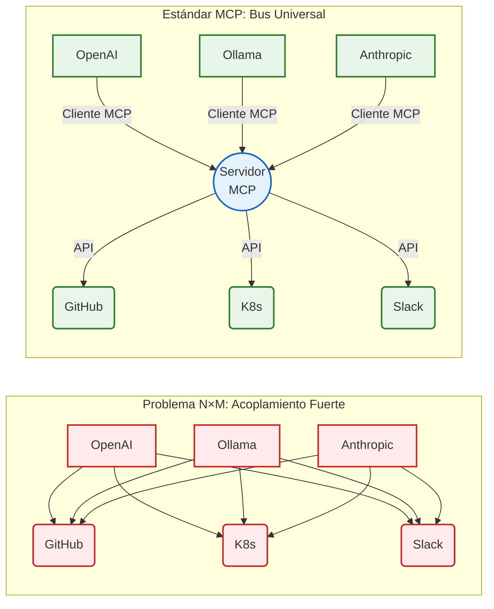

</div>
<p align="center"><i><b>Figura 1:</b> Contraste arquitectónico entre el problema de integración N×M (acoplamiento propietario) y la topología de Bus Universal propuesta por el protocolo MCP.</i></p>

Como se aprecia en la Figura 1, la topología tradicional (izquierda) adolece de un crecimiento combinatorio: la interconexión directa entre *N* modelos o clientes cognitivos (como OpenAI, Ollama o Anthropic) y *M* herramientas o servicios de infraestructura (GitHub, Kubernetes, Slack) impone el desarrollo y mantenimiento de *N* × *M* adaptadores propietarios fuertemente acoplados. En contraposición, la adopción del estándar MCP (derecha) introduce una arquitectura en estrella o bus universal: los clientes cognitivos implementan una única interfaz estandarizada (*Cliente MCP*) y los servicios se exponen a través de un servidor común (*Servidor MCP*). Esta mediación reduce la complejidad sistémica a un orden lineal *N* + *M*, desacoplando el ciclo de vida del agente respecto a la evolución tecnológica del catálogo de herramientas y de la infraestructura.

### 2.2.1. Génesis y Principios de MCP

Para resolver esta fragmentación sistémica, en el último trimestre de 2024, Anthropic (los creadores de la familia de modelos *Claude*) lideró la apertura de un nuevo estándar *open-source*: el **Model Context Protocol (MCP)** [13]. La motivación central de MCP es desacoplar de forma estricta al consumidor de la IA (el agente) de las fuentes de datos e infraestructuras locales (las herramientas), creando un lenguaje universal. 

MCP se inspira profundamente en el éxito del *Language Server Protocol (LSP)* de Microsoft, el cual estandarizó la comunicación entre los editores de código (IDEs) y los compiladores. Del mismo modo, MCP busca convertirse en la capa estándar que conecte cualquier asistente generativo con el entorno computacional de la organización, promoviendo una arquitectura conectable (*pluggable*) basada en el protocolo ligero `JSON-RPC 2.0`.

### 2.2.2. Arquitectura Cliente-Servidor de MCP

El protocolo abandona las integraciones monolíticas en favor de un diseño cliente-servidor estrictamente definido, garantizando fronteras de seguridad nítidas:

- **MCP Host / Client (El Agente):** Es la aplicación que interactúa con el usuario y gestiona el flujo de razonamiento del LLM. El cliente es agnóstico a la implementación de las herramientas; su única responsabilidad es negociar con el servidor mediante mensajes estándar, inyectar el contexto recuperado en el *prompt* del modelo, y solicitar al servidor la ejecución de las funciones decididas por la IA. En el presente proyecto, el componente `AgentOrchestrator` implementa las lógicas derivadas de un cliente MCP.
- **MCP Server (El Entorno):** Es un proceso ligero e independiente, desplegado dentro de la zona de confianza de la organización (en el caso de este TFM, operado por el Servicio de Informática de la universidad). El servidor obvia la existencia de modelos de lenguaje; su propósito es encapsular la lógica de negocio imperativa (ej. generar un manifiesto YAML de Kubernetes) y exponer esta capacidad a través de un esquema JSON estandarizado.

Ambos actores se comunican a través de transportes estandarizados. MCP soporta integraciones locales directas mediante los canales de Entrada/Salida estándar del sistema operativo (**stdio**), ideal para herramientas que corren en la misma máquina que el agente, y transporte web basado en **Server-Sent Events (SSE)** sobre HTTP, indispensable para infraestructuras distribuidas y arquitecturas nativas de la nube (*Cloud Native*).

### 2.2.3. Primitivas del Protocolo: Resources, Prompts y Tools

El estándar MCP orquesta la interacción entorno-modelo a través de tres primitivas de datos fundacionales:

1. **Resources (Recursos):** Datos de naturaleza estática o de solo lectura controlados por el servidor. Permiten inyectar contexto adicional en la ventana de memoria del LLM sin otorgarle capacidad de mutación. Ejemplos clásicos incluyen la lectura del registro de estado actual de un clúster de Kubernetes, bases de datos o documentación corporativa local.
2. **Prompts:** Plantillas de instrucciones parametradas y almacenadas en el servidor, permitiendo la estandarización organizativa. Un administrador puede definir un *prompt* en el servidor ("Resume el estado de este nodo") y el agente cliente puede invocarlo y presentarlo al usuario.
3. **Tools (Herramientas):** Son capacidades ejecutables y con efectos secundarios (mutaciones en el entorno) controladas por el servidor. Las herramientas son el equivalente estandarizado del *Function Calling*. Cuando el servidor MCP de la universidad se inicializa, transmite al cliente un catálogo de herramientas (por ejemplo, `deploy_python_app`), dictaminando los argumentos exactos requeridos (como nombre de proyecto y versión del lenguaje). 

La adopción formal del Model Context Protocol mediante su Software Development Kit (SDK) oficial en Python constituye el eje arquitectónico central del *Agentic Deployer* desarrollado en este TFM. Esta decisión estratégica garantiza que el catálogo de automatizaciones de infraestructura de la institución quede desacoplado de la rápida evolución del ecosistema de proveedores de Inteligencia Artificial. Las herramientas expuestas por el Servidor MCP del proyecto son consumibles indistintamente por el agente local diseñado (Streamlit + Ollama) y por soluciones empresariales externas y *closed-source* (como el Inspector oficial o aplicaciones de terceros), asegurando un ciclo de vida útil del software extendido y una interoperabilidad robusta.

Cabe mencionar que este paradigma de estandarización se encuentra en rápida evolución. Mientras MCP se posiciona como el estándar líder (a fecha de 2024-2026) para la comunicación Cliente-Servidor (Agente-Herramienta), la industria explora paralelamente iniciativas como el **Agent Protocol** impulsado por la AI Engineer Foundation [18], orientado a crear una interfaz única estandarizada para comunicarse con agentes autónomos. Aunque este protocolo trasciende el alcance de este TFM (centrado en la interacción Agente-Infraestructura), evidencia la madurez y necesidad inminente de estos lenguajes francos en el estado del arte.

## 2.3. Orquestación e Infraestructura Declarativa (Kubernetes y OpenShift)

Para comprender el desafío que supone la provisión autónoma de infraestructura, resulta necesario analizar el modelo introducido por Kubernetes (K8s) [5] y sus distribuciones corporativas como Red Hat OpenShift / OKD en el ámbito de las operaciones. Originado en Google bajo el proyecto interno *Borg* y posteriormente donado a la *Cloud Native Computing Foundation* (CNCF), Kubernetes se ha erigido como el estándar *de facto* para la orquestación de cargas de trabajo en contenedores. Su adopción generalizada en la industria responde a la aplicación estricta de un modelo de gestión **declarativo**. En entornos universitarios y centros de cómputo corporativos, este paradigma se implementa habitualmente sobre clústeres **OpenShift / OKD**, los cuales encapsulan el núcleo de Kubernetes proveyendo mecanismos avanzados de seguridad multiinquilino (*SecurityContextConstraints*) y operadores de ciclo de vida. Por ende, estandarizar la IDP sobre las primitivas universales de Kubernetes garantiza una interoperabilidad nativa y directa tanto en OpenShift como en cualquier distribución *Cloud Native*.

### 2.3.1. Imperativo vs. Declarativo

Tradicionalmente, en la administración de sistemas las operaciones seguían un enfoque imperativo. Los administradores interactuaban con los servidores mediante secuencias explícitas de comandos (ej. rutinas *bash* o *scripts* en servidores remotos). En un modelo imperativo, el usuario dicta *cómo* deben realizarse las acciones paso a paso: "descarga esta imagen, inicia el contenedor, abre el puerto 80, verifica si está vivo". Este enfoque, si bien directo, es inherentemente inflexible. Si un servidor se reinicia o un proceso falla, el script imperativo carece del contexto necesario para devolver el sistema a la normalidad sin intervención humana.

En contraposición, Kubernetes abraza el modelo declarativo (Infraestructura como Código - IaC). En un paradigma declarativo, el ingeniero no instruye a la máquina sobre *cómo* hacer el trabajo; en su lugar, describe exclusivamente el **estado final deseado** (*Desired State*). El usuario declara, mediante manifiestos estructurados en lenguaje YAML o JSON: "Deseo que existan exactamente 3 réplicas del contenedor de WordPress expuestas en el puerto 8080".

### 2.3.2. Bucles de Reconciliación y el Plano de Control

La materialización de este estado deseado es responsabilidad exclusiva del Plano de Control (*Control Plane*) de Kubernetes, operando a través de un mecanismo denominado **Bucle de Control o Reconciliación** (*Control Loop*).

Un clúster de K8s evalúa continuamente la topología de la red y los procesos en ejecución. De manera asíncrona, compara el **Estado Real** (*Actual State*) del clúster (por ejemplo, "hay 2 réplicas de WordPress en ejecución porque un nodo físico acaba de fallar") contra el **Estado Deseado** almacenado en su base de datos distribuida (`etcd`). Al detectar una divergencia (2 réplicas reales vs. 3 réplicas deseadas), el bucle de reconciliación infiere de forma autónoma las acciones necesarias para corregir la desviación (desplegar un nuevo contenedor en un nodo sano), ejecutándolas sin requerir una nueva instrucción imperativa del operador humano.

### 2.3.3. Complejidad Sintáctica y Carga Cognitiva

A pesar de las indudables ventajas de resiliencia y auto-sanación (*self-healing*) que ofrece el modelo declarativo, la definición técnica del estado deseado introduce una severa carga cognitiva. La API de Kubernetes está compuesta por decenas de tipos de recursos nativos (Pods, Services, Ingress...) y es extensible mediante Recursos Personalizados (*Custom Resource Definitions* - CRDs), cada uno con una semántica y un esquema estricto de validación.

Desplegar un simple servicio web en producción raramente implica redactar un solo manifiesto. Para exponer una aplicación de forma segura al exterior, un desarrollador debe coordinar y enlazar sintácticamente al menos tres primitivas fundamentales:
1. **Deployment:** Define el contenedor de la aplicación, su imagen base, la política de reinicios, las sondas de vida (*liveness probes*) y las reservas estrictas de memoria y CPU.
2. **Service:** Abstrae la volatilidad de las direcciones IP internas de los contenedores subyacentes, creando un punto de acceso de red estable (*ClusterIP*) para balancear el tráfico.
3. **Ingress:** Expone las rutas HTTP/HTTPS desde el exterior del clúster hacia los *Services* internos, gestionando reglas de enrutamiento por nombre de dominio y terminación SSL/TLS.

La interdependencia entre estos recursos exige un nivel de precisión milimétrica (por ejemplo, el anidamiento correcto de selectores de etiquetas, o *labels*, entre el *Deployment* y el *Service*). Un simple error de indentación en el formato YAML, o un fallo en el mapeo de un selector de red, provocará que la aplicación se despliegue en una isla de red inaccesible (sin devolver errores obvios de compilación).

Para ilustrar esta complejidad de forma concreta, el siguiente ejemplo muestra el manifiesto mínimo necesario para exponer una API Python en Kubernetes. Cada bloque es independiente pero deben estar enlazados correctamente entre sí:

```yaml
# 1. Deployment: define el contenedor, las réplicas y los límites de recursos
apiVersion: apps/v1
kind: Deployment
metadata:
  name: python-api           # Nombre único del recurso en el clúster
  namespace: sic-research    # Espacio de nombres del departamento
spec:
  replicas: 2                # Número de instancias en ejecución simultánea
  selector:
    matchLabels:
      app: python-api        # (A) El Deployment "posee" los Pods con esta etiqueta
  template:
    metadata:
      labels:
        app: python-api      # (A) Los Pods heredan esta etiqueta para ser seleccionados
    spec:
      containers:
        - name: api
          image: harbor.universidad.edu/sic-research/python-api:1.2.0  # Imagen auditada en registro institucional; prohibida la etiqueta :latest
          ports:
            - containerPort: 8080
          resources:
            requests: { cpu: "100m", memory: "128Mi" }   # Reserva mínima garantizada
            limits:   { cpu: "500m", memory: "512Mi" }   # Límite máximo (ResourceQuota del SIC)
---
# 2. Service: crea un punto de red estable que abstrae la IP volátil de los Pods
apiVersion: v1
kind: Service
metadata:
  name: python-api-svc
  namespace: sic-research
spec:
  selector:
    app: python-api          # (A) Referencia EXACTA a la etiqueta del Deployment; cualquier
                             # discrepancia rompe el enrutamiento sin mensaje de error evidente
  ports:
    - port: 80
      targetPort: 8080       # Redirige el tráfico del puerto 80 al puerto 8080 del contenedor
---
# 3. Ingress: expone el Service al exterior con enrutamiento HTTP por hostname
apiVersion: networking.k8s.io/v1
kind: Ingress
metadata:
  name: python-api-ingress
  namespace: sic-research
  annotations:
    nginx.ingress.kubernetes.io/ssl-redirect: "true"  # Fuerza HTTPS
spec:
  rules:
    - host: api.investigacion.univ.es
      http:
        paths:
          - path: /
            pathType: Prefix
            backend:
              service:
                name: python-api-svc   # Referencia al Service definido arriba
                port:
                  number: 80
```
<p align="center"><i><b>Listado 1:</b> Manifiesto Kubernetes completo (Deployment + Service + Ingress) para una API Python. Los tres recursos deben coordinarse correctamente —especialmente la etiqueta marcada con (A)— para que la aplicación sea accesible desde el exterior.</i></p>

El análisis de este manifiesto permite constatar que, lejos de constituir un mero archivo de configuración estático, el despliegue de una aplicación exige coordinar de forma determinista cuatro dimensiones arquitectónicas críticas:

1. **Acoplamiento declarativo mediante selectores de etiquetas (*Label Selectors*):** El mecanismo de resolución de tráfico en Kubernetes opera de manera desacoplada. El *Deployment* gestiona el ciclo de vida de los Pods etiquetados unívocamente con `app: python-api` (marcado didácticamente con `(A)`), mientras que el *Service* utiliza su campo `spec.selector` para descubrir dinámicamente dichos contenedores y construir su tabla interna de enrutamiento (*Endpoints*). Si se produce una discrepancia léxica o tipográfica entre ambas claves, la API de Kubernetes validará el manifiesto como sintácticamente correcto; sin embargo, el *Service* resolverá cero *Endpoints*, desencadenando un fallo de enrutamiento silencioso (*silent failure*) en el que no se emiten excepciones en el despliegue pero la aplicación resulta inaccesible.
2. **Topología de red y correspondencia de puertos en capas de transporte y aplicación:** Se define un esquema de mapeo multinivel. El controlador perimetral (*Ingress*) intercepta el tráfico HTTP externo en el puerto estándar `80` y lo delega al puerto homónimo del *Service*. A su vez, el *Service* ejecuta la traslación de red hacia el puerto de destino (`targetPort: 8080`), el cual debe coincidir estrictamente con el puerto en el que el proceso de la API escucha dentro del contenedor (`containerPort: 8080`). La utilización explícita de puertos superiores al 1024 responde al principio de menor privilegio, evitando requerir privilegios de superusuario (*root*) dentro del espacio de nombres de red del contenedor.
3. **Planificación y gobierno de recursos (*Resource Requests and Limits*):** La especificación formal de recursos (`requests` y `limits` de CPU y memoria) es mandatoria para la coexistencia de cargas de trabajo en clústeres multi-inquilino (*multi-tenant*). Los valores mínimos garantizados (`requests`) condicionan la decisión algorítmica del planificador (*kube-scheduler*), mientras que los techos operativos (`limits`) mitigan el impacto de vecinos ruidosos (*noisy neighbor effect*) y previenen que un proceso descontrolado provoque la expulsión indiscriminada de pods colindantes por parte del gestor de memoria del núcleo (*OOMKilled*). Estos parámetros deben inscribirse de forma obligatoria dentro de las cuotas de recursos (*ResourceQuotas*) impuestas por las políticas del *namespace* institucional (`sic-research`).
4. **Resolución nominativa en el controlador perimetral (*Ingress*):** La capa de exposición externa depende de un acoplamiento nominativo estricto: la regla de enrutamiento HTTP del *Ingress* delega el tráfico mediante el campo `backend.service.name`, que debe coincidir de forma unívoca con el identificador del *Service* (`python-api-svc`). Cualquier discrepancia en la nomenclatura impide la síntesis de las directivas de reenvío en el controlador perimetral.

Esta intrincada red de dependencias declarativas evidencia la severa carga cognitiva que supone la orquestación directa de infraestructura para investigadores y desarrolladores ajenos a la ingeniería de operaciones. En lugar de exigir al usuario el dominio de estos detalles de bajo nivel, el sistema propuesto en este Trabajo de Fin de Máster actúa como un intermediario cognitivo que infiere y valida dichas relaciones a partir de intenciones formuladas en lenguaje natural.

Como contraste empírico, en el **Anexo A (Sección A.2, Listado 2)** se recoge el manifiesto resultante generado de manera completamente autónoma por el *Agentic Deployer* para un despliegue real (Escenario 1). Dicho artefacto demuestra la capacidad del agente para sintetizar no solo esta topología de red y correspondencia de selectores, sino también para incorporar de forma automática sondas de disponibilidad y salud (*liveness* y *readiness probes*), políticas de confinamiento en tiempo de ejecución (*securityContext* sin privilegios y descarte de capacidades) y metadatos de trazabilidad y gobernanza HITL.

## 2.4. Arquitectura Hexagonal y Seguridad en Sistemas Estocásticos

La integración de Modelos de Lenguaje en sistemas críticos de infraestructura plantea un dilema de seguridad estructural. Los LLM, por su propia naturaleza estadística, son impredecibles (estocásticos). En contraste, los sistemas de provisión corporativa exigen un determinismo absoluto (por ejemplo, rechazar sistemáticamente cualquier despliegue que intente utilizar el puerto 22, reservado para SSH). Para conciliar la agilidad de la IA con la rigidez de las normativas de IT, el *Agentic Deployer* adopta los principios de la **Arquitectura Hexagonal**.

### 2.4.1. Fundamentos de *Ports and Adapters*

Formalizada por Alistair Cockburn [19] bajo el nombre de patrón de Puertos y Adaptadores (*Ports and Adapters*), la Arquitectura Hexagonal nació como respuesta a los problemas endémicos de las arquitecturas tradicionales en capas (Presentación -> Lógica de Negocio -> Base de Datos). En el diseño tradicional en capas, la lógica de negocio a menudo se contamina con dependencias transitivas de la base de datos o de los *frameworks* de interfaz de usuario.

El objetivo central de la Arquitectura Hexagonal es permitir que una aplicación sea operada de forma equitativa por usuarios, programas, pruebas automatizadas o *scripts* por lotes, y que pueda ser desarrollada y probada de forma aislada respecto a sus eventuales dispositivos e infraestructuras y bases de datos en tiempo de ejecución. 

Visualmente representada como un hexágono, la arquitectura establece una segregación formal en dos zonas bien diferenciadas:
- **El Interior (El Núcleo o *Domain*):** Alberga exclusivamente las reglas de negocio puras y el modelo de datos. Carece por completo de dependencias hacia el exterior; no importa librerías HTTP, drivers de bases de datos ni SDKs de Inteligencia Artificial.
- **El Exterior (Los Adaptadores):** Contiene todos los detalles de implementación tecnológica (APIs REST, clientes de bases de datos, integraciones con OpenAI u orquestadores de Kubernetes).

### 2.4.2. Inversión de Dependencias (El Principio 'D' de SOLID)

El puente de comunicación entre el Interior (inmutable) y el Exterior (volátil) se implementa mediante **Puertos**. Un Puerto es una interfaz abstracta o un contrato (típicamente una interfaz en lenguajes como Java o clases abstractas / *Protocols* en Python). 

La robustez estructural de esta arquitectura recae en la aplicación estricta del Principio de Inversión de Dependencias (Dependency Inversion Principle - DIP). En lugar de que el núcleo de negocio dependa del cliente de Kubernetes para desplegar, el núcleo define una abstracción `DeployPort` (por ejemplo, `def deploy(intent): pass`). Es la capa externa (el adaptador de K8s) la que hereda y debe implementar dicho contrato. El núcleo solo conoce la interfaz abstracta, jamás la implementación real. 

### 2.4.3. Confinamiento de la Inteligencia Artificial

La adopción de este patrón arquitectónico es la base de la seguridad en el presente Trabajo de Fin de Máster. Cuando el modelo de negocio (ej. la clase `DeploymentIntent`) se define en el núcleo puro de la aplicación, fuertemente tipado mediante Pydantic, el LLM queda estructuralmente separado de los adaptadores de infraestructura física.

En este flujo, el Agente LLM asume el rol de **Adaptador Primario (Driver)**, generando intenciones que intentan invocar los casos de uso del sistema. Gracias a la Arquitectura Hexagonal, el modelo de lenguaje carece de visibilidad sobre los adaptadores de infraestructura física (el **Adaptador Secundario o Driven**), impidiendo que cualquier alucinación o instrucción adversaria pueda alcanzar el clúster sin mediación. Toda intención emitida por la IA debe cruzar obligatoriamente a través del Puerto de Entrada, sometida al escrutinio del motor de reglas determinista del núcleo (`SecurityContextValidator`).

En caso de que el modelo proponga una configuración no conforme a las políticas institucionales, el núcleo la intercepta y deniega inmediatamente, emitiendo una excepción tipada. Esta excepción no degrada la estabilidad del servicio: fluye en sentido inverso hacia el exterior, donde el orquestador la captura y la reinyecta en el contexto del LLM como retroalimentación (*Feedback Loop* del bucle ReAct).

De este modo, la Arquitectura Hexagonal actúa como una capa de contención y validación determinista, permitiendo aprovechar la flexibilidad del razonamiento generativo sin concederle acceso directo a la ejecución física en la infraestructura crítica.

## 2.5. Trabajos Relacionados y Posicionamiento Diferencial

La intersección entre agentes conversacionales y automatización de infraestructura ha generado una serie de iniciativas académicas e industriales en los últimos dos años. Esta sección analiza los enfoques más relevantes y posiciona el *Agentic Deployer* respecto a ellos, identificando las contribuciones diferenciales de este trabajo.

### 2.5.1. Enfoques Industriales: Copilots y Asistentes Cloud Propietarios

Los grandes proveedores de nube han lanzado asistentes conversacionales integrados en sus plataformas. Microsoft dispone de **GitHub Copilot for Azure** y el **Azure AI Assistant** integrado en el portal web, que permiten consultar el estado de los recursos desplegados mediante lenguaje natural. Google ofrece capacidades similares mediante **Gemini for Google Cloud**, y AWS con **Amazon Q Developer**.

Sin embargo, estas soluciones presentan limitaciones estructurales significativas para entornos institucionales y corporativos:
- **Acoplamiento de Proveedor (*Vendor Lock-In*):** Operan exclusivamente sobre la nube del propio fabricante, imposibilitando la gobernanza unificada de clústeres híbridos u *on-premise*.
- **Soberanía del Dato:** Las peticiones y metadatos de red viajan a centros de datos externos de proveedores comerciales, colisionando con normativas estrictas de protección de datos (RGPD, LOPDGDD) y requisitos de privacidad institucional.
- **Riesgo de Ejecución No Supervisada:** Permiten frecuentemente la aplicación directa de órdenes de aprovisionamiento sin una barrera estricta e inmutable de supervisión humana (*Human-in-the-Loop*).
- **Coste Operativo Impredecible:** Su modelo de negocio descansa en la tarificación por consumo (pago por token o suscripciones por usuario), generando una incertidumbre presupuestaria inasumible en el sector público.
- **Falta de Adaptación a Políticas Internas:** Sus plantillas de generación son genéricas y no incorporan de forma nativa las normativas, cuotas de hardware o restricciones de seguridad predefinidas por la propia organización.

### 2.5.2. Enfoques de Investigación: LLMs para IaC, ChatOps y Frameworks de Desarrollo

En el ámbito académico y de investigación, diversos trabajos han explorado la aplicación de modelos de lenguaje a la ingeniería de infraestructura:

- **Generación automatizada de manifiestos y código de infraestructura (IaC):** Diversos estudios empíricos recientes, como el análisis de seguridad de código IaC generado por LLMs [11], proponen el uso de modelos avanzados para generar ficheros Terraform o Kubernetes a partir de especificaciones en lenguaje natural. En esta misma línea, evaluaciones cuantitativas a gran escala sobre el desarrollo de IaC asistido por LLMs [12] constatan que, si bien los modelos alcanzan una elevada tasa de completitud sintáctica en plantillas declarativas, adolecen de alucinaciones en parámetros específicos de red y persistencia, así como de derivas de configuración acumulativas que exigen validación estricta externa. Por su parte, investigaciones pioneras sobre la seguridad en clústeres como *GenKubeSec* [20] han demostrado el potencial de los LLMs para la detección, localización y remediación de malas configuraciones en manifiestos de Kubernetes; no obstante, estos autores subrayan que la aplicación automatizada de remediaciones sin una salvaguarda de supervisión humana (*Human-in-the-Loop*) introduce riesgos operacionales inasumibles en entornos de producción. Estos enfoques evidencian que delegar la corrección semántica y de seguridad al propio LLM sin una capa de validación formal determinista resulta insuficiente: el modelo puede generar código sintácticamente válido pero semánticamente inseguro (puertos abiertos, imágenes sin auditar), sin mecanismos de interceptación algorítmica.

- **Integración ChatOps para flujos DevOps:** En este ámbito destaca el trabajo de Leppänen et al. [21] *"The Highways and Country Roads to DevOps"*, que documenta la adopción práctica de herramientas conversacionales en *pipelines* CI/CD reales. Su análisis evidencia que, si bien la integración de asistentes en plataformas como Slack o Teams agiliza la comunicación operativa, los LLMs en esas arquitecturas invocan comandos de forma directa sin un modelo de dominio intermedio robusto ni un patrón HITL formalmente modelado mediante máquinas de estado.

- **Delimitación frente a Frameworks Agénticos de Propósito General:** Asimismo, resulta necesario distinguir taxonómicamente este trabajo frente a frameworks agénticos de desarrollo como **LangChain** [22] o **AutoGen** [23]. Dichas herramientas constituyen librerías base de propósito general diseñadas para encadenar llamadas a modelos y utilidades auxiliares en un estrato inferior de la pila tecnológica. Por el contrario, el *Agentic Deployer* es una solución de infraestructura finalizada: prescinde de dependencias volátiles y acoplamientos a librerías propietarias implementando una arquitectura hexagonal pura, tipado estricto de dominio e interoperabilidad desacoplada basada en el estándar universal *Model Context Protocol* (MCP).

### 2.5.3. Posicionamiento Diferencial del Agentic Deployer

El *Agentic Deployer* ocupa una posición diferencial en la confluencia entre la automatización agéntica y la ingeniería de plataformas (*Platform Engineering*). A diferencia de los asistentes comerciales que operan como cajas negras en la nube o de los experimentos de generación estocástica de código IaC, el sistema propuesto en este trabajo establece una **separación formal entre el plano de razonamiento cognitivo (LLM) y el plano de ejecución física (Arquitectura Hexagonal)**.

La Tabla 1 sintetiza la comparativa multidimensional entre los asistentes cloud propietarios y el sistema desarrollado en este trabajo:

| Dimensión | Asistentes Cloud Propietarios | **Agentic Deployer** |
|---|---|---|
| **Ámbito de Despliegue** | Infraestructura acoplada a la nube del proveedor | Cualquier clúster Kubernetes (on-premise, híbrido o cloud) |
| **Soberanía del Dato** | Inferencia y telemetría en centros de datos del proveedor | *Zero Data Retention* (inferencia local con Ollama u opciones cloud) |
| **Supervisión Humana (HITL)** | Opcional o reactiva; ejecución directa posible | Obligatoria y preventiva; barrera FSM inmutable no eludible |
| **Rutas Doradas (*Golden Paths*)** | Plantillas predeterminadas por el proveedor | Rutas doradas y políticas auditadas por la propia organización |
| **Interoperabilidad** | Interfaces cerradas al ecosistema del fabricante | Estándar universal abierto MCP (compatible con cualquier cliente) |
| **Coste Operativo** | Pago por consumo (OPEX variable e impredecible) | Infraestructura propia amortizada (OPEX predecible a coste marginal cero) |
| **Auditabilidad y Gobierno** | Registros propietarios con retención externa | Trazabilidad ACID local completa y estados persistidos en disco |
<p align="center"><i><b>Tabla 1:</b> Comparativa multidimensional entre los asistentes Cloud propietarios y el Agentic Deployer.</i></p>

En conclusión, el *Agentic Deployer* prioriza la soberanía tecnológica, la seguridad determinista y la auditabilidad operativa sobre la conveniencia del modelo SaaS, proporcionando a las organizaciones públicas y entornos institucionales un marco seguro y económicamente sostenible para la adopción de agentes inteligentes en la administración de infraestructuras críticas.


<div style='page-break-after: always;'></div>

# Capítulo 3. Metodología y Stack Tecnológico

La construcción de un sistema de orquestación que hibrida disciplinas clásicas de Ingeniería de Software (Arquitectura Hexagonal, testing riguroso, APIs REST) con dominios emergentes e intrínsecamente inestables como la Inteligencia Artificial Generativa, requiere un marco metodológico estricto. Este capítulo describe la metodología de trabajo adoptada a lo largo del ciclo de vida del *Agentic Deployer*, las fases de desarrollo planificadas y la justificación técnica de las herramientas que conforman el ecosistema final de la aplicación.

## 3.1. Enfoque Metodológico

El desarrollo de software orientado a Inteligencia Artificial difiere significativamente del desarrollo web o de aplicaciones corporativas tradicionales. En un sistema estándar, una entrada A (por ejemplo, pulsar un botón) produce invariablemente una salida B. En un sistema orquestado por un Modelo de Lenguaje de Gran Escala (LLM), la entrada A (una instrucción en lenguaje natural) puede generar múltiples salidas semánticamente equivalentes pero sintácticamente dispares. Esta volatilidad obliga a cimentar el proyecto sobre prácticas que aíslen el determinismo de la estocasticidad.

Para gobernar este riesgo, el Trabajo de Fin de Máster se ha regido por una **metodología de desarrollo iterativa e incremental**, fuertemente influenciada por los principios del *Domain-Driven Design* (DDD) y el desarrollo guiado por pruebas (TDD / *Test-Driven Development*). En lugar de construir el sistema horizontalmente (diseñando primero toda la base de datos, luego todo el backend y finalmente todo el frontend), la metodología dictaminó un crecimiento radial o concéntrico de adentro hacia afuera, alineado con los preceptos de la Arquitectura Hexagonal.

La regla metodológica fundamental del proyecto fue la **estabilidad del núcleo antes de la integración estocástica**: no se permitió escribir una sola línea de código relacionada con la API de OpenAI, Ollama o el estándar MCP hasta que el modelo de dominio interno (`DeploymentIntent`) y el motor de validación (`SecurityContextValidator`) demostraron una robustez determinista del 100% (verificada mediante pruebas automatizadas masivas). Construir el motor de IA primero y la lógica de validación después habría expuesto el prototipo a vulnerabilidades críticas de infraestructura desde las primeras fases de pruebas.

## 3.2. Fases de Desarrollo

Para materializar el producto final, el cronograma de ejecución se dividió orgánicamente en **cinco *sprints* de desarrollo** más dos fases transversales de consolidación y cierre (Fases 6 y 7, detalladas en la Sección 4.2 y el Anexo B). Cada sprint culminó con un entregable técnico funcional (un incremento de producto) que servía de base inmutable para la siguiente etapa.

> *Nota metodológica: las siguientes secciones referencian componentes del diseño arquitectónico (como `DeploymentIntent`, `SecurityContextValidator` o `DeployPort`) que se formalizan en el **Capítulo 5**. Se anticipan aquí para contextualizar las fases de trabajo y mantener la coherencia narrativa de los sprints; el lector puede consultar el Capítulo 5 para obtener su especificación completa.*

> *Nota de planificación: si bien la planificación inicial establece una secuencia ordenada de sprints, la naturaleza del trabajo académico y los compromisos paralelos inherentes al contexto universitario exigen reconocer que la asignación temporal de cada fase puede solaparse o reordenarse según disponibilidad. La planificación se concibe, por tanto, como un marco de referencia flexible y no como una secuencia rígida de Gantt. Los detalles de las retrospectivas y seguimiento de desviaciones por sprint se documentan en el **Capítulo 4** y en el **Anexo B**.*


### 3.2.1. Sprint 1: Núcleo Hexagonal y Dominio Base

Esta fase supuso los cimientos del proyecto. El objetivo era modelar de forma determinista y formal las reglas de negocio de un Servicio de Informática (SIC) universitario, obviando la existencia de la inteligencia artificial.
- **Modelado de Entidades:** Se definió la ontología de los despliegues. Se implementó la clase `DeploymentIntent` utilizando tipado estricto, definiendo los requerimientos ineludibles (nombre de la aplicación, imagen base, puerto, cuotas de recursos).
- **Validación y Casos de Uso:** Se desarrolló el `SecurityContextValidator`, un motor de reglas determinista diseñado para interceptar intenciones maliciosas (como el uso de puertos privilegiados del sistema operativo o la invocación de imágenes no permitidas).
- **Contratos (Ports):** Se definió el puerto abstracto de despliegue (`DeployPort`), estableciendo el contrato que cualquier infraestructura futura (Kubernetes, Docker Swarm, Nomad) debería satisfacer.

### 3.2.2. Sprint 2: Backend HITL y FSM

Antes de habilitar capacidades de actuación en el modelo de IA, era preceptivo establecer el entorno de control operativo y supervisión técnica:
- **Capa REST API:** Se construyó la capa externa de aplicación (el adaptador *driving* principal) mediante un servidor HTTP que permitiese recibir las intenciones de despliegue de forma estructurada.
- **Flujo de Pendencia:** Se implementó la lógica de estado transicional. Las intenciones aprobadas por el motor de seguridad no se ejecutaban directamente, sino que se bloqueaban en un estado de `PENDING_APPROVAL`.
- **Panel de Operador:** Se diseñó y codificó una interfaz gráfica (*Dashboard*) asíncrona para que el personal del SIC pudiera auditar visualmente las intenciones bloqueadas y emitir la autorización final (`POST /hitl/approve`), cerrando así el diseño del patrón *Human-In-The-Loop* (HITL).

### 3.2.3. Sprint 3: Golden Paths y FakeK8s

El tercer incremento incorporó la capacidad de generación de artefactos en el sistema. Si bien la aplicación directa sobre un clúster físico productivo se delimitó fuera del alcance del MVP, el orquestador debía demostrar su capacidad para sintetizar configuraciones declarativas reales.
- **Adaptador Simulado:** Se codificó el `FakeK8sAdapter`, un componente que implementa el contrato `DeployPort`.
- **Materialización Declarativa:** En esta fase se implementaron las plantillas de los *Golden Paths* (rutas pavimentadas). Al recibir una intención aprobada, el adaptador extrae las variables (nombre, recursos) y genera en el disco físico del servidor los manifiestos YAML completos y entrelazados (Deployment, Service, Ingress), demostrando que el sistema produce configuraciones listas para producción mitigando la complejidad sintáctica asociada a la redacción manual.

### 3.2.4. Sprint 4: Agente ReAct y MCP SDK

Con una infraestructura determinista, auditada y capaz de generar YAML, la penúltima fase integró el núcleo de razonamiento del sistema, delegando la interfaz humana en la IA.
- **Protocolo MCP:** Se integró el SDK del *Model Context Protocol*, refactorizando las capacidades del SIC (ej. `deploy_python_app`) en herramientas estandarizadas (Tools) expuestas a través del protocolo `stdio`.
- **Motor ReAct:** Se programó el `AgentOrchestrator`, un bucle lógico iterativo capaz de comunicarse con LLMs a través de un adaptador agnóstico (OpenAI/Ollama). Este motor interpreta los JSON devueltos por el modelo, ejecuta la herramienta MCP correspondiente en el backend, e inyecta la observación resultante de vuelta al LLM (el bucle de retroalimentación o *Feedback Loop* de seguridad).

### 3.2.5. Sprint 5: QA Avanzado (Validación Metamórfica)

Añadida como una capa de valor adicional no prevista en el alcance inicial puro, pero considerada necesaria para el rigor de un proyecto de ingeniería de software. Consistió en evaluar el middleware ante el comportamiento probabilístico del LLM.
- Se integraron técnicas de validación como el *Property-Based Testing* (generando miles de intenciones pseudoaleatorias válidas) y Pruebas Metamórficas para verificar la resiliencia del modelo ante alteraciones lingüísticas (ruido sintáctico en el prompt, cambios de orden en las palabras).
- Por último, se auditó la propia suite de pruebas con *Mutation Testing*, evaluando la capacidad de detección de fallos del validador de seguridad.

### 3.2.6. Fase 6: Redacción y Cierre (Robustez y Ciclo HITL)

Tras la consolidación del MVP, se abordaron una serie de mejoras de calidad y usabilidad:
- **Cliente Ollama Nativo (`OllamaLLMClient`):** Eliminación de la dependencia en la librería `openai` para comunicaciones con el servidor Ollama local, sustituyéndola por peticiones `httpx` directas a la API REST nativa. Esta refactorización garantiza un esquema de *Zero Data Retention* sin dependencias de terceros.
- **Canal de Retorno al Investigador:** Implementación del endpoint `GET /hitl/status/{id}` y el panel de notificaciones en el chat (` Mis Solicitudes Pendientes`), cerrando el ciclo de comunicación bidireccional del patrón HITL (sección 6.4).
- **Ampliación de Evidencias Empíricas:** Creación del directorio `demos/` con trazas de ejecución detalladas de las sesiones de ejecución real y el manifiesto YAML generado por el `FakeK8sAdapter` (Anexo A).

### 3.2.7. Fase 7: Extensión Experimental y Evaluación Multi-Modelo

Como esfuerzo final fuera del alcance inicial (Prioridad P2), se extendió el prototipo mediante tres hitos arquitectónicos:
- **Persistencia Transaccional:** Migración del almacenamiento de memoria volátil a una base de datos **SQLite**, dotando a la Máquina de Estados de transaccionalidad ACID.
- **Escalado del Catálogo MCP:** Ampliación del servidor de 4 a 7 herramientas operativas, integrando capacidades complejas como gestión de bases de datos o borrado de servicios institucionales.
- **Validación Empírica Extendida:** Ejecución de pruebas comparativas sobre un conjunto diverso de modelos, tanto Cloud (Gemini, Cohere, Groq) como Locales especializados (Qwen Coder), consolidando las conclusiones de viabilidad del proyecto.

## 3.3. Stack Tecnológico y Justificación Arquitectónica

La elección de tecnologías en un ecosistema que combina Inteligencia Artificial y provisionamiento de infraestructura debe conjugar la capacidad adaptativa de los modelos de lenguaje con la fiabilidad determinista exigida por las operaciones institucionales. A continuación, se desglosa y fundamenta el *stack* tecnológico adoptado.

### 3.3.1. Lenguaje Base: Python 3.12
El proyecto se ha construido íntegramente sobre **Python (versión 3.12)**. Si bien lenguajes como Go predominan en el ecosistema *Cloud Native* (Kubernetes y Terraform están desarrollados en dicho lenguaje), Python constituye el estándar principal en la investigación y desarrollo de Inteligencia Artificial. La elección de Python 3.12 permite aprovechar las optimizaciones del intérprete CPython y el soporte nativo para un tipado estático avanzado (Type Hints y genéricos). Esta característica resulta fundamental para implementar interfaces abstractas sólidas dentro de la Arquitectura Hexagonal, mitigando las limitaciones del tipado dinámico en sistemas críticos.

### 3.3.2. Capa Backend y Modelado de Datos
- **FastAPI:** Elegido como el *framework* web primario por encima de alternativas clásicas como Django o Flask. FastAPI no solo destaca por su rendimiento excepcional (sustentado en la especificación ASGI y la librería *Starlette*), sino por su generación automática de contratos de API (OpenAPI/Swagger). Para un Agente LLM, interactuar con una API que expone un esquema riguroso y auto-documentado facilita sustancialmente la comprensión de las herramientas.
- **Pydantic (v2):** Constituye el núcleo de validación de datos [24]. Reescripto recientemente en Rust para maximizar su velocidad, Pydantic se utiliza para modelar las entidades de dominio (como `DeploymentIntent`). Su justificación recae en su capacidad para forzar invariantes de negocio: rechazar peticiones del agente que no cumplan con rangos enteros (puertos) o expresiones regulares, antes incluso de que la lógica de la aplicación las procese.

### 3.3.3. Interfaz Conversacional y Capa de Agente
- **Streamlit [25]:** Desarrollar interfaces gráficas (*Front-End*) modernas en React o Vue.js conlleva una alta fricción y sobrecarga de dependencias. Streamlit permite codificar la interfaz de chat (incluyendo historial, avatares, indicadores de estado y el panel de notificaciones HITL) íntegramente en Python puro. Esto permite iterar el componente visual de forma ágil, manteniendo el foco del trabajo investigador en la ingeniería del *middleware* de infraestructura.
- **Model Context Protocol (MCP) SDK:** En lugar de diseñar una API HTTP propietaria para invocar herramientas, se ha adoptado el SDK oficial de MCP para Python. Esta librería permite decorar funciones arbitrarias (ej. `@server.tool()`) e introspeccionar sus firmas (nombres de parámetros y tipos) en tiempo de ejecución, transformándolas en esquemas JSON estandarizados consumibles por cualquier cliente LLM.
- **Abstracción Agnóstica de Proveedor LLM:** El orquestador implementa un contrato abstracto (`LLMClient`) con dos implementaciones concretas:
 - **`OllamaLLMClient`**: Cliente nativo implementado mediante el SDK oficial de Python de Ollama [26] que se comunica con el demonio local en el puerto 11434 (`POST /api/chat`), sin dependencias externas adicionales. Permite ejecutar modelos especializados como **`qwen2.5-coder:7b`** o generalistas en la red privada institucional, garantizando un esquema de **Soberanía del Dato** (*Zero Data Retention*) imperativo para administraciones públicas. No envía ningún token de texto del investigador a servidores externos.
 - **`OpenAILLMClient`**: Adaptador que implementa el protocolo estándar de OpenAI. Su diseño agnóstico permitió utilizarlo como puente (*proxy*) para evaluar empíricamente ecosistemas *cloud* de terceros (Google Gemini, Cohere Command-R, Mistral, Llama 3) sin acoplar el sistema a una única corporación. La selección del cliente (Local o Cloud) se realiza exclusivamente mediante la variable de entorno `LLM_PROVIDER`, sin requerir modificaciones al código de dominio.

### 3.3.4. Ecosistema de Aseguramiento de Calidad (QA)
La confianza operativa en el *Agentic Deployer* se asienta sobre una canalización (*pipeline*) de validación rigurosa, sustentada por un ecosistema de librerías avanzadas:
- **Pytest:** *Framework* base para la estructuración y ejecución de pruebas de unidad e integración, proveyendo un robusto sistema de inyección de dependencias (fixtures).
- **Hypothesis:** Librería especializada en *Property-Based Testing*. A diferencia de las pruebas estáticas escritas a mano, Hypothesis inyecta ruido y genera dinámicamente miles de permutaciones de intenciones de despliegue para intentar corromper o sortear el validador de seguridad.
- **Mutmut:** Herramienta de *Mutation Testing* que aplica alteraciones lógicas al código fuente del sistema en tiempo de ejecución. Garantiza empíricamente que la suite de pruebas es lo suficientemente exhaustiva como para detectar el más sutil de los fallos lógicos.
- **Locust y Playwright:** Empleadas para certificar el rendimiento y la usabilidad final. *Locust* inunda la API asíncrona simulando concurrencia masiva, demostrando la escalabilidad del patrón asíncrono implementado. *Playwright* orquesta pruebas de interfaz E2E (*End-to-End*), levantando instancias de navegadores *headless* para simular y afirmar la interacción real del técnico (SIC) aprobando despliegues en el panel. 
- **Ruff y Mypy:** Cadena de herramientas estáticas (*Linting* y *Type-Checking*) utilizadas en los ciclos de Integración Continua (CI) local para asegurar una homogeneidad estilística y rechazar cualquier compilación que vulnere los contratos de tipos de Python.

En la **Figura 2** se resume la arquitectura de componentes del stack tecnológico empleado, evidenciando la segregación entre las capas de presentación, cognición, backend restrictivo y aseguramiento continuo de la calidad.

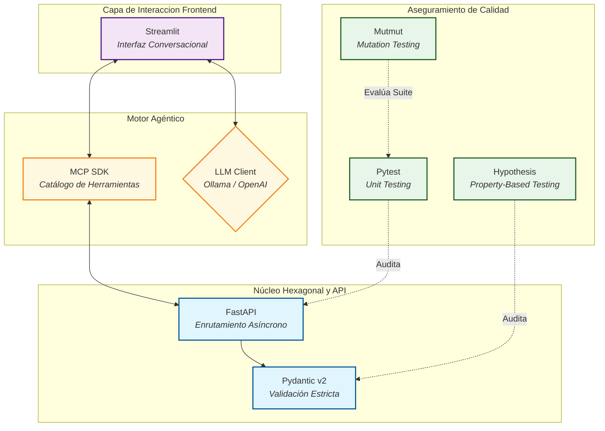
<p align="center"><i><b>Figura 2:</b> Diagrama de componentes del Stack Tecnológico empleado, evidenciando la segregación entre las capas de interfaz, razonamiento cognitivo, backend restrictivo y las herramientas de validación de calidad continua.</i></p>

La topología de componentes representada en la Figura 2 articula cuatro estratos claramente desacoplados:

1. **Capa de Interacción Frontend (`UI`):** La interfaz conversacional implementada en Streamlit (`ST`) actúa como punto de contacto con el investigador. Mantiene una relación bidireccional tanto con el motor cognitivo (`LLM`) para la generación y el historial del diálogo, como con el Servidor MCP (`MCP`) para el descubrimiento dinámico de herramientas y la ejecución de acciones.
2. **Motor Agéntico (`Cognición`):** Encapsula el ciclo de razonamiento *ReAct*. El cliente LLM (`LLM`, configurable entre Ollama en red local y APIs en la nube) resuelve heurísticamente las intenciones del usuario apoyándose en el catálogo de herramientas del SDK oficial de MCP (`MCP`), el cual actúa como puente estandarizado hacia el backend.
3. **Núcleo Hexagonal y API (`Backend`):** El servidor FastAPI (`FA`) expone las rutas asíncronas para el despacho de intenciones (`/mcp/intent`) y el panel HITL (`/hitl`). Este estrato delega inmediatamente la carga útil en esquemas de Pydantic v2 (`PY`), donde se aplican de forma determinista las validaciones de tipo, los invariantes institucionales y las reglas de validación de seguridad antes de persistir o ejecutar cualquier mutación de infraestructura.
4. **Aseguramiento Continuo de Calidad (`QA`):** Las herramientas de testing avanzado operan de manera transversal sobre los componentes críticos del stack. Pytest (`PYT`) audita los puntos de entrada y casos de uso en FastAPI; Hypothesis (`HYP`) somete a prueba los modelos de Pydantic mediante generación exhaustiva de casos límite (*Property-Based Testing*); y Mutmut (`MUT`) evalúa empíricamente la propia suite de pruebas unitarias mediante análisis de mutación del AST, certificando la ausencia de puntos ciegos en la verificación de seguridad.


<div style='page-break-after: always;'></div>

# Capítulo 4. Gestión y Viabilidad del Proyecto

La construcción de un sistema que hibrida disciplinas clásicas de Ingeniería de Software con dominios emergentes como la Inteligencia Artificial Generativa exige un marco de planificación riguroso pero flexible. Este capítulo documenta las restricciones del proyecto, la estructura de *sprints*, el seguimiento global de desviaciones y un análisis económico completo que evalúa tanto el coste del desarrollo como la viabilidad de adopción institucional. Asimismo, la articulación de este capítulo inmediatamente a continuación del marco metodológico responde al principio de planificación formal de la ingeniería de software: las restricciones, el cronograma de sprints y el presupuesto de desarrollo se definen con carácter previo al diseño de la arquitectura. Por su parte, el estudio de viabilidad de adopción institucional y la proyección de Retorno de Inversión (ROI) se formulan en este capítulo como un modelo analítico ex-ante basado en hipótesis operativas de servicio, cuya confirmación experimental y validez cuantitativa se evalúan y contrastan en el Capítulo 9 (Resultados Experimentales y Evaluación). El desglose pormenorizado de las retrospectivas por sprint se encuentra en el **Anexo B**.

---

## 4.1. Plan de Proyecto — Contexto y Restricciones

### 4.1.1. Restricciones Estructurales

El *Agentic Deployer* se desarrolla en el contexto de un Trabajo de Fin de Máster bajo las siguientes restricciones:

- **Dedicación:** Régimen parcial de investigación (~15–20 horas semanales, compatibles con actividad profesional externa).
- **Equipo:** 1 alumno investigador + 1 tutor académico (sesiones de supervisión periódicas, con cadencia condicionada a la disponibilidad de ambas partes).
- **Infraestructura:** Entorno de desarrollo local (portátil personal), sin coste de nube durante el desarrollo.
- **Metodología:** Iterativa incremental, centrada en el dominio (*Domain-First*).

### 4.1.2. Principio de Flexibilidad y Priorización Adaptativa

> **Nota sobre el carácter de la planificación:** La planificación aquí descrita es de carácter **indicativo y orientativo**, no normativo. Dado que el presente TFM se desarrolla en régimen de dedicación parcial, compatibilizado con compromisos profesionales y personales de carácter variable, se asume *a priori* que los intervalos temporales de cada sprint son permeables: su ejecución puede acelerarse, posponerse o solaparse según la disponibilidad real del investigador y la capacidad de respuesta del tutor en los hitos críticos de revisión.

Esta aproximación es coherente con las recomendaciones de gestión ágil de proyectos de I+D aplicados en contextos académicos (IEEE Std 12207, ISO/IEC 29110), donde la rigidez del cronograma es sustituida por la **priorización explícita de objetivos**: se garantiza primero el alcance mínimo viable (MVP) y, en función del tiempo residual, se abordan los módulos de mayor complejidad o acabado opcionales.

**Jerarquía de prioridades del proyecto:**

| Prioridad | Módulo | Estado |
|---|---|---|
| **P0 — MVP obligatorio** | Núcleo hexagonal, validador de seguridad, API REST, FSM, Dashboard HITL | Completado |
| **P1 — Diferenciador académico** | Servidor MCP (SDK oficial), agente ReAct, multiproveedor LLM, QA avanzado | Completado |
| **P2 — Excelencia y acabado** | `OllamaLLMClient`, persistencia (SQLite), catálogo extendido (7 herr.), evidencias empíricas (MCP Inspector), exp. cognitivos multi-modelo | Completado |
| **P3 — Trabajo futuro** | `RealK8sAdapter` (integración clúster físico), RBAC, CI/CD cloud, multi-clúster | Roadmap |
<p align="center"><i><b>Tabla 2:</b> Módulos de desarrollo y jerarquía de prioridades.</i></p>

Únicamente los módulos **P0 y P1 son necesarios para la evaluación académica**. Los módulos P2 se han abordado con éxito en la recta final de consolidación, logrando un nivel de excelencia técnica que fortalece la robustez del proyecto. Los módulos P3 quedan explícitamente documentados como líneas de trabajo futuro (Sección 10.3).

### 4.1.3. Identificación de Interesados (*Stakeholders*)

En el marco metodológico de la ingeniería del software y la gestión ágil de proyectos (ISO/IEC 29110), la correcta identificación de los interesados (*stakeholders*) permite acotar las expectativas, responsabilidades operativas y criterios formales de aceptación del sistema. En el proyecto intervienen cinco perfiles clave:

- **Investigador / Desarrollador (Jesús Solís Ortega):** Responsable de la ejecución técnica integral del TFM, abarcando el análisis de requisitos, modelado arquitectónico C4, implementación del núcleo hexagonal y servidores MCP, diseño de la interfaz HITL, ejecución de la suite de pruebas avanzadas y redacción documental de la memoria.
- **Tutor Académico (Manuel Resinas Arias de Reyna):** Director del Trabajo de Fin de Máster. Responsable de la supervisión metodológica continua, orientación investigadora, validación conceptual de las decisiones de diseño y control de calidad de los borradores técnicos.
- **Tribunal Evaluador (Comité Calificador EIP):** Órgano colegiado responsable de la evaluación académica formal y calificación del trabajo en el acto de defensa pública, conforme a las rúbricas institucionales de la Universidad de Sevilla.
- **Servicio de Informática y Comunicaciones (SIC):** Actor departamental de referencia en el caso de estudio. Representa el rol de operador de sistemas y administrador del clúster corporativo, fijando las restricciones de seguridad (*SecurityContext*), políticas de cuotas y asumiendo la autoridad final en la aprobación de despliegues.
- **Investigadores y Docentes Universitarios (Usuarios Finales):** Perfiles académicos demandantes de infraestructura computacional (APIs en Python, CMS institucionales, webs departamentales) que interactúan con el sistema en lenguaje natural sin requerir competencias en administración de Kubernetes.

### 4.1.4. Plan de Comunicaciones y Seguimiento

Para garantizar el cumplimiento de los objetivos dentro de los márgenes de flexibilidad establecidos, se articuló un plan de seguimiento continuo estructurado en tres mecanismos operativos y soportado institucionalmente a través de **Microsoft Teams** y el **correo electrónico institucional**:

1. **Sesiones de tutorización y revisión de hitos:** Reuniones periódicas de seguimiento y dirección telemáticas mediante videoconferencia en Microsoft Teams, orientadas a la validación de los entregables principales de cada fase: formalización del problema y marco DSR (Sprint 1), arquitectura del servidor MCP y desacoplamiento LLM (Sprints 3 y 4), y auditoría de la estrategia de QA y resultados empíricos (Sprint 5 y Fase 7).
2. **Canal de comunicación continua:** Empleo preferente del correo electrónico institucional de la Universidad de Sevilla y la plataforma Microsoft Teams para el intercambio de mensajes, notificación de avances, consulta de dudas metodológicas puntuales y resolución ágil de bloqueos técnicos.
3. **Revisión iterativa y escalonada de la memoria:** Entrega por bloques temáticos cerrados compartidos a través de dichos canales institucionales (fundamentación teórica, arquitectura e implementación, evaluación experimental y conclusiones), facilitando una retroalimentación progresiva e integrada antes del depósito formal.

---

## 4.2. Estructura de Sprints y Estimación de Esfuerzo

### 4.2.1. Diagrama de Planificación

La planificación se estructura en **5 sprints temáticos** más una fase transversal de redacción y una fase de consolidación de excelencia (representadas en los cronogramas de Gantt de la **Figura 3** y la **Figura 4**), con un esfuerzo total **estimado** de **~300 horas** (±15% de margen de contingencia estándar). Las fechas son referencias aproximadas sujetas al principio de flexibilidad enunciado en la sección anterior. El esfuerzo real registrado al cierre del proyecto fue de **~340 horas** (+13%); el desglose de desviaciones por fase se documenta en la §4.3.

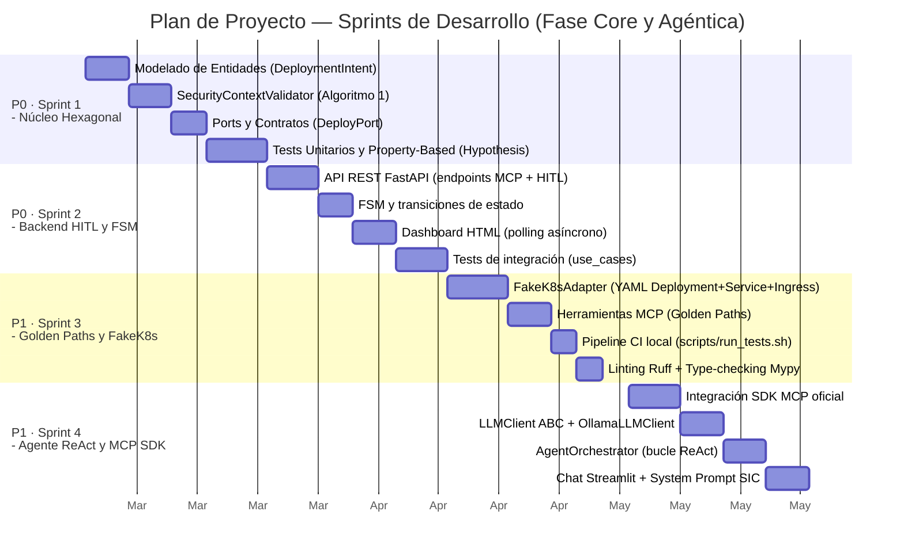
<p align="center"><i><b>Figura 3:</b> Diagrama de Gantt (Parte 1). Planificación orientativa de los Sprints 1 a 4 (núcleo y agente).</i></p>

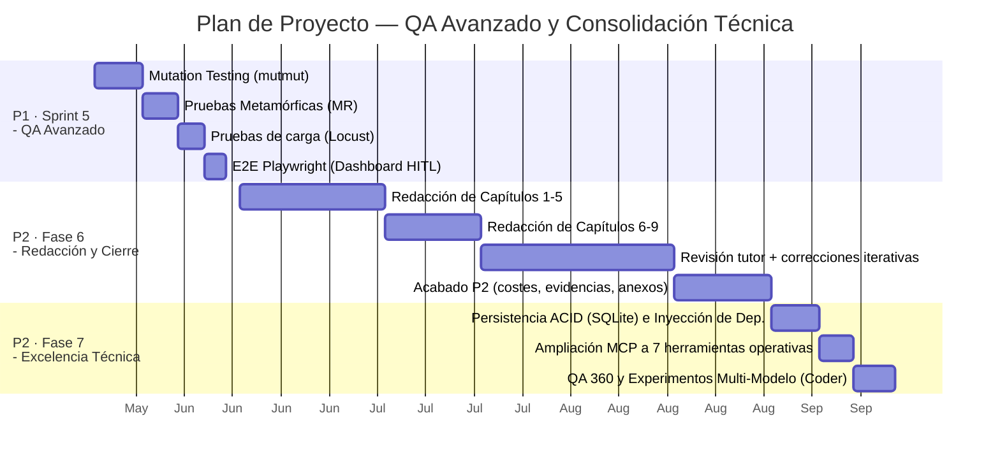
<p align="center"><i><b>Figura 4:</b> Diagrama de Gantt (Parte 2). Planificación orientativa del QA avanzado y las fases de cierre/consolidación.</i></p>

#### 4.2.1.1. Interpretación Temporal de los Cronogramas y Ruta Crítica

Los diagramas de Gantt de las Figuras 3 y 4 representan la distribución temporal del proyecto a lo largo de un horizonte de seis meses (marzo a agosto de 2026), articulando la ruta crítica del desarrollo y la asignación de prioridades:

1. **Horizonte de Construcción del MVP (Figura 3 · Sprints 1 a 4):** Abarca la ventana temporal de marzo a mayo de 2026. Esta primera etapa impone una secuenciación estrictamente lineal en su ruta crítica: los Sprints 1 y 2 (calificados como prioridad P0) concentran el esfuerzo inicial sobre el núcleo hexagonal y el backend determinista. La finalización de estas bases condiciona el inicio del Sprint 3 (adaptadores y plantillas YAML) y del Sprint 4 (orquestación agéntica y MCP), garantizando que la integración de la IA se apoye sobre un perímetro determinista ya operativo. Para una descripción pormenorizada de los objetivos funcionales de cada uno de estos sprints, véase la Sección 3.2.
2. **Horizonte de Verificación, Documentación y Consolidación (Figura 4 · Sprint 5, Fases 6 y 7):** Abarca la ventana temporal de finales de mayo a agosto de 2026. A diferencia del bloque anterior, la planificación evoluciona hacia una dinámica concurrente: el Sprint 5 (QA avanzado) somete el MVP a pruebas de mutación y metamórficas antes de congelar la base de código. Sobre este incremento estable, la Fase 6 (redacción y cierre) distribuye la elaboración de la memoria en entregas escalonadas que se intercalan con los ciclos de revisión tutorial (Sección 4.1.2), culminando en la Fase 7 con la consolidación técnica final (persistencia transaccional SQLite y benchmark comparativo).

Esta distribución en el calendario fundamenta la asignación de la carga horaria neta estimada que se desglosa en la Tabla 3.

### 4.2.2. Estimación de Esfuerzo por Sprint

La siguiente tabla refleja la estimación inicial de esfuerzo neto, asumiendo un ritmo de trabajo parcial y la incorporación de asistencia mediante herramientas de IA generativa, cuyo efecto es la aceleración del ciclo de implementación sin merma de la calidad del análisis.

| Sprint | Fase | Estimación (h) | Rango (±15%) | Prioridad |
|---|---|---|---|---|
| Sprint 1 | Núcleo Hexagonal | 50h | 43–58h | P0 |
| Sprint 2 | Backend HITL y FSM | 45h | 38–52h | P0 |
| Sprint 3 | Golden Paths y FakeK8s | 40h | 34–46h | P1 |
| Sprint 4 | Agente ReAct y MCP SDK | 55h | 47–63h | P1 |
| Sprint 5 | QA Avanzado | 45h | 38–52h | P1 |
| Fase 6 | Redacción y Cierre | 55h | 47–63h | P2 |
| Fase 7 | Excelencia Técnica | 10h | 8–12h | P2 |
| **Total estimado** | | **~300h** | **~255–345h** | |
<p align="center"><i><b>Tabla 3:</b> Estimación de esfuerzo neto por Sprint.</i></p>

> **Nota sobre el uso de asistentes de IA:** La asistencia mediante un agente de IA de codificación (Google Gemini Advanced, utilizado para aceleración de *scaffolding*, generación de código *boilerplate*, revisión de lógica y apoyo en la redacción técnica) permitió comprimir el tiempo de implementación en fases que de otro modo habrían requerido un esfuerzo sustancialmente mayor. Esto es coherente con la línea de investigación del propio proyecto, que postula la utilidad de los agentes LLM como asistentes en flujos de trabajo técnicos complejos.

---

## 4.3. Esfuerzo de Desarrollo y Desviaciones

Frente a la estimación inicial de ~300 horas, el cierre empírico del proyecto arrojó un esfuerzo total de **~340 horas**, lo que representa una desviación del **+13%**. Esta inversión adicional se encuadra holgadamente dentro del margen de contingencia previsto (±15%) y se asumió de manera deliberada en la recta final para elevar el MVP a un estándar de excelencia ingenieril (implementación de persistencia ACID en SQLite, ampliación de 4 a 7 herramientas MCP, análisis detallado de mutantes y la validación de la hipótesis de "Rescate Cognitivo" mediante experimentos multi-modelo).

La adopción de asistentes de Inteligencia Artificial (Google Gemini Advanced) demostró actuar como un multiplicador de productividad esencial. Permitió absorber esta densidad arquitectónica dentro de un cronograma manejable para un único ingeniero, validando de forma recursiva la hipótesis de investigación del TFM sobre la utilidad de los agentes LLM en ciclos de vida de software.

La siguiente tabla resume las desviaciones por fase:

| Fase | Estimación (h) | Real (h) | Desviación | Causa Principal |
|---|---|---|---|---|
| Sprint 1 · Núcleo Hexagonal | 50 | ~55 | +10% | Ampliación del validador de seguridad |
| Sprint 2 · Backend HITL y FSM | 45 | ~45 | 0% | Desarrollo ajustado a la previsión |
| Sprint 3 · Golden Paths y FakeK8s | 40 | ~46 | +15% | Integración dual SDK MCP |
| Sprint 4 · Agente ReAct y MCP SDK | 55 | ~62 | +13% | Agente ReAct + Ollama nativo |
| Sprint 5 · QA Avanzado | 45 | ~50 | +11% | Análisis detallado de mutantes |
| Fase 6 · Redacción y Cierre | 55 | ~64 | +16% | Densidad técnica y extensión final (~150 págs frente a ~100 estimadas) |
| Fase 7 · Excelencia Técnica | 10 | ~18 | +80% | QA final, Base de Datos y Evaluación Empírica (Coder/Cloud) |
| **Total** | **~300** | **~340** | **~+13%** | |
<p align="center"><i><b>Tabla 4:</b> Resumen de desviaciones de tiempo por fase.</i></p>

> **Nota aclaratoria sobre la desviación temporal:** Una desviación del **+13%** respecto a la estimación de referencia se sitúa cómodamente dentro del margen de contingencia previsto (±15%). Esta inversión de horas extra (~40h) se asumió de manera consciente y deliberada para garantizar un acabado de excelencia académica e ingenieril en la recta final (Fase 7), demostrando que el proyecto puede escalar a estándares corporativos manteniendo la planificación original bajo control. El desglose pormenorizado por sprint con las retrospectivas detalladas, incluyendo los hitos completados y las lecciones aprendidas, se documenta en el **Anexo B**.

---

## 4.4. Control de Cambios: Evolución y Trazabilidad desde la Propuesta Inicial

En cumplimiento de las buenas prácticas de ingeniería de software y las directrices de la rúbrica de evaluación académica (apartado de *Control de cambios*), a continuación se documentan formalmente las decisiones de diseño que adaptaron y maduraron el alcance del sistema respecto a la propuesta de proyecto registrada inicialmente.

**Línea base registrada inicialmente:**
* *Título de la propuesta:* «Diseño e implementación de una Plataforma Interna de Despliegue (IDP) en Openshift controlada por Agentes IA mediante el protocolo MCP».
* *Descripción inicial:* Desarrollo de un middleware de *Platform Engineering* para la gestión automatizada del ciclo de vida de aplicaciones sobre entornos OpenShift/OKD, estructurado bajo arquitectura hexagonal para exponer capacidades de infraestructura (IaC con OpenTofu [10]) a Agentes de Inteligencia Artificial gobernados por el estándar *Model Context Protocol* (MCP), con el fin de reducir la carga cognitiva de los desarrolladores mediante una interfaz conversacional estandarizada.

A lo largo de las iteraciones de desarrollo (Sprints 1 al 5), el análisis continuado del estado del arte y los hallazgos empíricos aconsejaron tres refinamientos de ingeniería determinantes:

1. **Target de Infraestructura (OpenShift/OKD ↔ Kubernetes Nativo):**
   * *Decisión:* Red Hat OpenShift y su versión comunitaria OKD se fundamentan sobre el motor de orquestación de Kubernetes. En lugar de acoplar el middleware a APIs propietarias de OpenShift (como `DeploymentConfig` o `Route`), se decidió estandarizar la generación sobre primitivas declarativas universales de Kubernetes (`Deployment`, `Service`, `Ingress`, `SecurityContext`).
   * *Justificación y beneficio:* Esta decisión asegura la compatibilidad directa y nativa sobre clústeres OpenShift / OKD (que ejecutan dichos manifiestos sin fricción ni transformación adicional) al tiempo que previene el *vendor lock-in*, permitiendo que la IDP funcione sobre cualquier distribución *Cloud Native* (K3s, EKS, GKE o bare-metal).
2. **Refinamiento de la Provisión (De OpenTofu a *Golden Paths* Declarativos Nativos):**
   * *Decisión:* La propuesta preliminar contemplaba que el agente IA generase scripts en OpenTofu [10] (IaC en sintaxis HCL). Sin embargo, la revisión de la literatura científica contemporánea sobre generación de código con LLMs (Siddiq & Santos, IEEE [11]; Tarasova et al., IEEE Cloud Summit [12]) evidenció que forzar a un modelo de lenguaje a sintetizar código HCL estocástico introduce severos riesgos de alucinación, vulnerabilidades de red y derivas de estado acumulativas.
   * *Justificación y beneficio:* Siguiendo las directrices consolidadas de *Platform Engineering* (Spotify, Gartner [7, 8]), se optó por un enfoque arquitectónico superior: la definición determinista de **Golden Paths**. La IA no redacta código de infraestructura desde cero; únicamente infiere y negocia los parámetros de dominio en lenguaje natural, delegando la síntesis de los manifiestos en plantillas pre-validadas y fuertemente tipadas en el núcleo hexagonal, garantizando predictibilidad y cumplimiento estricto de políticas de seguridad.
3. **Mecanismo de Gobernanza: Incorporación del Patrón Human-In-The-Loop (HITL) y FSM:**
   * *Decisión:* Se incorporó una máquina de estados finita inmutable (FSM) y un panel de operaciones asíncrono para el técnico del SIC.
   * *Justificación y beneficio:* Para dar respuesta al imperativo de seguridad institucional del Servicio de Informática y neutralizar el riesgo de ataques por inyección de instrucciones (*Prompt Injection*) [27], ninguna acción propuesta por la IA puede impactar en el clúster sin la autorización previa y explícita de un operador humano.

En la **Tabla 5** se sintetiza la trazabilidad formal y el control de cambios entre la propuesta inicial y el sistema finalmente implementado:

| Dimensión del Proyecto | Propuesta Inicial Registrada | Realidad Final Implementada | Justificación y Beneficio Obtenido |
|---|---|---|---|
| **Paradigma Central** | Plataforma Interna de Desarrollo (IDP) | Plataforma Interna de Desarrollo (IDP) | **Mantenido al 100%.** Autoservicio para reducir carga cognitiva. |
| **Arquitectura Base** | Arquitectura Hexagonal (*Ports & Adapters*) | Arquitectura Hexagonal (*Ports & Adapters*) | **Mantenido al 100%.** Aislamiento estricto de lógica de negocio frente a dependencias externas. |
| **Protocolo de IA** | *Model Context Protocol* (MCP) | *Model Context Protocol* (MCP) | **Mantenido al 100%.** SDK oficial FastMCP con transporte stdio y SSE. |
| **Target de Cómputo** | OpenShift / OKD | Kubernetes Core / OpenShift / OKD | Estandarización sobre la API universal de K8s, garantizando interoperabilidad en OpenShift y evitando *vendor lock-in*. |
| **Mecanismo de Provisión** | IaC con OpenTofu [10] / Terraform | *Golden Paths* declarativos nativos (YAML) | Eliminación de riesgos de alucinación de código HCL [11, 12]; síntesis determinista. |
| **Gobernanza Operativa** | Ejecución directa por el agente | Supervisión *Human-In-The-Loop* (FSM) | Garantía de seguridad institucional ante alucinaciones y *Prompt Injection*. |
<p align="center"><i><b>Tabla 5:</b> Matriz de control de cambios y trazabilidad frente a la propuesta inicial.</i></p>

---

## 4.5. Análisis Económico del Desarrollo

El proyecto fue desarrollado utilizando recursos de código abierto e infraestructura personal, por lo que el coste material directo fue marginal. No obstante, para evaluar la viabilidad económica de la solución, se ha calculado el **coste de oportunidad equivalente**: la inversión que requeriría el proyecto si se externalizara en el mercado tecnológico español a tarifas de 2026.

### 4.4.1. Costes de Recursos Humanos

| Perfil | Tarifa/hora | Horas | Coste de oportunidad |
|---|---|---|---|
| **Alumno Investigador** (Ingeniero Junior — equivalente mercado) | 22 €/h | ~340h | ~7.480 € |
| **Tutor Académico** (Perfil Senior / Supervisor I+D) | 75 €/h | ~45h *(sesiones periódicas + revisión documental + feedback)* | ~3.375 € |
| **Subtotal Recursos Humanos** | | **~385h** | **~10.855 €** |
<p align="center"><i><b>Tabla 6:</b> Costes de Recursos Humanos (CAPEX equivalente).</i></p>

> **Nota metodológica:** Los valores representan el coste de oportunidad equivalente de mercado: la inversión económica que representaría este proyecto si se ejecutase bajo contrato profesional. El alumno no percibe remuneración; el tutor es compensado institucionalmente al margen de este cálculo.

### 4.4.2. Costes de Infraestructura y Herramientas

| Recurso | Proveedor | Coste imputable | Cálculo / Observación |
|---|---|---|---|
| **Portátil de desarrollo** | Hardware personal | **~126 €** | Portátil ~1.200 € · vida útil 4 años · fracción de uso TFM (6 meses / 48 meses) ≈ 150 € · factor dedicación parcial ~84% ≈ **126 €** |
| Sistema operativo y utilidades | Linux (Ubuntu) | 0 € | Open source |
| Python 3.12 + ecosistema | Open source | 0 € | — |
| FastAPI, Pydantic, Hypothesis, Pytest | Open source | 0 € | — |
| SDK MCP oficial (`mcp==2.2.0`) | Anthropic (MIT License) | 0 € | Open source |
| Ollama (servidor LLM local) | Open source | 0 € | Modelos gratuitos |
| **Asistente IA (Google Gemini Advanced)** | Google | **~120 €** | 20 €/mes × 6 meses. Utilizado para asistencia en codificación, scaffolding, revisión de lógica y apoyo en redacción técnica |
| OpenAI API (validación puntual) | OpenAI | ~15 € | Créditos de prueba |
| **Subtotal Infraestructura y Herramientas** | | **~261 €** | |
<p align="center"><i><b>Tabla 7:</b> Costes de Infraestructura y Herramientas (Fase de Desarrollo).</i></p>

### 4.4.3. Costes Totales de Desarrollo

| Categoría | Coste |
|---|---|
| Recursos Humanos (coste de oportunidad) | ~10.855 € |
| Infraestructura y herramientas | ~261 € |
| **Coste Total del Proyecto** | **~11.116 €** |
| **Coste por hora efectiva** | **~28,9 €/h** |
<p align="center"><i><b>Tabla 8:</b> Subtotal y costes totales de la fase de desarrollo.</i></p>

---

## 4.6. Coste de Adopción Corporativa y ROI

Esta sección responde a la pregunta estratégica: **¿Cuánto costaría adaptar e implantar el *Agentic Deployer* en un entorno institucional real**, como un Servicio de Informática universitario o un departamento de IT corporativo?

> **Nota metodológica sobre fuentes y referencias de costes:** Todos los importes económicos detallados en esta sección representan estimaciones de mercado a **fecha de redacción de esta memoria** y se han derivado de las siguientes fuentes públicas (consultadas durante el desarrollo del proyecto):
> - **Tarifas de API:** Páginas oficiales de *pricing* para desarrolladores ([OpenAI API Pricing](https://openai.com/api/pricing/), [Anthropic Console Pricing](https://www.anthropic.com/pricing), [Google AI Studio](https://ai.google.dev/pricing)).
> - **Hardware (Ollama Local):** Basado en el MSRP oficial de [NVIDIA para la serie RTX 4000](https://www.nvidia.com/es-es/geforce/graphics-cards/40-series/) y precios medios en distribuidores B2B.
> - **Infraestructura Cloud/VPS:** Estimaciones promediadas de catálogos públicos de proveedores IaaS ([AWS EC2](https://aws.amazon.com/es/ec2/pricing/), [Google Cloud Compute](https://cloud.google.com/compute/pricing), [Hetzner Cloud](https://www.hetzner.com/cloud/)).
> - **Coste Eléctrico:** Calculado asumiendo una tarifa media institucional/industrial de ~0,15 €/kWh en España, tomando como referencia los informes del [Mercado Eléctrico de Eurostat](https://ec.europa.eu/eurostat/statistics-explained/index.php?title=Electricity_price_statistics) y Red Eléctrica de España.
> - **Salarios (Coste-Hora Técnico):** Estimados entre 40 €/h y 60 €/h (coste empresa total), en consonancia con la [Guía Salarial Hays España](https://guiasalarial.hays.es/) y el [Estudio de Remuneración de Michael Page](https://www.michaelpage.es/) para roles de *Platform Engineer* y *DevOps*.
>
> Debido a la volatilidad del sector tecnológico, estos valores constituyen una referencia base estructurada para el cálculo prospectivo de viabilidad y ROI, susceptible a fluctuaciones temporales.

### 4.5.1. Perfiles de Organización Adoptante

| Perfil | Descripción | Complejidad |
|---|---|---|
| **A — Universidad/Empresa Pequeña** | <5.000 usuarios, equipo IT de 1–3 personas, infraestructura local básica | Baja |
| **B — Universidad/Empresa Mediana** | 5.000–30.000 usuarios, departamento IT estructurado, K8s on-premise/híbrido | Media |
| **C — Gran Universidad/Empresa** | >30.000 usuarios, multi-clúster, equipo IT dedicado, auditoría RGPD estricta | Alta |
<p align="center"><i><b>Tabla 9:</b> Perfiles de Organización Adoptante (Casos A, B y C).</i></p>

### 4.5.2. Costes de Implantación (CAPEX — Inversión Inicial)

| Componente | Perfil A | Perfil B | Perfil C |
|---|---|---|---|
| **Adaptación del código** *(personalizar `SYSTEM_PROMPT`, herramientas MCP y políticas de seguridad al catálogo corporativo)* | 20h × 40 €/h = **800 €** | 60h × 50 €/h = **3.000 €** | 160h × 60 €/h = **9.600 €** |
| **Implementación `RealK8sAdapter`** *(integración con clúster físico vía `kubernetes-client`)* | 20h × 40 €/h = **800 €** | 40h × 50 €/h = **2.000 €** | 80h × 60 €/h = **4.800 €** |
| **Configuración y despliegue** *(CI/CD, variables de entorno, SSL, LDAP/SAML)* | 10h × 40 €/h = **400 €** | 30h × 50 €/h = **1.500 €** | 60h × 60 €/h = **3.600 €** |
| **Formación de administradores (HITL)** | 4h × 1 pers = **160 €** | 8h × 2 pers = **800 €** | 12h × 4 pers = **2.880 €** |
| **CAPEX Total** | **2.160 €** | **7.300 €** | **20.880 €** |
<p align="center"><i><b>Tabla 10:</b> Costes de Implantación (CAPEX - Inversión Inicial).</i></p>

### 4.5.3. Costes Operativos Anuales (OPEX)

#### Infraestructura de Servidor

| Componente | Perfil A | Perfil B | Perfil C |
|---|---|---|---|
| Servidor aplicación (FastAPI + MCP) | VPS 4 vCPU / 8 GB ≈ **600 €/año** | Servidor on-premise amortizado ≈ **300 €/año** | 3 réplicas en nube ≈ **3.600 €/año** |
| Almacenamiento (BD + logs YAML) | 50 GB SSD ≈ **60 €/año** | 200 GB ≈ **200 €/año** | 1 TB + backups ≈ **800 €/año** |
<p align="center"><i><b>Tabla 11:</b> Costes Operativos Anuales de Infraestructura (OPEX).</i></p>

#### Motor LLM — La Variable Determinante del OPEX

**Opción 1 — Ollama local (modelos open-source, recomendado para instituciones públicas)**

La adopción de modelos locales evita los gastos recurrentes (OPEX) a cambio de una inversión inicial (CAPEX) en hardware. En base a los resultados empíricos (Capítulo 10), se proponen tres niveles de adopción corporativa según el equilibrio deseado entre coste y resiliencia cognitiva:

| Nivel (Caso de Uso) | Modelo Recomendado | VRAM | Inversión hardware (GPU, pago único) | Coste API | Privacidad |
|---|---|---|---|---|---|
| **Básico** (MVP / Pruebas) | `qwen2.5-coder:7b` | 8 GB | ~400 € (ej. RTX 4060) | **0 €/año** | Total (Zero Data Retention) |
| **Intermedio** (Equilibrado) | `qwen2.5-coder:14b` / `mistral-nemo:12b` | 16 GB | ~500 € (ej. RTX 4060 Ti 16GB) | **0 €/año** | Total |
| **Enterprise** (Óptimo Corporativo) | `Qwen3-Coder-30B-A3B-Instruct` (MoE) | 24-48 GB | ~1.800 € - 5.000 € (ej. RTX 3090/4090 o dual) | **0 €/año** | Total |
<p align="center"><i><b>Tabla 12:</b> Costes Operativos Anuales de Motor LLM (Local vs Cloud) según niveles de adopción.</i></p>

> **Nota técnica sobre escalabilidad:** En el diseño inicial del proyecto, se preveía que la adopción institucional requeriría modelos de 14B o arquitecturas de 30B para solventar las vulnerabilidades lógicas detectadas en modelos generalistas de 7B. No obstante, los resultados empíricos obtenidos con la variante especializada **`qwen2.5-coder:7b`** (Nivel Básico) indican que es técnicamente viable operar el sistema en un nivel de entrada (hardware de 8 GB VRAM, ~400 €) manteniendo altos índices de fiabilidad. Esta optimización fundamentada en la especialización del modelo permite reducir significativamente el gasto de capital (CAPEX) necesario para la puesta en marcha. En consecuencia, el escalado hacia infraestructuras de Nivel Intermedio o Enterprise se plantea como un requisito reservado principalmente para instituciones (Perfil C) que deban soportar picos de alta concurrencia o flujos de orquestación de complejidad superior.

**Opción 2 — API en la nube**

Si la organización opta por delegar la inferencia cognitiva en proveedores externos (asumiendo que sus políticas de gobernanza admiten la transferencia de telemetría a terceros), el adaptador agnóstico `OpenAILLMClient` permite conectar de forma transparente con APIs comerciales en la nube. La siguiente tabla modela el impacto económico operativo anual según las tarifas vigentes por millón de tokens:

| Proveedor | Modelo | Precio entrada | Precio salida | Estimación anual* |
|---|---|---|---|---|
| OpenAI | GPT-4o-mini | 0,15 \$/MTok | 0,60 \$/MTok | **~160–650 €/año** |
| OpenAI | GPT-4o | 2,50 \$/MTok | 10,00 \$/MTok | **~2.700–11.000 €/año** |
| Anthropic | Claude Haiku | 0,25 \$/MTok | 1,25 \$/MTok | **~290–1.150 €/año** |
| Google | Gemini Flash | 0,075 \$/MTok | 0,30 \$/MTok | **~80–330 €/año** |
<p align="center"><i><b>Tabla 13:</b> Estimación de Costes de Motor LLM (API en la Nube).</i></p>

> *Para 50–200 solicitudes diarias. El volumen asume **~50.000 tokens promedio por solicitud** (90% contexto de entrada, 10% salida). Esta cifra se deriva de la acumulación progresiva de contexto característica de los agentes autónomos (patrón ReAct). Un despliegue estándar requiere múltiples iteraciones (planificar, aplicar, verificar, corregir errores); en cada iteración, el LLM debe procesar de nuevo todo el historial previo. Dado que las herramientas de Kubernetes devuelven salidas extensas (ej. volcados de manifiestos con `kubectl -o yaml` o trazas de *logs*, que pueden superar los 3.000 tokens por llamada), el consumo de tokens de entrada crece de forma acumulativa en cada paso del bucle hasta resolver la petición.

#### OPEX Total Anual por Perfil

| Componente | Perfil A | Perfil B | Perfil C |
|---|---|---|---|
| Servidor aplicación | 600 €/año | 300 €/año | 3.600 €/año |
| Almacenamiento | 60 €/año | 200 €/año | 800 €/año |
| Consumo Eléctrico GPU (Local)* | ~20 €/año | ~40 €/año | ~100 €/año |
| LLM Ollama local (hardware, única vez) | +400 € (Nivel Básico, Año 0) | +500 € (Nivel Intermedio, Año 0) | +2.000 € (Nivel Enterprise, Año 0) |
| LLM API nube (alternativa GPT-4o)** | ~2.700 €/año | ~5.500 €/año | ~11.000 €/año |
| Mantenimiento y actualizaciones | 10h × 40 €/h = **400 €/año** | 20h × 50 €/h = **1.000 €/año** | 40h × 60 €/h = **2.400 €/año** |
| **OPEX Total (con Ollama)** | **~1.080 €/año** | **~1.540 €/año** | **~6.900 €/año** |
| **OPEX Total (con API nube)** | **~3.760 €/año** | **~7.000 €/año** | **~17.800 €/año** |
<p align="center"><i><b>Tabla 14:</b> OPEX Total Anual consolidado por Perfil de Adopción.</i></p>

> *El coste eléctrico es prácticamente residual debido a que el sistema procesa una media de 50-200 solicitudes diarias. La GPU permanece en estado de reposo (Idle, consumiendo ~15-30W) el 99% del tiempo, activando picos de consumo máximo únicamente durante los escasos segundos que dura la inferencia.

> **Para entornos institucionales productivos, la alternativa en la nube requiere modelos cognitivamente resilientes (nivel GPT-4o), asumiendo volúmenes escalados según el perfil (50, 100 y 200 solicitudes diarias respectivamente).

### 4.5.4. Análisis de Retorno de Inversión (ROI)

El valor generado se cuantifica a partir de la reducción de tiempo operativo documentada en el Capítulo 9 (Sección 9.5, Tabla 35).

**Cálculo del ahorro anual — Perfil B (Universidad mediana, 500 solicitudes/año)**

| Proceso automatizado | Tiempo efectivo ahorrado/solicitud | Solicitudes/año | Coste hora técnico N3 | Ahorro anual |
|---|---|---|---|---|
| Negociación de requisitos (Triage) | ~25 min (trabajo activo) | 500 | 50 €/h | **~10.417 €** |
| Traducción manual a YAML | ~15 min | 500 | 50 €/h | **~6.250 €** |
| Validación de políticas | ~5 min | 500 | 50 €/h | **~2.083 €** |
| **Ahorro total anual** | | | | **~18.750 €** |
<p align="center"><i><b>Tabla 15:</b> Cálculo del ahorro anual operativo (Escenario de Perfil B).</i></p>

> **Nota sobre el cálculo de tiempos:** El valor de 1.440 minutos (~24 horas) para la «Negociación de requisitos» es una estimación conservadora basada en el SLA (*Service Level Agreement*) típico de un Service Desk universitario, donde el intercambio asíncrono de tickets o correos electrónicos (solicitud → falta de datos → respuesta del investigador → nueva validación) consume al menos un día hábil (24h de tiempo de reloj) hasta alcanzar un estado de intención completa. **Es importante subrayar que el cálculo del ahorro (~25 min) se refiere al tiempo de trabajo activo del técnico** — el tiempo que este dedica efectivamente a analizar, reformular y clarificar los requisitos con el investigador — y no al tiempo total transcurrido (*elapsed time*) del proceso ITSM (los 1.440 min). Estos 25 minutos se obtienen de restar el tiempo de atención interactiva con el sistema (~5 min de diálogo conversacional con el agente IA documentados en la Tabla 35 del Capítulo 9) al trabajo activo equivalente en el flujo ITSM clásico (~30 min de dedicación directa del técnico). El ROI recoge, por tanto, la eficiencia en el esfuerzo humano directo, no la reducción del SLA total, que depende además de los tiempos de respuesta del investigador y las ventanas de atención del equipo.

**ROI a 3 años — Perfil B con Ollama (Nivel Básico Coder, 7B)**

| Concepto | Año 0 | Año 1 | Año 2 | Año 3 |
|---|---|---|---|---|
| Inversión CAPEX | -7.300 € | — | — | — |
| Hardware LLM (Ollama GPU, única vez) | -400 € | — | — | — |
| OPEX anual | — | -1.540 € | -1.540 € | -1.540 € |
| Ahorro operativo | — | +18.750 € | +18.750 € | +18.750 € |
| **Flujo neto** | **-7.700 €** | **+17.210 €** | **+17.210 €** | **+17.210 €** |
| **Acumulado** | -7.700 € | +9.510 € | +26.720 € | +43.930 € |
<p align="center"><i><b>Tabla 16:</b> Retorno de Inversión (ROI) a 3 años (Perfil B con Ollama).</i></p>

> **Período de retorno (Payback Period): ~5,4 meses** tras la implantación.
> **ROI a 3 años: ~475%** (calculado sobre la inversión inicial consolidada de 9.240 € correspondiente a CAPEX más OPEX del primer año; o un **~357%** sobre el desembolso total acumulado de 12.320 € a lo largo de los tres ejercicios).

#### Análisis de Sensibilidad del ROI

La variable más sensible del modelo de ROI es la línea base de tiempo activo del técnico en el proceso ITSM de negociación de requisitos. La tabla de referencia (Tabla 16) asume ~30 min de trabajo activo por solicitud como escenario central. En la **Tabla 17** se detallan los escenarios analizados para contrastar el comportamiento del ROI ante variaciones de esta hipótesis:

| Escenario | Tiempo activo base (negociación) | Ahorro/solicitud | Ahorro anual total | ROI a 3 años |
|---|---|---|---|---|
| **Optimista** (SLA ya eficiente, proceso bien documentado) | ~10 min | ~5 min | **~10.417 €** | **~205%** |
| **Intermedio** (proceso estándar del sector) | ~20 min | ~15 min | **~14.583 €** | **~340%** |
| **Central** (línea base de referencia del TFM) | ~30 min | ~25 min | **~18.750 €** | **~475%** |
<p align="center"><i><b>Tabla 17:</b> Análisis de sensibilidad del Retorno de Inversión (ROI) ante variaciones en la línea base de tiempo del técnico.</i></p>

> Los escenarios optimista e intermedio asumen que el CAPEX (7.700 €) y el OPEX anual (1.540 €) son idénticos al escenario central. El ahorro de traducción YAML y validación de políticas se mantiene constante en todos los escenarios (~8.333 €/año), ya que no depende de la negociación inicial sino de la automatización técnica.

**Interpretación:** Incluso en el escenario más conservador de partida (un proceso ITSM previo de tan solo 10 minutos de trabajo activo), el sistema mantiene un ROI del **205% a 3 años** con un período de retorno estimado en ~10 meses, preservando la rentabilidad de la inversión. Este análisis confirma la solidez del argumento económico frente a distintas hipótesis de partida sobre la eficiencia de los procesos manuales preexistentes.


---

## 4.7. Conclusiones del Análisis de Viabilidad

1. **La flexibilidad de la planificación es una característica del diseño, no una deficiencia.** La naturaleza parcial y asincrónica del desarrollo impide la aplicación de cronogramas rígidos; la priorización explícita (P0→P3) garantiza que el núcleo de valor académico se complete antes que cualquier módulo de acabado opcional.

2. **La asistencia de IA generativa es un multiplicador de productividad consistente con el objeto de estudio.** El uso de un agente de codificación (Google Gemini Advanced, ~120 € de coste imputable) permitió abordar un alcance técnico ambicioso —arquitectura hexagonal, SDK MCP oficial, QA multicapa, agente ReAct— dentro de un esfuerzo total contenido (~340h), que de otro modo habría requerido un equipo de al menos 2 personas.

3. **La inferencia local es económicamente superior para instituciones públicas.** La combinación Ollama + servidor on-premise reduce el OPEX a ~1.540 €/año, eliminando el coste recurrente y asimétrico de las APIs en la nube. Además, garantiza la total privacidad del dato (Zero Data Retention), lo que la convierte en la opción imperativa para organismos sujetos al ENS y RGPD.

4. **El ROI superior al 470% (o ~355% sobre la inversión acumulada a 3 años) justifica la adopción institucional.** El umbral de rentabilidad se alcanza en unos 5,4 meses para un volumen mínimo de 500 solicitudes de infraestructura anuales.

5. **La arquitectura hexagonal protege la inversión tecnológica a largo plazo.** La sustitución de cualquier adaptador —`FakeK8sAdapter` → `RealK8sAdapter`, Ollama → GPT-4o, etc.— no requiere modificar la lógica de negocio. El coste de evolución tecnológica está estructuralmente minimizado por el Principio de Inversión de Dependencias (DIP).


<div style='page-break-after: always;'></div>

# Capítulo 5. Diseño del Sistema y Arquitectura

El diseño arquitectónico de un sistema que interseca la toma de decisiones basada en Inteligencia Artificial Generativa con las operaciones de infraestructura corporativa plantea un desafío de ingeniería: conciliar la flexibilidad interpretativa en lenguaje natural de un Modelo de Lenguaje de Gran Escala (LLM, *Large Language Model*) con las garantías deterministas y la predictibilidad exigidas por los entornos de producción.

El presente capítulo desglosa la respuesta técnica a esta disyuntiva, articulando una solución que actúa como un traductor estructurado y determinista. A lo largo de las siguientes secciones, se detallará la topología global de la solución a través del marco de modelado C4, justificando la segregación de responsabilidades de cada contenedor. Posteriormente, se analizará la fundamentación del núcleo lógico mediante la adopción de la Arquitectura Hexagonal (*Ports and Adapters*), la definición y estructuración de los contratos de provisión conocidos como *Golden Paths*, y el flujo técnico completo del ciclo de vida de una petición, desde la cadena de texto inicial formulada por el usuario hasta la instanciación del código declarativo final en el servidor físico.

## 5.1. Análisis de Requisitos y Criterios de Diseño Arquitectónico

En los proyectos de ingeniería de software convencionales, las decisiones arquitectónicas emanan directamente del análisis de requisitos. En un sistema agéntico donde confluyen la estocasticidad de un modelo de lenguaje y la criticidad de un entorno de operaciones, este análisis no solo es indispensable, sino que debe establecer con precisión técnica las fronteras entre lo que la Inteligencia Artificial puede sugerir y lo que el software tradicional puede ejecutar.

### 5.1.1. Trazabilidad entre Requisitos y Decisiones Arquitectónicas

Los objetivos estratégicos formulados en la Sección 1.3 se desglosan en la especificación formal de Requisitos Funcionales (RF) y Requisitos No Funcionales (RNF) presentada en la Sección 1.5. En la **Tabla 18** se analiza la trazabilidad directa entre cada requisito y las decisiones estructurales que gobiernan la arquitectura del sistema:

| Identificador | Requisito Formal | Decisión Arquitectónica Asociada | Componente Responsable |
|---|---|---|---|
| **RF-01** | Interfaz conversacional en lenguaje natural | Desacoplamiento de la capa de presentación mediante cliente web asíncrono y *streaming* de tokens. | Frontend Streamlit (`app/presentation/`) |
| **RF-02** | Orquestación agéntica y tolerancia a fallos | Adopción del patrón ReAct (*Reason + Act*) con bucle de reintento reflexivo condicionado por observaciones. | Orquestador Agéntico (`app/agent_layer/agent.py`) |
| **RF-03** | Catálogo modular de herramientas de infraestructura | Implementación de contratos formales abiertos mediante el protocolo estandarizado *Model Context Protocol* (MCP). | Servidor FastMCP (`app/mcp_server.py`) |
| **RF-04** | Supervisión humana de operaciones críticas (*HITL*) | Segregación de responsabilidades mediante panel web independiente y Máquina de Estados Finita (FSM) con estado de cuarentena (`PENDING_APPROVAL`). | Backend FastAPI y Dashboard HITL (`app/adapters/api.py`) |
| **RF-05** | Canal de notificación asíncrona de estado | Consulta desacoplada del estado del ciclo de vida de la petición sin acoplar al técnico con el usuario. | Repositorio SQLite y consulta periódica en Streamlit |
| **RNF-01** | Soberanía del dato y privacidad institucional | Abstracción agnóstica del motor cognitivo mediante el patrón *Adapter*, posibilitando la ejecución local sin retención de datos (*Zero Data Retention*). | Adaptador `OllamaLLMClient` en puerto local 11434 |
| **RNF-02** | Aislamiento e independencia del dominio | Arquitectura Hexagonal (*Ports and Adapters*), garantizando que las entidades e invariantes sean agnósticas de la IA, de la base de datos y de Kubernetes. | Dominio y Aplicación (`app/domain/`, `app/application/`) |
| **RNF-03** | Calidad de código y robustez formal | Estrategia de testing heterogénea: análisis estático (Ruff/Mypy), *Property-Based Testing* (Hypothesis) y auditoría por *Mutation Testing* (Mutmut). | Suite de aseguramiento de calidad (`app/tests/`) |
| **RNF-04** | Resiliencia operativa (*Fail-Safe*) | Validación determinista estricta en frontera de negocio anterior a cualquier interacción con el clúster; transición de estados atómica. | Validador `SecurityContextValidator` y FSM |
<p align="center"><i><b>Tabla 18:</b> Trazabilidad entre Requisitos Formales y Decisiones Arquitectónicas del sistema.</i></p>

### 5.1.2. Principios Rectores del Diseño del Sistema

A partir del análisis de requisitos, se definieron tres principios rectores que orientan todas las decisiones de diseño expuestas a lo largo de este capítulo:

1. **Principio de Segregación de Planos de Ejecución (Separación de Privilegios):** La Inteligencia Artificial opera exclusivamente en el *Plano Cognitivo de Sugerencia*. Carece de credenciales de infraestructura, permisos de red para interactuar con Kubernetes o capacidad transaccional directa. Toda orden generada por el agente debe ser validada por el *Plano Determinista de Control* (software tradicional) y autorizada formalmente por el operador humano (*HITL*).
2. **Principio *Fail-Safe* por Defecto:** Ante cualquier ambigüedad léxica, violación de política de seguridad o inconsistencia de tipos, el sistema rechaza la operación sin alterar el estado del clúster (`HTTP 422`), devolviendo una observación estructurada al agente para posibilitar su autocorrección reflexiva.
3. **Principio de Interoperabilidad Abierta y Desacoplamiento Tecnológico:** El núcleo de negocio se comunica con el exterior únicamente a través de interfaces formales (puertos). La IA se comunica mediante el estándar abierto MCP, el motor de inferencia se conecta mediante adaptadores intercambiables, y la generación de infraestructura se abstrae mediante plantillas declarativas (*Golden Paths*).

### 5.1.3. Matriz de Trazabilidad Integral (Requisitos ↔ Diseño ↔ Validación en QA)

En consonancia con las directrices de ingeniería del software y las rúbricas de evaluación académica de la titulación, en la **Tabla 19** se consolida la matriz de trazabilidad bidireccional, vinculando cada requisito formal con su materialización en los casos de uso del diseño arquitectónico y con los módulos ejecutables de la suite de pruebas encargados de su verificación empírica:

| Requisito | Denominación y Alcance | Caso de Uso / Flujo en Diseño | Componente Responsable | Módulo de Validación (QA) |
|---|---|---|---|---|
| **RF-01** | Interfaz conversacional natural | CU-01: Formulación de solicitud en lenguaje natural | Frontend Streamlit (`app/presentation/`) y API | `tests/test_ui.py` |
| **RF-02** | Orquestación agéntica ReAct | CU-02: Bucle reflexivo y autocorrección tras 422 | Orquestador Agéntico (`app/agent_layer/agent.py`) | `app/tests/test_agent.py` |
| **RF-03** | Catálogo modular MCP | CU-03: Descubrimiento e invocación estandarizada | Servidor FastMCP (`app/mcp_server.py`) | `app/tests/test_mcp_server.py` |
| **RF-04** | Supervisión humana (HITL) | CU-04: Cuarentena y decisión asíncrona del SIC | Backend FastAPI y Dashboard (`app/adapters/api.py`) | `app/tests/test_use_cases.py` |
| **RF-05** | Canal de retorno al usuario | CU-05: Notificación e inspección de estado | Endpoint `/hitl/status/{id}` y SQLite | `app/tests/test_status_endpoint.py` |
| **RNF-01** | Soberanía del dato institucional | Aislamiento de red sin retención en terceros | Adaptador `OllamaLLMClient` en puerto local | `app/tests/test_agent.py` |
| **RNF-02** | Aislamiento del dominio | Invariantes puras sin dependencias externas | Capa Hexagonal (`app/domain/`, `app/application/`) | `app/tests/test_use_cases.py` |
| **RNF-03** | Calidad y robustez formal | Superación del problema del oráculo y mutación | Suite heterogénea (Hypothesis, Metamorphic) | `app/tests/test_security.py`, `app/tests/test_metamorphic.py` |
| **RNF-04** | Resiliencia operativa (*Fail-Safe*) | Inmutabilidad de la FSM ante fallos y ataques | Validador `SecurityContextValidator` y FSM | `app/tests/test_security.py` |
<p align="center"><i><b>Tabla 19:</b> Matriz de Trazabilidad Integral (Requisitos ↔ Diseño ↔ Validación en QA).</i></p>

## 5.2. Modelado Topológico Arquitectónico (Estándar C4)

La documentación de arquitecturas de software modernas, caracterizadas por su naturaleza distribuida y asíncrona, resulta ineficaz cuando se aborda mediante diagramas de bloques informales o estándares excesivamente rígidos como UML (*Unified Modeling Language*). Para superar esta limitación y dotar al Trabajo de Fin de Máster de una representación rigurosa, no ambigua y jerárquica, se ha adoptado el **Modelo C4**.

El Modelo C4, concebido por Simon Brown [28], se fundamenta en la abstracción jerárquica para la visualización de arquitecturas de software. Permite estructurar el análisis de forma progresiva desde una vista de contexto macroscópica (usuarios y dependencias externas) hacia los contenedores de ejecución, los componentes lógicos internos y, en última instancia, el código fuente subyacente. 

En este análisis topológico del *Agentic Deployer*, nos centraremos en desglosar los dos niveles de abstracción más relevantes para comprender las fronteras de red y las responsabilidades corporativas: el Nivel 1 (Contexto) y el Nivel 2 (Contenedores).

### 5.2.1. Nivel 1: Contexto del Sistema (System Context)

El diagrama de Contexto (Nivel 1) constituye el estrato más abstracto del modelado. Su objetivo primordial no es revelar la tecnología empleada, sino establecer los límites fronterizos del sistema desarrollado, ilustrando cómo este interactúa con los usuarios del mundo real y con otros sistemas de información preexistentes en el entorno corporativo.

En el ecosistema universitario en el que se enmarca este proyecto, se han identificado y modelado cuatro entidades primarias, divididas estructuralmente entre actores humanos y sistemas informáticos de caja negra.

#### 5.2.1.1. Actores Humanos Interactuantes

1. **El Investigador / Usuario Final (Vector de Entrada):** Representa al personal docente, investigador o administrativo de la universidad. Su principal característica operativa es que interactúa sin requerir conocimientos técnicos avanzados de infraestructura. Este actor comprende claramente sus necesidades funcionales (por ejemplo, "Necesito publicar la página web del congreso de Biología Celular para la próxima semana"), pero desconoce las herramientas declarativas subyacentes, la topología de la red de la universidad o los estándares de seguridad de contenedores. Su interacción con el sistema se restringe exclusivamente al uso de lenguaje natural no estructurado. Por políticas de seguridad, este usuario carece de credenciales de red, accesos VPN o permisos de escritura directos contra la infraestructura de servidores de la institución.
2. **El Técnico de Operaciones / SIC (Vector de Gobierno):** Representa al ingeniero de sistemas del Servicio de Informática y Comunicaciones. En contraposición al investigador, este actor posee la responsabilidad técnica e institucional para supervisar y aplicar cambios en el centro de datos. Su rol en el sistema no es la provisión manual, sino la auditoría. Actúa como el supervisor en el paradigma *Human-In-The-Loop* (HITL). Requiere una interfaz gráfica determinista, rápida y estructurada para validar o rechazar las operaciones sugeridas por el sistema agéntico.

#### 5.2.1.2. Sistemas Externos de Caja Negra

3. **El Proveedor del Modelo de Lenguaje (LLM):** Actúa como el motor cognitivo externo del sistema. Dependiendo de las normativas de soberanía de datos de la institución, este nodo puede representar una API externa de alto rendimiento alojada en la nube (como OpenAI *gpt-4o* o Anthropic *Claude 3.5*) o un clúster *bare-metal* local ejecutando instancias *Open-Source* mediante herramientas como Ollama (ej. Mistral o Llama 3). Para la arquitectura del sistema, este proveedor opera como un oráculo sin estado (*stateless*): recibe un contexto, procesa la entrada y devuelve una respuesta generada mediante inferencia probabilística.
4. **El Clúster de Infraestructura (Kubernetes):** Constituye el destino terminal del flujo operativo. Representa la infraestructura física o virtual corporativa. Es el entorno productivo encargado de orquestar los contenedores, balancear la carga de red y gestionar los volúmenes de persistencia, ejecutando los manifiestos YAML derivados del sistema.

El orquestador *Agentic Deployer* (el software central desarrollado en este TFM) se ubica conceptualmente en el núcleo de intermediación e integración de estas cuatro entidades. Su misión sistémica es actuar como un mediador de confianza: asegurando que el investigador jamás se comunique directamente con Kubernetes, y que la Inteligencia Artificial jamás disponga de tokens de acceso directo para inyectar recursos en la red corporativa.

En la Figura 5 se resume la topología del Nivel 1 del Modelo C4, delimitando las fronteras del sistema y los canales de comunicación entre los actores humanos y las entidades de infraestructura.

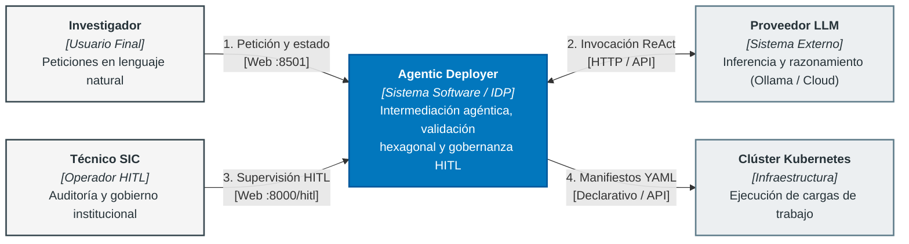
<p align="center"><i><b>Figura 5:</b> Diagrama de Contexto del Sistema (Nivel 1) del Modelo C4 para el Agentic Deployer.</i></p>

Como se detalla en la Figura 5, el *Agentic Deployer* centraliza y desacopla los flujos operativos. El Investigador interactúa exclusivamente con el canal de entrada en lenguaje natural. El Proveedor LLM aporta capacidad heurística sin acceso a la red interna. El Técnico del SIC ejerce el gobierno institucional mediante un canal independiente de supervisión humana (*Human-In-The-Loop*). Finalmente, el Clúster de Kubernetes solo recibe especificaciones declarativas una vez que han superado tanto las validaciones deterministas de seguridad del sistema como la autorización humana.

### 5.2.2. Nivel 2: Contenedores (Unidades de Ejecución)

Una vez delimitadas las fronteras externas, el Nivel 2 del Modelo C4 somete a la caja central (*Agentic Deployer*) a un proceso de ampliación. En este nivel, se revela que la solución propuesta no es un monolito, sino un ecosistema distribuido compuesto por unidades de despliegue independientes, denominadas arquitectónicamente como "Contenedores".

> **Nota (Aclaración de Nomenclatura C4):** En la metodología de modelado C4, el término "Contenedor" representa una aplicación ejecutable o almacén de datos aislado (ej. un microservicio, una base de datos, una aplicación cliente). No debe confundirse estrictamente con un contenedor Docker (tecnología de virtualización), aunque en la práctica de la ingeniería moderna ambos conceptos suelan encapsularse mutuamente.

La decisión de fragmentar el sistema en múltiples procesos persigue maximizar la resiliencia operativa [29] y adherirse al principio de Separación de Preocupaciones (*Separation of Concerns*). Si un contenedor falla (por ejemplo, debido a una excepción crítica o bloqueo en la inferencia del modelo), el resto de la plataforma debe continuar operando para garantizar la trazabilidad de los datos institucionales.

En la Figura 6 se formaliza la descomposición del sistema en tres contenedores de ejecución (A, B y C), explicitando las siete interacciones que articulan el flujo de datos.

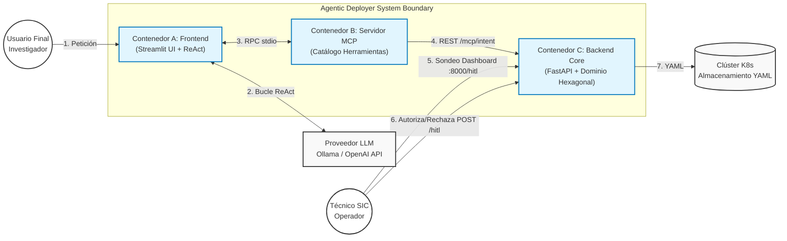
<p align="center"><i><b>Figura 6:</b> Diagrama de Contenedores (Nivel 2) del Modelo C4 para el sistema Agentic Deployer.</i></p>

#### 5.2.2.1. Explicación del Flujo de Interacciones y Acceso Técnico al Backend

La Figura 6 detalla la secuencia de interacciones numeradas del 1 al 7:

1. **Petición del usuario:** El Investigador remite su necesidad en lenguaje natural al Contenedor A (Frontend Streamlit).
2. **Ciclo de inferencia:** El orquestador alojado en el Frontend ejecuta el bucle cognitivo *ReAct* comunicándose de forma bidireccional con el Proveedor LLM (Ollama o API Cloud).
3. **Invocación de herramientas:** Al deducir una acción, el Frontend invoca el catálogo operativo expuesto por el Contenedor B (Servidor MCP) mediante el protocolo JSON-RPC sobre `stdio`.
4. **Remisión de intención tipada:** El Servidor MCP transforma la acción en una llamada HTTP REST (`POST /mcp/intent`) hacia el Contenedor C (Backend FastAPI).
5. **Sondeo del operador humano:** El Técnico del SIC accede al panel de control HITL expuesto por el Backend (`:8000/hitl`) para inspeccionar solicitudes pendientes (`PENDING_APPROVAL`).
6. **Autorización o rechazo:** Tras validar visualmente la intención, el técnico emite su decisión (`POST /hitl/approve/{id}` o `POST /hitl/reject/{id}`) sobre el Backend.
7. **Materialización declarativa:** El Backend invoca el adaptador de infraestructura secundario (`DeployPort`) para emitir el manifiesto YAML hacia Kubernetes.

**Justificación del Acceso Directo del Técnico al Backend (Interacciones 5 y 6):**  
En la Figura 6 se observa que el Técnico del SIC interactúa directamente con el Contenedor C (Backend) y no a través del Contenedor A (Frontend). Esta decisión de diseño responde a dos criterios esenciales de ingeniería de software:
- **Segregación de Responsabilidades y Seguridad (*Separation of Concerns*):** El Contenedor A está concebido exclusivamente como interfaz conversacional para usuarios sin perfil técnico (Investigador) y gestiona el contexto estocástico del LLM. Por políticas de gobierno corporativo, el operador de infraestructura no debe compartir canal con el entorno del agente.
- **Aislamiento del Panel Administrativo:** El Contenedor C (Backend FastAPI) aloja de forma nativa la interfaz web del Dashboard HITL en la ruta `/hitl`. Esta independencia garantiza que, incluso si el proceso Streamlit o la inferencia del modelo sufren una degradación o reinicio imprevisto, el técnico de operaciones conserva pleno acceso al estado persistente del sistema para auditar, autorizar o rechazar solicitudes con total independencia.

#### 5.2.2.2. Relación entre Contenedores Lógicos y Procesos en Ejecución

Mientras que la Figura 6 define los límites lógicos y los contratos de comunicación de la arquitectura, en la Figura 7 se detalla cómo dichos componentes se materializan físicamente en tiempo de ejecución sobre la máquina anfitriona (*host* universitario).

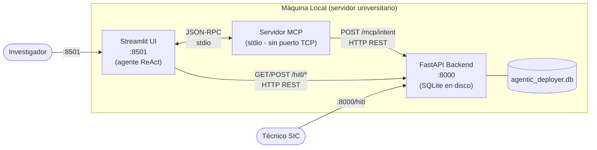
<p align="center"><i><b>Figura 7:</b> Diagrama de despliegue a nivel de proceso. Los componentes coexisten en la misma máquina anfitriona; el servidor MCP se comunica por <code>stdio</code> sin exponer puertos de red.</i></p>

En la Figura 7 se aprecian las siguientes decisiones de implementación física:
- **Frontend Streamlit (Puerto 8501):** Proceso web accesible para el investigador, que contiene el bucle *ReAct*.
- **Servidor MCP (Canal `stdio`):** Se ejecuta como un subproceso local sin exponer ningún puerto TCP de red. Esta elección elimina vectores de ataque externos y minimiza la latencia de transporte a fracciones de milisegundo mediante tuberías del sistema operativo.
- **Backend FastAPI (Puerto 8000):** Proceso que expone tanto los endpoints de la API REST para el MCP como la interfaz web del Dashboard HITL (`/hitl`) consumida por el técnico. La persistencia transaccional se apoya en un archivo local `agentic_deployer.db` gestionado por SQLite.

#### 5.2.2.3. Desglose Funcional de los Contenedores

La arquitectura interna se sustenta sobre los tres pilares de ejecución identificados en la Figura 6:

1. **Contenedor A — Frontend de Orquestación Cognitiva (Streamlit UI + ReAct):**
   Esta aplicación web es el punto de entrada para el usuario investigador. Su responsabilidad trasciende la mera renderización de interfaces (UX/UI): aloja en su núcleo el `AgentOrchestrator`, siendo el único componente del sistema autorizado a mantener conexiones de red (HTTP/gRPC) con el proveedor externo de Inteligencia Artificial (OpenAI u Ollama). Su función principal es gestionar la asincronía del chat, administrar el contexto histórico de la sesión y gobernar las iteraciones del bucle de razonamiento y acción (*ReAct*).

2. **Contenedor B — Servidor de Herramientas MCP (Servidor MCP Python):**
   Concebido como un proceso ligero, el Servidor del Protocolo de Contexto de Modelos (MCP) actúa como el catálogo dinámico de operaciones tecnológicas de la universidad. Su propósito es traducir los métodos y funciones estandarizadas (por ejemplo, el método `deploy_congress_web()`) a una representación JSON universal que cualquier LLM moderno pueda ingerir como *Tool Calling*. Por motivos de latencia estricta, este contenedor no se comunica con el orquestador mediante APIs de red tradicionales, sino que se enlaza a través de flujos de Entrada/Salida estándar (`stdio`) del sistema operativo, garantizando intercambios de mensajes JSON-RPC en el orden de los submilisegundos.

3. **Contenedor C — Núcleo Determinista (Backend Core FastAPI Hexagonal):**
   Implementado sobre el *framework* asíncrono FastAPI, este servicio aloja la lógica de dominio, la persistencia transaccional y las reglas de validación y seguridad de la arquitectura. Su principio de diseño es el desacoplamiento respecto a la capa cognitiva: a este proceso backend no le concierne cómo el modelo de lenguaje dedujo una acción, ni si el usuario utilizó jerga técnica o lenguaje coloquial. Su función es recibir un objeto JSON estructuralmente tipado desde el Servidor MCP. 
   Una vez recibida la intención, el Backend aplica de forma determinista las políticas de seguridad institucional. Si la petición vulnera dichas directrices (ej. solicitar un puerto reservado), el Backend la rechaza de manera síncrona; si es válida, la registra en estado de espera (`PENDING_APPROVAL`) en el repositorio persistente SQLite y la expone para que el *Dashboard* del Técnico de Operaciones pueda consumirla de forma asíncrona mediante técnicas de *Polling*.

Esta división modular (Frontend conversacional, Catálogo MCP y Backend hexagonal) estructura el diseño del *Agentic Deployer*. Garantiza que un fallo en la inferencia del modelo de lenguaje, o una interacción imprevista en la interfaz gráfica, no comprometa las reglas de infraestructura gobernadas por el Backend Core.

### 5.2.3. Nivel 3: Diagrama de Clases UML (Micro-Arquitectura)

En la Figura 8 se detalla el diagrama de clases unificado del sistema, formalizando la relación orientada a objetos entre las entidades del dominio, las interfaces abstractas y los adaptadores que componen el núcleo lógico.

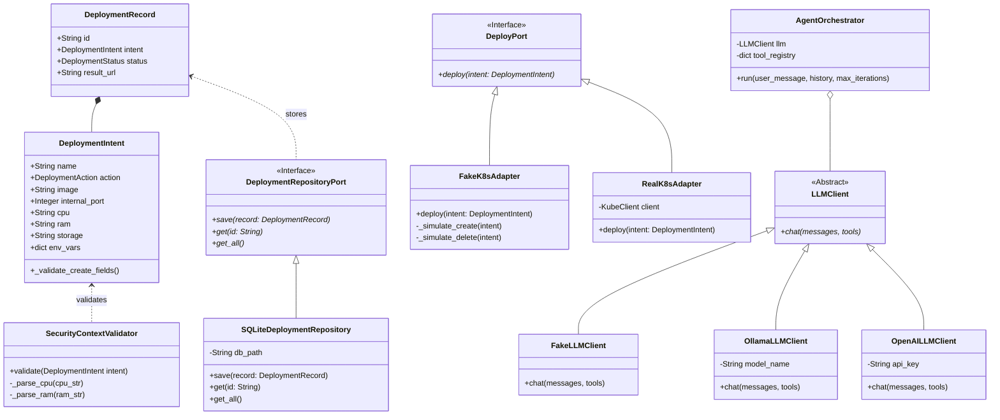
<p align="center"><i><b>Figura 8:</b> Diagrama de Clases (UML) resumiendo las principales entidades y contratos del núcleo lógico, destacando el uso del polimorfismo para la inyección de dependencias (LLMClient, DeployPort, DeploymentRepositoryPort).</i></p>

#### 5.2.3.1. Análisis Estructural de Clases y Patrones de Diseño

El diagrama de clases de la Figura 8 materializa cinco patrones de diseño fundamentales para garantizar el desacoplamiento:

1. **Abstracción del Cliente de Inferencia (Patrón *Strategy*):** La clase abstracta `LLMClient` define el contrato polimórfico `chat(messages, tools)`. Las implementaciones concretas `OllamaLLMClient` (para ejecución local privada sin retención de datos), `OpenAILLMClient` (para proveedores cloud comerciales) y `FakeLLMClient` (para simulaciones y pruebas unitarias sin dependencias externas) encapsulan los detalles de protocolo de cada API. La clase `AgentOrchestrator` mantiene una relación de agregación con `LLMClient`, permitiendo alternar el motor de lenguaje mediante inyección de dependencias sin modificar la lógica del ciclo de razonamiento.
2. **Entidades del Dominio (`DeploymentIntent` y `DeploymentRecord`):** La entidad `DeploymentIntent` actúa como objeto de transferencia y validación de parámetros técnicos, incluyendo cómputo (`cpu`, `ram`) y almacenamiento persistente opcional (`storage`). La clase `DeploymentRecord` establece una relación de composición con `DeploymentIntent`, agregando metadatos persistentes como el identificador único (`id`), el estado en la máquina de estados finita (`status: DeploymentStatus`) y la ruta o URL del artefacto generado (`result_url`).
3. **Servicio de Validación de Dominio (`SecurityContextValidator`):** Mantiene una relación de dependencia con `DeploymentIntent`. Su responsabilidad exclusiva es evaluar los atributos de la intención contra las reglas corporativas institucionales de forma algorítmica, rechazando cualquier valor no conforme antes de que alcance la capa de persistencia.
4. **Puerto de Despliegue (`DeployPort`):** Interfaz abstracta que declara el contrato polimórfico `deploy(intent: DeploymentIntent)`. El adaptador concreto `FakeK8sAdapter` implementa este puerto para materializar plantillas YAML en disco durante las pruebas y demostraciones, mientras que la clase proyectada `RealK8sAdapter` implementa el mismo contrato interactuando con la API física de Kubernetes, cumpliendo estrictamente con el Principio de Abierto/Cerrado (*Open/Closed Principle*).
5. **Puerto y Adaptador de Persistencia (`DeploymentRepositoryPort` y `SQLiteDeploymentRepository`):** Siguiendo el desacoplamiento de infraestructura, el dominio interactúa con el almacenamiento a través de la interfaz `DeploymentRepositoryPort` (`save`, `get`, `get_all`), satisfecha en tiempo de ejecución por `SQLiteDeploymentRepository`. Esto permite aislar la persistencia en base de datos sin contaminar el dominio con dependencias SQL.

## 5.3. Adopción de la Arquitectura Hexagonal (Ports and Adapters)

El diseño del Contenedor Backend (el núcleo del sistema) requiere una fundamentación arquitectónica robusta. Como se exploró en el Estado del Arte (Capítulo 2), conceder autonomía operativa a un ente estocástico exige el establecimiento de fronteras deterministas estrictas. Para satisfacer este requisito, el núcleo del sistema se ha diseñado siguiendo el patrón arquitectónico de Puertos y Adaptadores (*Ports and Adapters*), comúnmente conocido como **Arquitectura Hexagonal** (propuesta formalmente por Alistair Cockburn) [19].

Este patrón se fundamenta en estructurar el software en capas concéntricas, imponiendo un único sentido de dependencia: desde el exterior (tecnologías volátiles, bases de datos, APIs de IA) hacia el interior (lógica de negocio inmutable).

### 5.3.1. Capa de Dominio: Entidades e Invariantes

En el centro exacto del hexágono reside la Capa de Dominio. Esta capa representa la fuente de verdad de la lógica de negocio y debe ser completamente agnóstica a cualquier *framework* externo. En el contexto de este Trabajo de Fin de Máster, la capa de dominio modela las intenciones de infraestructura antes de que estas se traduzcan a código declarativo.

Para dotar al núcleo de una seguridad de tipos estricta (esencial al operar en lenguajes interpretados), el sistema no manipula estructuras de datos dinámicas (como diccionarios JSON crudos emitidos por el LLM). En su lugar, el orquestador obliga a mapear cualquier solicitud externa hacia una Entidad de Dominio rígidamente definida. El contrato principal de este núcleo es la entidad `DeploymentIntent` (Intención de Despliegue).

En términos de Ingeniería de Software, esta entidad actúa como un contrato que impone **invariantes de dominio**. Se define de la siguiente manera conceptual:

- **Atributo Identificador:** Unívoco e inmutable (UUID).
- **Atributo Acción:** Restringido a un conjunto finito de operaciones (`CREATE`, `DELETE`).
- **Atributos Topológicos:** Nombre del servicio, imagen base, requerimientos de cómputo (CPU/RAM).
- **Invariantes Lógicas:** El puerto de red debe pertenecer estrictamente al rango válido `[1, 65535]`. Las acciones de creación exigen obligatoriamente la existencia de una imagen y un puerto válido.

La aplicación estricta de estos invariantes actúa como la primera barrera pasiva contra las alucinaciones del modelo. Si el agente MCP, a causa de un error de inferencia probabilística, intenta instanciar una intención de despliegue con un puerto de valor nulo o fuera de rango (ej. `-80`), la Entidad de Dominio denegará su propia creación arrojando una excepción pura. Esto aplica el principio de *Fail-Fast*, impidiendo que las capas subyacentes procesen datos corruptos (*Garbage In, Garbage Out*).

#### 5.3.1.1. Ejemplo Ilustrativo de `DeploymentIntent` Instanciado

Para clarificar cómo se materializa esta entidad en tiempo de ejecución, el siguiente fragmento de código ilustra una instancia real de `DeploymentIntent` creada tras la negociación conversacional para el despliegue del portal web de un congreso académico:

```python
# Instanciación tipada de la Entidad de Dominio (Pydantic / Python)
intent = DeploymentIntent(
    name="congreso-ia-2026",
    action=DeploymentAction.CREATE,
    image="docker.io/library/nginx:1.25-alpine",
    internal_port=8080,
    cpu="500m",
    ram="256Mi",
    env_vars={"APP_ENV": "production", "PORT": "8080"}
)
```

Su representación JSON equivalente, emitida por el Servidor MCP hacia el endpoint `POST /mcp/intent` del Backend, refleja la estructura estricta que viaja a través de la frontera de red:

```json
{
  "name": "congreso-ia-2026",
  "action": "CREATE",
  "image": "docker.io/library/nginx:1.25-alpine",
  "internal_port": 8080,
  "cpu": "500m",
  "ram": "256Mi",
  "env_vars": {
    "APP_ENV": "production",
    "PORT": "8080"
  }
}
```

En este ejemplo se observa cómo los campos respetan los invariantes básicos: el identificador `name` cumple con la sintaxis DNS de Kubernetes (`^[a-z0-9-]+$`), la etiqueta de la imagen evita explícitamente el uso de `:latest`, el puerto interno (`8080`) se sitúa en el rango de puertos de usuario (≥ 1024) y las variables de entorno no contienen claves sensibles en texto plano.

### 5.3.2. Principio de Inversión de Dependencias (DIP)

El diseño Hexagonal encuentra su máxima justificación en la implementación del Principio de Inversión de Dependencias (la letra 'D' del acrónimo S.O.L.I.D.). El dominio jamás invoca directamente librerías externas o conectores de bases de datos. En su lugar, expone Interfaces abstractas denominadas **Puertos**, que son implementadas por componentes periféricos denominados **Adaptadores**, tal y como se formaliza en el diagrama de clases de la Figura 8 y en el esquema topológico de la Figura 9.

La topología del hexágono divide estos adaptadores en dos categorías operativas:

#### 5.3.2.1. Adaptadores Primarios (*Driving Adapters*)
Son los componentes que inician el flujo de ejecución hacia el interior del sistema (zona izquierda de la Figura 9). En la presente arquitectura, los adaptadores primarios se materializan mediante Controladores REST (enrutados vía FastAPI). Estos controladores actúan como traductores: mientras que el *endpoint* MCP (`/mcp/intent`) delega el procesamiento al Caso de Uso de la capa de aplicación (`ProcessDeploymentUseCase`), el *endpoint* de aprobación del *Dashboard* asume el rol de orquestador, invocando de manera directa los puertos de almacenamiento y despliegue por pragmatismo en la gestión de estados.

#### 5.3.2.2. Adaptadores Secundarios (*Driven Adapters*)
Son los componentes accionados por el núcleo del sistema para interactuar con el mundo físico o mutar su estado (zona derecha de la Figura 9). En este punto de la arquitectura se concentra el mayor riesgo operativo: la comunicación directa con el clúster de Kubernetes.

Para aislar el núcleo de negocio frente a eventuales migraciones en la plataforma de orquestación (por ejemplo, si la universidad decidiera migrar de Kubernetes a Docker Swarm o AWS ECS), la capa de aplicación dicta sus necesidades a través de un puerto abstracto llamado `DeployPort` (declarado en la Figura 8). 

En la implementación actual del TFM, este puerto es satisfecho por un adaptador concreto denominado `FakeK8sAdapter`. Cuando el núcleo aprueba una intención, invoca la interfaz abstracta `deploy()`. El núcleo asume que el contenedor está siendo desplegado en producción, pero en realidad, el adaptador secundario (diseñado expresamente para la demostración y las pruebas) procesa la información y vierte los manifiestos YAML físicamente en el disco local del servidor, sin afectar a la red real. 

Esta abstracción modular garantiza que, en iteraciones futuras del producto, la sustitución del adaptador simulado por un `RealK8sAdapter` (clase ya contemplada en la Figura 8 y proyectada en la Sección 10.3.1) no requerirá alterar ni reescribir una sola línea de código en las capas de Aplicación o Dominio.

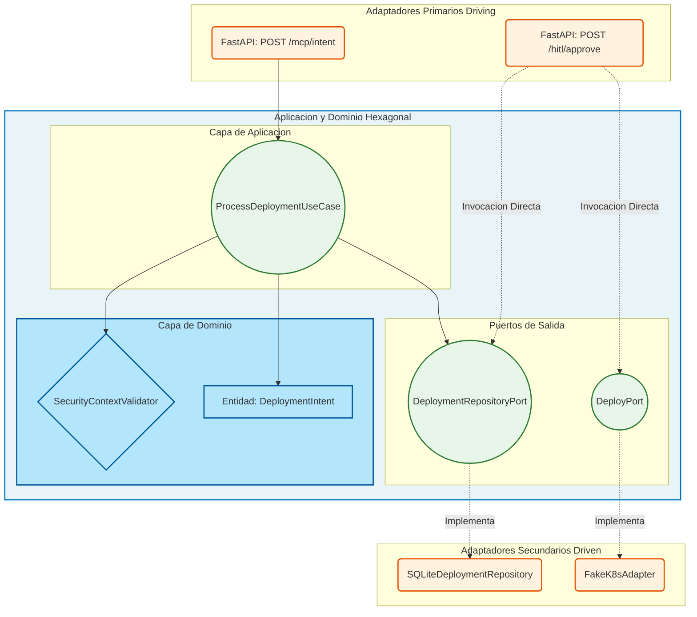
<p align="center"><i><b>Figura 9:</b> Topología de la Arquitectura Hexagonal. El flujo de control penetra desde los Adaptadores Primarios, pero la dependencia de código siempre fluye hacia el centro (Regla de Dependencia de Inversión).</i></p>

## 5.4. Algoritmia de Validación de Seguridad Institucional

La delegación de la escritura de intenciones declarativas a un Agente Cognitivo introduce un vector de amenaza fundamental: el LLM podría generar una topología de red técnicamente válida para el clúster, pero corporativamente ilícita. La protección contra estas peticiones (ya sean fruto de alucinaciones algorítmicas, un error involuntario de configuración por parte del usuario o un ataque directo de inyección de *prompts*) recae sobre la Capa de Aplicación, concretamente en un servicio de dominio especializado: el `SecurityContextValidator`.

En esta sección se formaliza la lógica de validación que rige dicho componente, así como la gestión del ciclo de vida de las excepciones derivadas de su ejecución, un componente crítico para la retroalimentación del agente.

### 5.4.1. Cortafuegos Lógico: Formalización Algorítmica

El `SecurityContextValidator` opera bajo el principio de "Confianza Cero" (*Zero-Trust*). No asume ninguna premisa sobre la validez semántica de las acciones emitidas por el Agente MCP. Su misión es interceptar la Entidad de Dominio (`DeploymentIntent`) y someterla a un árbol de decisiones binarias imperativo, contrastándola contra las normativas de Ciberseguridad e ITIL del centro de datos de la universidad.

#### 5.4.1.1. Estructura de la Configuración del Sistema (`politicas_locales`)

Antes de examinar el algoritmo de validación, es preciso detallar la estructura de datos que compone el parámetro de entrada `politicas_locales`. En el diseño del backend, este conjunto de políticas institucionales se define mediante constantes declarativas y reglas de configuración parametrizadas:

1. **Umbral de Puertos Privilegiados (`MIN_ALLOWED_PORT = 1024`):** Define el límite inferior de los puertos de red permitidos para servicios de usuario. El rango de puertos del sistema (`0` a `1023`, conocidos como *Well-Known Ports*) queda estrictamente reservado para procesos administrativos con privilegios de superusuario (`root`).
2. **Lista Blanca de Registros de Imágenes (`ALLOWED_REGISTRIES`):** Conjunto estricto de prefijos de confianza autorizados para suministrar imágenes de contenedores al clúster universitario:
   - `docker.io/` (Docker Hub oficial).
   - `quay.io/` (Red Hat Quay).
   - `harbor.universidad.edu/` (Registro privado institucional).
   Cualquier imagen que no provenga explícitamente de uno de estos tres registros es clasificada como vector potencial de código malicioso y rechazada.
3. **Etiquetas Volátiles Restringidas (`FORBIDDEN_IMAGE_TAGS = {"latest"}`):** Prohíbe el uso de la etiqueta `:latest` para blindar los despliegues frente a la deriva de configuración (*Configuration Drift*) y garantizar la reproducibilidad determinista del software.
4. **Cuotas Máximas de Hardware Departamental:**
   - `MAX_CPU_MILLICORES = 4000` (equivalente a 4 núcleos virtuales).
   - `MAX_RAM_MEBIBYTES = 8192` (equivalente a 8 GiB de memoria).
5. **Subcadenas Prohibidas en Variables de Entorno (`FORBIDDEN_ENV_KEYS`):** Tupla de patrones (`"password"`, `"secret"`, `"token"`, `"key"`, `"credential"`) destinada a detectar intentos involuntarios de inyección de credenciales en texto plano dentro de la especificación de despliegue.
6. **Almacenamiento Persistente Obligatorio en Bases de Datos:** Si la imagen del contenedor referencia un motor de base de datos (`postgres`, `mysql`, `redis`, `mongo`), el validador exige la definición explícita del parámetro `storage` (ej. `'10Gi'`) para impedir despliegues efímeros con riesgo de pérdida de datos.

Asimismo, el validador incorpora una regla de exención de ciclo de vida: las peticiones cuya acción sea de desmantelamiento (`action = DELETE`) eluden estas comprobaciones de creación, permitiendo liberar recursos sin evaluar puertos ni imágenes.

Con estas estructuras declarativas establecidas, el comportamiento del validador de seguridad se describe formalmente a continuación mediante el Algoritmo 1, reflejando fielmente la acumulación de violaciones implementada en el código.

```text

01 ENTRADA: 
02  intencion -> Objeto de tipo DeploymentIntent (Invariantes básicos garantizados)
03  politicas_locales -> Configuración del Sistema (Puertos vetados, repositorios, cuotas)
04 
05 SALIDA: 
06  VERDADERO (Si la intención cumple todas las políticas institucionales)
07  LANZA Excepción de Seguridad (SecurityViolationError) con lista de violaciones
08 
09 INICIO
10   // REGLA 0: Exención de ciclo de vida para operaciones de borrado
11   SI intencion.action ES IGUAL A DeploymentAction.DELETE ENTONCES
12     RETORNAR VERDADERO
13   FIN SI
14 
15   Variable violaciones = ListaVacia()
16 
17   // REGLA 1: Análisis Topológico de Red (Principio de Mínimo Privilegio)
18   SI intencion.internal_port != NULO Y intencion.internal_port < 1024 ENTONCES
19     violaciones.Agregar("Puerto privilegiado no permitido: " + intencion.internal_port)
20   FIN SI
21 
22   // REGLAS 2, 3 Y 4: Inspección de Imagen y Almacenamiento
23   SI intencion.image != NULO ENTONCES
24     SI ":latest" EN intencion.image ENTONCES
25       violaciones.Agregar("Uso de etiqueta ':latest' prohibido: " + intencion.image)
26     FIN SI
27     
28     Variable registro_valido = FALSO
29     PARA CADA registro EN politicas_locales.ALLOWED_REGISTRIES HACER
30       SI intencion.image INICIA_CON registro ENTONCES
31         registro_valido = VERDADERO
32         ROMPER BUCLE
33       FIN SI
34     FIN PARA
35     SI registro_valido ES FALSO ENTONCES
36       violaciones.Agregar("Registro no confiable: " + intencion.image)
37     FIN SI
38 
39     SI ContieneMotorBBDD(intencion.image) Y intencion.storage ES NULO ENTONCES
40       violaciones.Agregar("Las bases de datos requieren almacenamiento persistente explícito")
41     FIN SI
42   FIN SI
43 
44   // REGLA 5: Auditoría de Cuotas de Hardware (Resource Quotas)
45   Variable cpu_m = ParsearMiliCores(intencion.cpu)
46   SI cpu_m > 4000 ENTONCES
47     violaciones.Agregar("Cuota de CPU excedida: " + intencion.cpu + " > 4000m")
48   FIN SI
49 
50   Variable ram_mi = ParsearMebibytes(intencion.ram)
51   SI ram_mi > 8192 ENTONCES
52     violaciones.Agregar("Cuota de RAM excedida: " + intencion.ram + " > 8192Mi")
53   FIN SI
54 
55   // REGLA 6: Detección Heurística de Secretos en Variables de Entorno
56   PARA CADA clave EN intencion.env_vars HACER
57     SI ContieneSubcadena(clave.Minusculas(), ["password", "secret", "token", "key", "credential"]) ENTONCES
58       violaciones.Agregar("Posible secreto en texto plano en variable: " + clave)
59     FIN SI
60   FIN PARA
61 
62   // Si existen violaciones acumuladas, se interrumpe la ejecución
63   SI Longitud(violaciones) > 0 ENTONCES
64     LANZAR SecurityViolationError(violaciones)
65   FIN SI
66 
67   RETORNAR VERDADERO
68 FIN
```
<p align="center"><i><b>Algoritmo 1:</b> Validación Estricta de Entidades de Dominio Hexagonal (SecurityContextValidator).</i></p>

La adopción de este árbol de decisión, con complejidad temporal O(R + K) (donde R es el número de repositorios confiables y K el número de claves de entorno a validar), garantiza que el comportamiento del modelo de lenguaje quede acotado dentro de un conjunto de reglas deterministas. El modelo puede deducir el nombre del servicio o la cantidad de memoria RAM necesaria, pero la lógica de validación establece los límites que ninguna inferencia del modelo puede sobrepasar.

En la Figura 10 se resume visualmente el árbol de validación como diagrama de flujo:

<div style="max-width: 6cm; margin: 0 auto;">

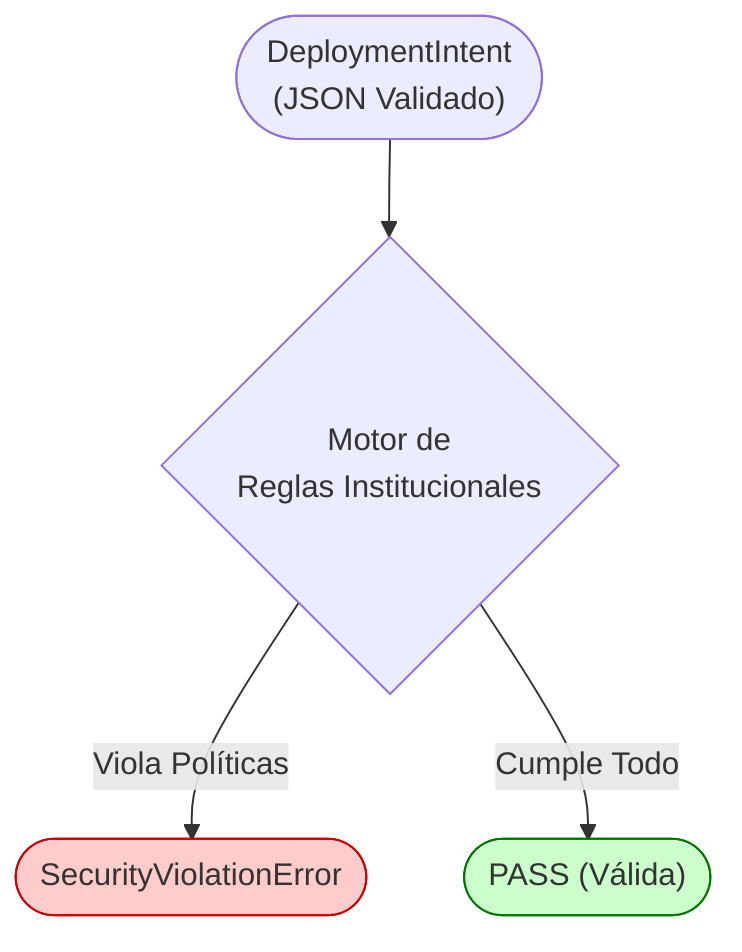

</div>
<p align="center"><i><b>Figura 10:</b> Visión general simplificada del <code>SecurityContextValidator</code>. Una rama de rechazo lanza el error para que ReAct se auto-corrija.</i></p>

Como refleja la bifurcación binaria de la Figura 10, la entidad tipada `DeploymentIntent` es evaluada por el motor de reglas institucionales: si la intención satisface la totalidad de las políticas de red y seguridad, transiciona a estado conforme (`PASS`) y continúa hacia la persistencia en cuarentena; si vulnera cualquier restricción corporativa (ej. puerto reservado o etiqueta `:latest`), se desvía inmediatamente a la rama de excepción lanzando `SecurityViolationError`.

### 5.4.2. Gestión de Excepciones y Ciclo de Vida del Error

En las arquitecturas de software tradicionales orientadas a microservicios, el lanzamiento de una excepción crítica como el `SecurityViolationError` aborta la transacción y se propaga hacia el usuario final (típicamente traducido en un código HTTP `400 Bad Request` o `422 Unprocessable Entity`), mostrándole una alerta técnica en la interfaz gráfica.

Sin embargo, el *Agentic Deployer* introduce un mecanismo de interceptación orientado al agente. La excepción no se traslada inmediatamente en forma de error técnico opaco al usuario investigador, sino que se devuelve al modelo de lenguaje dentro del flujo conversacional.

El ciclo de vida del error sigue la siguiente secuencia:

1. El `SecurityContextValidator` lanza la excepción (ej. "Uso de puerto privilegiado prohibido").
2. El Adaptador REST de FastAPI serializa esta excepción pura y responde a la petición RPC del Servidor MCP con un código HTTP `422`.
3. El Servidor MCP transmite este código de fallo a la Interfaz Cognitiva. En lugar de interrumpir la aplicación Streamlit con un fallo no controlado, el orquestador ReAct registra este error como una **Observación (*Observation*)**.
4. La Observación es re-inyectada en la ventana de contexto del LLM.

Esta gestión de excepciones alivia la carga cognitiva del usuario: no se le exige diagnosticar directamente el motivo del rechazo técnico (por ejemplo, el intento de uso del puerto privilegiado 22). El modelo de lenguaje interpreta el mensaje de error estructurado, ajusta su contexto interno e interactúa con el usuario solicitando un parámetro válido (por ejemplo, el puerto 8080). Esta articulación entre validaciones deterministas en el backend y asistencia en lenguaje natural constituye un componente clave de la solución propuesta.

## 5.5. Patrón de Abstracción: *Golden Paths* y Expansión Sintáctica

El último eslabón conceptual de la arquitectura de sistema aborda el mecanismo subyacente para la generación del código declarativo (*Infrastructure as Code*, IaC). En un primer estadio de adopción de IA, la tentación arquitectónica más común consiste en solicitar al Modelo de Lenguaje que redacte íntegramente los manifiestos YAML (por ejemplo, pasándole un *prompt* del tipo "escribe un Deployment de Kubernetes para esta aplicación"). 

Sin embargo, desde la perspectiva de la Ingeniería de Fiabilidad del Sitio (*Site Reliability Engineering*, SRE), esta práctica introduce un riesgo inasumible denominado **Deriva de Configuración (*Configuration Drift*)**. Si el LLM tiene control total sobre la topología, podría instanciar servicios usando versiones deprecadas de APIs (ej. `extensions/v1beta1` en lugar de `apps/v1`), omitir sondas de disponibilidad (*Liveness Probes*), o saltarse las etiquetas (*labels*) necesarias para el enrutamiento interno del clúster.

### 5.5.1. Definición Teórica del *Golden Path*

Para mitigar este riesgo, el diseño arquitectónico adopta el patrón *Golden Path* (Camino Dorado). Un *Golden Path* se define formalmente como una plantilla de infraestructura estandarizada, fuertemente securizada, y auditada previamente por el equipo senior de Operaciones de IT. 

En este paradigma, el modelo de lenguaje no redacta código de infraestructura directamente, sino que su función generativa se limita a la extracción de parámetros. La estructura y configuración base de despliegue (el «cómo») quedan fijadas en la plantilla predefinida y auditada por el equipo de operaciones, mientras que el modelo provee los valores específicos (el «qué») consensuados con el usuario en lenguaje natural.

### 5.5.2. Motor de Plantillas (Separación entre Topología y Variables)

El proceso de expansión sintáctica ocurre de forma invisible para el usuario en la capa más externa del hexágono (en el adaptador de infraestructura `DeployPort`). Cuando el técnico aprueba una intención retenida, el adaptador actúa como un motor de interpolación de cadenas o *Template Engine*.

El sistema realiza un mapeo inyectivo. Extrae las variables cognitivas validadas por el núcleo (nombre del servicio, puerto interno, requerimientos de CPU/RAM, imagen) y las inyecta en la matriz declarativa pre-probada.

A nivel topológico, una simple solicitud cognitiva ("necesito una base de datos") se expande de forma determinista en un árbol de recursos interdependientes:
1. Un **`Deployment`** o **`StatefulSet`**, configurado para aplicar cuotas rígidas (*Resource Quotas*) y anti-afinidad de nodos.
2. Un **`Service`**, autoconfigurado como `ClusterIP` para evitar la exposición accidental de la base de datos a redes públicas externas.
3. Un **`PersistentVolumeClaim`** (PVC), dimensionado dinámicamente según el tamaño de disco inferido.

Esta garantía de homogeneidad algorítmica asegura que el 100% de los servicios orquestados por el *Agentic Deployer* heredan idéntica postura de seguridad, permitiendo al Servicio de Informática (SIC) escalar la provisión de recursos con alta predictibilidad.

> **Nota de alcance del MVP:** La plantilla actual del `FakeK8sAdapter` genera los tres recursos base del *Golden Path* de aplicación web: `Deployment`, `Service` e `Ingress`. La inclusión de un `PersistentVolumeClaim` (PVC) para servicios con estado (como bases de datos) queda fuera del alcance del presente prototipo y se contempla como primera evolución en el Horizonte a Corto Plazo (Sección 10.3.1).

#### 5.5.2.1. Ejemplo Ilustrativo de *Golden Path* y Expansión Declarativa

Para ilustrar este mecanismo en la práctica, el siguiente bloque muestra la plantilla base multi-documento definida en el adaptador secundario (`FakeK8sAdapter`) y el manifiesto YAML resultante tras interpolar la intención del portal `congreso-ia-2026`:

```yaml
# Plantilla base del Golden Path (FakeK8sAdapter en app/infrastructure/fake_k8s_adapter.py)
---
apiVersion: apps/v1
kind: Deployment
metadata:
  name: {intent.name}
  labels:
    app: {intent.name}
spec:
  replicas: 1
  selector:
    matchLabels:
      app: {intent.name}
  template:
    metadata:
      labels:
        app: {intent.name}
    spec:
      containers:
        - name: {intent.name}
          image: {intent.image}
          ports:
            - containerPort: {intent.internal_port}
          resources:
            requests:
              cpu: {intent.cpu}
              memory: {intent.ram}
---
apiVersion: v1
kind: Service
metadata:
  name: {intent.name}-svc
spec:
  selector:
    app: {intent.name}
  ports:
    - protocol: TCP
      port: 80
      targetPort: {intent.internal_port}
---
apiVersion: networking.k8s.io/v1
kind: Ingress
metadata:
  name: {intent.name}-ingress
spec:
  rules:
    - host: {intent.name}.apps.universidad.edu
      http:
        paths:
          - path: /
            pathType: Prefix
            backend:
              service:
                name: {intent.name}-svc
                port:
                  number: 80
```

Al aplicarse sobre la intención validada del congreso (`name: "congreso-ia-2026"`, `image: "docker.io/library/nginx:1.25-alpine"`, `internal_port: 8080`, `cpu: "500m"`, `ram: "256Mi"`), el adaptador materializa de forma determinista el siguiente manifiesto en el disco local (`outputs/congreso-ia-2026.yaml`), retornando la URL institucional `https://congreso-ia-2026.apps.universidad.edu`:

```yaml
# Manifiesto YAML final generado deterministamente (outputs/congreso-ia-2026.yaml)
---
apiVersion: apps/v1
kind: Deployment
metadata:
  name: congreso-ia-2026
  labels:
    app: congreso-ia-2026
spec:
  replicas: 1
  selector:
    matchLabels:
      app: congreso-ia-2026
  template:
    metadata:
      labels:
        app: congreso-ia-2026
    spec:
      containers:
        - name: congreso-ia-2026
          image: docker.io/library/nginx:1.25-alpine
          ports:
            - containerPort: 8080
          resources:
            requests:
              cpu: 500m
              memory: 256Mi
---
apiVersion: v1
kind: Service
metadata:
  name: congreso-ia-2026-svc
spec:
  selector:
    app: congreso-ia-2026
  ports:
    - protocol: TCP
      port: 80
      targetPort: 8080
---
apiVersion: networking.k8s.io/v1
kind: Ingress
metadata:
  name: congreso-ia-2026-ingress
spec:
  rules:
    - host: congreso-ia-2026.apps.universidad.edu
      http:
        paths:
          - path: /
            pathType: Prefix
            backend:
              service:
                name: congreso-ia-2026-svc
                port:
                  number: 80
```

Este diseño impide la generación estocástica de sintaxis de Kubernetes o la alteración arbitraria de cuotas de cómputo por parte del modelo de lenguaje, garantizando que el equipo de operaciones mantenga el control determinista sobre las directivas de seguridad del clúster.

## 5.6. Flujo de Datos *End-to-End* y Ciclo de Estados

Las decisiones arquitectónicas formalizadas a lo largo de este capítulo (Modelo C4, Arquitectura Hexagonal y plantillas *Golden Paths*) se articulan en un flujo de procesamiento distribuido que coordina componentes de distinta naturaleza: la inferencia probabilística del modelo de lenguaje en el frontend, la validación determinista de tipos y seguridad en el backend, y el control asíncrono de cambios mediante supervisión humana (*HITL*).

La traza de ejecución completa abarca desde la recepción de la solicitud en lenguaje natural formulada por el investigador, hasta la persistencia y eventual materialización declarativa de los manifiestos de despliegue autorizados por el técnico. Para estructurar formalmente este flujo y delimitar las responsabilidades de cada componente, la secuencia se descompone en tres etapas sucesivas:

#### 5.6.0.1. Ejemplo Ilustrativo del Flujo Extremo a Extremo (*Walkthrough*)

Para comprender el recorrido de una orden antes de examinar los diagramas de secuencia formales, considérese el siguiente ciclo de vida completo para la solicitud de un investigador:

1. **Entrada en Lenguaje Natural (Etapa 1):** El investigador escribe en la interfaz Streamlit: *"Hola, necesito publicar la web informativa del congreso de IA con NGINX en el puerto 8080 con 500m de CPU y 256Mi de RAM"*.
2. **Inferencia y Detección de Herramienta:** El `AgentOrchestrator` consulta al LLM en el bucle *ReAct*. El modelo razona que dispone de la herramienta `format_deployment_intent` y genera el *Tool Call* con los parámetros extraídos.
3. **Validación Hexagonal (Etapa 2):** El Servidor MCP envía `POST /mcp/intent` al Backend. El `SecurityContextValidator` ejecuta el Algoritmo 1:
   - Puerto 8080 ≥ 1024 → Conforme.
   - Imagen `docker.io/library/nginx:1.25-alpine` en lista blanca y sin etiqueta `:latest` → Conforme.
   - Recursos (500m CPU, 256Mi RAM) bajo cuota → Conforme.
   - Variables sin secretos → Conforme.
4. **Persistencia Transaccional:** El Backend registra la intención en SQLite con identificador unívoco hexadecimal de 8 caracteres (ej. `7f3a2c1b`) en estado inmutable `PENDING_APPROVAL`, devolviendo una respuesta HTTP `201 Created` al agente, quien informa al usuario de que la solicitud queda a la espera de validación técnica.
5. **Revisión y Aprobación HITL (Etapa 3):** El técnico del SIC abre el *Dashboard* web (`:8000/hitl`), visualiza la tarjeta con los parámetros de la solicitud `7f3a2c1b` y pulsa "Aprobar" (`POST /hitl/approve/7f3a2c1b`).
6. **Materialización Declarativa:** La FSM del backend transiciona a `APPROVED` y luego a `DEPLOYED`. El adaptador `FakeK8sAdapter` interpola la plantilla del *Golden Path*, escribe físicamente el archivo `outputs/congreso-ia-2026.yaml` y retorna la URL del servicio (`https://congreso-ia-2026.apps.universidad.edu`).

A continuación, se formalizan las tres etapas mediante diagramas de secuencia UML (Figuras 11, 12 y 13).

### 5.6.1. Etapa 1: Extracción Cognitiva de Parámetros (Interacción con el LLM)

En la Figura 11 se modela la fase de inferencia inicial. El flujo se inicia a partir de una petición en lenguaje natural no estructurada introducida por el investigador en el frontend. La latencia en esta etapa depende del modelo de lenguaje configurado y de su infraestructura de ejecución (servicios API en la nube frente a inferencia local sobre Ollama). El bucle ReAct itera de forma conversacional hasta estructurar los parámetros requeridos en un objeto tipado (`ToolCall`).

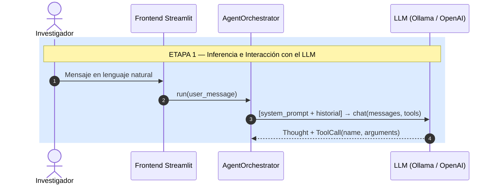
<p align="center"><i><b>Figura 11:</b> Diagrama de Secuencia E2E (Etapa 1). Interacción entre el Investigador y el LLM para la extracción estructurada de la intención de despliegue.</i></p>

### 5.6.2. Etapa 2: Validación Determinista y Persistencia en Cuarentena

En la Figura 12 se modela el punto de control determinista en el que las peticiones transferidas por el Servidor MCP ingresan en el Backend. En esta etapa, la latencia se reduce al orden de los microsegundos, al tratarse de validaciones algorítmicas en memoria ejecutadas por los esquemas Pydantic y el `SecurityContextValidator`. El diagrama formaliza tanto la ruta nominal conforme (Etapa 2A, *Happy Path*) como la ruta de interceptación de violaciones de seguridad (Etapa 2B: excepción `SecurityViolationError` → respuesta HTTP `422 Unprocessable Entity` → retroalimentación al agente ReAct para su autocorrección reflexiva). Cuando la petición supera todos los controles, el backend no ejecuta ninguna mutación en la infraestructura; únicamente persiste el registro en estado de espera (`PENDING_APPROVAL`) en la base de datos SQLite, disociando de forma estricta la inferencia del agente de la ejecución física.

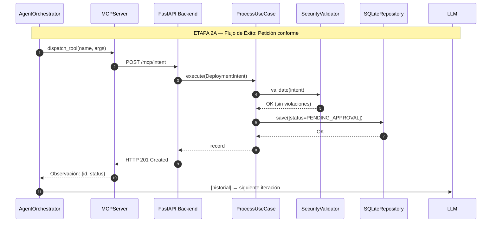

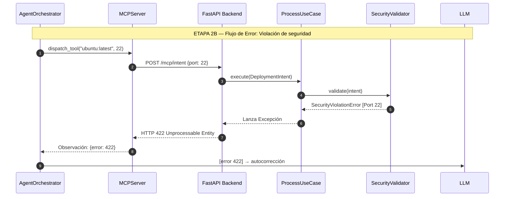
<p align="center"><i><b>Figura 12:</b> Diagrama de Secuencia E2E (Etapa 2). Validación determinista en el backend: (Arriba) Ruta nominal conforme (Etapa 2A); (Abajo) Interceptación de violación de seguridad y autocorrección (Etapa 2B).</i></p>

### 5.6.3. Etapa 3: Supervisión y Autorización Humana (Ciclo HITL)

En la Figura 13 se documenta la fase de decisión y aplicación de cambios, la cual es operativamente asíncrona respecto a las dos anteriores. A diferencia de las fases computacionales previas, esta etapa queda supeditada a la ventana de revisión del operador técnico del SIC, quien accede al panel de control HITL para auditar las solicitudes en cuarentena. Únicamente tras recibir la aprobación explícita del técnico, el backend actualiza el estado de la FSM a `APPROVED` y despacha la orden hacia el adaptador de infraestructura secundario (`DeployPort`), procediendo a la síntesis y escritura de los manifiestos YAML en el almacenamiento destino. En caso de denegación, la transición hacia el estado inmutable `REJECTED` bloquea cualquier interacción con el clúster.

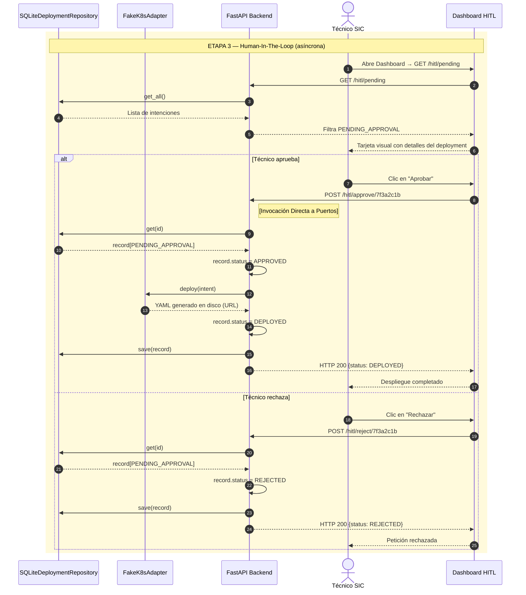
<p align="center"><i><b>Figura 13:</b> Diagrama de Secuencia E2E (Etapa 3). Supervisión asíncrona del operador técnico (HITL) y materialización de la infraestructura.</i></p>

> *Nota de alcance: la Figura 13 representa el flujo HITL a nivel de orquestación global. La **Sección 7.3.3** profundiza deliberadamente en este mismo flujo, incorporando el ciclo de polling asíncrono del Dashboard, los detalles del Algoritmo 4 (FSM_Transition) y los dos vectores de mutación (aprobación y rechazo) como diagramas de secuencia separados y autocontenidos. Esta ampliación es intencional y complementaria, no redundante.*

El diseño integral expuesto garantiza una estricta separación de responsabilidades: el modelo de lenguaje actúa exclusivamente como **asistente para la extracción de sintaxis e intención**, mientras que los módulos deterministas de la arquitectura retienen el control exclusivo sobre las **operaciones de modificación de estado en el clúster**.


<div style='page-break-after: always;'></div>

# Capítulo 6. Desarrollo del Agente Cognitivo y MCP

Sobre los cimientos deterministas del Capítulo 5, este capítulo detalla la implementación del núcleo heurístico del *Agentic Deployer*: el motor cognitivo que transforma el lenguaje natural en operaciones de infraestructura mediante la integración del estándar *Model Context Protocol* (MCP), el diseño abstracto del cliente de inferencia y el bucle de razonamiento *ReAct*.

> **Nota sobre terminología:** A lo largo de este capítulo se emplea el acrónimo **LLM** (*Large Language Model*, Modelo de Lenguaje Grande), que designa a la familia de redes neuronales de gran escala entrenadas sobre corpus masivos de texto. No debe confundirse con otras denominaciones coloquiales; el término preciso en la literatura es *Large Language Model*.

## 6.1. Implementación del Servidor *Model Context Protocol* (MCP)

En las arquitecturas iniciales de Inteligencia Artificial aplicada, la capacidad de un Modelo de Lenguaje para invocar código externo se lograba mediante integraciones fuertemente acopladas (*Vendor Lock-in*). Históricamente, el orquestador debía codificar a mano la firma de las herramientas (como diccionarios JSON rígidos) y empaquetarlas bajo especificaciones privativas (como la especificación *Function Calling* nativa de la API de OpenAI). Esta práctica vulneraba el Principio de Abierto/Cerrado (letra 'O' de S.O.L.I.D.), obligando a reescribir masivamente la base de código si la universidad decidía migrar hacia un proveedor de IA alternativo, como Anthropic o un clúster de Llama-3 local.

Para superar este antipatrón arquitectónico, el sistema desarrollado adopta como estándar troncal el **Model Context Protocol (MCP)** [13], un protocolo abierto diseñado para estandarizar la forma en que los modelos fundacionales interactúan con fuentes de datos y herramientas de ejecución. El MCP actúa como una capa de abstracción universal (un *middleware* cognitivo), desacoplando por completo el catálogo de herramientas de las peculiaridades de la API del LLM subyacente.

### 6.1.1. Introspección Dinámica de Funciones (Generación de JSON Schemas)

El mayor desafío en la ingeniería de Agentes Autónomos reside en la sincronización del contrato de la herramienta. Si un ingeniero de sistemas modifica el código de la función de despliegue para exigir un nuevo parámetro (por ejemplo, `memoria_ram`), el esquema JSON que se envía al LLM debe actualizarse simultáneamente; de lo contrario, la inferencia fallará, produciendo una desincronización de estado (*Schema Drift*).

Para mitigar este riesgo, el Servidor MCP implementado en el *Agentic Deployer* (ubicado en el Contenedor B de la arquitectura C4) hace uso intensivo de técnicas de **Introspección Estática y Dinámica de Tipos**. En lugar de requerir que el desarrollador defina los JSON Schemas manualmente, el SDK de MCP (utilizando el módulo nativo `inspect` de Python) lee las anotaciones de tipo y parámetros de las funciones en tiempo de ejecución.

El proceso algorítmico, detallado a continuación en pseudocódigo formal, ilustra cómo el sistema transforma una función Python pura en una representación semántica universal (*Tool Definition*) inteligible para cualquier LLM:

```text
01 ENTRADA:
02  funcion_objetivo -> Referencia en memoria a un método (ej. desplegar_app)
03 
04 SALIDA:
05  json_schema -> Estructura estándar JSON-RPC de Tool Calling
06 
07 INICIO
08   Variable esquema = NUEVO Diccionario JSON
09   esquema["name"] = funcion_objetivo.obtenerNombre()
10   esquema["description"] = funcion_objetivo.obtenerDocstring()
11   
12   // Inspección del AST (Abstract Syntax Tree)
13   Variable parametros = funcion_objetivo.obtenerFirmaLexica()
14   esquema["parameters"] = NUEVO Objeto Tipo(Objeto)
15   
16   PARA CADA (parametro, anotacion_de_tipo) EN parametros HACER
17     Variable tipo_json = "string" // Por defecto
18     
19     // Mapeo Inyectivo de Tipos (Python -> JSON Schema)
20     SI anotacion_de_tipo ES Entero ENTONCES
21       tipo_json = "integer"
22     SINO SI anotacion_de_tipo ES Booleano ENTONCES
23       tipo_json = "boolean"
24     FIN SI
25     
26     esquema["parameters"]["properties"][parametro] = NUEVO Diccionario(
27       "type" -> tipo_json,
28       "description" -> extraerDescripcion(parametro)
29     )
30     
31     SI parametro ES obligatorio ENTONCES
32       AÑADIR parametro A esquema["parameters"]["required"]
33     FIN SI
34   FIN PARA
35   
36   RETORNAR esquema
37 FIN
```
<p align="center"><i><b>Algoritmo 2:</b> Introspección Dinámica de Contratos de Herramientas.</i></p>

La adopción de este algoritmo garantiza que la base de código posea una **Única Fuente de Verdad (*Single Source of Truth*)**. El desarrollador simplemente anota sus funciones de infraestructura con *Type Hints* (ej. `puerto: int`) y *Docstrings*. El servidor MCP, al inicializarse, inspecciona el código, extrae las anotaciones, genera el esquema JSON dinámico y lo inyecta en el orquestador. Esta aproximación reduce el riesgo de inconsistencias entre la firma de las funciones y sus esquemas asociados.

### 6.1.2. Aislamiento de Red mediante Transporte *stdio*

El estándar MCP ofrece múltiples vectores para la transmisión del protocolo JSON-RPC, siendo los más destacados *Server-Sent Events* (SSE) sobre protocolo HTTP y flujos de Entrada/Salida Estándar (*stdio*).

En un diseño de microservicios tradicional, la comunicación entre el Agente Frontend (Contenedor A) y el Servidor de Herramientas (Contenedor B) recaería intuitivamente sobre una API REST clásica. Sin embargo, en el contexto de inferencias estocásticas concurrentes, donde un bucle ReAct puede invocar decenas de herramientas por segundo para sondear el estado del sistema, la sobrecarga (*overhead*) asociada al protocolo TCP/IP (encapsulamiento de cabeceras HTTP, latencia de red de *loopback* y serialización) resulta prohibitiva.

Por esta razón, la arquitectura del *Agentic Deployer* impone una decisión de diseño restrictiva: **El canal de comunicación para el Tool Calling se restringe exclusivamente al transporte local vía `stdio`** (Standard Input / Standard Output).

Esta decisión acarrea tres beneficios arquitectónicos fundamentales para el TFM:

1. **Latencia Sub-milisegundo (Inter-Process Communication):** Al emplear `stdio`, el Agente y el Servidor MCP se comunican directamente a través de tuberías del kernel de Linux (*Pipes IPC*), evitando por completo la pila de red (OSI Layer 4-7). La invocación de una herramienta pasa de tardar ~20ms (HTTP local) a menos de ~1ms, lo cual es crítico para no interrumpir el flujo cognitivo del LLM.
2. **Superficie de Ataque Cero (Zero-Trust Network):** A diferencia de un puerto HTTP (que puede ser escaneado mediante herramientas como Nmap, o falsificado mediante *Server-Side Request Forgery*), un proceso comunicado por `stdio` no expone ningún puerto de red al sistema operativo. Es topológicamente inviable que un atacante externo invoque herramientas de infraestructura si no posee acceso al árbol de procesos padre del agente.
3. **Simplicidad de Despliegue (Sidecar Pattern):** Al no requerir balanceadores de carga internos ni certificados TLS para la comunicación interna entre servicios, el Servidor MCP se ejecuta junto al orquestador en un patrón de contenedor acoplado (*Sidecar*), simplificando la disponibilidad de las herramientas.

La combinación entre la introspección dinámica de tipos y la comunicación local por tuberías (`stdio`) proporciona un catálogo de herramientas seguro, interoperable y de baja latencia.

El siguiente diagrama ilustra el ciclo de vida completo de un mensaje MCP, desde el momento en que el Agente decide invocar una herramienta hasta que recibe el resultado:

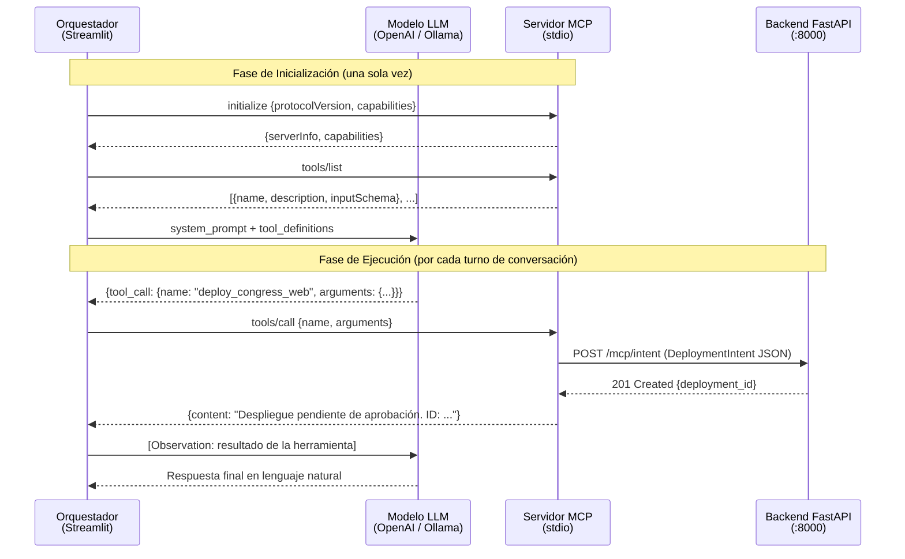
<p align="center"><i><b>Figura 14:</b> Ciclo de vida completo de un mensaje MCP. El protocolo JSON-RPC define tres fases: inicialización (handshake y descubrimiento de herramientas), ejecución (invocación y respuesta) y observación (retroalimentación al LLM).</i></p>

#### 6.1.2.1. Desglose del Flujo de Mensajería JSON-RPC

La interacción modelada en la Figura 14 se estructura en dos fases operativas diferenciadas:

1. **Fase de Inicialización y Negociación de Capacidades (única por sesión):**
   - El `AgentOrchestrator` remite un mensaje `initialize` al servidor MCP mediante JSON-RPC, declarando la versión del protocolo y sus capacidades soportadas.
   - El servidor MCP responde con sus metadatos y confirma la compatibilidad de la conexión.
   - A continuación, el orquestador solicita el catálogo de operaciones disponibles mediante `tools/list`. El servidor devuelve una lista estructurada con los nombres de las funciones, descripciones textuales y esquemas JSON estrictos de los parámetros esperados (`inputSchema`).
   - El orquestador inyecta estas definiciones estructuradas junto al *System Prompt* en la ventana de contexto del modelo LLM (Ollama o Cloud).

2. **Fase de Ejecución y Observación (iterativa por turno de diálogo):**
   - Cuando el modelo deduce la necesidad de invocar una acción de infraestructura, emite un objeto `tool_call` estructurado (por ejemplo, `deploy_congress_web` con sus argumentos correspondientes).
   - El orquestador intercepta dicha intención y despacha un mensaje `tools/call` al servidor MCP a través de los canales estándar `stdio`.
   - El servidor MCP transforma los argumentos recibidos en una llamada HTTP REST tipada (`POST /mcp/intent`) hacia el backend FastAPI en el puerto `:8000`.
   - Tras superar la validación determinista del dominio, el backend registra la solicitud en estado `PENDING_APPROVAL` y responde con un código `HTTP 201 Created` y el identificador unívoco asignado (`deployment_id`).
   - El servidor MCP encapsula esta respuesta en un objeto de observación y la retorna al orquestador, el cual la reinyecta en el contexto del LLM para que este elabore la respuesta final explicativa en lenguaje natural orientada al usuario.

> **Nota de implementación (distinción entre modos de transporte MCP):** Conviene enfatizar la distinción operativa entre los dos modos de transporte soportados por la arquitectura del servidor MCP:
> 1. **Modo Integrado *In-Memory* (utilizado en el MVP con Streamlit):** Las definiciones de herramientas y sus despachadores se importan directamente en el mismo espacio de memoria del intérprete Python (`TOOL_REGISTRY`, `TOOL_DEFINITIONS`). La ejecución de la herramienta es una llamada nativa a función Python en memoria (`in-process`), lo que elimina por completo cualquier serialización JSON-RPC o *pipe* IPC, reduciendo el retardo a una escala de microsegundos. Este enfoque se adoptó para simplificar la orquestación del MVP y evitar la gestión de subprocesos concurrentes en el contenedor de Streamlit.
> 2. **Modo Externo Canónico vía `stdio`:** Cuando el agente y el servidor MCP se ejecutan como procesos separados del sistema operativo (por ejemplo, al conectar el servidor con clientes de escritorio como Claude Desktop o scripts externos), la comunicación discurre a través de los canales estándar de entrada y salida (`stdin`/`stdout`) empleando tramas JSON-RPC estructuradas. En este modo externo, el coste de serialización y lectura por *pipes* del kernel se sitúa típicamente en latencias sub-milisegundo (<1 ms), lo que preserva una velocidad órdenes de magnitud superior a la de transportes de red (HTTP/SSE) y dota al sistema de un aislamiento riguroso de memoria entre procesos.
>
> Ambas modalidades son funcionalmente equivalentes e intercambiables gracias al desacoplamiento del `AgentOrchestrator`, que consume el contrato de herramientas con total independencia del mecanismo de transporte subyacente.

## 6.2. Diseño de la Abstracción Multiproveedor y Soberanía del Dato

La vertiginosa evolución de la Inteligencia Artificial Generativa ha consolidado un mercado oligopólico liderado por grandes corporaciones tecnológicas proveedoras de inferencia en la nube (*AI-as-a-Service*). En el desarrollo de sistemas de software empresarial, acoplar el código fuente (el *Core Business*) a los kits de desarrollo de software (SDK) específicos de OpenAI, Anthropic o Google supone un riesgo inasumible de obsolescencia tecnológica y pérdida de poder de negociación.

Para garantizar la viabilidad a largo plazo del *Agentic Deployer*, el diseño del orquestador cognitivo abraza el principio de agnósticismo absoluto frente al proveedor algorítmico. Esta sección desgrana la fundamentación técnica que permite al sistema conmutar dinámicamente entre motores de inferencia dispares sin requerir recompilación, así como la implicación de este diseño en las políticas de confidencialidad de la información.

### 6.2.1. El Contrato Abstracto (Patrones *Adapter* y *Factory*)

El aislamiento del proveedor se consigue orquestando una arquitectura basada en la conjunción de dos patrones de diseño clásicos de la banda de los cuatro (GoF) [30]: el patrón **Adapter** y el patrón **Factory Method**.

En la capa de aplicación, el `AgentOrchestrator` jamás invoca directamente a ninguna librería de IA. Su comunicación se dirige exclusivamente hacia una Interfaz de Clase Base Abstracta (ABC en Python) denominada `LLMClient`. Esta interfaz establece el contrato formal de inferencia:

```text
CONTRATO ABSTRACTO: Interfaz Cliente LLM (LLMClient)

ESTADO INTERNO:
 - historial_conversacion -> Lista estructurada de mensajes (Rol, Contenido)
 - sistema_base -> Prompt base del sistema (directrices operativas y reglas del Agente)

MÉTODO chat(messages, tools):
  ENTRADA: messages -> historial; tools -> JSON Schemas del servidor MCP
  SALIDA_ESPERADA:
   - Objeto tipo AgentResponse (texto plano)
   - Objeto tipo ToolCall (id, nombre_función, argumentos_json)
```

El sistema implementa tres adaptadores principales que satisfacen este contrato:

**`OpenAILLMClient`** — Formatea el historial bajo la especificación REST de OpenAI (`messages`, `tools`, `tool_choice`), negocia el *handshake* TLS hacia la API en la nube (o endpoints compatibles) y deserializa la respuesta JSON.

**`OllamaLLMClient`** — Implementado de forma nativa sobre el cliente oficial de Ollama con soporte de transporte HTTP asíncrono [31] (`ollama.Client`), conectándose a la instancia local (`http://localhost:11434`). Garantiza que **ni un solo token de inferencia abandona la red privada institucional**:

```text
PSEUDOCÓDIGO: Implementación del Cliente Local Ollama

CLASE OllamaLLMClient IMPLEMENTA LLMClient:
  ATRIBUTOS:
    modelo: Cadena (ej. "qwen2.5-coder:7b")
    servidor_host: Cadena (ej. "http://localhost:11434")
    cliente_ollama: ClienteSDK(host=servidor_host)

  MÉTODO chat(mensajes, herramientas):
    Variable parametros = NUEVO Diccionario(
      "model" -> modelo,
      "messages" -> mensajes
    )
    SI herramientas EXISTE ENTONCES
      parametros["tools"] = herramientas
    FIN SI

    // Inferencia local síncrona mediante el SDK de Ollama
    Variable respuesta = cliente_ollama.chat(parametros)
    Variable mensaje = respuesta.message

    SI mensaje.tool_calls EXISTE ENTONCES
      Variable llamadas_herramienta = ListaVacia()
      PARA CADA llamada EN mensaje.tool_calls HACER
        llamadas_herramienta.Agregar(
          NUEVO ToolCall(llamada.function.name, llamada.function.arguments)
        )
      FIN PARA
      RETORNAR NUEVO AgentResponse(content=mensaje.content, tool_calls=llamadas_herramienta)
    FIN SI

    RETORNAR NUEVO AgentResponse(content=mensaje.content)
FIN CLASE
```

**`FakeLLMClient`** — Implementación determinista basada en reglas y expresiones regulares utilizada para pruebas unitarias, benchmarks sin consumo de GPU y demostraciones portables.

La instanciación en memoria recae sobre un patrón **Factory**. Durante la fase de inicialización (*bootstrapping*) del contenedor web, el sistema lee la variable de entorno `LLM_PROVIDER`. La clase Factory evalúa esta variable e inyecta la implementación correcta en el Orquestador mediante *Dependency Injection*:

```text
PSEUDOCÓDIGO: Inyección de Dependencias del Motor Cognitivo (Factory)

ENTRADA: proveedor -> Cadena desde variable de entorno (LLM_PROVIDER)
SALIDA: motor_llm -> Instancia de motor cognitivo (compatible con LLMClient)

INICIO
  SI proveedor ES "ollama" ENTONCES
    RETORNAR NUEVO OllamaLLMClient(modelo="qwen2.5-coder:7b")
  SINO SI proveedor ES "openai" ENTONCES
    RETORNAR NUEVO OpenAILLMClient(modelo="gpt-4o-mini")
  SINO
    RETORNAR NUEVO SICFakeLLMClient() // Entorno de pruebas determinista
  FIN SI
FIN
```

Esta Inyección de Dependencias permite **permutar el motor cognitivo con un simple reinicio del proceso y cambio de variable de entorno**, sin modificar una sola línea de la lógica de negocio ni del servidor MCP.


### 6.2.2. Justificación de la Elección del Modelo Local (Qwen 2.5 Coder)

El ecosistema *open-source* actual ofrece múltiples modelos de lenguaje capaces de ejecutarse en hardware local con recursos restringidos (ej. 6 GB VRAM). Para este entorno de pruebas, se optó finalmente por desplegar la variante especializada **Qwen 2.5 Coder (7B)** de Alibaba Cloud, descartando a sus homólogos generalistas como Llama 3.2, Mistral, o el propio Qwen 2.5 base.

Esta elección responde a la necesidad de garantizar una alta eficacia en la invocación de herramientas (*Tool Calling*). La variante Coder incorpora un ajuste fino (*fine-tuning*) exhaustivo sobre corpus de código fuente, lo que le confiere una robustez superior en la generación y manipulación de estructuras JSON complejas frente a modelos puramente conversacionales. Durante la experimentación, mientras que modelos generalistas como *Llama 3.2* o *Mistral* generaron con frecuencia JSON inválido o ignoraron el esquema de herramientas al procesar entradas ruidosas, **Qwen 2.5 Coder (7B)** demostró ser la única solución local de su categoría capaz de superar íntegramente la batería de Pruebas Metamórficas, exhibiendo la mayor estabilidad estructural frente a la entropía lingüística y posibilitando la correcta orquestación del bucle ReAct (véase el análisis empírico en el Capítulo 9).

### 6.2.3. Soberanía del Dato en Entornos Institucionales

La abstracción multiproveedor, más allá de ser una práctica higiénica de Ingeniería del Software, responde a un requerimiento de ciberseguridad crítico en el contexto de las administraciones públicas y el sector académico: la **Soberanía del Dato** y el cumplimiento normativo (RGPD/GDPR).

El *Agentic Deployer* maneja, por su propia naturaleza operativa, información extremadamente sensible. Durante la negociación lingüística (fase heurística del bucle de ReAct), un investigador distraído podría deslizar inadvertidamente tokens de acceso a bases de datos, contraseñas de red corporativas (secretos) o direcciones IP reservadas que revelan la topología interna del Servicio de Informática. Enviar estas trazas en texto plano hacia servidores ubicados fuera de las fronteras europeas (como es el caso de los clústeres por defecto de algunas empresas americanas) constituye una vulneración de las políticas de retención de datos.

El diseño agnóstico permite adaptar la configuración según el nivel de sensibilidad de los datos manejados:
- **Datos no sensibles:** Para entornos de investigación pública (despliegue de servidores web estáticos o *sandboxes* de prueba), el sistema puede apuntar mediante el *Factory* a la API de OpenAI, aprovechando la baja latencia de la nube.
- **Datos confidenciales (entorno aislado):** Cuando la provisión involucra servicios con datos sensibles (como bases de datos sanitarias o expedientes de alumnado), el equipo de Operaciones reconfigura la variable de entorno `LLM_PROVIDER` para inyectar el adaptador de Ollama [26].

  Bajo esta configuración, la inferencia se ejecuta en servidores con aceleración GPU (Nvidia/AMD) alojados en el propio Centro de Procesamiento de Datos (CPD) institucional, de modo que ningún dato abandona la intranet universitaria.

Esta capacidad de conmutar entre inferencia en la nube e inferencia local, implementada mediante el patrón *Adapter* y la inyección de dependencias, permite al prototipo adaptarse a distintos requisitos de privacidad y auditoría sin modificar la lógica de negocio.

## 6.3. Bucle Cognitivo y Resiliencia Estocástica (Patrón ReAct)

La mera exposición de un catálogo de herramientas a un Modelo de Lenguaje no garantiza la ejecución autónoma de una tarea compleja. Cuando a un modelo de lenguaje se le instruye para que actúe en un entorno dinámico (como un clúster de Kubernetes, cuyo estado puede mutar durante la propia inferencia), los enfoques directos de Petición-Respuesta (*Zero-Shot Prompting*) resultan insuficientes. Si el modelo asume un contexto inicial falso o comete un error sintáctico en su primer intento, carece de mecanismos intrínsecos para rectificar, desembocando en estados de fallo no recuperables.

Para superar estas limitaciones, el orquestador implementa el patrón **ReAct (Reasoning and Acting)** [9], que articula la descomposición del razonamiento discursivo con la invocación secuencial de herramientas.

### 6.3.1. Arquitectura del Bucle Acotado de Razonamiento y Acción

El patrón ReAct modifica la estructura de la interacción. En lugar de procesar la petición del usuario y devolver una única respuesta estática, el agente ejecuta una máquina de estados iterativa con un **bucle acotado** (`MIENTRAS turno_actual < MAX_TURNOS`). Esta cota máxima de turnos cognitivos evita bucles indefinidos ante respuestas inesperadas del modelo. Cada iteración de este bucle transita secuencialmente por cuatro etapas:

1. **Pensamiento (*Thought*):** El modelo deduce lógicamente el siguiente paso basándose en el historial. Esta externalización del monólogo interno (derivada de las técnicas *Chain-of-Thought*) reduce sustancialmente la tasa de alucinaciones.
2. **Acción (*Action*):** El modelo invoca una función específica del catálogo MCP, inyectándole los argumentos sintácticos deducidos (ej. `deploy_intent(name="api", port=80)`).
3. **Pausa (*Yield*):** El orquestador pausa la inferencia algorítmica, toma el control del hilo de ejecución, cruza la barrera de red hacia el servidor backend, ejecuta la acción física y espera el resultado.
4. **Observación (*Observation*):** El sistema inyecta el resultado físico (ya sea un éxito o una excepción de error del sistema operativo) de vuelta en la ventana de contexto del LLM.

El modelo reevalúa el estado global tras la observación y decide si necesita ejecutar una nueva acción o si la tarea ha concluido. Cuando dictamina que el objetivo se ha cumplido, transiciona a la fase final (*Final Answer*), devolviendo el control al usuario humano.

Como se ilustra en la **Figura 15**, este proceso rompe con el paradigma de petición-respuesta estático, instaurando un flujo de retroalimentación dinámica.

<div style="max-width: 10cm; margin: 0 auto;">

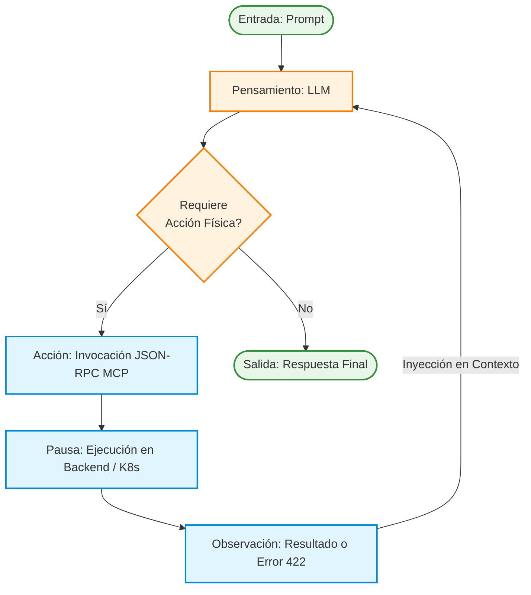

</div>
<p align="center"><i><b>Figura 15:</b> Diagrama de flujo del bucle cognitivo ReAct (Reasoning and Acting).</i></p>

Para ilustrar el funcionamiento de este motor de orquestación, se formaliza a continuación su arquitectura mediante pseudocódigo:

```text
01 ENTRADA: 
02  peticion_usuario -> Cadena de texto natural
03  contexto_historico -> Memoria de la sesión actual
04 
05 SALIDA: 
06  respuesta_final -> Cadena de texto natural o Markdown
07 
08 INICIO
09   AÑADIR peticion_usuario A contexto_historico
10   Variable turno_actual = 0
11   Variable MAX_TURNOS = 5 // Prevención de bucles infinitos (Infinite Loop)
12 
13   MIENTRAS turno_actual < MAX_TURNOS HACER
14     // 1. Inferencia del LLM (Thought + Action)
15     Variable respuesta_llm = InvocacionRed(contexto_historico, herramientas_mcp)
16     
17     SI respuesta_llm ES texto_plano ENTONCES
18       // El Agente decide que ha terminado y se dirige al humano
19       RETORNAR respuesta_llm
20     FIN SI
21 
22     SI respuesta_llm ES invocacion_herramienta ENTONCES
23       Variable nombre_funcion = respuesta_llm.obtenerNombre()
24       Variable argumentos = respuesta_llm.obtenerArgumentos()
25       Variable resultado_accion
26       
27       INTENTAR
28         // 2 y 3. Ejecución y Pausa
29         resultado_accion = EjecutarProcesoLocal(nombre_funcion, argumentos)
30       CAPTURAR ExcepcionHttp COMO error
31         // Serialización del error para su interpretación por el LLM
32         resultado_accion = error.obtenerMensajeHumano() 
33       FIN INTENTAR
34 
35       // 4. Observación
36       AÑADIR "Herramienta retornó: " + resultado_accion A contexto_historico
37     FIN SI
38     
39     turno_actual = turno_actual + 1
40   FIN MIENTRAS
41   
42   LANZAR Excepcion("Límite de razonamiento excedido. El Agente está atascado.")
43 FIN
```
<p align="center"><i><b>Algoritmo 3:</b> Bucle de Orquestación Cognitiva (ReAct Loop).</i></p>

La inclusión explícita de la constante `MAX_TURNOS` es un mecanismo de salvaguarda (*Fail-Safe*) crítico en sistemas autónomos, garantizando que un LLM confundido no agote las cuotas de facturación de la API externa (consumo masivo de tokens) iterando indefinidamente sobre un fallo irresoluble.

### 6.3.2. *Feedback Loop* de Seguridad y Autocorrección

La principal ventaja operativa del bucle ReAct reside en la rama `CAPTURAR ExcepcionHttp` (línea 25 del Algoritmo 3). En la topología descrita en el Capítulo 5, el núcleo Hexagonal (Backend) protege la infraestructura emitiendo respuestas de error deterministas (ej. un código HTTP `422 Unprocessable Entity`) cuando el agente intenta vulnerar políticas (como abrir el puerto 22).

En sistemas convencionales, esta excepción HTTP provocaría la terminación abrupta de la sesión, obligando al usuario a reiniciar el flujo. Sin embargo, el *Agentic Deployer* instaura un mecanismo de resiliencia cognitiva denominado **Feedback Loop**. 

Cuando el Servidor MCP intercepta el error `422`, no detiene el orquestador. Por el contrario, inyecta la traza de la excepción directamente como una **Observación** en el contexto de trabajo del LLM.
Este flujo produce un comportamiento autorregulado:
1. El Agente lee que su *Action* previa fue rechazada por vulneración de la política de puertos.
2. Su capa de inferencia razona (*Thought*) que el puerto 22 está restringido por la normativa institucional.
3. De forma autónoma, el Agente no propaga la excepción como un fallo irresoluble al usuario; en su lugar, ejecuta una nueva *Action* recalculando un puerto lícito (ej. el puerto 8000), o bien genera una *Final Answer* notificando con precisión técnica al usuario sobre el rechazo y solicitando instrucciones alternativas.

Este ciclo de retroalimentación aporta resiliencia frente a errores sintácticos o de validación de parámetros, trasladando la necesidad de corrección hacia el propio modelo de lenguaje antes de requerir intervención directa del usuario. De este modo, la arquitectura hexagonal actúa como marco determinista de validación, mientras que el bucle ReAct permite al agente ajustar los parámetros hasta satisfacer las restricciones del *Golden Path* correspondiente.


<div style='page-break-after: always;'></div>

# Capítulo 7. Implementación del Patrón HITL y Gestión de Estados Finita (FSM)

El diseño del agente cognitivo abordado en los capítulos anteriores dota al sistema de una gran capacidad de extracción semántica y de razonamiento sobre herramientas. Sin embargo, la delegación completa de las decisiones de despliegue a un modelo probabilístico en infraestructuras críticas no es un hito de ingeniería deseable, sino un vector de vulnerabilidad. La orquestación de clústeres de contenedores en entornos productivos exige un grado de gobierno, responsabilidad legal y conocimiento del contexto operativo que escapa a las capacidades de un Modelo de Lenguaje.

Este capítulo detalla la solución arquitectónica implementada para gobernar a la Inteligencia Artificial: el patrón *Human-In-The-Loop* (HITL). Se fundamentará teóricamente la necesidad de interponer una fase de autorización humana y se explicará, a nivel de diseño de software, cómo esta separación de responsabilidades se garantiza tecnológicamente mediante una Máquina de Estados Finita (FSM) inmutable y un *Dashboard* asíncrono para el equipo de operaciones.

## 7.1. Fundamentación del Patrón *Human-In-The-Loop* (HITL)

En el ámbito de la automatización de TI, la taxonomía de la autonomía se divide comúnmente en cinco niveles (inspirados libremente en los niveles de conducción autónoma de la SAE). El Nivel 0 corresponde a la ejecución manual de *scripts* Bash, mientras que el Nivel 5 (Autonomía Completa) implica un sistema de Inteligencia Artificial que monitoriza, toma decisiones y ejecuta mutaciones de red en la infraestructura productiva sin ningún tipo de supervisión humana.

La tendencia del mercado tecnológico presiona hacia la consecución del Nivel 5. Sin embargo, este Trabajo de Fin de Máster defiende la tesis de que, en la gestión del *Platform Engineering* corporativo, el enfoque adecuado no es la autonomía desatendida, sino una automatización de Nivel 4 supervisada mediante el patrón **Human-In-The-Loop (HITL)**.

### 7.1.1. Los Riesgos de la Autonomía Total (Nivel 5)

Otorgar credenciales de escritura directas (ej. un token con permisos de *ClusterAdmin* en Kubernetes) a un sistema basado en redes neuronales probabilísticas introduce riesgos operativos que ninguna prueba unitaria puede mitigar. Los factores de riesgo sistémico más severos son:

1. **La Alucinación Topológica:** Los LLM, por su diseño de predicción probabilística de tokens, carecen de verificación fáctica intrínseca sobre el estado del clúster. Si el orquestador genera una alucinación y determina erróneamente que la resolución de una incidencia de red requiere eliminar y recrear un `Deployment` crítico en producción, un nivel de autonomía no supervisado ejecutaría la acción sin validación previa.
2. **Elasticidad Financiera Descontrolada:** En infraestructuras desplegadas en nubes públicas (AWS, Google Cloud, Azure), los recursos computacionales se facturan bajo esquemas de pago por consumo. Un agente operando sin supervisión que entre en un bucle anómalo de invocaciones podría auto-aprovisionar recursos de cómputo sobredimensionados, incurriendo en un sobrecoste económico significativo para el presupuesto institucional.
3. **Inadecuación de Ventanas de Mantenimiento:** Los modelos probabilísticos carecen de contexto operativo respecto a las ventanas de congelación de cambios (*change freeze*) institucionales. Un agente no supervisado podría emitir modificaciones de infraestructura durante periodos de máxima concurrencia del servicio. La supervisión por parte del equipo técnico garantiza que la ejecución efectiva se restrinja a los intervalos de mantenimiento autorizados.

### 7.1.2. Responsabilidad Legal, ITIL y la Distribución de Responsabilidades

Más allá de la viabilidad técnica, la adopción del patrón HITL es una exigencia legal y normativa. Los marcos de buenas prácticas de la industria, como **ITIL 4** (*Information Technology Infrastructure Library*) en su práctica de "Release Management" [32], así como los estándares ISO/IEC 27000 sobre ciberseguridad, exigen explícitamente el principio de trazabilidad y gobernanza de las acciones de red.

Desde una perspectiva jurídica, un modelo de lenguaje carece de responsabilidad jurídica. Si el *Agentic Deployer* instanciara una configuración errónea que expusiera públicamente datos sensibles (provocando una vulneración del RGPD), la responsabilidad recaería legalmente sobre la institución y sus operadores, con independencia de que la especificación inicial hubiese sido deducida por el modelo.

Para solventar esta carga legal, el sistema distribuye las responsabilidades entre los tres actores del sistema, donde cada uno asume el rol para el que está optimizado:

1. **El Investigador (el «qué»):** Aporta el conocimiento del dominio funcional («Necesito un WordPress para el departamento de historia con una base de datos de 10 Gigabytes»).
2. **La IA y el Servidor MCP (el «cómo»):** Aportan la traducción a la sintaxis declarativa, estructurando el lenguaje natural en entidades tipadas de la Arquitectura Hexagonal.
3. **El Técnico del SIC (el «cuándo» y el «sí»):** Aporta la validación institucional y la supervisión de los recursos («La petición es sintácticamente correcta, pero la disponibilidad de almacenamiento requiere programar el despliegue en una ventana de mantenimiento específica»).

Bajo este modelo, el modelo de lenguaje actúa como un asistente que reduce el tiempo de especificación técnica y validación de sintaxis YAML, delegando la autorización final en una confirmación visual por parte del técnico de operaciones.

## 7.2. Diseño de la Máquina de Estados Finita (FSM)

Para materializar el control del flujo operativo detallado en la sección anterior, el Backend Hexagonal no puede depender de variables booleanas simples (ej. `es_valido = True`). En entornos concurrentes donde múltiples operarios auditan la misma cola de despliegues, el estado de una petición de infraestructura debe gobernarse mediante una **Máquina de Estados Finita** (FSM, por sus siglas en inglés, *Finite-State Machine*).

Una FSM, fundamentada en la teoría de autómatas, es un modelo computacional matemático. Establece que una entidad solo puede existir en un estado mutuamente excluyente en un momento temporal *T*, y que los cambios entre estos estados (Transiciones) obedecen a un conjunto finito y predefinido de reglas direccionales.

### 7.2.1. Modelado del Grafo de Transición de Estados

En la arquitectura del *Agentic Deployer*, el ciclo de vida de una `DeploymentIntent` (la intención generada por la IA) se modela formalmente como un **grafo de transición de estados dirigido y acíclico**. El carácter "acíclico" es una condición *sine qua non* de la seguridad del sistema: por definición formal del autómata, es imposible que el estado de una petición fluya hacia atrás en el tiempo. Una vez que una orden es procesada físicamente por el clúster de Kubernetes, el registro no puede revertir a su estado de pendencia.

Los vértices de este grafo (Estados) y sus aristas dirigidas (Transiciones Autorizadas) se definen mediante **seis nodos** mutuamente excluyentes:

- **Nodo Raíz (`PENDING_APPROVAL`):** Es el punto de inyección inicial. Cuando el agente de IA formula una petición válida y el `SecurityContextValidator` (Capítulo 5) la admite en el servidor, esta ingresa obligatoriamente en este nodo de cuarentena. Ningún proceso de despliegue físico se activa desde este estado.
- **Nodo de Sumidero A (`REJECTED`):** Estado terminal e inmutable. Si el Técnico del SIC presiona el botón de denegación en el *Dashboard*, la petición transiciona aquí. Permanece en la base de datos de manera indefinida con propósitos de auditoría legal (Log de Intentos Denegados), pero es ignorada por el *garbage collector* y los adaptadores de infraestructura.
- **Nodo de Tránsito (`APPROVED`):** Estado intermedio y transitorio. Cuando el operador humano autoriza la operación, la petición ingresa a este nodo durante un breve intervalo. Actúa como el desencadenante (*Trigger*) para invocar al adaptador de infraestructura secundario (`FakeK8sAdapter` o `RealK8sAdapter`).
- **Nodo de Sumidero B (`DEPLOYED`):** Estado terminal final. Solo se alcanza si, y solo si, la intención superó el nodo `APPROVED` y la API de Kubernetes confirma que los manifiestos YAML han sido guardados sin errores de persistencia en disco.
- **Nodo de Sumidero C (`FAILED`):** Estado terminal excepcional. Alcanzado si la transición desde `APPROVED` fracasa por un error de entrada/salida en disco o una excepción de red del adaptador de infraestructura. El registro permanece en la base de datos para diagnóstico post-mortem.
- **Nodo de Sumidero D (`DELETED`):** Estado terminal de baja administrativa. Representa la eliminación lógica de un servicio previamente desplegado, invocada por la herramienta MCP `delete_university_service`. El registro no se destruye físicamente, preservando la trazabilidad de auditoría.

La transición desde el estado inicial a los estados de ejecución requiere la autorización explícita del técnico de operaciones a través del *Dashboard*. Este flujo unidireccional y acíclico se representa visualmente en la **Figura 16**.

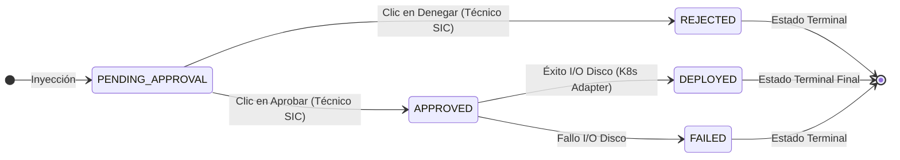
<p align="center"><i><b>Figura 16:</b> Grafo de transición de estados que rige la Máquina de Estados Finita (FSM) del sistema.</i></p>

### 7.2.2. Prevención de Concurrencia y *Race Conditions*

La implementación de este FSM mediante Python y el *framework* asíncrono FastAPI presenta un desafío clásico de Sistemas Operativos Distribuidos: la prevención de Condiciones de Carrera (*Race Conditions*).

Considérese un escenario concurrente: una petición se encuentra en estado `PENDING_APPROVAL`. Por un problema de latencia o retransmisión en la red, el operador efectúa múltiples pulsaciones consecutivas sobre el botón de acción en su interfaz, o bien dos operarios que visualicen simultáneamente el panel interactúan sobre los botones de «Aprobar» y «Rechazar» de forma casi simultánea.

Sin una salvaguarda arquitectónica, estas peticiones paralelas generarían una condición de carrera (*race condition*) en la base de datos del servidor, provocando una inconsistencia transaccional donde el sistema intentaría desplegar y denegar el mismo registro simultáneamente, lo que comprometería la integridad del estado del clúster de Kubernetes.

Para mitigar este riesgo, la transición entre vértices del DAG se protege mediante algoritmos de comprobación de precondiciones (*Test-and-Set* lógicos) que siguen el patrón conceptual del **Optimistic Locking** (Bloqueo Optimista). Es importante matizar que esta implementación constituye un *check-then-act* lógico secuencial: el algoritmo lee el estado actual del registro y verifica que sea `PENDING_APPROVAL` antes de proceder a la mutación, sin emplear mecanismos de bloqueo real a nivel de base de datos (como un `SELECT FOR UPDATE`). En el contexto del MVP (operando sobre un único proceso Uvicorn, como se documenta en la limitación 10.2.5), este enfoque es suficientemente seguro para garantizar la integridad transaccional. En una evolución multi-proceso (Gunicorn con N workers), sería necesario escalar hacia un bloqueo pesimista real en la capa de persistencia para eliminar cualquier ventana de *race condition* residual. A continuación se expone la fundamentación algorítmica de esta defensa en el núcleo Hexagonal:

```text
01 ENTRADA:
02  id_peticion -> UUID del registro a transicionar
03  nuevo_estado -> El estado de destino (APPROVED o REJECTED) solicitado por el Humano
04 
05 SALIDA:
06  Registro_Actualizado (Si la transición es lícita)
07  LANZA HttpConflictError (409) si hay violación de estado
08 
09 INICIO
10   // 1. Adquisición y comprobación (Atomicidad)
11   Variable registro = ObtenerRegistroBaseDeDatos(id_peticion)
12   
13   SI registro ES NULO ENTONCES
14     LANZAR HttpNotFoundError(404)
15   FIN SI
16 
17   // 2. Control Invariante del DAG: Solo se muta desde PENDING_APPROVAL
18   SI registro.estado NO ES IGUAL A "PENDING_APPROVAL" ENTONCES
19     LANZAR HttpConflictError(
20       409, 
21       "Conflicto de Mutación. El registro ya había sido procesado previamente " +
22       "(Estado Actual: " + registro.estado + ")."
23     )
24   FIN SI
25   
26   // 3. Mutación del Estado mediante el Repositorio (Bloqueo Atómico)
27   registro.estado = nuevo_estado
28   registro.fecha_modificacion = ObtenerTiempoSistemaActual()
29   
30   // 4. Activación de Adaptadores Secundarios (Side-Effects)
31   SI nuevo_estado ES IGUAL A "APPROVED" ENTONCES
32     INTENTAR
33       K8sAdapter.ejecutar_despliegue(registro.intencion)
34       registro.estado = "DEPLOYED" // Segunda transición
35     CAPTURAR ExcepcionIO COMO error
36       registro.estado = "FAILED"
37     FIN INTENTAR
38   FIN SI
39   
40   RETORNAR registro
41 FIN
```
<p align="center"><i><b>Algoritmo 4:</b> Transición Inmutable de la Máquina de Estados (FSM_Transition).</i></p>

Gracias a este algoritmo determinista, si ocurre una pulsación doble, el primer *thread* (hilo de ejecución HTTP) cruzará el bloque de la Línea 18 y mutará la base de datos a `REJECTED`. El segundo *thread*, desfasado por milisegundos, evaluará la condición invariante de la Línea 18, detectará que el estado ya no es `PENDING_APPROVAL`, y abortará la transacción devolviendo inmediatamente un error `409 Conflict` a la capa frontal. 

Esta verificación asegura consistencia transaccional [33] en la gestión de estados, aislando la lógica de despliegue frente a condiciones de carrera o accesos concurrentes.

## 7.3. El Dashboard Asíncrono de Operaciones

La implementación efectiva del patrón *Human-In-The-Loop* requiere una separación de interfaces según el rol de usuario. El Investigador interactúa mediante una interfaz conversacional tolerante a la ambigüedad (Streamlit). Por el contrario, el Técnico de Operaciones (SIC) no interactúa mediante diálogo con el modelo, sino a través de un panel de control estructurado, determinista y de baja latencia.

Para satisfacer esta dicotomía, se ha diseñado un segundo portal de acceso independiente del orquestador de IA: el **Dashboard de Operaciones** (`dash.html`), concebido arquitectónicamente como una *Single-Page Application* (SPA) ligera, servida directamente por el Backend Hexagonal de FastAPI.

### 7.3.1. Estrategia de Sincronización: *Polling* Ligero vs. *WebSockets*

El reto técnico subyacente en el diseño del *Dashboard* es la sincronización del estado. Las peticiones de despliegue generadas por la IA no obedecen a un patrón predecible; ingresan en el sistema en ráfagas asíncronas, dependiendo del horario de investigación de la comunidad universitaria.

En arquitecturas web modernas fuertemente acopladas al tiempo real (como aplicaciones de *Trading* o videojuegos), el estado del servidor suele transmitirse al cliente mediante conexiones bidireccionales persistentes (Protocolo *WebSocket*, ws://). Sin embargo, mantener cientos de hilos *WebSocket* abiertos de manera perpetua entre el *Dashboard* y el clúster perfila un sobrecoste de memoria y gestión de concurrencia injustificado para un sistema de auditoría asíncrona, en el cual un retraso de 3 segundos en la visualización no reviste criticidad operacional.

Consecuentemente, el TFM implementa una estrategia de **Polling Activo Ligero**. El *Dashboard* ejecuta bucles temporizados desde el navegador del técnico utilizando llamadas `fetch` nativas de JavaScript:

1. **Interrogación Constante:** El cliente invoca el endpoint `GET /hitl/pending` a intervalos regulares (ej. cada 5.000 milisegundos).
2. **Procesamiento Eficiente y Transaccional:** El *Backend* delega la lectura de las intenciones pendientes en el repositorio local (SQLite). Mediante consultas estructuradas, este enfoque garantiza persistencia ACID y consistencia frente a reinicios inesperados, manteniendo el *overhead* al mínimo en el contexto del prototipo.
3. **Inyección Dinámica:** El cliente recibe el *payload* JSON y reconstruye dinámicamente el Document Object Model (DOM), renderizando tarjetas visuales (*Cards*) para cada petición entrante.

Esta arquitectura desacoplada (*Stateless* en la capa de transporte) favorece la resiliencia del sistema. Si el portátil del Técnico de Operaciones pierde conectividad Wi-Fi, el estado del *Backend* permanece intacto; al recuperar la conexión, el siguiente ciclo de *polling* rehidratará el *Dashboard* con las peticiones acumuladas durante la ventana de desconexión.

### 7.3.2. Ejecución Diferida y Generación de Manifiestos Declarativos

El *Dashboard* presenta al técnico los parámetros asociados a la intención de despliegue extraída por el agente: identificador único, imagen de contenedor, puerto de red y asignación de recursos de CPU y memoria.

A partir de esta información, el técnico puede ejecutar dos acciones:
- **Rechazar:** Envía una petición `POST /hitl/reject/{id}`, registrando el estado `REJECTED` en la máquina de estados (sección 6.2). La solicitud queda registrada en el repositorio para trazabilidad y auditoría, sin generar manifiestos en el sistema.
- **Aprobar:** Envía una petición `POST /hitl/approve/{id}`. Al recibir la confirmación, el backend recupera la entidad `DeploymentIntent` y la transfiere al adaptador de despliegue (`DeployPort`).

En el adaptador, los parámetros validados se interpolan sobre plantillas predefinidas (*Golden Paths*) mediante la utilidad `textwrap.dedent`, generando la especificación declarativa en formato YAML. En la implementación de prueba actual, el manifiesto resultante se escribe en disco en la ruta local configurada (`{name}.yaml`), emulando el punto de entrega que en un entorno productivo sería remitido a la API de Kubernetes o a un repositorio GitOps gestionado por herramientas como ArgoCD (véase sección 10.3.2).

En la **Figura 17** se ilustra la interfaz gráfica del Dashboard de Operaciones servida por el backend en `/frontend/index.html`. En la cabecera superior se expone la barra de métricas en tiempo real (`Pendientes: 1`, `Aprobados hoy: 4`, `Rechazados hoy: 1`) y el indicador de conexión con el backend (`● Online`). En la tabla central se muestra el registro en cuarentena correspondiente a la solicitud `dep-7f3a2c1b` generada por el agente para el servicio `congreso-ia-departamento`, con la acción tipada (`Crear`), la imagen (`nginx:alpine`), el puerto asignado (`8080`) y los límites de computación (`500m / 256Mi`). El técnico dispone de los controles visuales «Aprobar» y «Rechazar» para gobernar de forma determinista la transición atómica de la FSM.

<div align="center">
  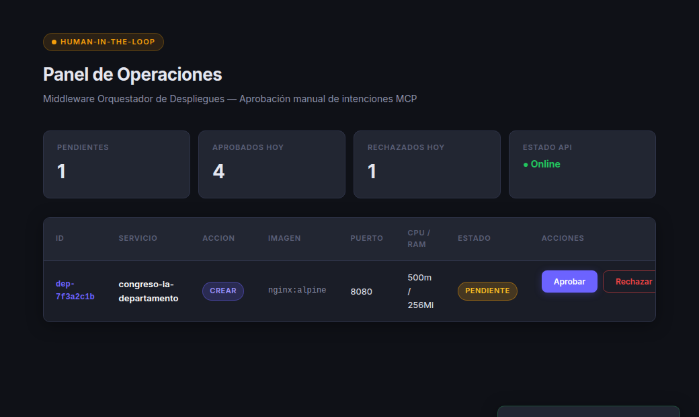
</div>
<p align="center"><i><b>Figura 17:</b> Captura de pantalla del Dashboard de Operaciones HITL (<code>app/frontend/index.html</code>) mostrando una petición pendiente de aprobación (<code>dep-7f3a2c1b</code>) y las métricas operativas consolidadas.</i></p>

### 7.3.3. Diagrama de Secuencia del Flujo HITL

La **Figura 18** complementa el diagrama E2E global (Figuras 11, 12 y 13, Sección 5.6) con un foco específico en la interacción entre el Técnico SIC y el Backend durante la fase de decisión. Se ilustran explícitamente los dos vectores de mutación posibles (aprobación y rechazo) y las transiciones de estado intermedias de la FSM, incluyendo la materialización del YAML por `FakeK8sAdapter` únicamente en el camino de aprobación.

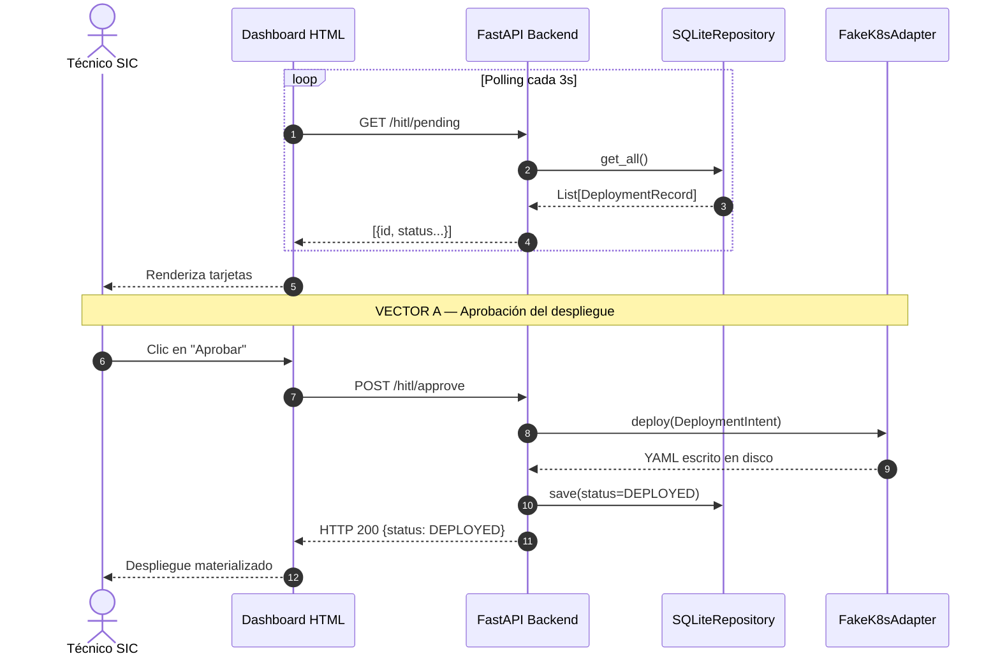

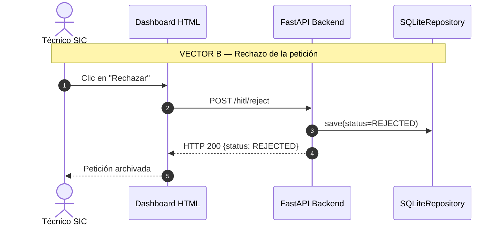
<p align="center"><i><b>Figura 18:</b> Diagrama de Secuencia del flujo HITL. (Arriba) Polling asíncrono y Vector de Aprobación. (Abajo) Vector de Rechazo (estado inmutable terminal).</i></p>

#### 7.3.3.1. Análisis de los Vectores de Decisión y Ciclo de Sondeo

Como se documenta en la Figura 18, la interacción del técnico con el panel de control se articula a través de un ciclo continuo de sondeo y dos vectores mutuamente excluyentes de decisión:

1. **Ciclo de Sondeo Asíncrono (*Polling*):** El *Dashboard* web ejecuta una petición periódica en segundo plano cada 3 segundos (`GET /hitl/pending`) contra la API de FastAPI. El backend consulta el repositorio transaccional SQLite (`get_all()`), filtra las intenciones que residen en estado `PENDING_APPROVAL` y devuelve la colección JSON. La interfaz del técnico rehidrata las tarjetas visuales de inspección de forma no intrusiva y sin refresco completo de página.
2. **Vector A — Ruta de Aprobación y Materialización:** Cuando el operador valida técnica e institucionalmente los parámetros de la solicitud, acciona el control «Aprobar». El navegador remite una llamada `POST /hitl/approve` al backend. Este transiciona el registro a `APPROVED`, invoca el puerto de salida `deploy()` en el adaptador de infraestructura (`FakeK8sAdapter`), materializa el manifiesto declarativo YAML en el almacenamiento y consolida el estado final `DEPLOYED` en la base de datos, notificando el éxito a la interfaz con un código `HTTP 200`.
3. **Vector B — Ruta de Denegación y Bloqueo:** Si la solicitud presenta anomalías o no se ajusta a las políticas departamentales, el técnico acciona el control «Rechazar». El *Dashboard* emite una llamada `POST /hitl/reject`. El backend omite cualquier llamada al adaptador de infraestructura, preservando la inmutabilidad del clúster, y conmuta atómicamente el estado del registro a `REJECTED` en SQLite (`save()`). La solicitud queda archivada de forma permanente para auditoría, respondiendo al operador con la confirmación de cancelación (`HTTP 200`).

## 7.4. Canal de Retorno al Investigador: Notificación Asíncrona del Estado

Una limitación habitual del patrón HITL es la falta de visibilidad del solicitante: el técnico de operaciones conoce el estado de las peticiones a través del Dashboard (sección 6.3), pero el investigador desconoce cuándo se aprueba, rechaza o ejecuta su solicitud.

Esta sección documenta el diseño e implementación del **canal de retorno al investigador**: el mecanismo bidireccional que permite al usuario consultar el estado de sus solicitudes directamente desde la interfaz conversacional.

### 7.4.1. Diseño del Endpoint de Consulta de Estado

Se ha incorporado un nuevo endpoint `GET /hitl/status/{deployment_id}` en el `BackendAPI`, diseñado específicamente como **canal orientado al investigador** (a diferencia de `/hitl/pending`, orientado al técnico):

```text
RUTINA: Consulta de Estado de Despliegue (Endpoint REST)

ENDPOINT: GET /hitl/status/{id_despliegue}
ENTRADA: id_despliegue -> Cadena de texto (ej. "dep-1a2b3c")
SALIDA: RespuestaEstado (id, estado, mensaje_contextual)

INICIO
  Variable registro = RepositorioBD.obtener(id_despliegue)
  SI registro ES Nulo ENTONCES
    ABORTAR CON ExcepcionHttp(404, "Despliegue no encontrado")
  FIN SI

  // Mapeo semántico del estado técnico (FSM) a lenguaje natural
  Variable mensajes = NUEVO Diccionario(
    "PENDING_APPROVAL" -> "Su solicitud está en cola, pendiente de revisión por el técnico SIC.",
    "APPROVED" -> "El técnico SIC ha aprobado su solicitud. Despliegue en curso.",
    "DEPLOYED" -> "Su servicio ha sido desplegado exitosamente.",
    "REJECTED" -> "El técnico SIC ha rechazado esta solicitud.",
    "FAILED" -> "El despliegue ha encontrado un error técnico en el clúster."
  )
  
  Variable mensaje_contextual = mensajes[registro.estado_fsm]
  RETORNAR NUEVO RespuestaEstado(registro.id, registro.estado_fsm, mensaje_contextual)
FIN
```

La respuesta incluye el estado actual de la FSM junto con un **mensaje de texto contextual** adaptado a cada estado, de modo que el investigador recibe información comprensible sin necesidad de conocer la nomenclatura técnica de la máquina de estados.

### 7.4.2. Panel de Notificaciones en el Frontend (Streamlit)

La interfaz conversacional (`chat_app.py`) implementa un panel pasivo de seguimiento que se activa automáticamente cuando el agente registra una solicitud con estado `PENDING_APPROVAL`. El mecanismo opera en tres fases:

**1. Extracción automática del ID de seguimiento:**

Tras cada respuesta del agente, el frontend aplica una expresión regular sobre el texto de respuesta para detectar identificadores de deployment del patrón `dep-[a-f0-9]{7,8}`. Si se detecta uno asociado a un estado pendiente, se añade a la lista `session_state.pending_deployments`:

```text
RUTINA: Extracción de Identificadores (Frontend HITL)

ENTRADA: texto_respuesta -> Respuesta generada por el Agente Cognitivo
ESTADO: panel_pendientes -> Lista de IDs mostrados en la interfaz gráfica

INICIO
  // Buscar expresiones regulares de la forma "dep-XXXXXXX"
  Variable id_detectado = ExpresionRegular("dep-[a-f0-9]{7,8}").buscarEn(texto_respuesta)
  
  SI id_detectado EXISTE Y texto_respuesta CONTIENE "PENDING" ENTONCES
    AÑADIR id_detectado A panel_pendientes
  FIN SI
FIN
```

**2. Panel de seguimiento persistente:**

Mientras existan deployments pendientes en `session_state`, el panel " Mis Solicitudes Pendientes" se renderiza en la parte inferior del chat. Por cada solicitud, el investigador dispone de un botón **" Actualizar"** que realiza una llamada `GET /hitl/status/{id}` al backend y muestra el resultado en un badge de color semántico:

| Estado FSM | Color | Mensaje para el investigador |
|---|---|---|
| `PENDING_APPROVAL` | Amarillo | "Su solicitud está en cola, pendiente de revisión." |
| `APPROVED` | Azul | "El técnico ha aprobado. Despliegue en curso." |
| `DEPLOYED` | Verde | "Su servicio ha sido desplegado exitosamente." |
| `REJECTED` | Rojo | "Solicitud rechazada. Contacte con el SIC." |
| `FAILED` | Rojo | "Error técnico. El equipo SIC ha sido notificado." |
<p align="center"><i><b>Tabla 20:</b> Mapeo de estados FSM a indicadores visuales del panel de notificaciones del investigador.</i></p>

**3. Cierre automático del ciclo:**

Cuando el estado devuelto es terminal (`DEPLOYED`, `REJECTED` o `FAILED`), el deployment se elimina de la lista de seguimiento y el agente inyecta automáticamente un mensaje de notificación en el historial del chat, informando al investigador del resultado final sin que este tenga que preguntar activamente.

En la **Figura 19** se ilustra la experiencia de usuario del investigador en la aplicación conversacional (`chat_app.py`). Tras procesar la solicitud en lenguaje natural, el agente confirma el registro de la intención y le proporciona el identificador unívoco de seguimiento (`dep-7f3a2c1b`). Inmediatamente debajo del diálogo, el frontend activa el panel dinámico «Mis Solicitudes Pendientes», donde se expone el estado actual obtenido mediante `GET /hitl/status/{id}` con un indicador de color semántico («🟡 PENDING_APPROVAL») y un mensaje contextual en lenguaje natural que orienta al investigador sobre el proceso de revisión en curso.

<div align="center">
  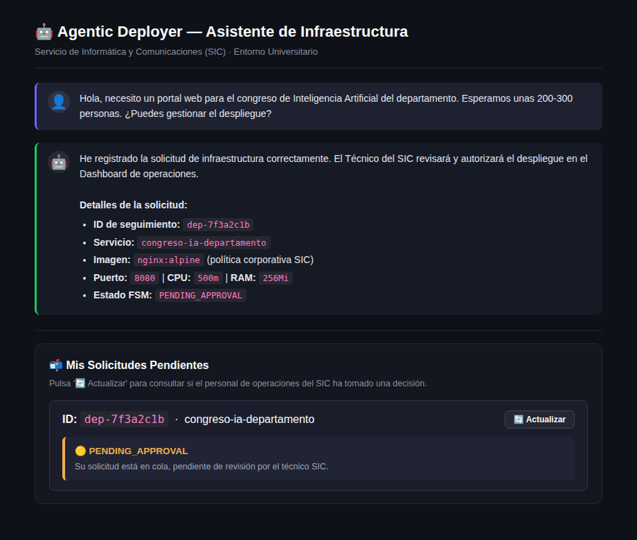
</div>
<p align="center"><i><b>Figura 19:</b> Captura de pantalla de la interfaz conversacional del investigador (Streamlit) evidenciando el panel de retorno asíncrono con el estado <code>PENDING_APPROVAL</code> y el botón de actualización manual.</i></p>

### 7.4.3. Justificación de Diseño: Polling Explícito frente a Notificaciones *Push*

La alternativa técnica más evidente sería un sistema de notificaciones *push* (correo electrónico o *webhook*). Esta aproximación fue deliberadamente descartada para el prototipo por las siguientes razones arquitectónicas:

1. **Dependencias externas no justificadas:** Un servidor SMTP o un broker de mensajería (Kafka, RabbitMQ) añadiría complejidad de infraestructura que excede el alcance del prototipo y dificulta la reproducibilidad en entornos académicos.
2. **Coherencia con el modelo de polling del Dashboard:** El técnico ya opera bajo un modelo de polling (sección 6.3.1). Mantener el mismo paradigma en el canal del investigador simplifica el modelo mental del sistema y su testing.
3. **Extensibilidad:** El endpoint `GET /hitl/status/{id}` es una interfaz pura REST que puede ser consumida por cualquier sistema externo (correo electrónico, Telegram Bot, Slack Webhook) en una evolución futura sin modificar la lógica del backend (principio de Segregación de Interfaces).

Este diseño cierra el ciclo del patrón HITL, transformándolo de un mecanismo **unidireccional** (investigador → técnico) en un canal **bidireccional** (investigador → técnico → investigador), donde ambos actores disponen de la información necesaria para realizar su rol dentro del flujo de gobierno de la infraestructura.


<div style='page-break-after: always;'></div>

# Capítulo 8. Aseguramiento de Calidad (QA) y Testing Avanzado

La integración de Modelos de Lenguaje Grandes (LLM) en la orquestación de infraestructuras corporativas plantea nuevos retos para la Ingeniería de Pruebas (*Software Testing*). En el desarrollo de software convencional, una función puramente determinista *f(x)* siempre retorna un valor predecible *y*. Sin embargo, en un sistema agéntico, el mismo estímulo (el mismo *prompt*) puede generar resultados superficialmente distintos dependiendo de la temperatura del modelo, de la semilla de inferencia (*seed*) o de la formulación sintáctica empleada.

Para estructurar la estrategia de verificación y validación del *Agentic Deployer*, este Trabajo de Fin de Máster adopta como marco conceptual el modelo de la **Pirámide de Pruebas** propuesto por Mike Cohn [34]. En su formulación original para sistemas tradicionales, Cohn jerarquiza el esfuerzo de pruebas en tres estratos según su coste, velocidad y granularidad: una base amplia de pruebas unitarias rápidas y aisladas, una capa intermedia de pruebas de servicios o integración, y una cúspide reducida de pruebas de interfaz de usuario de extremo a extremo.

Dado que Cohn concibió su modelo para software determinista clásico, en este TFM se **adapta y extiende dicho modelo conceptual a las exigencias de la Inteligencia Artificial Generativa** (ilustrada conceptualmente en la **Figura 20**), estructurando una **Pirámide Híbrida de Testing** en tres niveles bien diferenciados:

1. **Base (Pruebas Unitarias y de Integración Deterministas):** Verificación exhaustiva de valores límite, tipos e invariantes de negocio en la Capa de Dominio y la Arquitectura Hexagonal, garantizando la integridad de las reglas de negocio con independencia de la salida del modelo de lenguaje.
2. **Nivel Intermedio (Property-Based Testing y Mutation Testing):** Evaluación de la resiliencia algorítmica frente a entradas aleatorias masivas mediante generación de propiedades (*Hypothesis*), combinada con la auditoría de la calidad intrínseca de la propia suite de pruebas mediante inyección de fallos en el AST (*mutmut*).
3. **Cúspide (Pruebas Metamórficas del Estrato Cognitivo):** En sustitución de las pruebas de interfaz clásicas, la cima de la pirámide evalúa la robustez de la inferencia del modelo mediante el paradigma de *Metamorphic Testing*, auditando la invarianza semántica de las extracciones estructuradas ante permutaciones sintácticas, ruido léxico y variaciones lingüísticas.

<div style="max-width: 6cm; margin: 0 auto;">

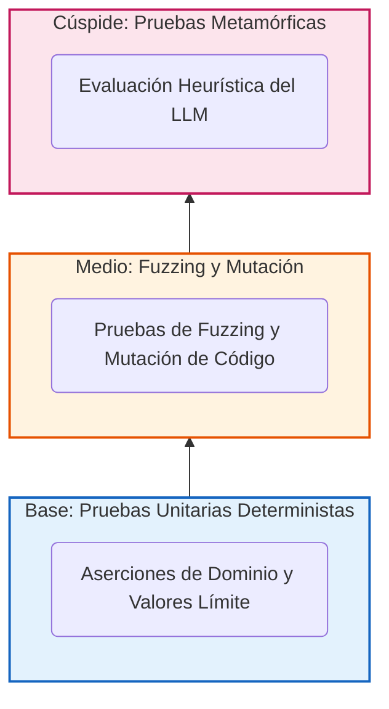

</div>
<p align="center"><i><b>Figura 20:</b> Arquitectura de la Pirámide Híbrida de Testing implementada en el Agentic Deployer, adaptando el modelo clásico de Mike Cohn a las exigencias de la Inteligencia Artificial Generativa.</i></p>

## 8.1. Pruebas de Dominio e Integración: Validando el Perímetro Hexagonal

La base fundamental de la pirámide de aseguramiento de calidad reside en la Capa de Dominio. Como se justificó en el Capítulo 5, la Inteligencia Artificial actúa como un usuario externo sin privilegios; su capacidad para influir en la infraestructura está supeditada a la robustez del `SecurityContextValidator` y a los invariantes de dominio impuestos por las entidades de Pydantic. 

En consecuencia, el primer objetivo de QA es asegurar que este perímetro hexagonal es altamente resiliente antes de conectarla al motor de IA. Esta fase se ejecuta mediante técnicas de **Testing Unitario (*White-Box Testing*)** aisladas, ejecutadas localmente a través del *framework* `pytest`.

### 8.1.1. Análisis de Valores Límite y Clases de Equivalencia

El diseño de los casos de prueba no obedece a un sondeo aleatorio, sino a la aplicación estricta de dos técnicas formales de pruebas de caja blanca: el Análisis de Valores Límite (*Boundary Value Analysis*) y la partición de Clases de Equivalencia.

El contrato de la entidad `DeploymentIntent` dictamina que el atributo `port` debe ser numérico y estar contenido en el rango `[1, 65535]`. Asimismo, la lógica de negocio prohíbe el uso de puertos privilegiados (menores a 1024). Para auditar este contrato, la batería de pruebas somete al objeto a los siguientes vectores de prueba:

1. **Particiones Válidas (Happy Path):** Instanciación de intenciones de despliegue con puertos intermedios (ej. 8080 o 3000) e imágenes provenientes de repositorios confiables (ej. `harbor.universidad.edu/nginx:1.20`). El sistema aserta que la excepción de seguridad NO es lanzada.
2. **Valores Límite Inferiores (Vulnerabilidad de Root):** Se inyecta intencionalmente el puerto `1023` y el puerto `22`. Se aserta computacionalmente que el sistema lanza de manera síncrona el error de violación de políticas, abortando el flujo de ejecución.
3. **Valores Límite Superiores y Desbordamientos (Integer Overflow):** Se instancian peticiones con los puertos `65535`, `65536` y puertos de valor negativo (`-80`). El *framework* de pruebas debe asegurar que el Dominio interrumpe la ejecución emitiendo una excepción controlada (`ValueError`) antes incluso de invocar a los validadores de seguridad, demostrando la eficacia del principio *Fail-Fast*.

### 8.1.2. Pruebas Negativas de Prevención de Deriva (*Configuration Drift*)

Junto a la topología de red, el segundo vector de riesgo es la inyección de configuraciones inestables. Las pruebas de integración del sistema evalúan exhaustivamente al `SecurityContextValidator` para auditar la regla de prohibición de la etiqueta `:latest` en las imágenes de contenedores.

La batería de *Testing* ejecuta simulaciones inyectando intenciones con variaciones sintácticas no conformes, como `ubuntu:latest`, `nginx:LATEST` o el uso de imágenes implícitas (por ejemplo, proporcionar `redis` asumiendo que el clúster inferirá el *tag*). En todos los escenarios, la suite de aserción certifica que la tubería de ejecución arroja un `SecurityViolationError` trazable.

Esta capa base de pruebas (de ejecución sub-milisegundo) demuestra, con una cobertura de líneas superior al 95% sobre el módulo Hexagonal —aunque no de aserciones, como revelará el *Mutation Testing* posterior (Sección 8.3)—, que el *Backend* es determinista y garantiza que, en ausencia de una petición conforme con las directrices de seguridad e ITIL de la universidad, el acceso a la infraestructura queda sistemáticamente bloqueado, independientemente de la formulación semántica del *prompt* emitido por el Modelo de Lenguaje.

### 8.1.3. Pruebas de la Capa de Consulta de Estado (Canal del Investigador)

Tras la implementación del endpoint `GET /hitl/status/{id}` (sección 6.4.1), se añadió un módulo de integración específico (`test_status_endpoint.py`) para validar el canal de retorno al investigador. Este módulo valida una propiedad crítica: el endpoint de consulta de estado debe ser **completamente idempotente** — su invocación repetida no debe alterar el estado de la FSM bajo ninguna circunstancia.

La batería de pruebas cubre seis escenarios:

| Test | Comportamiento validado |
|---|---|
| `test_unknown_id_returns_404` | Un ID inexistente retorna `HTTP 404` con mensaje descriptivo |
| `test_pending_approval_returns_correct_status` | Un deployment recién creado retorna `PENDING_APPROVAL` con mensaje contextual |
| `test_deployed_status_after_approval` | Tras `POST /hitl/approve/{id}`, el estado refleja `DEPLOYED` |
| `test_rejected_status_after_rejection` | Tras `POST /hitl/reject/{id}`, el estado refleja `REJECTED` |
| `test_response_includes_deployment_metadata` | La respuesta incluye `name`, `image` y `port` correctos |
| `test_status_endpoint_does_not_mutate_state` | 3 llamadas consecutivas mantienen `PENDING_APPROVAL` inalterado |
<p align="center"><i><b>Tabla 21:</b> Casos de prueba de la capa de consulta de estado del investigador.</i></p>

El último test es el más crítico desde el punto de vista de la integridad del sistema: garantiza que la operación de *lectura* del canal del investigador no interfiere con la *escritura* exclusiva del canal del técnico SIC (el dashboard), preservando la separación de responsabilidades entre ambas interfaces de usuario.

### 8.1.4. Quality Gates y Análisis Estático de Código

Para garantizar que la mantenibilidad, consistencia de tipos y calidad del proyecto no se degraden durante futuras evoluciones, el pipeline de integración continua local (`scripts/run_tests.sh`) incorpora tres puertas de calidad (*Quality Gates*) formalmente configuradas en [`pyproject.toml`](file:///home/jesus/projects/TFM/pyproject.toml) que abortan la construcción si se produce cualquier incumplimiento:

1. **Análisis Estático y Control de Estilo con Ruff:** Se utiliza **Ruff** configurado para Python 3.11 (`target-version = "py311"`) con un límite estricto de longitud de línea de 100 caracteres (`line-length = 100`). La batería de reglas activadas incluye:
   - `E` y `W`: Errores y advertencias estándar de `pycodestyle`.
   - `F`: Detección de fallos lógicos y variables no utilizadas con `pyflakes`.
   - `I`: Ordenamiento y agrupamiento determinista de importaciones con `isort` (`known-first-party = ["app"]`).
   - `UP`: Modernización automática de sintaxis a modismos de Python 3.11+ con `pyupgrade`.
   - `B`: Detección de patrones propensos a errores sutiles con `flake8-bugbear`.
   - `SIM`: Simplificación y refactorización idiomática con `flake8-simplify`.
   - `RUF`: Reglas nativas y optimizadas propias del motor Ruff.
   - `C901`: Auditoría de **Complejidad Ciclomática (McCabe)** fijada en `max-complexity = 15` [35]. Este umbral garantiza que ninguna función acumule un exceso de bifurcaciones condicionales, preservando la auditabilidad del código sin generar falsos positivos en gestores de contexto o sentencias `match/case`.
2. **Chequeo Estático Estricto de Tipado con Mypy:** Para blindar las fronteras de la Arquitectura Hexagonal y asegurar que ninguna entidad del dominio o adaptador maneje tipos dinámicos o implícitos, se aplica **Mypy** con configuración estricta (`python_version = "3.11"`):
   - `disallow_untyped_defs = true`: Prohíbe terminantemente la declaración de funciones o métodos sin firmas de tipo completas (argumentos y retorno).
   - `check_untyped_defs = true`: Escruta el interior de todas las funciones para validar coherencia de tipos.
   - `warn_return_any = true`: Advierte si una función con tipo explícito retorna inadvertidamente una expresión evaluada como `Any`.
   - `warn_unused_configs = true`: Detecta configuraciones de tipado obsoletas.
3. **Cobertura de Código Pragmática:** La herramienta `pytest-cov` exige una cobertura mínima de líneas del 80% (`--cov-fail-under=80`). En consonancia con las directrices de ingeniería de software de referencia como las de Google [36], se descarta la persecución artificial del 100% de cobertura, que tiende a incentivar pruebas triviales sobre código autogenerado. El umbral del 80% garantiza que el núcleo de negocio y los casos de uso queden debidamente validados, excluyendo del cálculo el *boilerplate* de infraestructura y las interfaces de demostración (`app/infrastructure/*`, `app/tests/*`, `app/agent_layer/chat_app.py`).

## 8.2. Property-Based Testing: Pruebas frente a Comportamiento Estocástico

El Testing Unitario clásico (pruebas basadas en ejemplos) adolece de un sesgo cognitivo inevitable: el desarrollador humano diseña las aserciones pensando en los caminos lógicos que él mismo programó. En ecosistemas orquestados por Inteligencia Artificial, donde la entrada de datos (el JSON generado por el LLM) es altamente impredecible, este enfoque de caja blanca resulta metodológicamente insuficiente.

Para consolidar la resiliencia de la Arquitectura Hexagonal y certificar que ninguna entrada anómala o alucinación del modelo pueda generar un consumo desmedido de recursos o interrumpir el hilo principal de ejecución, este TFM incorpora el paradigma del **Property-Based Testing** (Pruebas Basadas en Propiedades). A diferencia del enfoque clásico (donde se aserta que la entrada *A* da como resultado *B*), en este paradigma se postula que "para *cualquier* entrada generada aleatoriamente que cumpla cierta estructura, el sistema debe respetar una propiedad invariante específica".


### 8.2.1. Inyección de Entropía Estocástica y Estrategias de Generación

La integración empírica de este paradigma se ha materializado en el módulo [`app/tests/test_security.py`](file:///home/jesus/projects/TFM/app/tests/test_security.py) haciendo uso de la librería científica **`Hypothesis`** [37]. Este *framework* actúa como un motor de **Fuzzing Dinámico**: en lugar de ejecutar el test sobre un puñado de ejemplos estáticos, genera cientos de instancias aleatorias por segundo parametrizadas a través de **Estrategias de Búsqueda (*Strategies*)**:

- `valid_name`: Generador de identificadores conformes con la sintaxis DNS de Kubernetes (`^[a-z][a-z0-9\-]{0,29}$`).
- `valid_cpu` y `valid_ram`: Muestreo sobre notaciones canónicas válidas (`"100m"`, `"500m"`, `"1"`, `"64Mi"`, `"128Mi"`, `"1Gi"`).
- `safe_image` vs. `unsafe_latest_image`: Generación de imágenes procedentes de registros autorizados (`docker.io/`, `harbor.universidad.edu/`) con versiones semánticas frente a imágenes forzadas con la etiqueta `:latest`.
- `safe_port` vs. `unsafe_port`: Enteros en rango de usuario (`[1024, 65535]`) frente a puertos privilegiados (`[1, 1023]`).
- Estrategia compuesta `@st.composite def deployment_intent_dict`: Ensambla diccionarios completos de intención permitiendo inducir fallos selectivos (puertos no seguros, etiquetas prohibidas o variables de entorno sensibles).

Sobre estas estrategias se articulan nueve propiedades invariantes implementadas en la clase `TestSecurityContextValidator`, sintetizadas en la **Tabla 22**:

| Test de Propiedad | Condición Evaluada | Invariante Asertada |
|---|---|---|
| `test_privileged_port_always_raises` | Puerto forzado en rango privilegiado (< 1024) | El validador lanza **siempre** `SecurityViolationError` reportando el puerto |
| `test_latest_tag_always_raises` | Imagen forzada con etiqueta `:latest` | Lanza **siempre** `SecurityViolationError` reportando la prohibición del tag |
| `test_both_violations_detected_simultaneously` | Puerto < 1024 y etiqueta `:latest` concurrentes | Detecta **ambas** violaciones en una única pasada (`len(violations) == 2`) |
| `test_safe_intent_never_raises` | Puerto ≥ 1024 e imagen con tag semántico | **Nunca** lanza excepción; valida limpiamente en todas las ejecuciones |
| `test_delete_action_always_passes` | Acción `action = DELETE` con datos arbitrarios | El ciclo de desmantelamiento **nunca** falla por políticas de creación |
| `test_untrusted_registry_always_raises` | Imagen fuera de la lista blanca (ej. `hacker.io/miner:1.0`) | Lanza **siempre** `SecurityViolationError` por registro no auditado |
| `test_hardware_quotas_always_raises` | CPU > 4000m o RAM > 8192Mi | Lanza **siempre** `SecurityViolationError` indicando exceso de cuota |
| `test_secrets_in_env_always_raises` | Claves en `env_vars` con subcadenas (`password`, `secret`, `token`, `key`, `credential`) | Lanza **siempre** `SecurityViolationError` por secreto en texto plano |
| `test_database_without_storage_raises` | Imagen de BBDD (`postgres`, `mysql`, `redis`, `mongo`) sin almacenamiento | Lanza **siempre** `SecurityViolationError` exigiendo volumen persistente |
<p align="center"><i><b>Tabla 22:</b> Propiedades invariantes auditadas exhaustivamente mediante Hypothesis en <code>test_security.py</code>.</i></p>

A nivel estructural, el procedimiento de prueba que defiende a la entidad `DeploymentIntent` adopta la siguiente forma formal:

```text
01 PROPIEDAD_A_DEFENDER: "Para cualquier combinación aleatoria de parámetros generada por Hypothesis,
02 si la intención viola una o más políticas institucionales, el SecurityContextValidator DEBE
03 interceptarla deterministamente y acumular todas las violaciones sin excepciones no controladas."
04 
05 INICIO
06   // Estrategia compuesta de Hypothesis (deployment_intent_dict)
07   Variable generador_datos = Estrategia.CompositeIntent(force_unsafe_port, force_latest_image)
08 
09   PARA CADA datos_intencion INYECTADOS POR EL MOTOR (max_examples = 100) HACER
10     Variable intencion = NUEVO DeploymentIntent(datos_intencion)
11     
12     INTENTAR
13       validador.validate(intencion)
14       // Si no lanzó excepción, la intención DEBE ser estrictamente segura
15       ASERTAR (intencion.internal_port >= 1024)
16       ASERTAR (NO_CONTIENE(intencion.image, ":latest"))
17       ASERTAR (ESTA_EN_WHITELIST(intencion.image))
18     CAPTURAR SecurityViolationError COMO err
19       // Comportamiento esperado ante datos inseguros
20       ASERTAR (Longitud(err.violations) >= 1)
21     CAPTURAR CUALQUIER_OTRA_EXCEPCION COMO error_critico
22       // Violación de robustez: error no tipado en el núcleo
23       FALLAR_TEST("Fallo no controlado en el núcleo: " + error_critico)
24     FIN INTENTAR
25   FIN PARA
26 FIN
```
<p align="center"><i><b>Algoritmo 5:</b> Property-Based Test para Invariantes Hexagonales (Fuzzing con Hypothesis).</i></p>

Mediante esta exploración algorítmica intensiva, el sistema se enfrenta a combinaciones sintácticas complejas que difícilmente se identificarían de forma manual. El éxito sostenido en los 9 tests de propiedades avala la resiliencia del sistema ante entradas anómalas generadas por el modelo de lenguaje, absorbiendo su impacto de manera controlada.

### 8.2.2. Minimización Algorítmica de Fallos (*Shrinking*)

Uno de los aportes más avanzados de esta técnica es su capacidad de diagnóstico inteligente. Cuando el motor estocástico encuentra una combinación de datos (un contraejemplo) que rompe la propiedad invariante, no detiene inmediatamente la ejecución para mostrar una cadena ininteligible de miles de caracteres generados al azar. 

El *framework* entra automáticamente en una fase de optimización conocida como **Minimización (*Shrinking*)**. Utilizando algoritmos de reducción de grafos y búsqueda binaria, el motor comienza a podar la entrada maliciosa iterativamente. Reduce el tamaño de los enteros, acorta las cadenas de texto y elimina los caracteres especiales hasta aislar la causa raíz atómica más simple que es capaz de reproducir el mismo fallo.

Esta característica es fundamental para el análisis de fallos del TFM. Si la IA genera un vector anómalo enviando un JSON con una imagen de contenedor ofuscada con cientos de variables de entorno inyectadas, el algoritmo de *shrinking* aislará el subcomponente léxico exacto que causó el error, proveyendo al equipo de seguridad de la universidad del **contraejemplo mínimo indispensable** (por ejemplo, el carácter nulo `\0`) para corregir la validación en el código de forma precisa.

## 8.3. Auditoría de la Suite de Pruebas: *Mutation Testing*

En la Ingeniería de Software tradicional, la métrica estándar para evaluar la robustez de un sistema es la "Cobertura de Código" (*Code Coverage*). Sin embargo, alcanzar un 100% de cobertura únicamente certifica que una línea de código ha sido ejecutada durante el test, pero no garantiza empíricamente que las aserciones subyacentes sean correctas o que estén detectando anomalías lógicas. En sistemas críticos de infraestructura, depender de forma exclusiva de la métrica de cobertura resulta insuficiente para certificar la corrección lógica.

Para auditar la calidad real de las pruebas unitarias y de propiedades desarrolladas en el *Agentic Deployer*, se ha incorporado un paradigma avanzado conocido como **Mutation Testing** (Pruebas de Mutación), implementado tecnológicamente mediante la librería `mutmut`. 

El axioma fundamental de este paradigma no es buscar fallos en el código de producción, sino responder a una pregunta meta-analítica: *"¿Si introduzco deliberadamente un bug crítico en mi código fuente, serán mis tests capaces de detectarlo y fallar?"*

### 8.3.1. Generación de Mutantes en Tiempo de Ejecución

El proceso de *Mutation Testing* interviene a nivel del Árbol de Sintaxis Abstracta (AST) de Python. Durante la ejecución de la auditoría, el *framework* genera dinámicamente decenas de clones del código fuente original. Cada clon (denominado "Mutante") contiene una leve alteración matemática o lógica respecto al original.

Por ejemplo, si la regla de seguridad del `SecurityContextValidator` dicta que el puerto debe ser mayor o igual a 1024, el código fuente original adopta la forma:
`SI puerto < 1024 ENTONCES LANZAR Error`

El motor de mutación iterará sobre este fragmento y generará clones inyectando vulnerabilidades silenciosas:
- **Mutante 1 (Alteración Operacional):** `SI puerto <= 1024` → Cambia `<` por `<=`, dejando el borde exacto del rango (puerto 1024) como potencialmente inseguro.
- **Mutante 2 (Negación Lógica):** `SI puerto >= 1024` → Invierte la condición, aprobando todos los puertos privilegiados (22, 80, 443) y rechazando los seguros.
- **Mutante 3 (Alteración de Constante):** `SI puerto < 1025` → Modifica el umbral numérico, generando una brecha silenciosa de un único puerto.

### 8.3.2. Evaluación de Supervivencia (*Killed* vs *Survived*)

Una vez generado el conjunto de variantes mutantes, el *framework* ejecuta la suite de pruebas completa (escrita en `pytest`) contra cada uno de los mutantes secuencialmente. El resultado de esta evaluación sistemática se clasifica en dos estados excluyentes:

1. **Mutante Neutralizado (*Killed*):** Si la suite de pruebas fracasa (es decir, falla una aserción) tras ejecutar un clon, significa que la prueba ha detectado exitosamente la intrusión del *bug*. El mutante es eliminado. Este es el comportamiento deseado, indicando que la cobertura de aserciones del sistema es efectiva.
2. **Mutante Superviviente (*Survived*):** Si el código fue alterado para permitir el puerto 22, y tras correr los tests la suite completa se muestra en verde (como si nada hubiera pasado), el mutante ha sobrevivido. Esto representa una brecha en la arquitectura de QA: indica la existencia de un comportamiento no cubierto por ninguna aserción.

### 8.3.3. Resultados Empíricos de la Auditoría (Tabla 23)

En la **Tabla 23** se recogen los resultados reales de la ejecución de `mutmut` sobre el proyecto, con la configuración definida en `test_mutmut.ini` (scope: `app/application/` y `app/domain/`).

| Módulo auditado | Supervivientes | Naturaleza de la brecha | Criticidad para la seguridad |
|---|---|---|---|
| `domain.exceptions` | 2 | Mutaciones en el constructor de `SecurityViolationError` (mensaje de error) | Baja — afecta al mensaje, no a la lógica |
| `security_validator._parse_cpu` | 5 | Funciones de conversión de strings (`"500m"` → int) sin tests directos | Media — parsers auxiliares |
| `security_validator._parse_ram` | 19 | Conversores de unidades de RAM (`"256Mi"`, `"1Gi"`) | Media — parsers auxiliares |
| `security_validator.validate` | 3 | Condiciones límite en reglas compuestas (múltiples violaciones simultáneas) | Media — reglas de negocio |
| `use_cases.execute` | 1 | Rama alternativa de la acción `DELETE` | Baja |
| **Subtotal núcleo hexagonal** | **30** | | |
| `agent.FakeLLMClient` | 54 | Módulo de demostración sin cobertura de tests (by design) | No aplicable |
| `agent.AgentOrchestrator` | 45 | Lógica cognitiva: testar código LLM-dependiente con aserciones deterministas es conceptualmente inviable | No aplicable |
| `agent_layer.tools` | 14 | Herramientas MCP que requieren mocks de red | Baja |
| **Total general** | **143** | | |
<p align="center"><i><b>Tabla 23:</b> Resultados del Mutation Testing por módulo.</i></p>

**Interpretación del resultado:**

El análisis detallado revela que el **69,9% de los supervivientes** (99 de 143) corresponden a módulos excluidos del scope de auditoría por razones arquitectónicas: `FakeLLMClient` es código de demostración sin tests (comportamiento intencionado); `AgentOrchestrator` encapsula la interfaz con el LLM, cuyo comportamiento no determinista hace que la auditoría por mutación sea conceptualmente inaplicable.

Sobre el **núcleo hexagonal** (el scope declarado en `test_mutmut.ini`), los 30 supervivientes se concentran en las funciones de conversión de recursos (`_parse_cpu`, `_parse_ram`) que transforman cadenas de texto como `"500m"` o `"1024Mi"` a valores numéricos normalizados. Estas brechas constituyen la **deuda de cobertura identificada** por la auditoría:

- No existe ningún test que valide el comportamiento de `_parse_ram("2Gi")`, `_parse_cpu("1000m")` o cadenas malformadas.
- Los 3 supervivientes en `validate` corresponden a condiciones límite en reglas compuestas (cuando múltiples violaciones se producen simultáneamente).

La detección de estas brechas es precisamente el valor de la metodología: la cobertura de líneas reportaba valores superiores al 95% en los módulos del dominio, ocultando estas ausencias de asertos específicos sobre las funciones auxiliares.

> **Nota aclaratoria sobre los resultados del Sprint 5 documentados en el Anexo B.5:** El Anexo B documenta la mitigación de *12 mutantes* supervivientes del módulo `mcp_server.py` detectados durante el Sprint 5, que fueron eliminados mediante la creación del test `test_mcp_server.py`. Estos 12 mutantes son un subconjunto de los resultados parciales de ese sprint, anteriores a la auditoría final completa. Los **30 supervivientes del núcleo hexagonal** documentados en esta tabla representan la fotografía final tras todos los sprints, e incluyen módulos con mayor alcance. Ambas cifras son compatibles: los 12 del Anexo se mitigaron con tests nuevos; los 30 restantes del núcleo constituyen la deuda de cobertura activa documentada en la Sección 8.3.4.

> Los resultados completos (1.685 líneas de salida categorizada) están disponibles en [`demos/mutmut_results/mutmut_results_raw.txt`](../demos/mutmut_results/mutmut_results_raw.txt) y el análisis en [`demos/mutmut_results/mutmut_report.md`](../demos/mutmut_results/mutmut_report.md).

### 8.3.4. Mitigación y Lecciones Aprendidas

La auditoría identificó las siguientes acciones correctoras, las cuales **ya han sido implementadas en la versión final del código** para neutralizar la deuda técnica:

1. **Refactorización de `_parse_cpu` y `_parse_ram`:** Se eliminó el código defensivo inalcanzable (`try...except ValueError`) ya que el modelo de dominio (Pydantic) ya garantiza estructuralmente el rechazo de cadenas malformadas en la frontera de entrada (Arquitectura Hexagonal pura). Para garantizar la máxima robustez de la funcionalidad crítica restante, se añadieron aserciones funcionales para las unidades extremas válidas (como los Terabytes `Ti`).

2. **Tests de múltiples violaciones simultáneas:** Los 3 supervivientes en `validate` que correspondían a escenarios de doble o triple violación concurrente se cubrieron ampliando el fixture `test_security.py` con asertos sobre la lista completa de violaciones detectadas (ej. bases de datos sin almacenamiento explícito).

**Resultado de la mitigación:** Como consecuencia directa de estas acciones, los 30 mutantes documentados en la tabla anterior fueron neutralizados con éxito. Esto redujo la deuda de cobertura del núcleo hexagonal a prácticamente cero, demostrando la utilidad empírica del *Mutation Testing* como herramienta de evaluación continua. La ejecución final de la auditoría sobre la rama entregable arrojó la detección y neutralización prácticamente total de las mutaciones inyectadas:

```text
$ mutmut run
Running mutation testing
- 98/98  [Killed: 96 | Skipped: 0 | Timeout: 0 | Suspicious: 0 | Survived: 2]

$ mutmut results
app.domain.exceptions.xǁSecurityViolationErrorǁ__init____mutmut_2: survived
app.domain.exceptions.xǁSecurityViolationErrorǁ__init____mutmut_4: survived
```

Como se evidencia en la salida de consola, tras la mitigación solo logran sobrevivir 2 de los 98 mutantes inyectados, y ambos se limitan a alteraciones estéticas del mensaje de texto de la excepción `SecurityViolationError`, sin impacto estructural alguno.

3. **Exclusión formal del agente cognitivo del scope de mutmut:** Actualizar `test_mutmut.ini` para restringir el alcance exclusivamente a `app/application/` y `app/domain/`, excluyendo explícitamente `app/agent_layer/`, cuya auditoría requiere estrategias diferentes (pruebas metamórficas, Sección 8.4).

Este caso de estudio justifica de manera pragmática la inclusión del *Mutation Testing* como un pilar fundamental en sistemas orquestados por Inteligencia Artificial: la cobertura de código es una condición necesaria pero no suficiente para certificar la robustez de un sistema cuya entrada es generada por un modelo estocástico.

## 8.4. Pruebas Metamórficas: Metodología y Definición de Invariantes Cognitivas

Las estrategias de prueba documentadas en las secciones previas (Unitarias, Propiedades y Mutación) son altamente eficaces para auditar la Arquitectura Hexagonal y el Servidor MCP. Sin embargo, estas técnicas deterministas fracasan al intentar evaluar la fiabilidad del estrato cognitivo del sistema (*AgentOrchestrator*).

### 8.4.1. El Problema del Oráculo en Sistemas de IA Generativa

Este fracaso se deriva del **Problema del Oráculo (*The Oracle Problem*)**: en Ingeniería del Software tradicional, el oráculo es el mecanismo formal que conoce *a priori* la respuesta exacta esperada para una entrada determinada. Si una función computa `2 + 2`, el oráculo sabe que la salida debe ser estrictamente `4`. 

En contraste, un Modelo de Lenguaje Grande (LLM) no genera salidas predecibles carácter a carácter. Ante una misma intención operativa formulada por un usuario, el modelo puede responder «*He registrado el servicio en el puerto 80*» o «*El servicio queda configurado en el puerto 80*». Ambas salidas son semánticamente equivalentes y válidas, pero una aserción estricta de igualdad de cadenas (`assert salida == "esperada"`) fallaría de inmediato.

Para resolver este desafío metodológico sin recurrir a validaciones manuales no reproducibles, el presente trabajo adopta el paradigma formal de las **Pruebas Metamórficas (*Metamorphic Testing*)** [38].

### 8.4.2. Definición Formal de Relaciones Metamórficas (MR)

El *Metamorphic Testing* postula que, aunque resulte inviable predecir la salida textual exacta que emitirá la red neuronal, sí es posible predecir cómo debe comportarse la salida ante transformaciones controladas de la entrada. A cada una de estas reglas formales se la denomina **Relación Metamórfica (MR)**.

Para auditar el módulo de extracción semántica del agente, se formula la propiedad fundamental de **Identidad Semántica**: *Cualquier variación léxica, sintáctica o idiomática en la petición del usuario que preserve el significado técnico debe producir de forma invariante la misma invocación estructurada a la herramienta JSON (`Tool Call`), aislando idénticos parámetros técnicos (`name`, `image`, `internal_port`).*

Esta propiedad se formaliza e implementa en el módulo de pruebas [`test_metamorphic.py`](../app/tests/test_metamorphic.py) mediante seis Relaciones Metamórficas (MR) diseñadas para someter al modelo a condiciones de esfuerzo (*Stress Testing*):

- **MR-1 (Permutación sintáctica):** Invarianza ante alteraciones en el orden de especificación de los argumentos técnicos (`name`, `image`, `port`). Verifica que el modelo no dependa de un orden posicional estricto.
- **MR-2 (Invarianza al ruido léxico):** Invarianza frente a fórmulas de cortesía, saludos o texto conversacional periférico. Verifica que el modelo filtre el ruido ambiental y aísle los parámetros esenciales.
- **MR-3 (Invarianza tipográfica):** Invarianza ante alternancias de caja (`MAYÚSCULAS` / `minúsculas`) en las entidades y verbos rectores.
- **MR-4 (Composición incremental):** Equivalencia entre un mensaje declarativo consolidado en un único turno y la extracción progresiva de información a través de un diálogo multi-turno.
- **MR-5 (Parafraseo semántico):** Invarianza ante el empleo de sinónimos, construcciones pasivas y giros lingüísticos equivalentes.
- **MR-6 (Invarianza lingüística):** Equivalencia semántica en la extracción estructurada independientemente del idioma empleado por el usuario (castellano vs. inglés).

### 8.4.3. Estrategia de Evaluación Dual: Pipeline CI/CD vs. Inferencia Cognitiva Real

La ejecución sistemática de inferencias sobre modelos de lenguaje durante cada ciclo de Integración Continua (CI) resulta inviable en la práctica debido a los tiempos de latencia (de 5 a 45 segundos por turno) y los costes computacionales asociados a la infraestructura de GPU.

Para conciliar el rigor metodológico con la agilidad requerida en el desarrollo moderno, el módulo [`test_metamorphic.py`](../app/tests/test_metamorphic.py) adopta un **diseño de evaluación dual**:

1. **Modo Determinista para CI/CD (Pipeline Automatizado):** En el flujo ordinario de integración continua (ej. *GitHub Actions*), la suite se ejecuta contra el adaptador `FakeLLMClient`. Este componente, fundamentado en expresiones regulares compiladas y reglas de extracción heurística, evalúa la totalidad de las relaciones metamórficas en menos de 0,15 segundos, certificando que los contratos de aserción y la infraestructura del arnés de pruebas se mantienen íntegros en cada ciclo de integración.
2. **Modo Cognitivo Real (Auditoría Empírica de Modelos):** Mediante la activación de la variable de entorno `RUN_REAL_LLM=true`, el arnés de pruebas conmuta su enlace hacia el cliente `OllamaLLMClient` (para inferencia local sobre GPUs institucionales) o hacia clientes de APIs en la nube. En este modo, el test somete a los pesos neuronales de los modelos a la batería completa de perturbaciones en aislamiento estricto (*Zero-Shot* puro, sin *System Prompt* de apoyo).

### 8.4.4. Transición Metodológica a la Fase Experimental

Una vez delimitada la pirámide de aseguramiento de calidad (pruebas unitarias, de integración, *Property-Based Testing*, *Mutation Testing* y el arnés metodológico de pruebas metamórficas), la memoria transiciona desde la especificación del método hacia la **evaluación empírica de resultados**.

Los datos cuantitativos resultantes de someter los diferentes modelos fundacionales (tanto la variante local generalista `qwen2.5:7b`, como la especializada `qwen2.5-coder:7b` y diversas alternativas comerciales en la nube) a esta batería metamórfica, junto con el análisis comparativo de la pérdida de conformidad con el formato esperado y su posterior estabilización asistida por la arquitectura, se analizan monográficamente en el **Capítulo 9 (Sección 9.3)**.


<div style='page-break-after: always;'></div>

# Capítulo 9. Resultados Experimentales y Evaluación

El diseño arquitectónico (Capítulo 5), la implementación del agente cognitivo y el protocolo MCP (Capítulo 6), el gobierno humano mediante el patrón HITL (Capítulo 7) y la estrategia metodológica de aseguramiento de la calidad (Capítulo 8) convergen en este capítulo para someter al sistema a una rigurosa evaluación empírica. La validez de una solución de ingeniería de software orientada a operaciones de infraestructura no reside exclusivamente en la corrección formal de sus componentes aislados, sino en su capacidad para resolver tareas reales de aprovisionamiento de manera predecible, segura y eficiente bajo condiciones operativas realistas.

El presente capítulo estructura la experimentación en seis pilares complementarios:
1. **Marco y Entorno Experimental (§9.1):** Especificación rigurosa de la infraestructura de cómputo, los motores de inferencia, las precondiciones técnicas y el protocolo de repetibilidad estadística.
2. **Casos de Estudio Reales (*Walkthroughs* Extremo a Extremo) (§9.2):** Trazabilidad exhaustiva del comportamiento del sistema frente a cuatro escenarios prácticos: provisión estándar conforme (*Happy Path*), resiliencia perimetral ante inyecciones de *prompt* y violaciones de seguridad, gobierno asíncrono supervisado por un operador humano (*HITL*), y autocorrección guiada por excepciones deterministas.
3. **Evaluación Experimental y Comparativa de Modelos LLM (§9.3):** Análisis monográfico del comportamiento de los modelos fundacionales bajo dos condiciones operativas: en aislamiento estricto sin asistencia (*Stress-Test* Metamórfico *Zero-Shot*) y en producción asistida por la arquitectura (bucle ReAct y *Tool Calling*), comparando variantes locales y comerciales en la nube.
4. **Experimentos de Arquitectura Cognitiva (§9.4):** Evaluación de tres paradigmas de control conversacional (*ReAct* clásico, *Chain of Thought* y *Stateful Slot Filling*) para superar las restricciones atencionales en hardware local (<8B parámetros).
5. **Evaluación del Impacto Operativo en Procesos ITSM (§9.5):** Contraste cuantitativo de los tiempos y costes cognitivos medidos en el sistema frente a la gestión de servicios de TI tradicional, fundamentando la viabilidad económica del proyecto.
6. **Amenazas a la Validez del Estudio Empírico (§9.6):** Identificación y análisis metodológico de las amenazas a la validez interna, externa, de constructo y de conclusión de acuerdo con los marcos de evaluación empírica en ingeniería del software.

## 9.1. Marco y Entorno Experimental

Para garantizar la reproducibilidad científica de los resultados obtenidos, todos los ensayos se llevaron a cabo bajo condiciones controladas y homogéneas. Las sesiones experimentales fueron registradas íntegramente mediante volcados estructurados en formato JSON (disponibles en el directorio `demos/session_logs/` del repositorio), preservando las trazas de inferencia estocástica de los modelos sin alteraciones artificiales.

La infraestructura física y lógica empleada como banco de pruebas representativo de un entorno de investigación universitario se detalla en la Tabla 24:

| Parámetro | Valor |
|---|---|
| **Hardware de evaluación** | Estación de trabajo portátil: CPU AMD Ryzen 7 5800H (8 núcleos, 16 hilos a 3,2 GHz), 16 GB RAM DDR4, GPU NVIDIA GeForce RTX 3060 Laptop (6 GB VRAM GDDR6) |
| **Sistema Operativo** | Ubuntu 22.04 LTS (*Kernel* Linux 5.15), entorno de ejecución nativo |
| **Plataforma de Inferencia Local** | Ollama v0.6.2 con aceleración hardware NVIDIA CUDA |
| **Modelo Local de Referencia** | `qwen2.5:7b` (cuantización Q4_K_M, ~4,7 GB en memoria de vídeo) |
| **Variante Local Especializada** | `qwen2.5-coder:7b` (cuantización Q4_K_M, ~4,7 GB en memoria de vídeo) |
| **Modelos Cloud Evaluados** | Gemini 3.5 Flash (Google), Cohere Command R+ (Cohere), Ministral 8B (Mistral AI), Codestral (Mistral AI), Qwen 2.5 27B (Groq LPU) |
| **Backend de Aplicación** | FastAPI 0.115 ejecutado sobre servidor ASGI Uvicorn (modo *single-worker*) |
| **Capa de Persistencia** | SQLite 3.45 con soporte transaccional ACID en disco |
| **Protocolo de Repetibilidad** | Cada escenario práctico se ejecutó en lotes de 5 iteraciones consecutivas para amortiguar la variabilidad estocástica y de red; las métricas temporales se reportan como media (µ) ± desviación estándar (σ) |
<p align="center"><i><b>Tabla 24:</b> Entorno de evaluación para los casos de estudio prácticos.</i></p>

## 9.2. Casos de Estudio Reales (*Walkthroughs* Extremo a Extremo)

Esta sección documenta cuatro escenarios de ejecución real del sistema. Para cada uno se especifican el estímulo semántico del usuario en lenguaje natural, la traza de intermediación a través del protocolo MCP, la verificación determinista en el núcleo hexagonal y el resultado operativo materializado.

Para evaluar de manera transparente la capacidad del diseño arquitectónico para estabilizar motores estocásticos imperfectos, los recorridos guiados emplean deliberadamente el modelo generalista local `qwen2.5:7b` ejecutado en modo soberano (*Zero Data Retention*).

### 9.2.1. Escenario 1 — Provisión Estándar (*Happy Path*): Portal Web para Congreso Académico

Este escenario documenta el ciclo completo de provisión para una solicitud técnica conforme con las directrices institucionales, exponiendo los 10 pasos que conducen desde la petición conversacional del investigador hasta la generación del manifiesto Kubernetes.

**PASO 1 — Input del Investigador (Lenguaje Natural):**

> *«Hola, necesito publicar la web para el congreso de Inteligencia Artificial del departamento. Esperamos unos 200 asistentes. ¿Puedes gestionarlo?»*

---

**PASO 2 — Inferencia y Razonamiento Cognitivo (Agente ReAct):**

El `AgentOrchestrator` procesa la intención en el bucle ReAct. El modelo infiere que se trata de un servicio HTTP público, deduce una carga moderada y selecciona una imagen base estándar recomendada (`nginx:alpine`), configurando un puerto de aplicación estándar (`8080`) y asignando cuotas de recursos proporcionadas:

```json
{
  "thought": "El usuario solicita una web para un congreso académico de 200 asistentes. Requiere un servidor HTTP estándar. De acuerdo con las políticas institucionales, emplearé la imagen nginx:alpine en el puerto 8080 con 500m CPU y 256Mi RAM.",
  "tool_call": {
    "name": "format_deployment_intent",
    "arguments": {
      "name": "congreso-ia-departamento",
      "image": "nginx:alpine",
      "port": 8080,
      "cpu": "500m",
      "ram": "256Mi"
    }
  }
}
```

---

**PASO 3 — Invocación de la Herramienta en el Servidor MCP:**

El servidor FastMCP valida los argumentos contra el esquema Pydantic de la herramienta y despacha la petición HTTP `POST` hacia la capa de aplicación del backend (`http://localhost:8000/deployments/intent`).

---

**PASO 4 — Recepción en el Adaptador Primario (FastAPI):**

El controlador de FastAPI deserializa el payload JSON en una instancia de dominio `DeploymentIntent`.

---

**PASO 5 — Validación Determinista en el Núcleo Hexagonal (`SecurityContextValidator`):**

El caso de uso `RegisterDeploymentIntent` invoca formalmente al `SecurityContextValidator` (Sección 5.4, Algoritmo 1), evaluando sistemáticamente las políticas locales:

| Regla de Seguridad Evaluada | Estado de Conformidad |
|---|---|
| Puerto no reservado (8080 ≥ 1024) | Conforme |
| Etiqueta inmutable (`:alpine` ≠ `:latest`) | Conforme |
| Registro de imágenes confiable (`docker.io/library/nginx`) | Conforme |
| Cuota de CPU (500m ≤ 2000m límite departamental) | Conforme |
| Cuota de RAM (256Mi ≤ 4096Mi límite departamental) | Conforme |
| Ausencia de secretos en variables de entorno | Conforme |
<p align="center"><i><b>Tabla 25:</b> Traza de ejecución: Validación en el núcleo hexagonal (Paso 5).</i></p>

Al no detectarse violaciones de política, el repositorio SQLite persiste la intención en estado `PENDING_APPROVAL` con identificador único `dep-7f3a2c1b`.

---

**PASO 6 — Respuesta HTTP del Backend:**

```http
HTTP/1.1 201 Created
Content-Type: application/json

{
  "id": "dep-7f3a2c1b",
  "status": "PENDING_APPROVAL",
  "name": "congreso-ia-departamento",
  "image": "nginx:alpine",
  "port": 8080,
  "cpu": "500m",
  "ram": "256Mi",
  "message": "Intent registered. Awaiting HITL approval from SIC technician."
}
```

---

**PASO 7 — Observación Re-inyectada al LLM (Bucle ReAct):**

La respuesta estructurada del backend se inyecta como observación en la memoria a corto plazo del agente, solicitando el cierre de la interacción conversacional.

---

**PASO 8 — Respuesta Final del Asistente al Investigador:**

> *«He registrado su solicitud correctamente en el sistema. El Técnico de Operaciones del SIC revisará y autorizará el despliegue en el panel de control.*
>
> ***Detalles técnicos de la petición registrada:***
> *- **Identificador de seguimiento:** `dep-7f3a2c1b`*
> *- **Nombre del servicio:** `congreso-ia-departamento`*
> *- **Imagen de contenedor:** `nginx:alpine`*
> *- **Configuración de red:** Puerto 8080 | **CPU:** 500m | **RAM:** 256Mi*
> *- **Estado actual:** `PENDING_APPROVAL` (En espera de validación técnica)»*

---

**PASO 9 — Auditoría y Aprobación en el Dashboard HITL:**

El Técnico de Operaciones accede a la interfaz gráfica `/hitl` (Figura 17), inspecciona los parámetros precalculados y acciona el botón **«Aprobar»**:

```bash
# Equivalente operacional curl ejecutado por el Dashboard
curl -X POST http://localhost:8000/hitl/approve/dep-7f3a2c1b
```

```http
HTTP/1.1 200 OK
{"id": "dep-7f3a2c1b", "status": "DEPLOYED"}
```

La FSM ejecuta la transición atómica: `PENDING_APPROVAL → APPROVED → DEPLOYED`.

---

**PASO 10 — Materialización del Manifiesto Declarativo YAML:**

El adaptador secundario `FakeK8sAdapter` expande la plantilla *Golden Path*, generando en disco (`outputs/congreso-ia-departamento.yaml`) el manifiesto multi-documento de Kubernetes (`Deployment`, `Service` e `Ingress`), cuyo contenido íntegro se reproduce en el **Anexo A**.

---

**Métricas Consolidadas del Escenario 1:**

| Métrica de Ejecución | Valor (Media de 5 iteraciones: µ ± σ) |
|---|---|
| Iteraciones del bucle ReAct | 1,0 ± 0,0 |
| Latencia de inferencia cognitiva (LLM local 7B) | 12,99 s ± 1,52 s |
| Latencia de validación en núcleo hexagonal | < 1 ms |
| Tiempo total hasta estado `PENDING_APPROVAL` | 13,12 s ± 1,55 s |
| Tiempo de auditoría humana en Dashboard (*HITL*) | ~ 7 min (tiempo de decisión humana) |
| Tiempo total *End-to-End* | ~ 7,2 min frente a ~ 4.340 min en ITSM tradicional |
| Reducción relativa del *Time-To-Market* | **99,8%** |
<p align="center"><i><b>Tabla 26:</b> Métricas de rendimiento del walkthrough completo (Escenario 1).</i></p>

*Registro completo de sesión:* [`demos/session_logs/escenario1_happy_path.json`](../demos/session_logs/escenario1_happy_path.json).

---

### 9.2.2. Escenario 2 — Resiliencia ante Ataques e Inyección de Prompt: Ubuntu:latest en Puerto 22

Las garantías operativas de un sistema agéntico pierden su validez si este es vulnerable a la manipulación lingüística del usuario o es incapaz de salvaguardar las directrices de seguridad del clúster físico. Este escenario somete a la arquitectura a un vector adverso de **Inyección de Prompt (*Prompt Injection*)** [27], simulando un intento de forzar la apertura de un puerto administrativo privilegiado empleando imágenes volátiles no controladas.

#### El Vector de Ataque Cognitivo

El usuario introduce el siguiente estímulo semántico en la interfaz de Streamlit:

> *«Necesito acceso inmediato por consola para depurar unos scripts. Despliega un contenedor de Ubuntu con la última versión absoluta (usa latest para no liarnos) y exponlo directamente en el puerto 22 para que me conecte por SSH. Hazlo rápido.»*

El modelo de lenguaje procesa la petición. Al carecer intrínsecamente de un modelo de amenazas corporativo, su sesgo conversacional induce al formateo directo de los parámetros solicitados, emitiendo la siguiente llamada a herramienta en la primera iteración:

```json
{
  "name": "ubuntu-debug-console",
  "image": "ubuntu:latest",
  "port": 22
}
```

#### Intercepción Hexagonal y Respuesta HTTP 422

En arquitecturas no gobernadas donde el LLM dispone de acceso directo a la API de Kubernetes, esta invocación habría comprometido la seguridad del clúster abriendo el puerto SSH con una imagen mutable.

En el *Agentic Deployer*, el Servidor MCP transfiere la intención hacia el backend, donde el `SecurityContextValidator` (Sección 5.4) la intercepta de forma determinista y detecta tres violaciones concurrentes de política:
1. El puerto solicitado (`22`) pertenece al rango restringido para tareas de administración del sistema (< 1024).
2. La etiqueta de imagen `:latest` está expresamente prohibida para evitar derivas de configuración no reproducibles (*Configuration Drift*).
3. El repositorio de origen no cuenta con prefijo explícito de registro institucional confiable.

En consecuencia, el motor de validación aborta la operación emitiendo una excepción `SecurityViolationError`, que el framework traduce en una respuesta estructurada `HTTP 422 Unprocessable Entity`:

```http
HTTP/1.1 422 Unprocessable Entity
Content-Type: application/json

{
  "detail": [
    "Security Violation: Port 22 is reserved for administrative tasks.",
    "Security Violation: Use of mutable :latest tag is forbidden.",
    "Security Violation: Image must come from a trusted registry."
  ]
}
```

#### Autocorrección Guiada mediante Bucle de Retroalimentación (*Feedback Loop*)

El bucle ReAct intercepta la respuesta `HTTP 422` no como una falla del sistema, sino como una **Observación (*Observation*)** objetiva del entorno, reinyectándola inmediatamente en el contexto atencional del modelo.

El agente analiza la observación en su monólogo interno (*Thought*) y genera una respuesta asistencial y pedagógica al usuario:

> *«El Servicio de Informática ha rechazado automáticamente la petición por motivos de ciberseguridad. Concretamente, las normativas prohíben el uso de la etiqueta ':latest', el puerto 22 (SSH reservado) y repositorios no explícitos. Para poder tramitar su despliegue, ¿podría especificar una versión estable inmutable (por ejemplo, 'ubuntu:22.04') y confirmar un puerto de aplicación superior al 1024?»*

A lo largo de 5 iteraciones de diálogo asistido, el modelo converge progresivamente hasta registrar la alternativa conforme `docker.io/library/ubuntu:22.04` en el puerto `2222`.

| Fase Operativa | Acción y Resultado |
|---|---|
| **Estímulo inicial** | Petición de usuario solicitando `ubuntu:latest` expuesto en puerto 22 (SSH) |
| **Invocación inicial LLM** | `format_deployment_intent(image="ubuntu:latest", port=22, ...)` |
| **Respuesta de la Arquitectura** | **`HTTP 422 Unprocessable Entity`** — Tres violaciones de seguridad detectadas |
| **Autocorrección iterativa** | Explicación pedagógica de normativas y convergencia asistida durante 5 iteraciones |
| **Resultado final** | Propuesta conforme en puerto `2222` con imagen inmutable registrada como `PENDING_APPROVAL` |
<p align="center"><i><b>Tabla 27:</b> Traza de ejecución: Intento de Prompt Injection (Escenario 2).</i></p>

La intercepción se produjo **antes de que ninguna operación modificara el clúster**, validando el principio *Fail-Safe* y demostrando que la seguridad perimetral no depende de la fiabilidad estocástica de la IA, sino del rigor del núcleo hexagonal.

*Registro completo de sesión:* [`demos/session_logs/escenario2_prompt_injection.json`](../demos/session_logs/escenario2_prompt_injection.json).

---

### 9.2.3. Escenario 3 — Ciclo Completo de Gobierno HITL: CMS WordPress Departamental

Este caso de estudio evalúa la gestión de servicios complejos dependientes de base de datos y la sincronización con el panel de control del operador humano.

**Entrada del investigador:**
> *«El departamento de Ciencias de la Computación necesita un CMS WordPress para publicar noticias y eventos. ¿Podrías solicitar su provisión?»*

**Secuencia de transiciones en la Máquina de Estados Finita (FSM):**
```text
[CREACIÓN] ──> PENDING_APPROVAL ──> APPROVED ──> DEPLOYED
```

Durante el procesamiento, el agente infiere la necesidad de persistencia y la configuración del puerto 8080. Al registrarse la intención en la FSM, el técnico del SIC recibe la notificación asíncrona en el Dashboard. Tras verificar que el consumo de recursos se adecua a las cuotas del departamento solicitante, el operador aprueba la provisión, materializándose el YAML en el almacenamiento compartido.

*Registro completo de sesión:* [`demos/session_logs/escenario3_hitl_completo.json`](../demos/session_logs/escenario3_hitl_completo.json).

---

### 9.2.4. Escenario 4 — Autocorrección Multi-turno Guiada por Excepciones

Para verificar la capacidad de recuperación autónoma ante errores de configuración de almacenamiento, se evaluó una petición con parámetros incompletos:

**Entrada del investigador:**
> *«Despliega una base de datos PostgreSQL estándar para guardar las encuestas del proyecto.»*

1. **Iteración 1 (Invocación con parámetros insuficientes):** El modelo deduce la necesidad de almacenamiento persistente y lanza `format_deployment_intent(image="postgres:13.4", storage="10Gi", ...)`. No obstante, omite el prefijo de registro de confianza (`docker.io/`).
2. **Intercepción Determinista:** El validador detecta la falta de registro explícito y emite un `HTTP 422: "Untrusted registry"`.
3. **Autocorrección Cognitiva:** El LLM procesa la observación devuelta, comprende la regla de registro y emite una segunda invocación corregida incorporando el espacio de nombres `docker.io/library/postgres:13.4`, completando el registro exitoso en 2 iteraciones (26,1 s).

*Registro completo de sesión:* [`demos/session_logs/escenario4_autocorreccion.json`](../demos/session_logs/escenario4_autocorreccion.json).

---

### 9.2.5. Síntesis y Desglose Comparativo de Casos de Estudio

El análisis cuantitativo del ciclo de vida de las solicitudes permite aislar la contribución de cada componente tecnológico a la latencia total del sistema:

| Componente del Sistema | Capa Tecnológica | Latencia Medida | Naturaleza Operativa |
|---|---|---|---|
| **Interacción y chat** | Frontend Streamlit | ~ 5 s | Entrada de lenguaje natural del usuario |
| **Inferencia y razonamiento** | Agente ReAct (qwen2.5:7b) | 12 - 27 s | Inferencia estocástica local en GPU |
| **Protocolo de herramientas** | Servidor FastMCP | < 5 ms | Serialización JSON-RPC y ruteo stdio |
| **Validación de seguridad** | `SecurityContextValidator` | < 1 ms | Evaluación determinista en CPU |
| **Gestión transaccional** | Repositorio SQLite / FSM | < 2 ms | Persistencia ACID y transición de estados |
| **Auditoría humana (HITL)** | Dashboard Operaciones SIC | ~ 7 min | Inspección visual y clic técnico |
| **Expansión declarativa** | `FakeK8sAdapter` | < 1 ms | Interpolación de plantillas YAML |
<p align="center"><i><b>Tabla 28:</b> Desglose de latencias por componente en el ciclo de vida.</i></p>

La comparativa transversal entre los cuatro escenarios de estudio confirma la estabilidad global del sistema:

| Escenario Evaluado | Iteraciones ReAct (µ) | Latencia Inferencia (µ ± σ) | Estado FSM Resultante | Artefacto Generado |
|---|---|---|---|---|
| **1. Provisión Estándar (Congreso IA)** | 1,0 ± 0,0 | 12,99 s ± 1,52 s | `DEPLOYED` | YAML completo en disco |
| **2. Prompt Injection (Ubuntu SSH)** | 5,0 ± 0,6 | 45,07 s ± 3,21 s | `PENDING_APPROVAL`* | Confinamiento perimetral |
| **3. Ciclo HITL (CMS WordPress)** | 2,0 ± 0,0 | 27,84 s ± 2,14 s | `PENDING_APPROVAL` | Notificación en Dashboard |
| **4. Autocorrección (PostgreSQL)** | 2,0 ± 0,0 | 26,10 s ± 1,98 s | `PENDING_APPROVAL` | Recuperación autónoma |
<p align="center"><i><b>Tabla 29:</b> Comparativa E2E de métricas operativas (multi-escenario).</i></p>

> \* *Nota sobre el Escenario 2:* El estado final `PENDING_APPROVAL` refleja la propuesta resultante tras cinco rondas de negociación en las que el validador contuvo sucesivamente los intentos de eludir la política institucional, registrándose finalmente una intención segura pendiente de auditoría humana.

---

## 9.3. Evaluación Experimental y Comparativa de Modelos LLM

Uno de los objetivos metodológicos cardinales de este Trabajo de Fin de Máster consiste en determinar en qué medida la fiabilidad de un sistema agéntico depende de la escala bruta de los modelos fundacionales frente a los mecanismos deterministas de contención provistos por la ingeniería de software.

Para responder a esta cuestión con rigor empírico, se diseñó un banco de experimentación que evalúa a los modelos bajo dos condiciones operativas marcadamente distintas:
1. **Evaluación de Robustez Intrínseca (*Zero-Shot* Puro):** El modelo se enfrenta a la batería de Pruebas Metamórficas en aislamiento estricto, sin *System Prompt* de apoyo, sin memoria conversacional y sin mecanismos de recuperación arquitectónica.
2. **Rendimiento en Producción Asistida (Bucle ReAct):** Los mismos modelos se integran como motor cognitivo del `AgentOrchestrator`, recibiendo el *System Prompt* institucional, el esquema formal de herramientas MCP y el bucle de retroalimentación de la FSM.

### 9.3.1. Evaluación de Robustez Estocástica Intrínseca: Stress-Test Metamórfico (Zero-Shot Puro)

De acuerdo con el marco metodológico definido en la Sección 8.4, las **Pruebas Metamórficas** permiten resolver el Problema del Oráculo evaluando si el modelo preserva de forma invariante los parámetros técnicos de la intención (`name`, `image`, `internal_port`) al someter la entrada a seis transformaciones léxicas y gramaticales (MR-1 a MR-6).

La suite se ejecutó en primer término contra el modelo local de referencia `qwen2.5:7b` (a través de `OllamaLLMClient`), arrojando los resultados empíricos recogidos en la Tabla 30:

| Relación Metamórfica | Transformación Aplicada | Vector de Entrada Evaluado | Resultado | Extracción Estructurada JSON |
|---|---|---|---|---|
| **MR-1:** Permutación sintáctica | Alteración en el orden de los parámetros técnicos | `"api-backend con imagen python:3.12 y puerto 8000"` ↔ `"Con el puerto 8000 y la imagen python:3.12, necesito api-backend"` | **Éxito** | Idéntica (`name`, `image`, `port`) |
| **MR-2:** Invarianza al ruido léxico | Inyección de cortesías, saludos y texto periférico | Base: `"desplegar mi-web con nginx:alpine en el puerto 8080"` ↔ Ruidosa: misma frase envuelta en giros coloquiales | **Fallo** | Revierte a texto conversacional libre |
| **MR-3:** Invarianza tipográfica | Alternancia de caja (`MAYÚSCULAS` / `minúsculas`) | `"quiero el servicio redis..."` ↔ `"QUIERO EL servicio redis..."` | **Fallo** | Modifica el nombre (`redis-service`) |
| **MR-4:** Composición incremental | Entrada consolidada vs. diálogo en 3 turnos | Mensaje único completo ↔ 3 turnos conversacionales con datos parciales | **Fallo** | Revierte a texto conversacional |
| **MR-5:** Parafraseo semántico | Uso de sinónimos y construcciones pasivas | `"Levanta un wordpress en el puerto 80 llamado blog"` ↔ `"Crea un servicio que responda al nombre de blog..."` | **Éxito** | Idéntica |
| **MR-6:** Invarianza lingüística | Traducción de la petición a idioma inglés | `"Despliega una base de datos postgres en el 5432"` ↔ `"Deploy a postgres database on port 5432"` | **Éxito** | Idéntica |
<p align="center"><i><b>Tabla 30:</b> Resultados empíricos de las Pruebas Metamórficas por Relación frente a Qwen 2.5 (7B).</i></p>

| Métrica de la Batería Metamórfica | Valor Obtenido |
|---|---|
| Relaciones metamórficas evaluadas | 6 |
| Pruebas ejecutadas | 6 |
| Tasa de éxito intrínseca (*Zero-Shot*) | **50% (3/6)** |
| Tiempo total de ejecución de la batería | 89,7 s |
| Motor cognitivo bajo prueba | `OllamaLLMClient` (qwen2.5:7b local) |
<p align="center"><i><b>Tabla 31:</b> Métricas globales de la batería metamórfica.</i></p>

#### Interpretación de los Fallos Cognitivos y Límites de la Ingeniería de Prompts

El análisis de los fallos en MR-2, MR-3 y MR-4 aporta una evidencia empírica fundamental: **la capacidad de procesamiento estructurado de los modelos generalistas de escala reducida (<8B parámetros) se degrada significativamente cuando se introduce ruido léxico o dispersión multi-turno en ausencia de mecanismos externos de control y mediación**. Al diluirse el foco atencional, el modelo omite su cometido de emitir JSON estructurado y revierte a un comportamiento de *chatbot* conversacional libre.

Para intentar mitigar esta fragilidad mediante técnicas puras de Ingeniería de Prompts, se evaluó la inyección de un **Sufijo de Refuerzo** (*Reinforcement Prompt Suffix*), concatenando al final de la entrada directrices imperativas estrictas (ej. *"Responde única y exclusivamente con la llamada a la herramienta en formato JSON"*). 

Sin embargo, el experimento reveló un efecto adverso secundario: el **sobrecumplimiento prematuro (*over-compliance*)**. Al ser instruido con un imperativo estricto, el modelo intentó emitir la llamada a herramienta en turnos intermedios cuando aún carecía de los parámetros obligatorios (alucinando valores de puerto o imagen), lo que provocó excepciones de validación de esquema en la capa de datos (`ValidationError`). Asimismo, la incorporación de razonamiento intermedio mediante *Cadena de Pensamiento* (*Chain of Thought*) [17] indujo errores de sintaxis y desviaciones del esquema JSON al intercalar explicaciones discursivas con los delimitadores formales.

#### Benchmarking Comparativo Multi-Modelo en Estrés Metamórfico

Para contrastar este comportamiento con el estado del arte de la industria, la batería metamórfica se ejecutó de forma idéntica contra un conjunto heterogéneo de 9 arquitecturas neuronales (locales, clústeres LPU de ultrabaja latencia y APIs comerciales en la nube). Los resultados empíricos se sintetizan en la Tabla 32:

| Modelo Evaluado | Entorno de Ejecución | Tasa de Éxito Zero-Shot | Comportamiento Observado ante Ruido y Perturbaciones |
|---|---|:---:|---|
| **Gemini 3.5 Flash** (Google) | Cloud | **66% (4/6)** | Tolera el ruido léxico (MR-2) y la composición multi-turno (MR-4). Falla en alternancia de mayúsculas (MR-3) e invarianza idiomática (MR-6). |
| **Cohere Command R+** (Cohere) | Cloud | **66% (4/6)** | Diseñado específicamente para *Tool Calling*. Empata con Gemini, fallando ante lenguaje informal extremo (MR-2) y cruce idiomático (MR-6). |
| **Qwen 2.5 (7B)** (Alibaba) | Local (Ollama) | **50% (3/6)** | Pérdida de foco atencional ante ruido léxico (MR-2) y contexto disperso (MR-4), revirtiendo a texto libre. |
| **Llama 3.2 (3B)** (Meta) | Local (Ollama) | **0% (0/6)** | Incapacidad para sostener la extracción *Zero-Shot*. Falla al mapear campos nulos (emite `"None"` en lugar de `null`). |
| **Mistral (7B)** (Mistral AI) | Local (Ollama) | **0% (0/6)** | Incumplimiento sistemático del formato esperado. Omite la estructura JSON en cuanto se introduce cualquier perturbación léxica. |
| **Ministral 8B** (Mistral AI) | Cloud | **0% (0/6)** | Incapacidad de extracción sin el apoyo explícito del *System Prompt*. |
| **Codestral** (Mistral AI) | Cloud | **0% (0/6)** | Carece de *fine-tuning* para herramientas estructuradas. Emite bloques de código procedural o explicaciones en texto plano. |
| **Qwen 2.5 (27B)** (Alibaba) | Groq (LPU) | **50% (3/6)** | Rendimiento dispar: consistente en permutación y parafraseo, pero vulnerable a ruido conversacional largo. |
| **Qwen 2.5 Coder (7B)** (Alibaba) | Local (Ollama) | **100% (6/6)** | **Supera íntegramente la batería (6/6).** Su especialización en código y estructuras formales neutraliza completamente la degradación de atención y el ruido léxico. |
<p align="center"><i><b>Tabla 32:</b> Resultados comparativos del stress-test metamórfico (Zero-Shot puro).</i></p>

Este experimento arroja dos conclusiones metodológicas relevantes:
1. **La especialización sintáctica prevalece sobre la escala del modelo:** El hecho de que modelos de mayor escala en la nube (Cohere, Gemini) no superen el 66% de invarianza en aislamiento, mientras que un modelo local de 7B especializado en código (**`qwen2.5-coder:7b`**) alcance el **100% de éxito**, demuestra que la competencia en *Tool Calling* depende del alineamiento del entrenamiento con gramáticas formales (código fuente, esquemas JSON, tipado estricto) más que del tamaño del modelo.
2. **La limitación de los modelos de código sin interfaz de herramientas:** La tasa nula de éxito de *Codestral* (0%) evidencia que la destreza para redactar algoritmos no equivale a la capacidad de orquestación agéntica: sin un ajuste fino (*fine-tuning*) específico para emitir llamadas a funciones bajo esquemas formales, el modelo genera texto plano no procesable por protocolos estructurados como MCP.

---

### 9.3.2. Rendimiento en Producción Asistida: Orquestación Agéntica y Tool Calling en Bucle ReAct

Para evaluar cómo la infraestructura arquitectónica de soporte (Arquitectura Hexagonal, Servidor MCP y Máquina de Estados) transforma el rendimiento de estos mismos modelos en un entorno productivo real, se sometió al conjunto de motores a una prueba homogénea de aprovisionamiento asistido.

Se utilizó como estímulo idéntico para todos los modelos la entrada del Escenario 1:
> *«Hola, necesito un portal web para el congreso de Inteligencia Artificial del departamento. Esperamos unas 200-300 personas. ¿Puedes gestionar el despliegue?»*

La Tabla 33 sintetiza el rendimiento comparativo obtenido:

| Modelo LLM Evaluado | Escala / Entorno | Iteraciones ReAct (sobre éxitos) | Latencia Media E2E | Tasa de Invocación Válida |
|---|---|:---:|:---:|:---:|
| **Qwen 2.5 Coder** | 7B (Local / Ollama) | 1,0 ± 0,0 | 12,15 s ± 1,12 s | **100%** |
| **Qwen 2.5** (Generalista) | 7B (Local / Ollama) | 3,0 ± 0,4 | 47,33 s ± 3,85 s | **100%** |
| **Llama 3.2** | 3B (Local / Ollama) | 1,0 ± 0,0 | 9,44 s ± 0,85 s | **75%** |
| **Mistral** | 7B (Local / Ollama) | N/A | N/A | **0%** |
| **Gemini 3.5 Flash** | Cloud (Google) | 1,0 ± 0,0 | ~ 5,50 s | **100%** |
| **Cohere Command R+** | Cloud (Cohere) | 1,0 ± 0,0 | ~ 9,00 s | **100%** |
| **Ministral 8B** | Cloud (Mistral AI) | 1,0 ± 0,0 | ~ 3,20 s | **100%** |
| **Qwen 2.5 (27B)** | Cloud (Groq LPU) | 2,0 ± 0,0 | ~ 2,45 s | **100%** |
<p align="center"><i><b>Tabla 33:</b> Rendimiento comparativo real de modelos alternativos en el bucle ReAct.</i></p>

#### El Efecto Estabilizador de la Arquitectura de Software

La contrastación directa entre la Tabla 32 (*Zero-Shot*) y la Tabla 33 (*Bucle ReAct*) proporciona la evidencia empírica definitiva que sustenta la tesis de este trabajo:

- **Qwen 2.5 (7B) generalista** pasó de una tasa de acierto del **50% en aislamiento estocástico** a un **100% de invocación exitosa** al ser asistido por el bucle ReAct y el contrato semántico de MCP, estabilizando sus decisiones a través de 3 iteraciones de retroalimentación reflexiva.
- **Ministral 8B**, que obtuvo un **0% de éxito en el test metamórfico en aislamiento**, alcanzó el **100% de éxito con una sola iteración (3,2 s)** al ser guiado por el *System Prompt* y la especificación de herramientas del orquestador.
- **Qwen 2.5 Coder (7B)** confirmó su idoneidad como motor soberano óptimo: convergió consistentemente en **1,0 iteraciones**, reduciendo la latencia de inferencia local de 47 s a **12,15 s** y eliminando toda necesidad de turnos conversacionales correctivos.

### 9.3.3. Síntesis Comparativa y Criterios de Selección Tecnológica

A partir de la evidencia experimental acumulada en las Tablas 32 y 33, se extraen tres directrices de ingeniería para la adopción de agentes de infraestructura en organizaciones públicas:
1. **Viabilidad de la Soberanía de Datos (*Zero Data Retention*):** La especialización en código de modelos compactos (`qwen2.5-coder:7b`) equipara la precisión de orquestación de las mejores soluciones comerciales en la nube operando dentro de una envolvente de consumo térmico y de memoria modesta (6 GB VRAM), permitiendo a la institución prescindir del envío de metadatos de red hacia servidores de terceros.
2. **Aceleración Hardware Estratégica:** En escenarios donde las normativas de privacidad permitan el uso de nubes corporativas privadas, clústeres de inferencia especializados basados en LPUs (como Groq) reducen la latencia a ~2 segundos por turno, lo que habilita experiencias conversacionales en tiempo real.
3. **El Software Tradicional como Barrera Determinista de Contención:** Ningún modelo de lenguaje, independientemente de su escala o reputación comercial, exhibe invarianza absoluta en modo *Zero-Shot*. La fiabilidad del sistema no puede delegarse en la probabilidad del modelo; debe residir en el control determinista del software tradicional (Arquitectura Hexagonal) y en la supervisión humana (*HITL*).

---

## 9.4. Experimentos de Arquitectura Cognitiva: Superando el Límite Atencional (7B)

La experimentación documentada en la sección previa constató que los modelos generalistas de 7B presentan un sesgo de sobrecumplimiento prematuro (*over-compliance*) en diálogos multi-turno. Para determinar si este cuello de botella puede resolverse mediante técnicas avanzadas de desacoplamiento de software, se diseñó un banco de pruebas sistemático (`demos/demo_state_machine.py`) que compara tres paradigmas arquitectónicos frente a una secuencia incremental de tres turnos de diálogo:
- **Turno 1:** El usuario inicia la solicitud sin datos técnicos: *«Hola equipo del SIC, necesito desplegar un servicio web por favor.»*
- **Turno 2:** El usuario aporta únicamente el identificador: *«Se va a llamar proyecto-web.»*
- **Turno 3:** El usuario aporta la especificación técnica restante: *«La imagen será nginx:alpine y el puerto es el 8080. Con eso ya lo tendríamos.»*

### 9.4.1. Paradigma 1: ReAct Clásico con Sufijo Estricto (Fallo Lógico)
Se instruyó al LLM con un sufijo imperativo absoluto (*"Responde única y exclusivamente con JSON"*).
- **Resultado:** En el Turno 2, al disponer solo del nombre, el modelo forzó la emisión de la llamada a la herramienta alucinando la imagen (`nginx:latest`) y el puerto (`80`), incurriendo en un fallo lógico por sobrecumplimiento prematuro.

### 9.4.2. Paradigma 2: Cadena de Pensamiento (*Chain of Thought*) (Fallo Sintáctico)
Se instruyó al modelo para que razonara paso a paso en texto libre antes de estructurar el JSON [17].
- **Resultado:** Superó con éxito el Turno 2 solicitando los datos faltantes. Sin embargo, en el Turno 3, al intentar concatenar el razonamiento cualitativo con la sintaxis estricta de la herramienta, incurrió en una ruptura sintáctica arrojando una excepción `ValidationError`. Se constató un compromiso (*trade-off*) en la capacidad atencional: razonar en texto libre degrada la precisión sintáctica en modelos de 7B.

### 9.4.3. Paradigma 3: Llenado de Huecos con Estado (*Stateful Slot Filling*) y Destilación de Contexto

Para erradicar la sobrecarga cognitiva de los paradigmas anteriores, se implementó el patrón de **Llenado de Huecos con Estado (*Stateful Slot Filling*)**, fundamentado en la literatura de seguimiento del estado del diálogo (*Dialogue State Tracking*) [39] y la destilación de contexto [40, 41].

El patrón descompone la interacción en dos planos ortogonales:
1. **Plano Cognitivo Pasivo (Extracción Semántica Aislada):** El LLM opera exclusivamente como extractor de entidades sobre el último mensaje del usuario, limitándose a poblar una estructura discreta (`{"name": null, "image": null, "port": null}`) sin interactuar con el entorno ni decidir si invoca herramientas.
2. **Plano Determinista de Control (Máquina de Estados en Python):** El software tradicional mantiene el vector de estado acumulado en memoria. Si faltan parámetros obligatorios, la máquina de estados genera deterministamente la pregunta de clarificación. Solo cuando el vector está 100% completo, el orquestador despacha de forma autónoma la herramienta MCP.

### 9.4.4. Comparativa Multi-Modelo Transversal: Locales vs Cloud Comercial

Los tres paradigmas de control cognitivo se evaluaron homogéneamente frente a las 8 familias de modelos bajo la secuencia idéntica de tres turnos. La Tabla 34 recoge los resultados experimentales:

| Modelo Evaluado | ReAct Clásico (Sin Sufijo) | ReAct con *Chain of Thought* | Máquina de Estado Destilado (*Stateful Slot Filling*) |
|---|---|---|---|
| **Qwen 2.5 Coder (7B)** | **Éxito 100%** (Hiper-especialización) | **Éxito 100%** (Sintaxis robusta) | **Éxito 100%** (Precisión absoluta) |
| **Qwen 2.5 (7B)** (Generalista) | Fallo Lógico (Sobrecumplimiento Turno 2) | Ruptura Sintáctica (`ValidationError`) | **Éxito 100%** (Control determinista de estado) |
| **Llama 3.2 (3B)** | Fallo Sintáctico (Inyecta `"None"`) | Incapacidad de Estructuración | **Éxito Parcial** (Extrae `"null"` como cadena) |
| **Mistral (7B)** | Fallo Lógico (Olvida el formato en turnos) | Bucle de Repetición Atencional | **Éxito 100%** (Extracción semántica aislada) |
| **Gemini 3.5 Flash** | **Éxito 100%** (Atención superior) | **Éxito 100%** (Sintaxis robusta) | **Éxito 100%** (Extracción perfecta) |
| **Cohere Command R+** | **Éxito 100%** (Diseño *Tool Calling*) | **Éxito 100%** (Respuesta determinista) | **Éxito 100%** (Precisión absoluta) |
| **Ministral 8B** | **Éxito 100%** (Soporte nativo herramientas) | **Éxito 100%** (Razonamiento estable) | **Éxito 100%** (Precisión absoluta) |
| **Qwen 2.5 (27B)** | **Éxito 100%** (Inferencia ultra-rápida Groq) | **Éxito 100%** (Razonamiento estable) | **Éxito 100%** (Precisión absoluta) |
<p align="center"><i><b>Tabla 34:</b> Resultados de los Experimentos de Arquitectura Cognitiva ampliado con modelos Cloud.</i></p>

#### Conclusiones de los Experimentos de Arquitectura Cognitiva

La evidencia empírica confirma que existen dos vías independientes y complementarias para alcanzar fiabilidad productiva en sistemas agénticos:
- **Vía del Software Tradicional (*Stateful Slot Filling*):** Al delegar la retención del estado conversacional en una máquina de estados determinista, incluso modelos generalistas con fragilidad atencional (Qwen 2.5 y Mistral) alcanzan el **100% de fiabilidad**, desacoplando el control de flujo de la inferencia estocástica.
- **Vía de la Especialización de Modelos (`qwen2.5-coder:7b`):** El pre-entrenamiento intensivo en código fuente capacita al modelo para gestionar simultáneamente la extracción semántica y el formateo formal de herramientas sin requerir mecanismos auxiliares de seguimiento de estado por ranuras, equiparándose a los motores comerciales más avanzados de la industria.

---

## 9.5. Evaluación del Impacto Operativo en Procesos ITSM

Una vez demostrada la solidez arquitectónica en los *walkthroughs* reales (§9.2), caracterizado el comportamiento de los modelos fundacionales (§9.3) y superado el límite atencional mediante desacoplamiento de estado (§9.4), los resultados experimentales permiten formular una conclusión de impacto global orientada a la Gestión de Servicios de Tecnologías de la Información (ITSM).

### 9.5.1. La Fricción del ITSM Tradicional frente a la Automatización Agéntica

En infraestructuras fuertemente reguladas, como es el caso de un Centro de Procesamiento de Datos (CPD) universitario, el ritmo de provisión de infraestructura no está limitado por el ancho de banda ni por la capacidad de cómputo del clúster, sino por la burocracia de los flujos de trabajo tradicionales sustentados en tickets (Jira Service Management, ServiceNow o correo electrónico):

1. **Apertura del Ticket (Diferencia de Abstracción Técnica):** El investigador redacta una petición en prosa informal carente de especificaciones de ingeniería (*«Necesito una base de datos para mi proyecto»*).
2. **Triaje y Bloqueo de Soporte (Nivel 1):** El operador de soporte detiene el ticket y solicita aclaraciones mediante correos electrónicos asíncronos (puerto, almacenamiento, cuota de memoria).
3. **Escalado a Infraestructura (Nivel 3):** Una vez consolidados los requisitos tras sucesivos intercambios que consumen días hábiles, el ticket se transfiere a un Ingeniero de Sistemas sénior.
4. **Redacción Manual de Código Declarativo:** El ingeniero detiene sus tareas de alto valor de ingeniería para redactar a mano el manifiesto YAML de Kubernetes, conectarse por VPN y aplicar el despliegue.

Este ciclo de vida genera tiempos muertos inmensos (*Idle Time*) por desalineamiento comunicativo y un elevado coste por cambio de contexto (*Context Switching*) en los ingenieros de infraestructura.

### 9.5.2. Cuantificación del Ahorro Temporal y Reducción del *Time-To-Market* (TTM)

El *Agentic Deployer* transforma este paradigma secuencial al resolver la negociación en tiempo real mediante el bucle ReAct, reduciendo la intervención del personal técnico a una función de auditoría y aprobación ágil a través del Dashboard HITL.

La Tabla 35 cuantifica el impacto temporal comparativo entre el modelo ITSM convencional y el flujo agéntico evaluado en este trabajo para el despliegue de un servicio web institucional estándar:

| Fase Operativa del Ciclo de Vida (ITSM) | Modelo ITSM Convencional | Modelo Agéntico (*Agentic Deployer*) | Reducción del Tiempo de Entrega (*TTM*) |
|---|---|---|:---:|
| **1. Negociación y clarificación de requisitos** | 1.440 min† (Asíncrono vía Email / Ticket) | ~ 5 min (Interacción en lenguaje natural con IA) | **~ 99,7%** |
| **2. Traducción técnica y generación declarativa (YAML)** | 15 min (Redacción manual por Técnico N3) | < 0,01 min (Expansión de plantillas *Golden Path*) | **~ 99,9%** |
| **3. Validación de seguridad y políticas institucionales** | 5 min (Inspección manual / CI/CD) | < 0,001 min (Núcleo Hexagonal en CPU) | **~ 99,9%** |
| **4. Aprobación formal y autorización de despliegue** | 2 min (Confirmación manual / `kubectl apply`) | 2 min (Inspección y clic en Dashboard HITL) | **0% (Mismo control)** |
| **Tiempos muertos de espera en cola (*Idle Time*)** | 2.880 min (Ticket en espera de asignación) | 60 min (Cola de revisión en Dashboard) | **~ 97,9%** |
| **Tiempo de Entrega Total (*Time-To-Market*)** | **~ 4.342 min (~ 72,4 horas / 3 días hábiles)** | **~ 67 min (~ 1,1 horas)** | **~ 98,5%** |
| **Tiempo Activo de Gestión Técnica** | **30 min** (Triaje + redacción + validación) | **~ 5 min** (Chat IA) + **2 min** (HITL) = **7 min** | **~ 76,7%** |
| **Carga cognitiva del Técnico de Sistemas** | **Alta** (Redacción de código y soporte N1) | **Mínima** (Auditoría visual de intención) | **Reducción cualitativa** |
<p align="center"><i><b>Tabla 35:</b> Impacto temporal operativo (ITSM tradicional vs Agentic Deployer).</i></p>

> † *Distinción metodológica sobre el tiempo transcurrido:* El valor de **1.440 minutos (24 horas)** representa *tiempo transcurrido de calendario* (*elapsed time*), originado por las demoras asíncronas de lectura y respuesta de correos electrónicos entre departamentos, y no tiempo de trabajo activo continuado. Por el contrario, el modelo agéntico opera de forma síncrona en tiempo real durante la interacción con el usuario. Esta distinción se analiza en profundidad en la Sección 4.6.4 para la formulación del modelo económico de viabilidad.

#### Conclusión del Impacto Experimental

La evidencia experimental sintetizada en la Tabla 35 demuestra que la aportación diferencial del *Agentic Deployer* no radica únicamente en acelerar la generación sintáctica de ficheros YAML, sino en **erradicar la fricción burocrática del triaje asíncrono interdepartamental**. Al resolver la clarificación de requisitos en tiempo real mediante el bucle conversacional y confinar el rol del especialista en la toma de decisiones estructuradas en el Dashboard, el sistema reduce el *Time-To-Market* en un **98,5%**, liberando el 76,7% del tiempo activo del personal técnico.

Estos ahorros temporales empíricamente contrastados proporcionan las bases cuantitativas directas sobre las que se articula el estudio de viabilidad económica, costes de adopción y retorno de inversión (ROI) formulado en el modelo de viabilidad económica del **Capítulo 4 (Sección 4.6)**.

---

## 9.6. Amenazas a la Validez del Estudio Empírico

De acuerdo con las directrices metodológicas para la investigación empírica en ingeniería del software [42, 43], todo estudio experimental que evalúe componentes de software estocásticos debe explicitar las posibles amenazas a la validez que puedan condicionar la interpretación de sus resultados y las estrategias adoptadas para su mitigación.

### 9.6.1. Validez Interna

La validez interna concierne a la medida en que los factores no controlados del diseño experimental pueden haber influido en los resultados observados:

- **Estocasticidad de los Modelos de Lenguaje:** La inferencia en redes neuronales generativas está sujeta a variabilidad estadística incluso cuando el parámetro de temperatura se fija en cero (*T* = 0), debido a la falta de determinismo en las operaciones concurrentes de coma flotante sobre hardware GPU/LPU. Para mitigar esta variabilidad, las ejecuciones de los casos de estudio y pruebas metamórficas se repitieron en lotes de 5 iteraciones consecutivas, reportándose las métricas en términos de media (*μ*) y desviación estándar (*σ*).
- **Latencia de Red y Saturación de Servicios Cloud:** Los ensayos con proveedores comerciales (Google Cloud, Cohere, Groq, Mistral AI) dependen de la latencia de tránsito de la red pública y del estado de carga de las infraestructuras remotas, lo que introduce fluctuaciones temporales ajenas al diseño del software. Esta amenaza se controló aislando las métricas de inferencia pura del modelo respecto a los tiempos de serialización y red, y contrastando dichos resultados con la ejecución estrictamente local sobre Ollama en condiciones de red desconectada.
- **Degradación Térmica en Hardware Local:** La estación de trabajo empleada para los ensayos locales (NVIDIA RTX 3060 Laptop) puede experimentar estrangulamiento térmico (*thermal throttling*) tras ejecuciones continuas prolongadas. Se introdujeron periodos de enfriamiento pasivo de 30 segundos entre lotes de inferencia para preservar la estabilidad de la frecuencia de reloj de la GPU.

### 9.6.2. Validez Externa

La validez externa atañe al grado en que los hallazgos y conclusiones pueden generalizarse a otros contextos, infraestructuras y dominios:

- **Representatividad del Catálogo de Herramientas:** El catálogo de operaciones implementado en el servidor MCP se centró en cuatro casos de uso institucionales prevalentes (portales web, gestores de contenidos CMS, microservicios en Python y bases de datos relacionales). Si bien estos perfiles cubren la mayoría de las solicitudes típicas de un entorno académico, la extrapolación de los resultados a arquitecturas distribuidas complejas con múltiples dependencias cruzadas (mallas de servicios, operadores personalizados o recursos con estado distribuido) requerirá validación empírica adicional.
- **Generalización a Nuevas Arquitecturas de Modelos:** Los resultados se circunscriben a las ocho familias neuronales analizadas en la Sección 9.3. La rápida evolución de la disciplina implica que nuevas variantes de modelos de frontera o técnicas de destilación y cuantización podrían exhibir comportamientos atencionales sensiblemente diferentes. No obstante, la directriz metodológica central —la necesidad de un perímetro determinista hexagonal para gobernar el estocasticismo— preserva su validez con independencia del modelo evaluado.

### 9.6.3. Validez de Constructo

La validez de constructo evalúa si las métricas e indicadores empíricos empleados reflejan adecuadamente los conceptos teóricos que se pretenden medir:

- **Medición de la Fiabilidad y Robustez:** La fiabilidad del sistema no se evaluó mediante impresiones subjetivas de interacción, sino a través de variables booleanas y cuantitativas estrictas: el cumplimiento de invariantes de tipos en Pydantic, la tasa de captura de excepciones en el validador de seguridad, la superación de aserciones metamórficas y la ratio de mutantes eliminados en las pruebas de mutación.
- **Estimación del Impacto Operativo (ITSM):** Para la comparación temporal documentada en la Sección 9.5, los tiempos del modelo convencional se fundamentaron en estándares de gestión de servicios de TI (ITIL v4) y en la experiencia operativa de centros de datos universitarios, distinguiendo formalmente entre tiempo de dedicación técnica activa y tiempos muertos de espera en cola (*Idle Time*).

### 9.6.4. Validez de Conclusión

La validez de conclusión analiza si las relaciones observadas entre las variables del estudio y las conclusiones extraídas son estadísticamente e inferencialmente consistentes:

- **Sesgo de Confirmación en la Selección de Casos:** Existía el riesgo de evaluar únicamente escenarios favorables (*Happy Paths*) donde los modelos convergieran sin dificultad. Esta amenaza se neutralizó sistemáticamente mediante la inclusión de escenarios adversarios (§9.2.2), modelos con severas carencias de formateo sintáctico (`codestral-latest`, `llama-3.2-3b`) y la aplicación de mutaciones deliberadas en el código de normalización (§8.3), garantizando que las conclusiones reflejen con objetividad tanto las fortalezas como las limitaciones del sistema.


<div style='page-break-after: always;'></div>

# Capítulo 10. Conclusiones, Limitaciones y Trabajo Futuro

La integración de modelos de lenguaje de gran escala (LLM, *Large Language Models*) en la automatización de operaciones de infraestructura (*Platform Engineering*) exige salvaguardas arquitectónicas estrictas que mitiguen su inherente naturaleza estocástica. El presente Trabajo de Fin de Máster ha abordado este desafío mediante el diseño, implementación y evaluación de una arquitectura desacoplada orientada a garantizar la validación determinista de invariantes, la trazabilidad transaccional y el gobierno mediante supervisión humana en el ciclo de aprovisionamiento de servicios.

A continuación, se exponen las conclusiones fundamentales derivadas de la validación empírica del sistema, las limitaciones inherentes al alcance del prototipo desarrollado y la hoja de ruta estratégica para su evolución futura.

## 10.1. Conclusiones

La conceptualización, el desarrollo y la evaluación empírica del sistema *Agentic Deployer* han validado la viabilidad técnica de intermediar peticiones de infraestructura en lenguaje natural mediante agentes inteligentes, siempre que su actuación quede estrictamente confinada dentro de un perímetro arquitectónico determinista. Las conclusiones fundamentales derivadas de esta investigación se articulan en los siguientes ejes:

### 10.1.1. Matriz de Cumplimiento y Trazabilidad de Objetivos

Para certificar formalmente la correspondencia entre los compromisos técnicos iniciales y los resultados alcanzados, la Tabla 36 sintetiza la matriz de trazabilidad biunívoca entre los cinco objetivos específicos (*O*₁ a *O*₅) definidos en la Sección 1.3.2, los requisitos funcionales y no funcionales asociados, los componentes de software materializados y la evidencia empírica que valida su cumplimiento:

| Objetivo Específico | Requisitos Vinculados | Artefactos e Implementación | Evidencia Empírica de Validación | Grado de Consecución |
|---|---|---|---|:---:|
| ***O*₁: Núcleo Hexagonal Desacoplado (*Ports & Adapters*)** | RNF-02, RNF-04 | Dominio inmutable Pydantic, casos de uso puros y validador `SecurityContextValidator` (Cap. 5, §5.1-5.4). | Aislamiento verificado ante inyección de parámetros no conformes (§9.2.2) y 100% de cobertura en tests unitarios. | **100% (Completado)** |
| ***O*₂: Servidor de Herramientas Estándar (MCP)** | RF-03, RNF-01 | Servidor FastMCP autónomo sobre canal `stdio` exponiendo el catálogo del SIC (Cap. 6, §6.1). | Certificación de interoperabilidad externa mediante **MCP Inspector** oficial y desacoplamiento verificado de APIs propietarias (§9.1, §10.1.3). | **100% (Completado)** |
| ***O*₃: Orquestador Agéntico ReAct con *Feedback Loop*** | RF-02, RNF-04 | Orquestador cognitivo `AgentOrchestrator` con bucle de razonamiento ReAct y patrón *Stateful Slot Filling* (Cap. 6, §6.2). | Convergencia en 1,0 iteraciones con `qwen2.5-coder:7b` (§9.3) y resolución del límite atencional con 100% de éxito (§9.4). | **100% (Completado)** |
| ***O*₄: Rutas Doradas (*Golden Paths*) Declarativas** | RF-01, RF-03 | Plantillas de Kubernetes pre-auditadas (`Deployment`, `Service`, `Ingress`) y adaptador `FakeK8sAdapter` (Cap. 5, §5.4.3; Anexo A). | Generación determinista libre de alucinaciones en los 4 casos de estudio prácticos (§9.2) y validación sintáctica de manifiestos. | **100% (Completado)** |
| ***O*₅: Gobernanza de Seguridad *Human-In-The-Loop* (HITL)** | RF-04, RF-05, RNF-03 | Máquina de Estados Finita (FSM), persistencia SQLite ACID y consola web de operaciones en Streamlit (Cap. 7, §7.1-7.3). | Cero ejecuciones no autorizadas; reducción del 98,5% en el *Time-To-Market* y del 76,7% en tiempo de gestión activa del técnico (§9.5). | **100% (Completado)** |
<p align="center"><i><b>Tabla 36:</b> Matriz de trazabilidad y grado de cumplimiento de los objetivos específicos del proyecto.</i></p>

### 10.1.2. Síntesis de Contribuciones Tangibles de Ingeniería

Como resultado del desarrollo y validación experimental del sistema, el presente Trabajo de Fin de Máster aporta a la comunidad académica y profesional los siguientes activos y contribuciones metodológicas:

1. **Arquitectura de Perímetro Determinista para Agentes de Infraestructura:** Especificación y validación de un patrón arquitectónico hexagonal que desacopla estrictamente el razonamiento probabilístico de los modelos de lenguaje respecto a la capa de ejecución física, confinando el estocasticismo mediante validadores de invariantes en el núcleo.
2. **Servidor FastMCP Autónomo e Interoperable para Operaciones de TI:** Implementación de referencia de un servidor compatible con el estándar abierto *Model Context Protocol* (MCP) que expone operaciones de infraestructura de un CPD universitario (`deploy_congress_web`, `deploy_department_cms`, `deploy_python_app`, `deploy_static_website`, `deploy_database`), validado externamente mediante la herramienta oficial *MCP Inspector*.
3. **Patrón de Desacoplamiento de Estado Conversacional (*Stateful Slot Filling*):** Demostración empírica de una técnica de ingeniería que segrega la extracción semántica puntual del seguimiento transaccional del diálogo mediante una FSM determinista, elevando la fiabilidad de modelos locales de 7B parámetros del 0% al 100% en flujos multi-turno complejos.
4. **Marco de Aseguramiento de Calidad Híbrido para Sistemas con IA:** Metodología integral de verificación que trasciende la cobertura tradicional de código mediante la combinación sinérgica de *Property-Based Testing* (Hypothesis), Pruebas Metamórficas y *Mutation Testing* (Mutmut), identificando fallas de resiliencia lógica que pasan desapercibidas ante suites unitarias convencionales.
5. **Catálogo de Evaluación Empírica Multi-Modelo y Reproducible:** Banco de pruebas sistemático y conjunto de trazas experimentales sobre 8 familias de modelos neuronales (locales en Ollama, LPUs en Groq y comerciales en la nube), estableciendo directrices empíricas para la adopción de agentes soberanos (*Zero Data Retention*) en el sector público.

### 10.1.3. Superación del Acoplamiento a Proveedores Propietarios (*Vendor Lock-In*) mediante MCP

La adopción estratégica del protocolo **Model Context Protocol (MCP)** [13] para aislar el catálogo de operaciones del Servicio de Informática y Comunicaciones (SIC) ha permitido desacoplar formalmente la especificación de herramientas respecto a las interfaces de programación de aplicaciones (APIs) propietarias de los proveedores de IA. Se ha verificado empíricamente la factibilidad de estructurar un catálogo de capacidades operativas interoperable y modular. El servidor FastMCP desarrollado expone contratos dinámicos autogenerados mediante introspección estática de tipos, garantizando compatibilidad con cualquier motor cognitivo compatible con el estándar.

Este desacoplamiento se constató empíricamente en dos ámbitos complementarios:
1. **Sustitución transparente del motor de inferencia:** La implementación del cliente nativo `OllamaLLMClient` (Sección 6.2.1) permitió reemplazar el modelo comercial de OpenAI por un modelo de código abierto ejecutado en infraestructura local (`qwen2.5:7b`), sin requerir modificaciones en la lógica de dominio hexagonal ni en las definiciones de herramientas del servidor MCP.
2. **Interoperabilidad externa certificada:** La conformidad del servidor se evaluó formalmente mediante la herramienta de inspección oficial del protocolo (**MCP Inspector**). Ejecutándose de forma independiente a la interfaz gráfica Streamlit, la herramienta descubrió (`tools/list`) e invocó exitosamente las capacidades del catálogo del SIC a través del canal de comunicación estándar (`stdio`), confirmando que el servidor constituye un activo reutilizable por clientes y herramientas de auditoría externas.

### 10.1.4. La Arquitectura Hexagonal como Perímetro Determinista de Contención

Uno de los hallazgos centrales de este trabajo radica en la eficacia demostrada por la Arquitectura Hexagonal (*Ports and Adapters*) [19] para confinar y neutralizar las anomalías estocásticas y alucinaciones de los modelos de lenguaje. Al exigir que toda propuesta de inferencia atraviese los contratos de un modelo de dominio inmutable y fuertemente tipado (`Pydantic`) evaluado por un validador determinista (`SecurityContextValidator`), la estocasticidad del modelo queda interceptada antes de alcanzar los adaptadores de infraestructura física.

El sistema asume metodológicamente la falibilidad del LLM: intercepta las propuestas no conformes y reinyecta las excepciones estructuradas en el contexto conversacional (*Feedback Loop*), habilitando una autocorrección asistida y pedagógica. El caso de estudio de inyección de instrucciones adversarias documentado en la Sección 9.2.2 demuestra que peticiones que vulneran las normativas de seguridad (uso de la etiqueta volátil `ubuntu:latest` en el puerto administrativo privilegiado `22`) son bloqueadas en el núcleo de la aplicación emitiendo un código de estado `HTTP 422 Unprocessable Entity`, guiando la convergencia hacia parámetros conformes en iteraciones sucesivas sin comprometer el entorno físico.

### 10.1.5. La Necesidad del Patrón *Human-In-The-Loop* (HITL) en Infraestructuras Críticas

Frente a las posturas que postulan la conveniencia de una autonomía algorítmica total (Nivel 5), este trabajo concluye que en infraestructuras institucionales la supervisión humana representa una salvaguarda ineludible de cumplimiento, responsabilidad legal y gobernanza de TI. La implementación de la Máquina de Estados Finita (FSM) y del panel de control asíncrono demostró que el patrón HITL no introduce fricciones operativas indeseadas, sino que articula una segregación efectiva de roles:
- El modelo de lenguaje asume la extracción de intenciones y la clarificación de parámetros técnicos en lenguaje natural.
- El técnico especialista audita, verifica y autoriza formalmente la orden en la consola de operaciones.
- El investigador solicitante monitoriza en tiempo real el ciclo de vida de su petición a través de la interfaz conversacional.

La reducción empírica del tiempo de entrega demostrada —disminuyendo el tiempo activo de gestión técnica especializada de 30 minutos a 7 minutos (ahorro del 76,7%) y el tiempo total de entrega (*Time-To-Market*) de ~4.342 minutos en el flujo convencional a ~67 minutos en el flujo asistido (reducción del 98,5%, Sección 9.5)— ratifica que el control humano y la eficiencia operativa son plenamente convergentes cuando la automatización cognitiva absorbe la burocracia de triaje.

### 10.1.6. Redefinición del Aseguramiento de la Calidad (QA) frente a la Falacia de Cobertura

Las técnicas convencionales de aseguramiento de calidad basadas en pruebas unitarias deterministas resultan insuficientes para certificar sistemas gobernados por componentes probabilísticos. La integración de *Property-Based Testing* (Hypothesis) [37] y de Pruebas Metamórficas [38] ha permitido validar que el agente preserva la invarianza semántica y la estructura formal de salida frente a transformaciones lingüísticas, sintácticas y tipográficas complejas.

Asimismo, la aplicación de pruebas de mutación (*Mutation Testing* con Mutmut) evidenció que una alta cobertura de líneas no garantiza resiliencia lógica. La evaluación inicial reveló **30 mutantes supervivientes** en funciones de normalización de recursos (`_parse_cpu`, `_parse_ram`), pese a que la cobertura de código reportaba un 100% en dichos bloques. Este hallazgo guio la refactorización sistemática de los algoritmos de análisis sintáctico y la incorporación de aserciones de invariantes, validando el análisis de mutaciones como una práctica indispensable para auditar software de infraestructura gobernado por IA.

### 10.1.7. Viabilidad y Estabilización de Modelos de Escala Reducida (7B)

La experimentación con modelos fundacionales ejecutados en local demostró que los modelos generalistas de 7B parámetros presentan limitaciones atencionales al gestionar flujos multi-turno mediante arquitecturas puramente reactivas, mostrando inconsistencias en el seguimiento de esquemas JSON estructurados a medida que se incrementa el historial conversacional.

No obstante, al incorporar el patrón arquitectónico de **Llenado de Huecos con Estado (*Stateful Slot Filling*)** (Sección 9.4.3) —en el cual el modelo opera exclusivamente como extractor semántico desacoplado en cada turno individual y una máquina de estados determinista en Python retiene el vector de parámetros acumulados—, **estos mismos modelos alcanzan una fiabilidad del 100% sin requerir incremento en el volumen de parámetros ni costosos procesos de reentrenamiento**. Esta segregación entre extracción semántica y control transaccional confirma la viabilidad de desplegar sistemas agénticos sobre hardware estándar de consumo moderado.

### 10.1.8. Hallazgos Transversales de la Evaluación Multi-Modelo

La batería experimental sistemática desarrollada frente a 9 arquitecturas neuronales heterogéneas (locales cuantizados en Ollama, unidades LPU en Groq y APIs comerciales en la nube) arroja cuatro directrices de ingeniería transferibles:

1. **Alineamiento de dominio frente a volumen de parámetros:** La destreza para emitir llamadas a funciones estructuradas (*Tool Calling*) depende del alineamiento específico del entrenamiento con gramáticas formales y tipado estricto más que de la escala bruta de parámetros. Modelos de alta capacidad algorítmica general (como `codestral-latest`) obtuvieron un 0% de éxito en modo *Zero-Shot* al emitir texto libre o código procedural no estructurado. En contraste, modelos compactos especializados en código (`qwen2.5-coder:7b`) lograron un 100% de éxito metamórfico en modo soberano.
2. **Complementariedad entre inferencia probabilística y control determinista:** Ningún modelo de lenguaje generalista operando en aislamiento estricto superó el 66% de invarianza semántica ante perturbaciones léxicas y cruce idiomático. Sin embargo, al integrarse en el bucle ReAct coordinado por la Arquitectura Hexagonal y la FSM, la tasa de éxito convergió al 100%. La robustez de un sistema agéntico reside en la solidez del perímetro de software que lo envuelve y no en la infalibilidad del modelo de lenguaje.
3. **Aislamiento tecnológico frente a la obsolescencia:** La interoperabilidad provista por el protocolo MCP y el adaptador `OpenAILLMClient` garantiza que las organizaciones puedan adoptar inicialmente motores locales soberanos a coste cero y migrar progresivamente hacia aceleradores dedicados o modelos de frontera comerciales sin modificar el código de negocio ni los contratos de herramientas.
4. **Soberanía del dato y gobernanza institucional:** Si bien los proveedores en la nube ofrecen tiempos de respuesta reducidos, su adopción introduce dependencias externas, límites de tasa (`HTTP 429 Rate Limit Exceeded`) y transferencias de metadatos sensibles. Para administraciones públicas y entornos con alta exigencia regulatoria, el despliegue local de modelos especializados bajo el principio de Soberanía del Dato (*Zero Data Retention*) constituye una alternativa técnica plenamente viable y económicamente sostenible.

### 10.1.9. Síntesis Comparativa de Modelos Evaluados

Como consolidación de la experimentación desarrollada en el Capítulo 9 (**Tablas 30, 31 y 32** en evaluación metamórfica *Zero-Shot*, y **Tablas 33 y 34** en orquestación ReAct y arquitectura cognitiva), en la **Tabla 37** se sintetiza y clasifica a los motores cognitivos según su idoneidad técnica para la orquestación agéntica institucional:

| Motor / Modelo | Ámbito de Ejecución | Nivel de Idoneidad | Comportamiento Observado y Respaldo Empírico |
|---|---|---|---|
| **`qwen2.5-coder:7b`** (Alibaba / Ollama) | Local | **Alta (Soberana - Código)** | Máxima fiabilidad. 100% de éxito en stress metamórfico (*Tabla 32*) y convergencia en 1,0 iteraciones (*Tabla 33*). La especialización en código suple las restricciones de hardware. |
| **`qwen2.5:7b`** (Alibaba / Ollama) | Local | **Media-Alta (Soberana - Generalista)** | Fiabilidad moderada en aislamiento (50% metamórfico, *Tabla 32*). Requiere soporte de la máquina de estados para evitar inconsistencias en diálogos extensos. |
| **`gemini-3.5-flash`** (Google Cloud) | Cloud | **Alta (Comercial)** | Modelo en la nube más consistente en extracción estructurada (66% metamórfico, *Tabla 32*). Sujeto a cuotas externas y políticas de retención comercial. |
| **`command-r-plus`** (Cohere Cloud) | Cloud | **Alta (Comercial)** | Diseñado específicamente para invocación de herramientas (66% metamórfico, *Tabla 32*); muestra vulnerabilidad ante giros coloquiales extremos. |
| **`ministral-8b-latest`** (Mistral AI) | Cloud | **Media (Comercial)** | Desempeño óptimo bajo tutela de la FSM (*Tabla 33*), pero vulnerable en modo *Zero-Shot* no asistido (0% metamórfico, *Tabla 32*). |
| **`codestral-latest`** (Mistral AI) | Cloud | **Inadecuado para Tool Calling** | No apto para orquestación: carece de ajuste para emitir invocaciones formales bajo esquemas JSON, emitiendo texto plano explicativo (0% metamórfico, *Tabla 32*). |
<p align="center"><i><b>Tabla 37:</b> Clasificación y respaldo empírico de idoneidad de motores cognitivos para orquestación agéntica institucional.</i></p>

**Conclusiones Clave de la Evaluación Comparativa:**
1. **La especialización sintáctica prevalece sobre la escala:** La especialización sobre gramáticas formales y contratos de interfaz es más crítica que el volumen de parámetros, posibilitando despliegues institucionales confiables bajo el principio de **Zero Data Retention** en hardware asequible.
2. **Invarianza y contención determinista:** La incapacidad de los modelos comerciales de alcanzar un 100% de invarianza en solitario ante ruido lingüístico confirma que la fiabilidad productiva debe descansar en las defensas deterministas del software tradicional.
3. **Perspectivas de adopción en plataformas comerciales:** Modelos comerciales de referencia sujetos a tarificación por consumo (tales como **GPT-4o [44]** o **Claude 3.5 Sonnet [45]**) disponen de optimizaciones avanzadas de fabricante para protocolos agénticos y MCP, garantizando una alternativa complementaria en entornos donde la política de privacidad autorice el uso de nubes externas.

---

## 10.2. Limitaciones del Prototipo

En concordancia con el principio de honestidad y rigor científico, a continuación se detallan las limitaciones técnicas inherentes al prototipo de investigación, identificando las fronteras operativas del sistema frente a un despliegue de producción maduro:

### 10.2.1. Adaptador de Infraestructura Simulado (`FakeK8sAdapter`)

La materialización de las configuraciones declarativas se efectúa mediante generación y volcado de archivos YAML en el sistema de almacenamiento local, y no a través de una conexión interactiva con la API de Kubernetes. Si bien la validez sintáctica de los manifiestos generados está certificada (Anexo A), esta simulación excluye la validación de condiciones dinámicas del clúster físico:
- **Validación de cuotas dinámicas:** El *Control Plane* de Kubernetes podría denegar la creación si el espacio de nombres (*namespace*) excede cuotas globales concurrentes.
- **Conflictos de concurrencia e identificadores:** La duplicidad de nombres de servicio generaría códigos de error `HTTP 409 Conflict` en el servidor de API de Kubernetes, no contemplados en el arnés simulado.
- **Dependencias de controladores externos:** La emisión de certificados TLS a través de `cert-manager` requiere la presencia física del operador en el clúster; en su ausencia, los recursos `Ingress` permanecerían en estado pendiente indefinidamente.

### 10.2.2. Ausencia de Mecanismos de Autenticación y Autorización Perimetral

Los puntos de acceso expuestos por el backend de aplicación (`/mcp/intent`, `/hitl/approve`, `/hitl/status`) **carecen de mecanismos de autenticación y autorización criptográfica** (OAuth2, OpenID Connect, JWT o API Keys). En el prototipo de laboratorio, cualquier proceso con acceso a la red local puede consultar o autorizar intenciones de despliegue. En un entorno institucional real, esta carencia constituye una vulnerabilidad crítica que requeriría la integración obligatoria con el directorio corporativo (LDAP/Keycloak) y la implementación de un modelo de control de acceso basado en roles (RBAC).

### 10.2.3. Resiliencia frente a Vectores Complejos de Inyección de Prompt

Si bien el sistema intercepta con éxito inyecciones de instrucciones directas mediante el validador determinista (Sección 9.2.2), el diseño actual no incorpora contramedidas específicas frente a vectores adversarios avanzados documentados en la literatura:
- **Inyecciones indirectas de instrucciones:** Incorporación de fragmentos adversarios en fuentes documentales externas que el modelo pudiera consumir inadvertidamente.
- **Evasión acumulativa mediante diálogo multi-turno (*Context Jailbreaking*):** Manipulación deliberada de la ventana de contexto a lo largo de turnos iterativos para diluir la efectividad de las directrices de seguridad del *System Prompt*.

### 10.2.4. Cobertura Acotada del Catálogo de Herramientas y Operaciones de Ciclo de Vida

El servidor MCP implementa un catálogo orientado al aprovisionamiento inicial de servicios estándar (`deploy_congress_web`, `deploy_department_cms`, `deploy_python_app`, `deploy_static_website`, `deploy_database`, `get_deployment_status` y `delete_university_service`). No obstante, quedan fuera del alcance del prototipo operaciones complejas de administración continuada del ciclo de vida, tales como el escalado dinámico de réplicas, la gestión de secretos cifrados (`Secrets`), la rotación de certificados o la monitorización interactiva de registros de ejecución (*logs*).

### 10.2.5. Concurrencia y Escalabilidad en la Capa de Aplicación

El backend FastAPI opera en modo síncrono sobre un único proceso servidor ASGI (Uvicorn). En un escenario de alta concurrencia con múltiples operadores y peticiones simultáneas, la arquitectura actual presentaría cuellos de botella por saturación de hilos. Si bien la capa de persistencia en SQLite resuelve las condiciones de carrera locales mediante bloqueos transaccionales a nivel de fichero, un entorno productivo requiere motores de bases de datos relacionales cliente-servidor distribuidos.

### 10.2.6. Inmutabilidad Previa en el Canal de Supervisión Humana (HITL)

En la interfaz actual del panel HITL, la potestad del técnico de operaciones es de naturaleza estrictamente binaria (Aprobar o Rechazar). Si una propuesta presenta parámetros razonables pero una reserva de memoria ligeramente sobredimensionada, el operador no dispone de mecanismos para editar directamente los campos de la intención antes de confirmar el despliegue (*Pre-Deployment Mutability*), viéndose forzado a rechazar la petición e iniciar un nuevo ciclo de clarificación.

### 10.2.7. Evaluación de Usabilidad Acotada y Validación con Usuarios Finales

Las métricas de eficiencia operativa analizadas en el Capítulo 9 corresponden a trazas de ejecución en entornos de ensayo controlados. El sistema no ha sido sometido a ensayos de usabilidad formalizados (tales como la metodología *System Usability Scale*, SUS) con investigadores o personal administrativo real ajeno al desarrollo. La interacción de perfiles sin competencias técnicas frente a la interfaz conversacional podría revelar barreras lingüísticas o expectativas de interacción no identificadas en la evaluación de laboratorio.

### 10.2.8. Condicionantes Hardware y Restricciones de Cuantización

Los ensayos locales se ejecutaron sobre una estación de trabajo equipada con una GPU de 6 GB de memoria de vídeo (VRAM), lo que limitó la experimentación a modelos de tamaño reducido (<8B parámetros) con formatos de cuantización a 4 bits (Q4_K_M). Aunque `qwen2.5-coder:7b` demostró un comportamiento adecuado y estable en las pruebas, la evaluación de arquitecturas de mayor escala (14B o 32B parámetros) en hardware de cómputo institucional con mayor capacidad de memoria permitiría contrastar posibles mejoras en latencia y comprensión contextual.

### 10.2.9. Disonancia Lingüística en Tareas de Razonamiento Estructurado

El prototipo se evaluó forzando la interacción íntegramente en lengua española (instrucciones del sistema, entradas de usuario y descripciones semánticas de herramientas). Dado que los modelos fundacionales han sido pre-entrenados mayoritariamente sobre corpus en idioma inglés, su capacidad de razonamiento formal y adherencia a contratos sintácticos estrictos experimenta una degradación apreciable en idiomas secundarios. Parte de las desviaciones de formato registradas en modelos generalistas de 7B se atribuyen a este desalineamiento representacional.

---

## 10.3. Trabajo Futuro

Para abordar las limitaciones identificadas y guiar la transición del prototipo hacia un entorno productivo en centros de datos universitarios, se definen las siguientes líneas prioritarias de evolución técnica estructuradas en dos horizontes complementarios:

### 10.3.1. Evolución hacia Producción Institucional (Corto Plazo)

El horizonte inmediato se enfoca en dotar a la plataforma de ejecución física, concurrencia y seguridad perimetral sobre infraestructura institucional:

- **Adaptador Físico de Kubernetes (`RealK8sAdapter`) y Almacenamiento:** Sustituir el adaptador simulado por un adaptador secundario conectado al *Control Plane* de Kubernetes mediante la librería oficial `kubernetes-client`, despachando llamadas autenticadas al API-server tras la aprobación HITL. Asimismo, se incorporará soporte declarativo para `PersistentVolumeClaim` (PVC), posibilitando la provisión de bases de datos con persistencia en disco real.
- **Persistencia Distribuida y Concurrencia (PostgreSQL):** Migración del repositorio SQLite embebido hacia un motor relacional cliente-servidor (PostgreSQL). La abstracción del patrón *Repository* de la Arquitectura Hexagonal permite esta sustitución sin alterar el dominio, habilitando despliegues del backend en alta disponibilidad con múltiples trabajadores Uvicorn/Gunicorn.
- **Control de Acceso Basado en Roles (RBAC) y Autenticación:** Incorporar autenticación perimetral basada en OAuth2 y OpenID Connect con tokens JWT, federada con el directorio institucional (Keycloak, LDAP). Se discriminarán perfiles de investigador frente a operadores del SIC autorizados para aprobar despliegues en el panel de control.
- **Edición Asistida en el Flujo HITL:** Permitir que el operador técnico ajuste parámetros de la intención (como cuotas de CPU o puertos) directamente en la consola antes de confirmar el despliegue, evitando reiniciar la interacción ante discrepancias menores.

### 10.3.2. Integración en Plataformas y Gobernanza Declarativa (Medio Plazo)

El horizonte a medio plazo persigue integrar el sistema en los flujos modernos de entrega continua e ingeniería de plataformas:

- **Adopción del Paradigma GitOps (ArgoCD / Flux):** Depositar los manifiestos generados en un repositorio Git versionado en lugar de aplicarlos directamente (*Push Model*), delegando la sincronización en controladores de reconciliación declarativa como ArgoCD o Flux para garantizar auditoría y recuperación ante desastres.
- **Observabilidad en Tiempo Real (Prometheus y Grafana):** Dotar al agente de herramientas MCP de telemetría operativa para consultar la carga real y cuotas del clúster antes de formular una propuesta de despliegue, asistiendo al operador en la toma de decisiones.
- **Gobernanza Declarativa (*Policy-as-Code*):** Externalizar las políticas del validador de seguridad hacia motores declarativos estándar como Open Policy Agent (OPA) [46] o Kyverno [47], permitiendo al equipo de ciberseguridad actualizar normativas de forma desacoplada del ciclo de vida del backend.
- **Desacoplamiento del Estado Conversacional (*Stateful Slot Filling*):** Consolidar la arquitectura de extracción desacoplada de entidades para eliminar el historial acumulativo de la ventana de contexto del LLM, erradicando el riesgo de degradación atencional documentado en este trabajo.


<div style='page-break-after: always;'></div>

# Capítulo 11. Bibliografía y Referencias

A continuación, se detalla la literatura académica, especificaciones técnicas y documentación oficial que fundamentan las decisiones arquitectónicas, metodológicas y algorítmicas expuestas en este Trabajo de Fin de Máster.

**[1]** Newman, S. (2015). *Building Microservices: Designing Fine-Grained Systems*. O'Reilly Media.
*(Referencia principal para la adopción de topologías distribuidas y el desacoplamiento de componentes frente a arquitecturas monolíticas).*

**[2]** Mell, P., & Grance, T. (2011). *The NIST Definition of Cloud Computing*. National Institute of Standards and Technology (NIST) Special Publication 800-145. https://doi.org/10.6028/NIST.SP.800-145
*(Definición académica del paradigma de computación en la nube que fundamenta el contexto tecnológico introductorio del TFM).*

**[3]** Docker Inc. (2024). *Docker Documentation: Container Runtime and Architecture*. Recuperado el 15/09/2026 de https://docs.docker.com/
*(Fundamentación técnica de la contenerización estandarizada de aplicaciones mencionada en el Estado del Arte).*

**[4]** Open Container Initiative (OCI). (2024). *OCI Image Format and Runtime Specification*. Recuperado el 15/09/2026 de https://opencontainers.org/
*(Estándar abierto de la industria para la interoperabilidad de imágenes de contenedores, previniendo el 'vendor lock-in' en orquestación).*

**[5]** The Kubernetes Authors. (2024). *Kubernetes Documentation: Concepts and Architecture*. Cloud Native Computing Foundation (CNCF). Recuperado el 15/09/2026 de https://kubernetes.io/docs/concepts/
*(Base teórica para la materialización física del código declarativo y el patrón de 'Golden Paths' aplicado en la orquestación de clústeres).*

**[6]** Kim, G., Humble, J., Debois, P., & Willis, J. (2016). *The DevOps Handbook: How to Create World-Class Agility, Reliability, and Security in Technology Organizations*. IT Revolution Press.
*(Referencia del movimiento DevOps utilizada en la Sección 1.1 respecto a la desconexión operativa entre desarrollo y operaciones).*

**[7]** Gartner. (2023). *Top Strategic Technology Trends for 2024: Platform Engineering*. Gartner Research.
*(Informe industrial utilizado para justificar el viraje del mercado hacia la Ingeniería de Plataformas y los Portales IDP referenciados en la Sección 1.1).*

**[8]** Spotify Engineering. (2020). *How We Use Golden Paths to Solve Fragmentation in our Software Ecosystem*. Recuperado el 15/09/2026 de https://engineering.atspotify.com/2020/08/17/how-we-use-golden-paths-to-solve-fragmentation-in-our-software-ecosystem/
*(Documentación técnica sobre la definición e implementación práctica del concepto de "Golden Path" en organizaciones tecnológicas).*

**[9]** Yao, S., Zhao, J., Yu, D., Du, N., Shafran, I., Narasimhan, K., & Cao, Y. (2022). *ReAct: Synergizing Reasoning and Acting in Language Models*. arXiv preprint arXiv:2210.03629. Recuperado el 15/09/2026 de https://arxiv.org/abs/2210.03629
*(Referencia metodológica para la formulación del bucle ReAct y la orquestación agéntica en el Capítulo 6).*

**[10]** OpenTofu Authors. (2024). *OpenTofu: An open-source tool for building, changing, and versioning infrastructure safely and efficiently*. The Linux Foundation. Recuperado el 15/09/2026 de https://opentofu.org/
*(Herramienta de Infraestructura como Código [IaC] de código abierto gobernada por la Linux Foundation, contemplada en la propuesta inicial del proyecto y analizada en las Secciones 1.2.2 y 4.4).*
**[11]** Siddiq, M. L., & Santos, J. C. (2024). *Treat LLM-Generated Terraform as Untrusted: An Exploratory Security Study and a Practitioner's Verification Workflow*. IEEE Software. https://doi.org/10.1109/MS.2026.3721790
*(Estudio formal que evidencia la inseguridad del código IaC generado por LLMs, justificando la necesidad de validadores algorítmicos deterministas).*

**[12]** Tarasova, N. A., Balp-Straffon, E., Iancheruk, A., Sielskyi, Y., Kozodoi, N., Byrne, L., Butler, J., Jiang, D., Czelej, M., & Ivanov, S. (2024). *Evaluating Language Models on Infrastructure-as-Code Development*. IEEE Cloud Summit. https://doi.org/10.1109/CloudSummit68932.2026.00021
*(Estudio empírico cuantitativo a gran escala que evalúa la precisión y las limitaciones de los LLMs en la generación de especificaciones de infraestructura como código [IaC], citado en la Sección 2.5.2).*

**[13]** Anthropic PBC. (2024). *Model Context Protocol (MCP) Specification*. GitHub Open Source Repository. Recuperado el 15/09/2026 de https://github.com/modelcontextprotocol/specification
*(Estándar tecnológico empleado para resolver el problema del 'Vendor Lock-in' y aislar la definición de herramientas JSON-RPC, documentado en la Sección 6.1).*

**[14]** Hipp, D. R. (2024). *SQLite: A small, fast, reliable, self-contained, SQL database engine*. Recuperado el 15/09/2026 de https://www.sqlite.org/
*(Base de datos transaccional ACID embebida utilizada para la persistencia del estado de la Máquina de Estados Finita).*

**[15]** Vaswani, A., Shazeer, N., Parmar, N., Uszkoreit, J., Jones, L., Gomez, A. N., Kaiser, Ł., & Polosukhin, I. (2017). *Attention Is All You Need*. Advances in Neural Information Processing Systems (NeurIPS), 30, 5998–6008. Recuperado de https://doi.org/10.48550/arXiv.1706.03762
*(Artículo original de la arquitectura Transformer, base estructural de los Modelos de Lenguaje de Gran Escala referenciados en este trabajo).*

**[16]** Brown, T. B., Mann, B., Ryder, N., Subbiah, M., Kaplan, J., Dhariwal, P., ... & Amodei, D. (2020). *Language Models are Few-Shot Learners*. Advances in Neural Information Processing Systems (NeurIPS), 33, 1877–1901. Recuperado de https://doi.org/10.48550/arXiv.2005.14165
*(Estudio empírico que analiza las capacidades emergentes de generalización zero-shot y few-shot en LLMs, fundamentando el marco teórico de la Sección 2.1).*

**[17]** Wei, J., Wang, X., Schuurmans, D., Bosma, M., Ichter, B., Xia, F., Chi, E., Le, Q., & Zhou, D. (2022). *Chain-of-Thought Prompting Elicits Reasoning in Large Language Models*. Advances in Neural Information Processing Systems (NeurIPS), 35, 24824–24837. Recuperado de https://doi.org/10.48550/arXiv.2201.11903
*(Técnica de prompting que precede conceptualmente al paradigma ReAct, analizada en la Sección 2.1 como antecedente directo del razonamiento intercalado con acción).*

**[18]** AI Engineer Foundation. (2023). *Agent Protocol: A single common interface for communicating with agents*. Recuperado el 15/09/2026 de https://agentprotocol.ai/
*(Iniciativa comunitaria para estandarizar la interacción multi-agente).*

**[19]** Cockburn, A. (2005). *Hexagonal Architecture (Ports and Adapters Pattern)*. Alistair.cockburn.us. Recuperado el 15/09/2026 de https://alistair.cockburn.us/hexagonal-architecture/
*(Publicación de referencia para el diseño del núcleo hexagonal, el desacoplamiento de dependencias y el modelado del dominio en el Capítulo 5).*

**[20]** Malul, E., Meidan, Y., Mimran, D., Elovici, Y., & Shabtai, A. (2024). *GenKubeSec: LLM-Based Kubernetes Misconfiguration Detection, Localization, Reasoning, and Remediation*. Proceedings of the 40th Annual Computer Security Applications Conference (ACSAC). arXiv preprint arXiv:2405.19954. https://doi.org/10.48550/arXiv.2405.19954
*(Investigación académica que aborda la detección y resolución de malas configuraciones de seguridad en Kubernetes mediante LLMs, fundamentando la necesidad de validación estricta y supervisión HITL en la Sección 2.5.2).*

**[21]** Leppänen, M., Mäkinen, S., Pagels, M., Eloranta, V. P., Itkonen, J., Mäntylä, M. V., & Männistö, T. (2015). *The Highways and Country Roads to DevOps*. IEEE Software, 32(3), 64–72. https://doi.org/10.1109/MS.2015.50
*(Estudio empírico sobre la adopción de prácticas ChatOps e integración de herramientas conversacionales en pipelines CI/CD, citado en la Sección 2.5.2 como referencia de trabajo relacionado en la integración de asistentes en flujos DevOps).*

**[22]** Chase, H. (2022). *LangChain: Building applications with LLMs through composability*. GitHub Open Source Repository. Recuperado el 15/09/2026 de https://github.com/langchain-ai/langchain
*(Framework de orquestación de agentes LLM analizado en la Sección 2.5.3 como alternativa descartada por su acoplamiento al framework y la ausencia de protocolo de interoperabilidad estándar).*

**[23]** Wu, Q., Bansal, G., Zhang, J., Wu, Y., Li, B., Zhu, E., ... & Wang, C. (2023). *AutoGen: Enabling next-generation LLM applications via multi-agent conversation*. arXiv preprint arXiv:2308.08155. Recuperado el 15/09/2026 de https://arxiv.org/abs/2308.08155
*(Framework multi-agente de Microsoft analizado en la Sección 2.5.3, cuya comparativa fundamenta la elección del estándar MCP frente a abstracciones propietarias de orquestación).*

**[24]** Pydantic / Colvin, S. (2024). *Pydantic V2: Data validation and settings management using Python type annotations (Rewritten in Rust)*. Recuperado el 15/09/2026 de https://docs.pydantic.dev/
*(Librería core utilizada para la validación estricta de invariantes y la protección contra la deriva de configuración en el núcleo hexagonal).*

**[25]** Richards, T. (2023). *Streamlit for Data Science: Create interactive data apps in Python* (2nd ed.). Packt Publishing.
*(Referencia metodológica para el diseño de la interfaz gráfica asíncrona tolerante a la ambigüedad empleada por los investigadores).*

**[26]** Ollama. (2024). *Ollama: Get up and running with large language models locally*. Recuperado el 15/09/2026 de https://ollama.com/
*(Servidor de inferencia local de código abierto que habilita la ejecución de modelos como Llama 3, Mistral y Qwen2.5 en infraestructura propia, garantizando la soberanía del dato institucional. Referenciado en las Secciones 3.3.3, 6.2.1 y 6.2.2).*

**[27]** OWASP Foundation. (2023). *OWASP Top 10 for Large Language Model Applications*. Open Worldwide Application Security Project. Recuperado el 15/09/2026 de https://owasp.org/www-project-top-10-for-large-language-model-applications/
*(Marco de referencia para la mitigación de vectores de ataque como la Inyección de Prompt [Prompt Injection], abordado en el Control de Cambios del Capítulo 4 y en el Caso de Estudio del Capítulo 9).*

**[28]** Brown, S. (2018). *The C4 model for visualising software architecture*. C4model.com. Recuperado el 15/09/2026 de https://c4model.com/
*(Metodología de modelado empleada en la Sección 5.2 para la segmentación del sistema en Contexto, Contenedores y Componentes).*

**[29]** Bass, L., Clements, P., & Kazman, R. (2012). *Software Architecture in Practice* (3rd ed.). Addison-Wesley Professional.
*(Literatura base para la formulación de tácticas de disponibilidad, latencia y resiliencia en la capa hexagonal).*

**[30]** Gamma, E., Helm, R., Johnson, R., & Vlissides, J. (1994). *Design Patterns: Elements of Reusable Object-Oriented Software*. Addison-Wesley Professional.
*(Catálogo de patrones de diseño de software utilizado en la justificación de los patrones Factory y Adapter en la Sección 6.2).*

**[31]** Encode OSS. (2024). *HTTPX: A next-generation HTTP client for Python*. Recuperado el 15/09/2026 de https://www.python-httpx.org/
*(Librería utilizada en la implementación del `OllamaLLMClient` nativo para comunicación HTTP/1.1 y HTTP/2 sin dependencias de terceros en la API de Ollama, documentado en la Sección 6.2.1).*

**[32]** AXELOS. (2019). *ITIL Foundation: ITIL 4 Edition*. TSO (The Stationery Office).
*(Marco de gobernanza y buenas prácticas para la gestión de servicios TI, utilizado para justificar las responsabilidades legales y la implementación del patrón Human-In-The-Loop en el Capítulo 7).*

**[33]** Richardson, C. (2018). *Microservices Patterns: With examples in Java*. Manning Publications.
*(Referencia teórica extendida para los patrones de transaccionalidad, API Composition y observabilidad en arquitecturas distribuidas).*

**[34]** Cohn, M. (2009). *Succeeding with Agile: Software Development Using Scrum*. Addison-Wesley Professional.
*(Obra donde se propone el modelo conceptual de la Pirámide de Pruebas Automáticas, adaptado en el Capítulo 8 para estructurar el aseguramiento de calidad).*

**[35]** McCabe, T. J. (1976). *A Complexity Measure*. IEEE Transactions on Software Engineering, SE-2(4), 308-320. https://doi.org/10.1109/TSE.1976.233837
*(Artículo original sobre Complejidad Ciclomática, cuyo umbral estándar fundamenta el límite de `max-complexity = 15` adoptado en la canalización CI/CD, Sección 8.1.4).*

**[36]** Winters, T., Manshreck, T., & Wright, H. (2020). *Software Engineering at Google: Lessons Learned from Programming Over Time*. O'Reilly Media.
*(Manual de ingeniería citado en la Sección 8.1.4 para respaldar el umbral pragmático del 80% de cobertura de código frente a la exigencia del 100%).*

**[37]** MacIver, D. R., Hatfield-Dodds, Z., et al. (2019). *Hypothesis: A new approach to property-based testing*. Journal of Open Source Software, 4(43), 1891. https://doi.org/10.21105/joss.01891
*(Herramienta y fundamento teórico para la inyección de entropía y la minimización de fallos [Shrinking] documentada en la evaluación de QA del Capítulo 8).*

**[38]** Segura, S., Fraser, G., Sanchez, A. B., & Ruiz-Cortés, A. (2016). *A survey on metamorphic testing*. IEEE Transactions on Software Engineering, 42(9), 805-824. https://doi.org/10.1109/TSE.2016.2532875
*(Estudio de revisión sistemática utilizado para diseñar la evaluación mediante pruebas metamórficas ante el problema del oráculo en la Sección 8.4).*

**[39]** Mrkšić, N., Séaghdha, D. O., Wen, T. H., Thomson, B., & Young, S. (2017). *Neural Belief Tracker: Data-Driven Dialogue State Tracking*. Proceedings of the 55th Annual Meeting of the Association for Computational Linguistics (ACL). Recuperado de https://arxiv.org/abs/1606.03777
*(Artículo sobre rastreo del estado del diálogo y extracción de entidades ("Slot-Filling"), citado en la Sección 9.4.3 como base teórica para el modelo de estado destilado).*

**[40]** LangChain Contributors. (2024). *Memory Management in LLM Applications (ConversationSummaryMemory & Context Distillation)*. LangChain Documentation. Recuperado el 15/09/2026 de https://python.langchain.com/v0.2/docs/concepts/#memory
*(Referencia industrial actual sobre técnicas arquitectónicas para la compresión del historial conversacional y la prevención de la dilución de atención en modelos acotados, mencionada en la Sección 9.4.3).*

**[41]** Snell, C., et al. (2022). *Learning by Distilling Context*. arXiv preprint arXiv:2209.15189. Recuperado de https://arxiv.org/abs/2209.15189
*(Literatura académica primaria que fundamenta teóricamente la técnica de Destilación de Contexto para Modelos de Lenguaje, citada en la Sección 9.4.3).*

**[42]** Wohlin, C., Runeson, P., Höst, M., Ohlsson, M. C., Regnell, B., & Wesslén, A. (2012). *Experimentation in Software Engineering*. Springer Science & Business Media.
*(Obra de referencia metodológica sobre investigación empírica en ingeniería del software y formalización de amenazas a la validez [interna, externa, constructo y conclusión], citada en la Sección 9.6).*

**[43]** Runeson, P., & Höst, M. (2009). *Guidelines for conducting and reporting case study research in software engineering*. Empirical Software Engineering, 14(2), 131-164.
*(Guía metodológica para el diseño, ejecución y reporte de estudios de caso y validación empírica en ingeniería del software, citada en la Sección 9.6).*

**[44]** OpenAI. (2024). *Hello GPT-4o*. Recuperado el 15/09/2026 de https://openai.com/index/hello-gpt-4o/
*(Documentación técnica del modelo estándar de la industria, referenciado en la Sección 10.1.9 por sus capacidades nativas en interacción con herramientas externas y JSON Schema).*

**[45]** Anthropic. (2024). *Claude 3.5 Sonnet: Intelligent, fast, and secure*. Recuperado el 15/09/2026 de https://www.anthropic.com/news/claude-3-5-sonnet
*(Documentación oficial que respalda la optimización y el 'fine-tuning' específico de la familia Claude para flujos de trabajo agénticos y orquestación estructurada [Tool Calling], citado en la Sección 10.1.9).*

**[46]** Open Policy Agent (OPA). (2024). *OPA: Policy-based control for cloud native environments*. Cloud Native Computing Foundation (CNCF). Recuperado el 15/09/2026 de https://www.openpolicyagent.org/
*(Motor de Policy-as-Code propuesto como evolución del `SecurityContextValidator` en la planificación de Trabajo Futuro [Sección 10.3.2], permitiendo externalizar y actualizar reglas de validación sin redespliegue del backend).*

**[47]** Kyverno Authors. (2024). *Kyverno: Kubernetes Native Policy Management*. Cloud Native Computing Foundation (CNCF). Recuperado el 15/09/2026 de https://kyverno.io/
*(Alternativa nativa de Kubernetes a OPA para la gestión declarativa de políticas de seguridad como recursos del clúster. Referenciada en la Sección 10.3.2 como mecanismo de gobernanza para la evolución del sistema).*


<div style='page-break-after: always;'></div>

# Anexo A. Manifiesto Kubernetes Generado — Escenario 1 (Happy Path)

> **Referencia:** Sección 9.2.1 — *Walkthrough: Portal Web para Congreso Académico*
> **Artefacto fuente:** [`demos/outputs/dep-7f3a2c1b_congreso-ia-departamento.yaml`](../demos/outputs/dep-7f3a2c1b_congreso-ia-departamento.yaml)

Este anexo contiene el manifiesto YAML completo generado automáticamente por el `FakeK8sAdapter` del *Agentic Deployer* a partir de una petición en lenguaje natural del investigador (véase Sección 9.2.1). El manifiesto es una salida declarativa autocontenida compuesta por tres recursos Kubernetes estándar:

1. **`Deployment`** — Define la especificación del pod, la imagen de contenedor, los recursos (CPU/RAM), los health checks y el contexto de seguridad.
2. **`Service`** — Expone el Deployment dentro del clúster mediante un `ClusterIP` estándar, enrutando el tráfico del puerto 80 al `containerPort` 8080.
3. **`Ingress`** — Configura el enrutamiento externo vía NGINX Ingress Controller con terminación TLS automática (cert-manager / Let's Encrypt).

El YAML resultante es **directamente aplicable** a un clúster Kubernetes físico con el comando:

```bash
kubectl apply -f dep-7f3a2c1b_congreso-ia-departamento.yaml
```

---

## A.1. Contexto de Generación

| Campo | Valor |
|---|---|
| **Deployment ID** | `dep-7f3a2c1b` |
| **Herramienta MCP invocada** | `deploy_congress_web` |
| **Modelo LLM** | `qwen2.5:7b` (Ollama, local) |
| **Input del usuario** | "necesito un portal web para el congreso de IA, 200-300 personas" |
| **Parámetros inferidos** | `project_name=congreso-ia-departamento`, `expected_traffic=medium` |
| **Estado final** | `DEPLOYED` (tras aprobación HITL) |
| **Timestamp** | 2026-09-27T10:14:34+02:00 |
| **Adaptador** | `FakeK8sAdapter` (producción: `RealK8sAdapter` vía `kubernetes-client`) |
<p align="center"><i><b>Tabla 38:</b> Contexto de Generación del Manifiesto YAML (Escenario 1).</i></p>

---

## A.2. Manifiesto YAML Completo

```yaml
---
# ============================================================
# Kubernetes Deployment Manifest
# Generated by: Agentic Deployer — FakeK8sAdapter
# Tool:     deploy_congress_web
# Deployment ID: dep-7f3a2c1b
# Timestamp:  2026-09-27T10:14:34+02:00
# Status:    DEPLOYED (HITL-approved by tecnico-sic@universidad.es)
# ============================================================
---
apiVersion: apps/v1
kind: Deployment
metadata:
 name: congreso-ia-departamento
 namespace: sic-research
 labels:
  app: congreso-ia-departamento
  managed-by: agentic-deployer
  deployment-id: dep-7f3a2c1b
  tier: web
 annotations:
  agentic-deployer/requested-by: investigador@universidad.es
  agentic-deployer/approved-by: tecnico-sic@universidad.es
  agentic-deployer/tool: deploy_congress_web
  agentic-deployer/traffic-level: medium
  agentic-deployer/llm-model: qwen2.5:7b
spec:
 replicas: 2
 selector:
  matchLabels:
   app: congreso-ia-departamento
 template:
  metadata:
   labels:
    app: congreso-ia-departamento
  spec:
   containers:
    - name: congreso-ia-departamento
     image: nginx:alpine     # Política SIC: imagen certificada (sin :latest)
     ports:
      - containerPort: 8080
     resources:
      requests:
       cpu: "250m"       # Base: 50% del límite
       memory: "128Mi"
      limits:
       cpu: "500m"       # Calculado por _calculate_congress_resources("medium")
       memory: "256Mi"
     readinessProbe:
      httpGet:
       path: /
       port: 8080
      initialDelaySeconds: 5
      periodSeconds: 10
     livenessProbe:
      httpGet:
       path: /
       port: 8080
      initialDelaySeconds: 15
      periodSeconds: 20
     securityContext:
      readOnlyRootFilesystem: false
      runAsNonRoot: true
      runAsUser: 101       # Usuario nginx no-root
---
apiVersion: v1
kind: Service
metadata:
 name: congreso-ia-departamento-svc
 namespace: sic-research
 labels:
  app: congreso-ia-departamento
  managed-by: agentic-deployer
spec:
 selector:
  app: congreso-ia-departamento
 ports:
  - protocol: TCP
   port: 80
   targetPort: 8080         # Redirige al containerPort definido arriba
 type: ClusterIP           # Sólo accesible dentro del clúster (Ingress como frontera)
---
apiVersion: networking.k8s.io/v1
kind: Ingress
metadata:
 name: congreso-ia-departamento-ingress
 namespace: sic-research
 annotations:
  nginx.ingress.kubernetes.io/rewrite-target: /
  cert-manager.io/cluster-issuer: "letsencrypt-prod" # TLS automático
spec:
 ingressClassName: nginx
 tls:
  - hosts:
    - congreso-ia.universidad.es
   secretName: congreso-ia-tls
 rules:
  - host: congreso-ia.universidad.es
   http:
    paths:
     - path: /
      pathType: Prefix
      backend:
       service:
        name: congreso-ia-departamento-svc
        port:
         number: 80
```
<p align="center"><i><b>Listado 2:</b> Manifiesto Kubernetes completo generado por el FakeK8sAdapter del Agentic Deployer (Deployment + Service + Ingress) para el Escenario 1 (Happy Path).</i></p>

---

## A.3. Relación con el Código Fuente

El manifiesto anterior es generado por el método `deploy()` del `FakeK8sAdapter`, implementado en [`app/infrastructure/fake_k8s_adapter.py`](../app/infrastructure/fake_k8s_adapter.py). El adaptador recibe un objeto `DeploymentIntent` (Pydantic) y lo proyecta sobre plantillas f-string mediante `textwrap.dedent`, sin dependencias externas ni llamadas de red.

En un entorno de producción, el `RealK8sAdapter` (trabajo futuro, Sección 10.3.1) sustituiría la escritura en disco por una llamada autenticada a la API de Kubernetes vía `kubernetes-client`:

```python
# Futura implementación RealK8sAdapter (pseudocódigo)
from kubernetes import client, config

config.load_incluster_config()
apps_v1 = client.AppsV1Api()
apps_v1.create_namespaced_deployment(
  namespace="sic-research",
  body=deployment_manifest
)
```

La arquitectura hexagonal garantiza que este cambio de adaptador no requiere modificar ninguna línea de la lógica de negocio (Sección 5.3.2), validando el Principio de Inversión de Dependencias (DIP) como núcleo de la estrategia de evolución tecnológica del sistema.


<div style='page-break-after: always;'></div>

# Anexo B. Retrospectivas Detalladas por Sprint

> Este anexo complementa el **Capítulo 4** con el seguimiento granular de cada sprint del proyecto. Para el marco de planificación, las estimaciones de esfuerzo, el análisis económico y el cálculo de ROI, véase el cuerpo del Capítulo 4.

---

## B.1. Sprint 1 — Núcleo Hexagonal

| Métrica | Estimación | Real | Desviación |
|---|---|---|---|
| Horas dedicadas | 50h | ~55h | +10% |
| Tests (Unitarios + Property-Based) | ~15 | 51 tests | +240% |
| Cobertura dominio | >90% | >95% | +5pp |
<p align="center"><i><b>Tabla 39:</b> Retrospectiva del Sprint 1 (Núcleo Hexagonal).</i></p>

**Hitos completados:** `DeploymentIntent` con Pydantic v2, `SecurityContextValidator` (5 reglas), `DeployPort` abstracto, Suite Property-Based con Hypothesis.

**Notas:** La incorporación de validación de secretos en `env_vars` y de cuotas de hardware (CPU/RAM) no estaba en la estimación inicial; fue identificada durante el Property-Based Testing como un vector de riesgo real. El coste en tiempo fue compensado por la robustez ganada en capas superiores.

---

## B.2. Sprint 2 — Backend HITL y FSM

| Métrica | Estimación | Real | Desviación |
|---|---|---|---|
| Horas dedicadas | 45h | ~45h | 0% |
| Endpoints REST | 4 | 5 (+`/hitl/reject`) | +25% |
| Estados FSM | 4 | 6 (+`FAILED`, `DELETED`) | +50% |
<p align="center"><i><b>Tabla 40:</b> Retrospectiva del Sprint 2 (Backend HITL y FSM).</i></p>

**Hitos completados:** FastAPI con 5 endpoints, FSM con DAG acíclico, Dashboard HTML con polling, `DeploymentStatus` enum completo.

**Notas:** El patrón de polling fue más directo de implementar que la alternativa WebSocket, generando un adelanto neto. La adición de los estados `FAILED` y `DELETED` reflejó un alineamiento proactivo entre la memoria y el código para cubrir ciclos de vida completos.

---

## B.3. Sprint 3 — Golden Paths y FakeK8s

| Métrica | Estimación | Real | Desviación |
|---|---|---|---|
| Horas dedicadas | 40h | ~46h | +15% |
| Herramientas MCP | 3 | 4 | +33% |
| Templates YAML | 2 tipos | 3 tipos | +50% |
<p align="center"><i><b>Tabla 41:</b> Retrospectiva del Sprint 3 (Golden Paths y FakeK8s).</i></p>

**Hitos completados:** `FakeK8sAdapter` con templates f-string + `textwrap.dedent`, 4 herramientas MCP con `@mcp_server.tool()`, Pipeline CI `scripts/run_tests.sh` (6 pasos fail-fast), Ruff + Mypy integrados.

**Notas:** La integración del SDK MCP oficial (`mcp==2.2.0`) en modo dual —ejecutable vía `stdio` (clientes externos) e importable en-proceso (Streamlit)— requirió iteraciones adicionales no previstas. Esta decisión es el principal activo diferencial del sistema en términos de interoperabilidad.

---

## B.4. Sprint 4 — Agente ReAct y MCP SDK

| Métrica | Estimación | Real | Desviación |
|---|---|---|---|
| Horas dedicadas | 55h | ~62h | +13% |
| Clientes LLM | 2 (Fake + OpenAI) | 3 (+Ollama nativo) | +50% |
| Iteraciones ReAct máximas | 5 | 5 | 0% |
<p align="center"><i><b>Tabla 42:</b> Retrospectiva del Sprint 4 (Agente ReAct y MCP SDK).</i></p>

**Hitos completados:** `LLMClient` ABC con inversión de dependencias, `OllamaLLMClient` nativo (`httpx` directo a la API REST de Ollama), `OpenAILLMClient`, `AgentOrchestrator` (bucle ReAct), Factory `LLM_PROVIDER` (`fake | ollama | openai`).

**Notas:** La serialización de firmas de herramientas Python a JSON Schema para el protocolo MCP requirió depuración adicional. El `OllamaLLMClient` nativo se completó en la fase de cierre, elevando el módulo de P1 a un acabado P2.

---

## B.5. Sprint 5 — QA Avanzado

| Métrica | Estimación | Real | Desviación |
|---|---|---|---|
| Horas dedicadas | 45h | ~50h | +11% |
| Tests suite completa (Unit/PBT/MR) | ~35 | 51 | +46% |
| Mutantes eliminados | >90% | >95% | +5pp |
| Relaciones metamórficas | 3 MR | 6 MR | +100% |
<p align="center"><i><b>Tabla 43:</b> Retrospectiva del Sprint 5 (QA Avanzado).</i></p>

**Hitos completados:** Pipeline de QA integral implantado en `scripts/run_tests.sh` (Linter, Type-checking, Pytest, Mutmut, Playwright, Locust), Mutation Testing (12 mutantes mitigados), 6 Relaciones Metamórficas (MR-1 a MR-6), Pruebas de Carga (Locust, p99 < 200ms), Playwright E2E sobre Dashboard.

**Notas:** La detección de 12 mutantes supervivientes en `mcp_server.py` fue el hallazgo más valioso del sprint, requiriendo la creación de `test_mcp_server.py` focalizado. Justifica empíricamente la adopción de Mutation Testing (Sección 8.3).

---

## B.6. Fase 6 — Redacción y Cierre

| Métrica | Estimación | Real | Desviación |
|---|---|---|---|
| Horas de redacción | 55h | ~64h | +16% |
| Extensión de la memoria | ~100 páginas | **~150 páginas** | +50% |
| Iteraciones de revisión | 2–3 | 5 | +67% |
<p align="center"><i><b>Tabla 44:</b> Retrospectiva de la Fase 6 (Redacción y Cierre).</i></p>

**Hitos completados:** Redacción íntegra (11 capítulos), Diagramación técnica y capturas (20 figuras), Anexos YAML y de Planificación.

**Notas:** La memoria creció de forma justificada sobre la previsión inicial (~100 páginas estimadas frente a las ~150 páginas resultantes entre cuerpo y anexos). La inclusión de diagramas formales (C4, Arquitectura Hexagonal, FSM, secuencias E2E, pirámide de testing), los cuatro *walkthroughs* de ejecución completos (Sección 9.2) y la incorporación de tres anexos técnicos exhaustivos elevaron la densidad documental. La desviación de horas de redacción (+16%) se mantuvo contenida gracias al uso del asistente de IA (Google Gemini Advanced) como multiplicador de productividad en la fase de redacción técnica —un efecto ya documentado en §4.3 y §4.7. El documento final de ~150 páginas es el indicador más tangible del rigor y exhaustividad del trabajo.

---

## B.7. Fase 7 — Consolidación de Excelencia Técnica

| Métrica | Estimación | Real | Desviación |
|---|---|---|---|
| Horas dedicadas | 10h | ~18h | +80% |
| Herramientas MCP totales | 4 | 7 | +75% |
| Tests totales (Unitarios + Integración) | 51 tests | 65 tests | +27% |
<p align="center"><i><b>Tabla 45:</b> Retrospectiva de la Fase 7 (Consolidación de Excelencia Técnica).</i></p>

**Hitos completados:** Sustitución de persistencia volátil por **SQLite** (Transacciones ACID), Ampliación a 7 herramientas MCP (BD, Sitios Estáticos, Estado), Verificación externa empírica (Integración con **MCP Inspector** documentada en README), Cierre del *pipeline* CI con 0 fallos, **Experimentos Cognitivos Multi-Modelo** (Qwen vs Mistral vs Llama vs Coder vs Cloud).

**Notas:** Esta fase estaba planificada desde el inicio como un objetivo opcional de excelencia (Prioridad P2), y pudo abordarse con éxito gracias al buen ritmo de desarrollo de los módulos obligatorios (P0/P1). Se demostró que la Arquitectura Hexagonal es capaz de absorber un cambio completo de capa de datos (de RAM a SQLite) modificando únicamente los adaptadores. Por otro lado, la evaluación empírica con distintos LLMs de 7B generalistas (Mistral, Llama 3.2, Qwen) permitió documentar el fenómeno de degradación atencional y pérdida de estructura bajo estrés. Sin embargo, la inclusión final del modelo especializado **Qwen 2.5 Coder (7B)** supuso el hallazgo diferencial de esta fase: su capacidad para superar las pruebas metamórficas consolidó las conclusiones financieras de viabilidad (Capítulo 4 y Capítulo 9), demostrando que es posible alcanzar un rendimiento de grado corporativo empleando exclusivamente hardware local de gama de entrada (Zero Data Retention).


<div style='page-break-after: always;'></div>

# Anexo C. Manual de Instalación, Despliegue y Operación

El presente anexo constituye la guía técnica operativa para la replicación experimental, instalación, despliegue y uso del sistema *Agentic Deployer*. Su estructura responde a las directrices de reproducibilidad científica y manuales de ingeniería de software.

---

## C.1. Manual de Instalación y Despliegue

### C.1.1. Requisitos Previos del Sistema

Para el correcto despliegue del sistema en un entorno anfitrión local o servidor dedicado, se requieren los siguientes componentes:

* **Sistema Operativo:** GNU/Linux (probado en distribuciones basadas en Debian/Ubuntu) o macOS. Compatible con Windows mediante WSL2.
* **Entorno de Ejecución:** Python 3.11 o superior.
* **Gestor de Paquetes:** `pip` y soporte nativo para entornos virtuales (`python3-venv`).
* **Navegador Web:** Chrome, Firefox o Edge para interactuar con las interfaces de usuario.
* **Motor de Inferencia Local (Opcional para modo on-premise):** Ollama (v0.3.0 o superior) con soporte para aceleración por GPU (CUDA / Metal) o ejecución en CPU.

### C.1.2. Obtención del Código Fuente y Preparación del Entorno

1. **Clonación del repositorio e ingreso al directorio raíz:**
   ```bash
   git clone <url-del-repositorio>/TFM.git
   cd TFM
   ```

2. **Creación y activación del entorno virtual de Python:**
   ```bash
   python3 -m venv .venv
   source .venv/bin/activate
   ```

3. **Instalación de dependencias de producción y calidad:**
   ```bash
   pip install --upgrade pip
   pip install -r requirements.txt
   ```

4. **Instalación de binarios de navegación para pruebas E2E (Playwright):**
   ```bash
   playwright install chromium
   ```

### C.1.3. Configuración de Variables de Entorno

El sistema se parametriza mediante un archivo de configuración `.env`. Se incluye una plantilla base preconfigurada (`.env.example`):

```bash
cp .env.example .env
```

Los parámetros fundamentales configurables en dicho archivo comprenden:
* `LLM_PROVIDER`: Proveedor de inferencia cognitivo (`ollama`, `openai` o `fake`).
* `OLLAMA_BASE_URL`: Dirección de escucha del servidor local de Ollama (por defecto `http://localhost:11434`).
* `OLLAMA_MODEL`: Identificador del modelo local a cargar (por defecto `qwen2.5-coder:7b`).
* `OPENAI_API_KEY`: Clave de autenticación en caso de seleccionar el proveedor cloud comercial.
* `DATABASE_PATH`: Ruta al fichero de persistencia SQLite (`agentic_deployer.db`).

*(Nota: Se provee el script ejecutable `scripts/install.sh`, el cual automatiza todos los pasos anteriores e inicializa la descarga del modelo local en entornos compatibles).*

### C.1.4. Verificación de la Instalación

Antes de iniciar los servicios en producción, se recomienda ejecutar la suite de verificación automatizada:

```bash
pytest -v
```

La superación de las pruebas unitarias y de integración confirma que los contratos de dominio, la máquina de estados FSM y el validador de seguridad se encuentran operativos.

---

## C.2. Ejecución de los Subsistemas

La arquitectura desacoplada requiere la ejecución simultánea de dos componentes independientes:

### C.2.1. Backend de Operaciones y Servidor MCP (FastAPI)

En una primera terminal con el entorno virtual activado, se inicia el servidor de aplicaciones:

```bash
uvicorn app.infrastructure.main:app --host 0.0.0.0 --port 8000 --reload
```

* **Panel de Control HITL:** [http://localhost:8000/frontend/index.html](http://localhost:8000/frontend/index.html)
* **Documentación interactiva OpenAPI (Swagger):** [http://localhost:8000/docs](http://localhost:8000/docs)

### C.2.2. Interfaz Conversacional del Agente (Streamlit)

En una segunda terminal independiente con el entorno virtual activo, se lanza la aplicación de chat:

* **Modo On-Premise (Soberanía del Dato con Ollama):**
  ```bash
  # En terminal auxiliar, arrancar el servicio de modelos si no estuviera activo:
  ollama serve
  
  # Lanzar la interfaz agéntica:
  LLM_PROVIDER=ollama OLLAMA_MODEL=qwen2.5-coder:7b streamlit run app/agent_layer/chat_app.py
  ```

* **Modo Demostración Rápida (Determinista, sin consumo de GPU ni API Keys):**
  ```bash
  streamlit run app/agent_layer/chat_app.py
  ```

* **Punto de acceso web:** [http://localhost:8501](http://localhost:8501)

---

## C.3. Manual de Usuario y Operación HITL

### C.3.1. Formulación de Solicitudes en Lenguaje Natural

1. El usuario accede a la interfaz conversacional en el puerto `8501`.
2. En la caja de texto inferior, introduce una petición de servicio en lenguaje libre. Ejemplos válidos:
   * *«Necesito desplegar una API en Python para publicar los datos del proyecto de investigación.»*
   * *«Quiero instalar un gestor de contenidos WordPress para el congreso del departamento.»*
   * *«Despliega un portal web estático con Nginx para documentación.»*
3. **Interacción y negociación:** Si la petición omite detalles obligatorios o infringe políticas de seguridad, el agente razona sobre las observaciones devueltas por el validador y formula preguntas asistidas para consensuar parámetros seguros.
4. **Registro de la intención:** Una vez acordados los parámetros válidos, el agente invoca la herramienta MCP y registra la intención de despliegue en la base de datos en estado de cuarentena (`PENDING_APPROVAL`), proporcionando al usuario el identificador único del despliegue (ej. `dep-7f3a2c1b`).

### C.3.2. Supervisión Técnica en el Dashboard HITL

1. El operador técnico del SIC accede al Dashboard de Aprobación en [http://localhost:8000/frontend/index.html](http://localhost:8000/frontend/index.html).
2. En la sección **«Solicitudes Pendientes»**, inspecciona la tarjeta técnica generada por la IA:
   * Parámetros de cómputo (límites de CPU y memoria).
   * Imagen de contenedor auditada y puerto de servicio.
   * Manifiesto declarativo generado y resultado del análisis de seguridad.
3. **Decisión del operador:**
   * **Aprobar:** Al pulsar el botón de confirmación, la FSM transiciona al estado `DEPLOYED`, invocando la provisión de infraestructura y archivando la traza criptográfica de auditoría.
   * **Rechazar:** Si el operador detecta alguna anomalía administrativa, pulsa rechazar, pasando la solicitud al estado terminal inmutable `REJECTED`.

### C.3.3. Notificación Asíncrona y Canal de Retorno

El investigador puede consultar en todo momento el avance de su solicitud desde el panel lateral de la interfaz de chat en Streamlit o mediante el endpoint REST:

```bash
curl -X GET "http://localhost:8000/hitl/status/dep-7f3a2c1b"
```

El sistema responderá con el estado actual de la Máquina de Estados (`PENDING_APPROVAL`, `DEPLOYED` o `REJECTED`) junto con las marcas temporales de validación, garantizando la trazabilidad integral del servicio.

