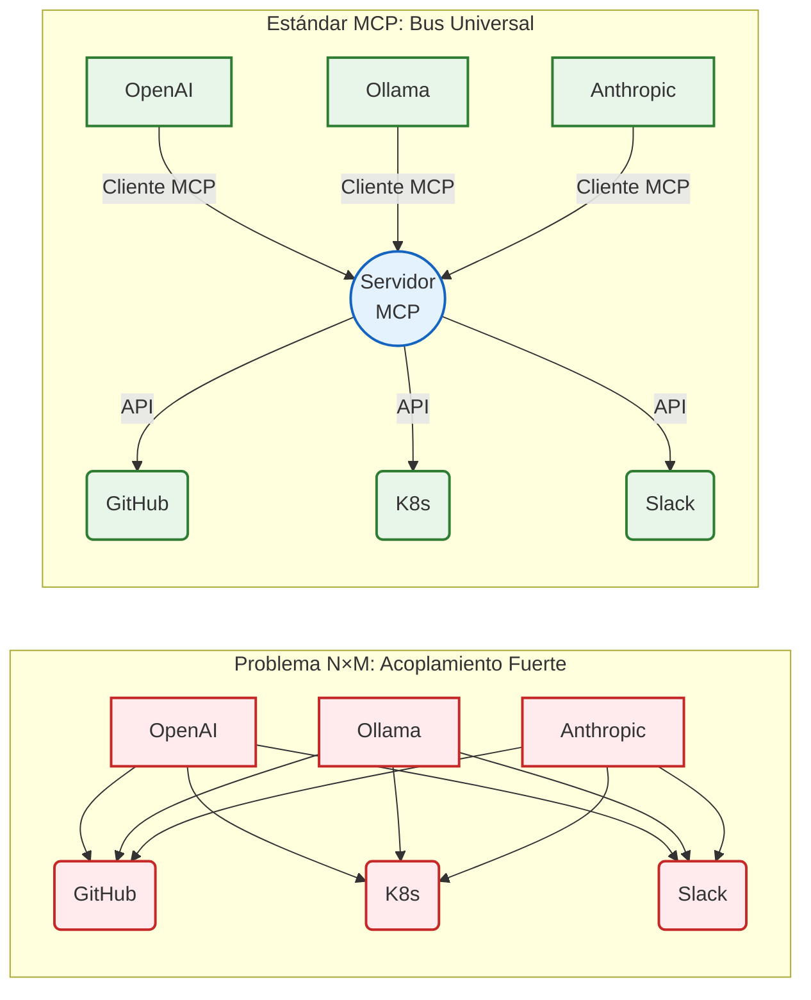

# Capítulo 2. Estado del Arte

Este capítulo articula el marco teórico y tecnológico sobre el que se sustenta la arquitectura del *Agentic Deployer*. Se expone una revisión exhaustiva de los paradigmas contemporáneos en Inteligencia Artificial, los protocolos de estandarización para la comunicación de modelos fundacionales, y los principios modernos de Ingeniería de Plataformas.

## 2.1. Agentes autónomos basados en Modelos de Lenguaje de Gran Escala (LLM)

Durante años, la investigación en Procesamiento de Lenguaje Natural (NLP, por sus siglas en inglés) persiguió la construcción de modelos capaces de comprender y generar texto humano con fluidez. Sin embargo, con el advenimiento de la arquitectura Transformer [15] y la posterior consolidación de los Modelos de Lenguaje de Gran Escala (LLM, *Large Language Models*), se descubrió empíricamente que, a partir de cierto umbral de parámetros y datos de entrenamiento, los modelos exhibían habilidades "emergentes" que excedían la simple predicción probabilística de la siguiente palabra (*next-token prediction*). 

Estas habilidades incluyen el razonamiento lógico deductivo, la generalización zero-shot y la capacidad de seguir instrucciones complejas [16]. La explotación de estas capacidades ha impulsado una transición en la disciplina: la evolución desde *asistentes conversacionales* pasivos hacia **Agentes Autónomos**. Un agente basado en LLM es un sistema computacional diseñado donde el modelo de lenguaje actúa no solo como interfaz, sino como el motor de razonamiento central que coordina la percepción de un estado, la planificación de pasos y la ejecución de acciones sobre su entorno para alterar dicho estado.

Para que un LLM trascienda su encapsulamiento (estando típicamente aislado de la internet en tiempo real y limitado por su fecha de corte de conocimiento) y adquiera verdadera agencia, la industria ha consolidado dos avances técnicos fundamentales: el paradigma de razonamiento *ReAct* y la capacidad técnica de invocación de herramientas (*Function Calling*).

### 2.1.1. El Paradigma ReAct (Reason + Act)

Previo a la formalización de arquitecturas agénticas, los enfoques tradicionales obligaban a los modelos a emitir una respuesta final inmediata, o bien a razonar estáticamente mediante técnicas como *Chain-of-Thought* (CoT) [17]. Aunque CoT optimiza sustancialmente el razonamiento al obligar al modelo a "pensar paso a paso", padece de una limitación intrínseca: el modelo razona exclusivamente sobre la información contenida en el *prompt* inicial o en sus pesos internos, sin capacidad para consultar nueva información o rectificar premisas falsas en tiempo real. Esto a menudo desemboca en fenómenos de alucinación y propagación de errores, inadmisibles en escenarios de operaciones críticas de infraestructura.

Para resolver este desafío, Yao et al. [9] introdujeron el paradigma **ReAct**. Este marco conceptual propone intercalar dinámicamente la generación de trazas de razonamiento humano-inteligibles con la ejecución de acciones específicas en el entorno. En un bucle ReAct, el agente opera bajo un ciclo continuo estructurado en tres primitivas:

1. **Pensamiento (Thought):** El agente analiza el estado actual y la petición del usuario, deduciendo cuál es el siguiente paso lógico. Por ejemplo: *"El usuario quiere un CMS. Necesito consultar las cuotas del departamento antes de asignarle memoria."*
2. **Acción (Action):** El agente selecciona, de un catálogo predefinido, una herramienta externa para ejecutarla. Por ejemplo: `consultar_cuotas_departamento(departamento="informatica")`.
3. **Observación (Observation):** El motor subyacente (el código de la aplicación) ejecuta la herramienta real contra la infraestructura y devuelve el resultado (en texto o JSON) al LLM. El modelo absorbe esta nueva información real y vuelve al estado 1.

Este ciclo iterativo se detiene únicamente cuando el modelo determina, a través de su fase de *Thought*, que ha recabado suficiente información y ha ejecutado todas las mutaciones necesarias en el entorno para emitir la **Respuesta Final (Final Answer)**. En el contexto de este Trabajo de Fin de Máster, ReAct se adopta como el mecanismo de control del orquestador: permite al agente interactuar para acordar los parámetros de un despliegue (ej. solicitar al usuario un puerto válido si la primera observación devuelve un error de validación de Kubernetes), reduciendo el riesgo de inconsistencias al anclar el razonamiento en las observaciones devueltas por el sistema subyacente.

### 2.1.2. Invocación de Herramientas (Function Calling / Tool Calling)

El mecanismo material que permite a un LLM ejecutar la fase de *Acción* de un bucle ReAct se denomina *Function Calling* (o *Tool Calling*). Antes de su estandarización, la extracción de entidades desde un texto libre dependía de expresiones regulares (RegEx) rígidas o clasificadores secundarios. Un usuario podía redactar: "Despliega una base de datos redis", pero forzar al modelo a responder estrictamente con un JSON parseable (ej. `{"accion": "desplegar", "servicio": "redis"}`) resultaba propenso a errores de formato, saltos de línea inyectados o caracteres de escape inválidos.

El salto cualitativo se produjo cuando proveedores como OpenAI, y posteriormente la comunidad *Open-Source* mediante iniciativas como Ollama, comenzaron a someter a los LLMs a procesos de ajuste fino (*fine-tuning*) intensivos, diseñados específicamente para el seguimiento estricto de estructuras de datos.

En el modelo actual de *Tool Calling*, el desarrollador inyecta en el contexto del sistema (junto al mensaje del usuario) un esquema estructurado (habitualmente *JSON Schema*) que describe las funciones disponibles, sus descripciones en lenguaje natural, y los tipos de datos exactos de sus parámetros (enteros, booleanos, enumeraciones). Cuando el modelo de lenguaje infiere que una petición de usuario requiere una acción externa, suspende la generación de texto conversacional y devuelve un objeto computacionalmente riguroso. Este objeto instruye a la aplicación que hospeda el modelo para que ejecute una rutina arbitraria en el servidor.

Esta capacidad ha transformado el rol de los lenguajes de programación en la Inteligencia Artificial. Lenguajes como Python o Go dejan de ser meros envoltorios de peticiones HTTP, y se convierten en interfaces directas de actuación de los agentes, otorgándoles acceso directo a bases de datos SQL, clientes de correo, o como en el caso del *Agentic Deployer*, acceso a la API del clúster de orquestación de Kubernetes. La robustez técnica lograda por el *Function Calling* contemporáneo es el habilitador crítico que permite confiar procesos de *DevOps* a sistemas estocásticos.

## 2.2. Estandarización de Integraciones: Model Context Protocol (MCP)

Si bien el *Function Calling* dotó a los modelos de lenguaje de capacidades de ejecución, su adopción temprana generó un ecosistema tecnológico fuertemente fragmentado. Cada proveedor de Inteligencia Artificial (OpenAI, Google, Anthropic) diseñó especificaciones propietarias para el registro de herramientas. Paralelamente, los frameworks de orquestación de IA más populares (tales como LangChain, LlamaIndex o AutoGen) crearon abstracciones incompatibles entre sí. 

Este escenario desembocó en el problema clásico de la interoperabilidad (*vendor lock-in*). Si un departamento de operaciones desarrollaba un conjunto de herramientas para orquestar su infraestructura compatible con LangChain y OpenAI, migrar hacia un ecosistema gobernado por modelos de código abierto (ej. Ollama o vLLM) requería reescribir por completo la capa de integración de las herramientas. Resultaba insostenible para las organizaciones mantener adaptadores múltiples para cada nueva iteración de los modelos fundacionales. En la **Figura 1** se ilustra este problema de integración *N* × *M* frente a la topología de bus universal propuesta por un protocolo de contexto estandarizado.

<div style="max-width: 12cm; margin: 0 auto;">



</div>
<p align="center"><i><b>Figura 1:</b> Contraste arquitectónico entre el problema de integración N×M (acoplamiento propietario) y la topología de Bus Universal propuesta por el protocolo MCP.</i></p>

Como se aprecia en la Figura 1, la topología tradicional (izquierda) adolece de un crecimiento combinatorio: la interconexión directa entre *N* modelos o clientes cognitivos (como OpenAI, Ollama o Anthropic) y *M* herramientas o servicios de infraestructura (GitHub, Kubernetes, Slack) impone el desarrollo y mantenimiento de *N* × *M* adaptadores propietarios fuertemente acoplados. En contraposición, la adopción del estándar MCP (derecha) introduce una arquitectura en estrella o bus universal: los clientes cognitivos implementan una única interfaz estandarizada (*Cliente MCP*) y los servicios se exponen a través de un servidor común (*Servidor MCP*). Esta mediación reduce la complejidad sistémica a un orden lineal *N* + *M*, desacoplando el ciclo de vida del agente respecto a la evolución tecnológica del catálogo de herramientas y de la infraestructura.

### 2.2.1. Génesis y Principios de MCP

Para resolver esta fragmentación sistémica, en el último trimestre de 2024, Anthropic (los creadores de la familia de modelos *Claude*) lideró la apertura de un nuevo estándar *open-source*: el **Model Context Protocol (MCP)** [13]. La motivación central de MCP es desacoplar de forma estricta al consumidor de la IA (el agente) de las fuentes de datos e infraestructuras locales (las herramientas), creando un lenguaje universal. 

MCP se inspira profundamente en el éxito del *Language Server Protocol (LSP)* de Microsoft, el cual estandarizó la comunicación entre los editores de código (IDEs) y los compiladores. Del mismo modo, MCP busca convertirse en la capa estándar que conecte cualquier asistente generativo con el entorno computacional de la organización, promoviendo una arquitectura conectable (*pluggable*) basada en el protocolo ligero `JSON-RPC 2.0`.

### 2.2.2. Arquitectura Cliente-Servidor de MCP

El protocolo abandona las integraciones monolíticas en favor de un diseño cliente-servidor estrictamente definido, garantizando fronteras de seguridad nítidas:

- **MCP Host / Client (El Agente):** Es la aplicación que interactúa con el usuario y gestiona el flujo de razonamiento del LLM. El cliente es agnóstico a la implementación de las herramientas; su única responsabilidad es negociar con el servidor mediante mensajes estándar, inyectar el contexto recuperado en el *prompt* del modelo, y solicitar al servidor la ejecución de las funciones decididas por la IA. En el presente proyecto, el componente `AgentOrchestrator` implementa las lógicas derivadas de un cliente MCP.
- **MCP Server (El Entorno):** Es un proceso ligero e independiente, desplegado dentro de la zona de confianza de la organización (en el caso de este TFM, operado por el Servicio de Informática de la universidad). El servidor obvia la existencia de modelos de lenguaje; su propósito es encapsular la lógica de negocio imperativa (ej. generar un manifiesto YAML de Kubernetes) y exponer esta capacidad a través de un esquema JSON estandarizado.

Ambos actores se comunican a través de transportes estandarizados. MCP soporta integraciones locales directas mediante los canales de Entrada/Salida estándar del sistema operativo (**stdio**), ideal para herramientas que corren en la misma máquina que el agente, y transporte web basado en **Server-Sent Events (SSE)** sobre HTTP, indispensable para infraestructuras distribuidas y arquitecturas nativas de la nube (*Cloud Native*).

### 2.2.3. Primitivas del Protocolo: Resources, Prompts y Tools

El estándar MCP orquesta la interacción entorno-modelo a través de tres primitivas de datos fundacionales:

1. **Resources (Recursos):** Datos de naturaleza estática o de solo lectura controlados por el servidor. Permiten inyectar contexto adicional en la ventana de memoria del LLM sin otorgarle capacidad de mutación. Ejemplos clásicos incluyen la lectura del registro de estado actual de un clúster de Kubernetes, bases de datos o documentación corporativa local.
2. **Prompts:** Plantillas de instrucciones parametradas y almacenadas en el servidor, permitiendo la estandarización organizativa. Un administrador puede definir un *prompt* en el servidor ("Resume el estado de este nodo") y el agente cliente puede invocarlo y presentarlo al usuario.
3. **Tools (Herramientas):** Son capacidades ejecutables y con efectos secundarios (mutaciones en el entorno) controladas por el servidor. Las herramientas son el equivalente estandarizado del *Function Calling*. Cuando el servidor MCP de la universidad se inicializa, transmite al cliente un catálogo de herramientas (por ejemplo, `deploy_python_app`), dictaminando los argumentos exactos requeridos (como nombre de proyecto y versión del lenguaje). 

La adopción formal del Model Context Protocol mediante su Software Development Kit (SDK) oficial en Python constituye el eje arquitectónico central del *Agentic Deployer* desarrollado en este TFM. Esta decisión estratégica garantiza que el catálogo de automatizaciones de infraestructura de la institución quede desacoplado de la rápida evolución del ecosistema de proveedores de Inteligencia Artificial. Las herramientas expuestas por el Servidor MCP del proyecto son consumibles indistintamente por el agente local diseñado (Streamlit + Ollama) y por soluciones empresariales externas y *closed-source* (como el Inspector oficial o aplicaciones de terceros), asegurando un ciclo de vida útil del software extendido y una interoperabilidad robusta.

Cabe mencionar que este paradigma de estandarización se encuentra en rápida evolución. Mientras MCP se posiciona como el estándar líder (a fecha de 2024-2026) para la comunicación Cliente-Servidor (Agente-Herramienta), la industria explora paralelamente iniciativas como el **Agent Protocol** impulsado por la AI Engineer Foundation [18], orientado a crear una interfaz única estandarizada para comunicarse con agentes autónomos. Aunque este protocolo trasciende el alcance de este TFM (centrado en la interacción Agente-Infraestructura), evidencia la madurez y necesidad inminente de estos lenguajes francos en el estado del arte.

## 2.3. Orquestación e Infraestructura Declarativa (Kubernetes y OpenShift)

Para comprender el desafío que supone la provisión autónoma de infraestructura, resulta necesario analizar el modelo introducido por Kubernetes (K8s) [5] y sus distribuciones corporativas como Red Hat OpenShift / OKD en el ámbito de las operaciones. Originado en Google bajo el proyecto interno *Borg* y posteriormente donado a la *Cloud Native Computing Foundation* (CNCF), Kubernetes se ha erigido como el estándar *de facto* para la orquestación de cargas de trabajo en contenedores. Su adopción generalizada en la industria responde a la aplicación estricta de un modelo de gestión **declarativo**. En entornos universitarios y centros de cómputo corporativos, este paradigma se implementa habitualmente sobre clústeres **OpenShift / OKD**, los cuales encapsulan el núcleo de Kubernetes proveyendo mecanismos avanzados de seguridad multiinquilino (*SecurityContextConstraints*) y operadores de ciclo de vida. Por ende, estandarizar la IDP sobre las primitivas universales de Kubernetes garantiza una interoperabilidad nativa y directa tanto en OpenShift como en cualquier distribución *Cloud Native*.

### 2.3.1. Imperativo vs. Declarativo

Tradicionalmente, en la administración de sistemas las operaciones seguían un enfoque imperativo. Los administradores interactuaban con los servidores mediante secuencias explícitas de comandos (ej. rutinas *bash* o *scripts* en servidores remotos). En un modelo imperativo, el usuario dicta *cómo* deben realizarse las acciones paso a paso: "descarga esta imagen, inicia el contenedor, abre el puerto 80, verifica si está vivo". Este enfoque, si bien directo, es inherentemente inflexible. Si un servidor se reinicia o un proceso falla, el script imperativo carece del contexto necesario para devolver el sistema a la normalidad sin intervención humana.

En contraposición, Kubernetes abraza el modelo declarativo (Infraestructura como Código - IaC). En un paradigma declarativo, el ingeniero no instruye a la máquina sobre *cómo* hacer el trabajo; en su lugar, describe exclusivamente el **estado final deseado** (*Desired State*). El usuario declara, mediante manifiestos estructurados en lenguaje YAML o JSON: "Deseo que existan exactamente 3 réplicas del contenedor de WordPress expuestas en el puerto 8080".

### 2.3.2. Bucles de Reconciliación y el Plano de Control

La materialización de este estado deseado es responsabilidad exclusiva del Plano de Control (*Control Plane*) de Kubernetes, operando a través de un mecanismo denominado **Bucle de Control o Reconciliación** (*Control Loop*).

Un clúster de K8s evalúa continuamente la topología de la red y los procesos en ejecución. De manera asíncrona, compara el **Estado Real** (*Actual State*) del clúster (por ejemplo, "hay 2 réplicas de WordPress en ejecución porque un nodo físico acaba de fallar") contra el **Estado Deseado** almacenado en su base de datos distribuida (`etcd`). Al detectar una divergencia (2 réplicas reales vs. 3 réplicas deseadas), el bucle de reconciliación infiere de forma autónoma las acciones necesarias para corregir la desviación (desplegar un nuevo contenedor en un nodo sano), ejecutándolas sin requerir una nueva instrucción imperativa del operador humano.

### 2.3.3. Complejidad Sintáctica y Carga Cognitiva

A pesar de las indudables ventajas de resiliencia y auto-sanación (*self-healing*) que ofrece el modelo declarativo, la definición técnica del estado deseado introduce una severa carga cognitiva. La API de Kubernetes está compuesta por decenas de tipos de recursos nativos (Pods, Services, Ingress...) y es extensible mediante Recursos Personalizados (*Custom Resource Definitions* - CRDs), cada uno con una semántica y un esquema estricto de validación.

Desplegar un simple servicio web en producción raramente implica redactar un solo manifiesto. Para exponer una aplicación de forma segura al exterior, un desarrollador debe coordinar y enlazar sintácticamente al menos tres primitivas fundamentales:
1. **Deployment:** Define el contenedor de la aplicación, su imagen base, la política de reinicios, las sondas de vida (*liveness probes*) y las reservas estrictas de memoria y CPU.
2. **Service:** Abstrae la volatilidad de las direcciones IP internas de los contenedores subyacentes, creando un punto de acceso de red estable (*ClusterIP*) para balancear el tráfico.
3. **Ingress:** Expone las rutas HTTP/HTTPS desde el exterior del clúster hacia los *Services* internos, gestionando reglas de enrutamiento por nombre de dominio y terminación SSL/TLS.

La interdependencia entre estos recursos exige un nivel de precisión milimétrica (por ejemplo, el anidamiento correcto de selectores de etiquetas, o *labels*, entre el *Deployment* y el *Service*). Un simple error de indentación en el formato YAML, o un fallo en el mapeo de un selector de red, provocará que la aplicación se despliegue en una isla de red inaccesible (sin devolver errores obvios de compilación).

Para ilustrar esta complejidad de forma concreta, el siguiente ejemplo muestra el manifiesto mínimo necesario para exponer una API Python en Kubernetes. Cada bloque es independiente pero deben estar enlazados correctamente entre sí:

```yaml
# 1. Deployment: define el contenedor, las réplicas y los límites de recursos
apiVersion: apps/v1
kind: Deployment
metadata:
  name: python-api           # Nombre único del recurso en el clúster
  namespace: sic-research    # Espacio de nombres del departamento
spec:
  replicas: 2                # Número de instancias en ejecución simultánea
  selector:
    matchLabels:
      app: python-api        # (A) El Deployment "posee" los Pods con esta etiqueta
  template:
    metadata:
      labels:
        app: python-api      # (A) Los Pods heredan esta etiqueta para ser seleccionados
    spec:
      containers:
        - name: api
          image: harbor.universidad.edu/sic-research/python-api:1.2.0  # Imagen auditada en registro institucional; prohibida la etiqueta :latest
          ports:
            - containerPort: 8080
          resources:
            requests: { cpu: "100m", memory: "128Mi" }   # Reserva mínima garantizada
            limits:   { cpu: "500m", memory: "512Mi" }   # Límite máximo (ResourceQuota del SIC)
---
# 2. Service: crea un punto de red estable que abstrae la IP volátil de los Pods
apiVersion: v1
kind: Service
metadata:
  name: python-api-svc
  namespace: sic-research
spec:
  selector:
    app: python-api          # (A) Referencia EXACTA a la etiqueta del Deployment; cualquier
                             # discrepancia rompe el enrutamiento sin mensaje de error evidente
  ports:
    - port: 80
      targetPort: 8080       # Redirige el tráfico del puerto 80 al puerto 8080 del contenedor
---
# 3. Ingress: expone el Service al exterior con enrutamiento HTTP por hostname
apiVersion: networking.k8s.io/v1
kind: Ingress
metadata:
  name: python-api-ingress
  namespace: sic-research
  annotations:
    nginx.ingress.kubernetes.io/ssl-redirect: "true"  # Fuerza HTTPS
spec:
  rules:
    - host: api.investigacion.univ.es
      http:
        paths:
          - path: /
            pathType: Prefix
            backend:
              service:
                name: python-api-svc   # Referencia al Service definido arriba
                port:
                  number: 80
```
<p align="center"><i><b>Listado 1:</b> Manifiesto Kubernetes completo (Deployment + Service + Ingress) para una API Python. Los tres recursos deben coordinarse correctamente —especialmente la etiqueta marcada con (A)— para que la aplicación sea accesible desde el exterior.</i></p>

El análisis de este manifiesto permite constatar que, lejos de constituir un mero archivo de configuración estático, el despliegue de una aplicación exige coordinar de forma determinista cuatro dimensiones arquitectónicas críticas:

1. **Acoplamiento declarativo mediante selectores de etiquetas (*Label Selectors*):** El mecanismo de resolución de tráfico en Kubernetes opera de manera desacoplada. El *Deployment* gestiona el ciclo de vida de los Pods etiquetados unívocamente con `app: python-api` (marcado didácticamente con `(A)`), mientras que el *Service* utiliza su campo `spec.selector` para descubrir dinámicamente dichos contenedores y construir su tabla interna de enrutamiento (*Endpoints*). Si se produce una discrepancia léxica o tipográfica entre ambas claves, la API de Kubernetes validará el manifiesto como sintácticamente correcto; sin embargo, el *Service* resolverá cero *Endpoints*, desencadenando un fallo de enrutamiento silencioso (*silent failure*) en el que no se emiten excepciones en el despliegue pero la aplicación resulta inaccesible.
2. **Topología de red y correspondencia de puertos en capas de transporte y aplicación:** Se define un esquema de mapeo multinivel. El controlador perimetral (*Ingress*) intercepta el tráfico HTTP externo en el puerto estándar `80` y lo delega al puerto homónimo del *Service*. A su vez, el *Service* ejecuta la traslación de red hacia el puerto de destino (`targetPort: 8080`), el cual debe coincidir estrictamente con el puerto en el que el proceso de la API escucha dentro del contenedor (`containerPort: 8080`). La utilización explícita de puertos superiores al 1024 responde al principio de menor privilegio, evitando requerir privilegios de superusuario (*root*) dentro del espacio de nombres de red del contenedor.
3. **Planificación y gobierno de recursos (*Resource Requests and Limits*):** La especificación formal de recursos (`requests` y `limits` de CPU y memoria) es mandatoria para la coexistencia de cargas de trabajo en clústeres multi-inquilino (*multi-tenant*). Los valores mínimos garantizados (`requests`) condicionan la decisión algorítmica del planificador (*kube-scheduler*), mientras que los techos operativos (`limits`) mitigan el impacto de vecinos ruidosos (*noisy neighbor effect*) y previenen que un proceso descontrolado provoque la expulsión indiscriminada de pods colindantes por parte del gestor de memoria del núcleo (*OOMKilled*). Estos parámetros deben inscribirse de forma obligatoria dentro de las cuotas de recursos (*ResourceQuotas*) impuestas por las políticas del *namespace* institucional (`sic-research`).
4. **Resolución nominativa en el controlador perimetral (*Ingress*):** La capa de exposición externa depende de un acoplamiento nominativo estricto: la regla de enrutamiento HTTP del *Ingress* delega el tráfico mediante el campo `backend.service.name`, que debe coincidir de forma unívoca con el identificador del *Service* (`python-api-svc`). Cualquier discrepancia en la nomenclatura impide la síntesis de las directivas de reenvío en el controlador perimetral.

Esta intrincada red de dependencias declarativas evidencia la severa carga cognitiva que supone la orquestación directa de infraestructura para investigadores y desarrolladores ajenos a la ingeniería de operaciones. En lugar de exigir al usuario el dominio de estos detalles de bajo nivel, el sistema propuesto en este Trabajo de Fin de Máster actúa como un intermediario cognitivo que infiere y valida dichas relaciones a partir de intenciones formuladas en lenguaje natural.

Como contraste empírico, en el **Anexo A (Sección A.2, Listado 2)** se recoge el manifiesto resultante generado de manera completamente autónoma por el *Agentic Deployer* para un despliegue real (Escenario 1). Dicho artefacto demuestra la capacidad del agente para sintetizar no solo esta topología de red y correspondencia de selectores, sino también para incorporar de forma automática sondas de disponibilidad y salud (*liveness* y *readiness probes*), políticas de confinamiento en tiempo de ejecución (*securityContext* sin privilegios y descarte de capacidades) y metadatos de trazabilidad y gobernanza HITL.

## 2.4. Arquitectura Hexagonal y Seguridad en Sistemas Estocásticos

La integración de Modelos de Lenguaje en sistemas críticos de infraestructura plantea un dilema de seguridad estructural. Los LLM, por su propia naturaleza estadística, son impredecibles (estocásticos). En contraste, los sistemas de provisión corporativa exigen un determinismo absoluto (por ejemplo, rechazar sistemáticamente cualquier despliegue que intente utilizar el puerto 22, reservado para SSH). Para conciliar la agilidad de la IA con la rigidez de las normativas de IT, el *Agentic Deployer* adopta los principios de la **Arquitectura Hexagonal**.

### 2.4.1. Fundamentos de *Ports and Adapters*

Formalizada por Alistair Cockburn [19] bajo el nombre de patrón de Puertos y Adaptadores (*Ports and Adapters*), la Arquitectura Hexagonal nació como respuesta a los problemas endémicos de las arquitecturas tradicionales en capas (Presentación -> Lógica de Negocio -> Base de Datos). En el diseño tradicional en capas, la lógica de negocio a menudo se contamina con dependencias transitivas de la base de datos o de los *frameworks* de interfaz de usuario.

El objetivo central de la Arquitectura Hexagonal es permitir que una aplicación sea operada de forma equitativa por usuarios, programas, pruebas automatizadas o *scripts* por lotes, y que pueda ser desarrollada y probada de forma aislada respecto a sus eventuales dispositivos e infraestructuras y bases de datos en tiempo de ejecución. 

Visualmente representada como un hexágono, la arquitectura establece una segregación formal en dos zonas bien diferenciadas:
- **El Interior (El Núcleo o *Domain*):** Alberga exclusivamente las reglas de negocio puras y el modelo de datos. Carece por completo de dependencias hacia el exterior; no importa librerías HTTP, drivers de bases de datos ni SDKs de Inteligencia Artificial.
- **El Exterior (Los Adaptadores):** Contiene todos los detalles de implementación tecnológica (APIs REST, clientes de bases de datos, integraciones con OpenAI u orquestadores de Kubernetes).

### 2.4.2. Inversión de Dependencias (El Principio 'D' de SOLID)

El puente de comunicación entre el Interior (inmutable) y el Exterior (volátil) se implementa mediante **Puertos**. Un Puerto es una interfaz abstracta o un contrato (típicamente una interfaz en lenguajes como Java o clases abstractas / *Protocols* en Python). 

La robustez estructural de esta arquitectura recae en la aplicación estricta del Principio de Inversión de Dependencias (Dependency Inversion Principle - DIP). En lugar de que el núcleo de negocio dependa del cliente de Kubernetes para desplegar, el núcleo define una abstracción `DeployPort` (por ejemplo, `def deploy(intent): pass`). Es la capa externa (el adaptador de K8s) la que hereda y debe implementar dicho contrato. El núcleo solo conoce la interfaz abstracta, jamás la implementación real. 

### 2.4.3. Confinamiento de la Inteligencia Artificial

La adopción de este patrón arquitectónico es la base de la seguridad en el presente Trabajo de Fin de Máster. Cuando el modelo de negocio (ej. la clase `DeploymentIntent`) se define en el núcleo puro de la aplicación, fuertemente tipado mediante Pydantic, el LLM queda estructuralmente separado de los adaptadores de infraestructura física.

En este flujo, el Agente LLM asume el rol de **Adaptador Primario (Driver)**, generando intenciones que intentan invocar los casos de uso del sistema. Gracias a la Arquitectura Hexagonal, el modelo de lenguaje carece de visibilidad sobre los adaptadores de infraestructura física (el **Adaptador Secundario o Driven**), impidiendo que cualquier alucinación o instrucción adversaria pueda alcanzar el clúster sin mediación. Toda intención emitida por la IA debe cruzar obligatoriamente a través del Puerto de Entrada, sometida al escrutinio del motor de reglas determinista del núcleo (`SecurityContextValidator`).

En caso de que el modelo proponga una configuración no conforme a las políticas institucionales, el núcleo la intercepta y deniega inmediatamente, emitiendo una excepción tipada. Esta excepción no degrada la estabilidad del servicio: fluye en sentido inverso hacia el exterior, donde el orquestador la captura y la reinyecta en el contexto del LLM como retroalimentación (*Feedback Loop* del bucle ReAct).

De este modo, la Arquitectura Hexagonal actúa como una capa de contención y validación determinista, permitiendo aprovechar la flexibilidad del razonamiento generativo sin concederle acceso directo a la ejecución física en la infraestructura crítica.

## 2.5. Trabajos Relacionados y Posicionamiento Diferencial

La intersección entre agentes conversacionales y automatización de infraestructura ha generado una serie de iniciativas académicas e industriales en los últimos dos años. Esta sección analiza los enfoques más relevantes y posiciona el *Agentic Deployer* respecto a ellos, identificando las contribuciones diferenciales de este trabajo.

### 2.5.1. Enfoques Industriales: Copilots y Asistentes Cloud Propietarios

Los grandes proveedores de nube han lanzado asistentes conversacionales integrados en sus plataformas. Microsoft dispone de **GitHub Copilot for Azure** y el **Azure AI Assistant** integrado en el portal web, que permiten consultar el estado de los recursos desplegados mediante lenguaje natural. Google ofrece capacidades similares mediante **Gemini for Google Cloud**, y AWS con **Amazon Q Developer**.

Sin embargo, estas soluciones presentan limitaciones estructurales significativas para entornos institucionales y corporativos:
- **Acoplamiento de Proveedor (*Vendor Lock-In*):** Operan exclusivamente sobre la nube del propio fabricante, imposibilitando la gobernanza unificada de clústeres híbridos u *on-premise*.
- **Soberanía del Dato:** Las peticiones y metadatos de red viajan a centros de datos externos de proveedores comerciales, colisionando con normativas estrictas de protección de datos (RGPD, LOPDGDD) y requisitos de privacidad institucional.
- **Riesgo de Ejecución No Supervisada:** Permiten frecuentemente la aplicación directa de órdenes de aprovisionamiento sin una barrera estricta e inmutable de supervisión humana (*Human-in-the-Loop*).
- **Coste Operativo Impredecible:** Su modelo de negocio descansa en la tarificación por consumo (pago por token o suscripciones por usuario), generando una incertidumbre presupuestaria inasumible en el sector público.
- **Falta de Adaptación a Políticas Internas:** Sus plantillas de generación son genéricas y no incorporan de forma nativa las normativas, cuotas de hardware o restricciones de seguridad predefinidas por la propia organización.

### 2.5.2. Enfoques de Investigación: LLMs para IaC, ChatOps y Frameworks de Desarrollo

En el ámbito académico y de investigación, diversos trabajos han explorado la aplicación de modelos de lenguaje a la ingeniería de infraestructura:

- **Generación automatizada de manifiestos y código de infraestructura (IaC):** Diversos estudios empíricos recientes, como el análisis de seguridad de código IaC generado por LLMs [11], proponen el uso de modelos avanzados para generar ficheros Terraform o Kubernetes a partir de especificaciones en lenguaje natural. En esta misma línea, evaluaciones cuantitativas a gran escala sobre el desarrollo de IaC asistido por LLMs [12] constatan que, si bien los modelos alcanzan una elevada tasa de completitud sintáctica en plantillas declarativas, adolecen de alucinaciones en parámetros específicos de red y persistencia, así como de derivas de configuración acumulativas que exigen validación estricta externa. Por su parte, investigaciones pioneras sobre la seguridad en clústeres como *GenKubeSec* [20] han demostrado el potencial de los LLMs para la detección, localización y remediación de malas configuraciones en manifiestos de Kubernetes; no obstante, estos autores subrayan que la aplicación automatizada de remediaciones sin una salvaguarda de supervisión humana (*Human-in-the-Loop*) introduce riesgos operacionales inasumibles en entornos de producción. Estos enfoques evidencian que delegar la corrección semántica y de seguridad al propio LLM sin una capa de validación formal determinista resulta insuficiente: el modelo puede generar código sintácticamente válido pero semánticamente inseguro (puertos abiertos, imágenes sin auditar), sin mecanismos de interceptación algorítmica.

- **Integración ChatOps para flujos DevOps:** En este ámbito destaca el trabajo de Leppänen et al. [21] *"The Highways and Country Roads to DevOps"*, que documenta la adopción práctica de herramientas conversacionales en *pipelines* CI/CD reales. Su análisis evidencia que, si bien la integración de asistentes en plataformas como Slack o Teams agiliza la comunicación operativa, los LLMs en esas arquitecturas invocan comandos de forma directa sin un modelo de dominio intermedio robusto ni un patrón HITL formalmente modelado mediante máquinas de estado.

- **Delimitación frente a Frameworks Agénticos de Propósito General:** Asimismo, resulta necesario distinguir taxonómicamente este trabajo frente a frameworks agénticos de desarrollo como **LangChain** [22] o **AutoGen** [23]. Dichas herramientas constituyen librerías base de propósito general diseñadas para encadenar llamadas a modelos y utilidades auxiliares en un estrato inferior de la pila tecnológica. Por el contrario, el *Agentic Deployer* es una solución de infraestructura finalizada: prescinde de dependencias volátiles y acoplamientos a librerías propietarias implementando una arquitectura hexagonal pura, tipado estricto de dominio e interoperabilidad desacoplada basada en el estándar universal *Model Context Protocol* (MCP).

### 2.5.3. Posicionamiento Diferencial del Agentic Deployer

El *Agentic Deployer* ocupa una posición diferencial en la confluencia entre la automatización agéntica y la ingeniería de plataformas (*Platform Engineering*). A diferencia de los asistentes comerciales que operan como cajas negras en la nube o de los experimentos de generación estocástica de código IaC, el sistema propuesto en este trabajo establece una **separación formal entre el plano de razonamiento cognitivo (LLM) y el plano de ejecución física (Arquitectura Hexagonal)**.

La Tabla 1 sintetiza la comparativa multidimensional entre los asistentes cloud propietarios y el sistema desarrollado en este trabajo:

| Dimensión | Asistentes Cloud Propietarios | **Agentic Deployer** |
|---|---|---|
| **Ámbito de Despliegue** | Infraestructura acoplada a la nube del proveedor | Cualquier clúster Kubernetes (on-premise, híbrido o cloud) |
| **Soberanía del Dato** | Inferencia y telemetría en centros de datos del proveedor | *Zero Data Retention* (inferencia local con Ollama u opciones cloud) |
| **Supervisión Humana (HITL)** | Opcional o reactiva; ejecución directa posible | Obligatoria y preventiva; barrera FSM inmutable no eludible |
| **Rutas Doradas (*Golden Paths*)** | Plantillas predeterminadas por el proveedor | Rutas doradas y políticas auditadas por la propia organización |
| **Interoperabilidad** | Interfaces cerradas al ecosistema del fabricante | Estándar universal abierto MCP (compatible con cualquier cliente) |
| **Coste Operativo** | Pago por consumo (OPEX variable e impredecible) | Infraestructura propia amortizada (OPEX predecible a coste marginal cero) |
| **Auditabilidad y Gobierno** | Registros propietarios con retención externa | Trazabilidad ACID local completa y estados persistidos en disco |
<p align="center"><i><b>Tabla 1:</b> Comparativa multidimensional entre los asistentes Cloud propietarios y el Agentic Deployer.</i></p>

En conclusión, el *Agentic Deployer* prioriza la soberanía tecnológica, la seguridad determinista y la auditabilidad operativa sobre la conveniencia del modelo SaaS, proporcionando a las organizaciones públicas y entornos institucionales un marco seguro y económicamente sostenible para la adopción de agentes inteligentes en la administración de infraestructuras críticas.

