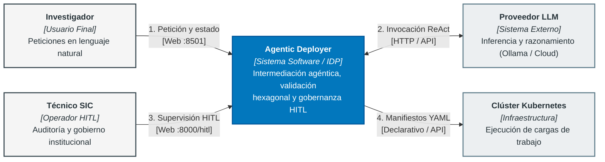
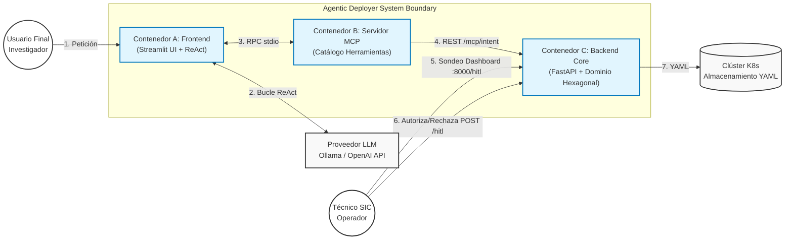
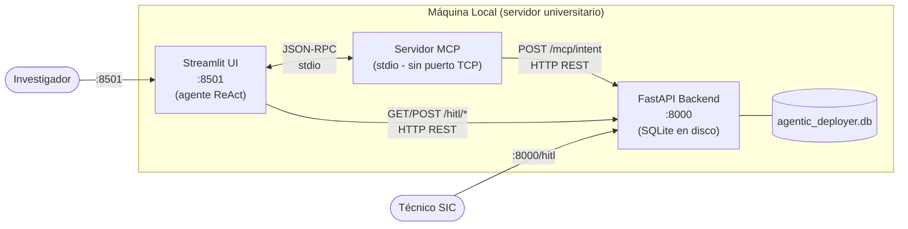
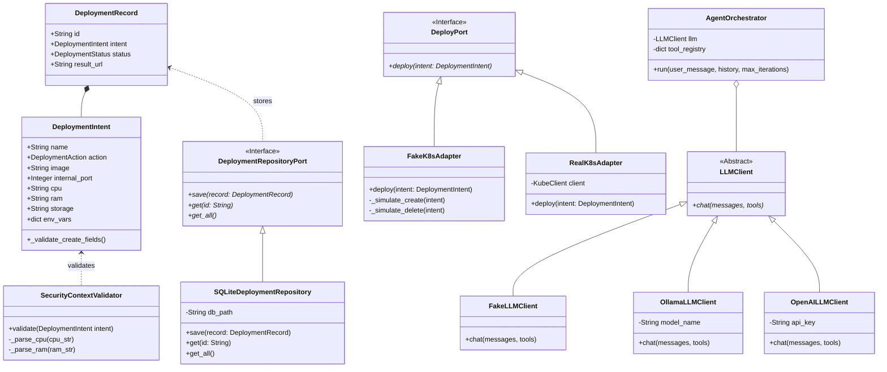
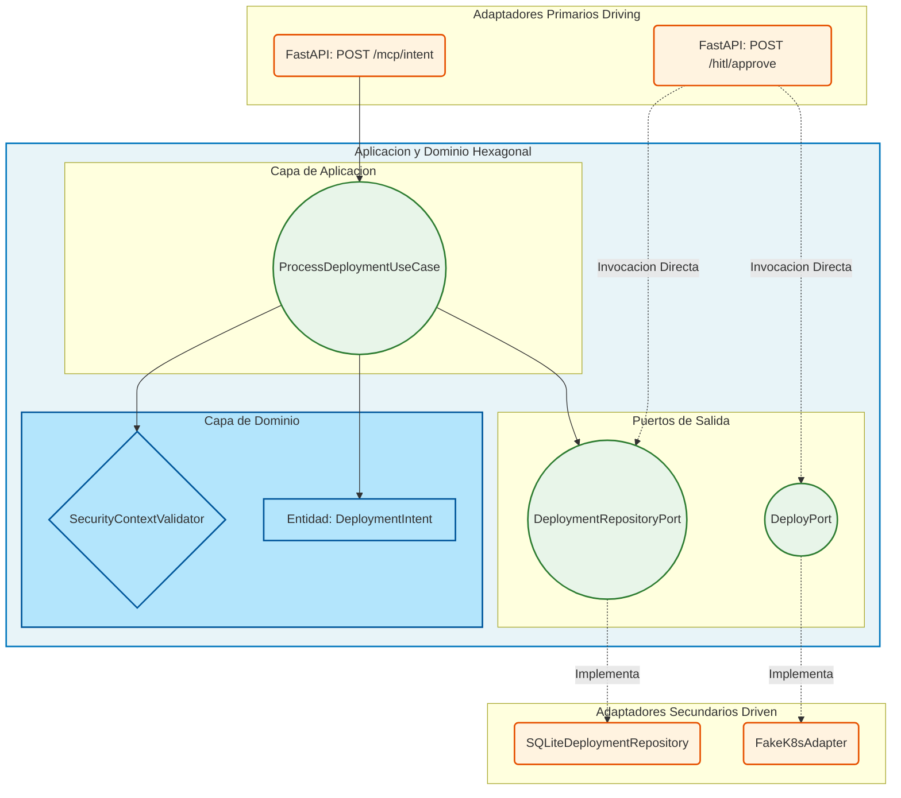
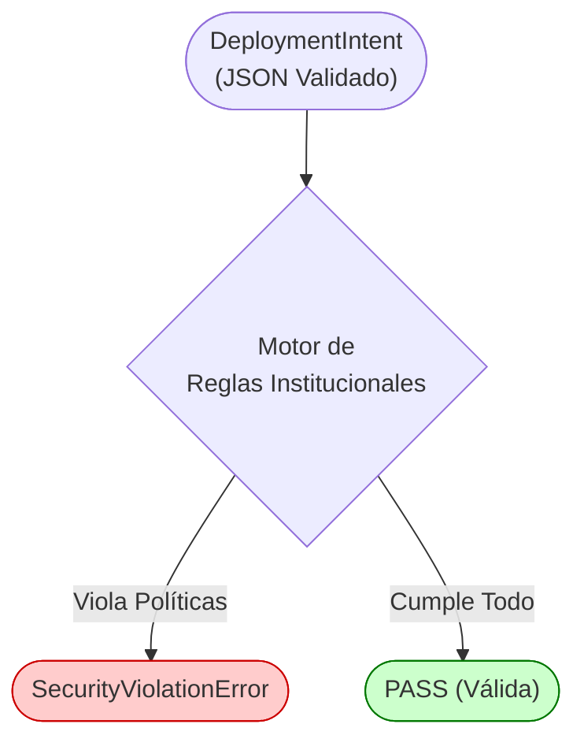
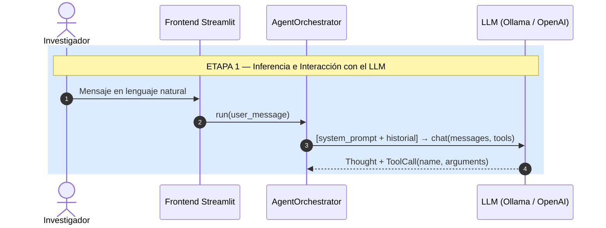
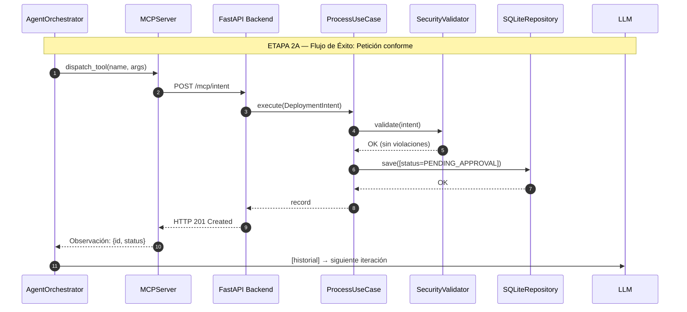
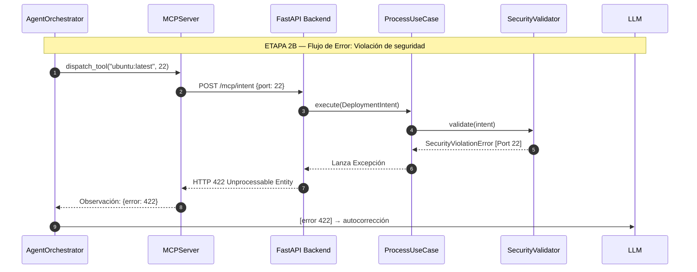
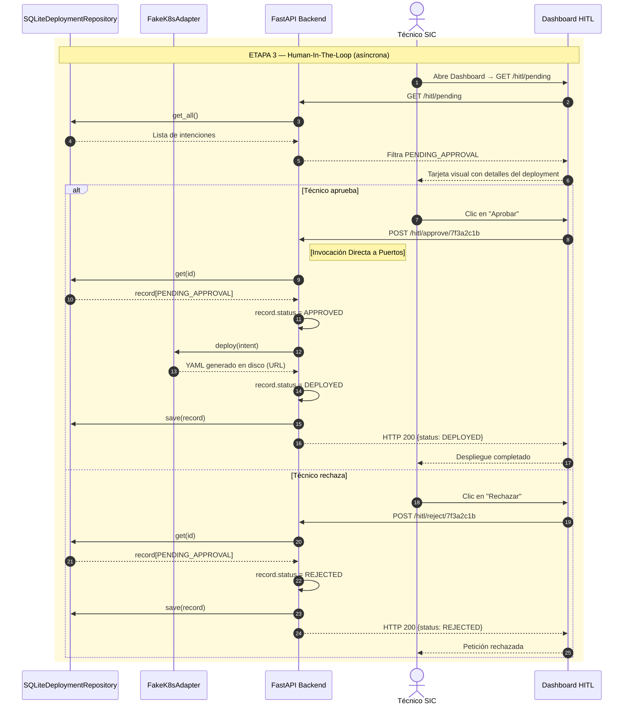

# Capítulo 5. Diseño del Sistema y Arquitectura

El diseño arquitectónico de un sistema que interseca la toma de decisiones basada en Inteligencia Artificial Generativa con las operaciones de infraestructura corporativa plantea un desafío de ingeniería: conciliar la flexibilidad interpretativa en lenguaje natural de un Modelo de Lenguaje de Gran Escala (LLM, *Large Language Model*) con las garantías deterministas y la predictibilidad exigidas por los entornos de producción.

El presente capítulo desglosa la respuesta técnica a esta disyuntiva, articulando una solución que actúa como un traductor estructurado y determinista. A lo largo de las siguientes secciones, se detallará la topología global de la solución a través del marco de modelado C4, justificando la segregación de responsabilidades de cada contenedor. Posteriormente, se analizará la fundamentación del núcleo lógico mediante la adopción de la Arquitectura Hexagonal (*Ports and Adapters*), la definición y estructuración de los contratos de provisión conocidos como *Golden Paths*, y el flujo técnico completo del ciclo de vida de una petición, desde la cadena de texto inicial formulada por el usuario hasta la instanciación del código declarativo final en el servidor físico.

## 5.1. Análisis de Requisitos y Criterios de Diseño Arquitectónico

En los proyectos de ingeniería de software convencionales, las decisiones arquitectónicas emanan directamente del análisis de requisitos. En un sistema agéntico donde confluyen la estocasticidad de un modelo de lenguaje y la criticidad de un entorno de operaciones, este análisis no solo es indispensable, sino que debe establecer con precisión técnica las fronteras entre lo que la Inteligencia Artificial puede sugerir y lo que el software tradicional puede ejecutar.

### 5.1.1. Trazabilidad entre Requisitos y Decisiones Arquitectónicas

Los objetivos estratégicos formulados en la Sección 1.3 se desglosan en la especificación formal de Requisitos Funcionales (RF) y Requisitos No Funcionales (RNF) presentada en la Sección 1.5. En la **Tabla 18** se analiza la trazabilidad directa entre cada requisito y las decisiones estructurales que gobiernan la arquitectura del sistema:

| Identificador | Requisito Formal | Decisión Arquitectónica Asociada | Componente Responsable |
|---|---|---|---|
| **RF-01** | Interfaz conversacional en lenguaje natural | Desacoplamiento de la capa de presentación mediante cliente web asíncrono y *streaming* de tokens. | Frontend Streamlit (`app/presentation/`) |
| **RF-02** | Orquestación agéntica y tolerancia a fallos | Adopción del patrón ReAct (*Reason + Act*) con bucle de reintento reflexivo condicionado por observaciones. | Orquestador Agéntico (`app/agent_layer/agent.py`) |
| **RF-03** | Catálogo modular de herramientas de infraestructura | Implementación de contratos formales abiertos mediante el protocolo estandarizado *Model Context Protocol* (MCP). | Servidor FastMCP (`app/mcp_server.py`) |
| **RF-04** | Supervisión humana de operaciones críticas (*HITL*) | Segregación de responsabilidades mediante panel web independiente y Máquina de Estados Finita (FSM) con estado de cuarentena (`PENDING_APPROVAL`). | Backend FastAPI y Dashboard HITL (`app/adapters/api.py`) |
| **RF-05** | Canal de notificación asíncrona de estado | Consulta desacoplada del estado del ciclo de vida de la petición sin acoplar al técnico con el usuario. | Repositorio SQLite y consulta periódica en Streamlit |
| **RNF-01** | Soberanía del dato y privacidad institucional | Abstracción agnóstica del motor cognitivo mediante el patrón *Adapter*, posibilitando la ejecución local sin retención de datos (*Zero Data Retention*). | Adaptador `OllamaLLMClient` en puerto local 11434 |
| **RNF-02** | Aislamiento e independencia del dominio | Arquitectura Hexagonal (*Ports and Adapters*), garantizando que las entidades e invariantes sean agnósticas de la IA, de la base de datos y de Kubernetes. | Dominio y Aplicación (`app/domain/`, `app/application/`) |
| **RNF-03** | Calidad de código y robustez formal | Estrategia de testing heterogénea: análisis estático (Ruff/Mypy), *Property-Based Testing* (Hypothesis) y auditoría por *Mutation Testing* (Mutmut). | Suite de aseguramiento de calidad (`app/tests/`) |
| **RNF-04** | Resiliencia operativa (*Fail-Safe*) | Validación determinista estricta en frontera de negocio anterior a cualquier interacción con el clúster; transición de estados atómica. | Validador `SecurityContextValidator` y FSM |
<p align="center"><i><b>Tabla 18:</b> Trazabilidad entre Requisitos Formales y Decisiones Arquitectónicas del sistema.</i></p>

### 5.1.2. Principios Rectores del Diseño del Sistema

A partir del análisis de requisitos, se definieron tres principios rectores que orientan todas las decisiones de diseño expuestas a lo largo de este capítulo:

1. **Principio de Segregación de Planos de Ejecución (Separación de Privilegios):** La Inteligencia Artificial opera exclusivamente en el *Plano Cognitivo de Sugerencia*. Carece de credenciales de infraestructura, permisos de red para interactuar con Kubernetes o capacidad transaccional directa. Toda orden generada por el agente debe ser validada por el *Plano Determinista de Control* (software tradicional) y autorizada formalmente por el operador humano (*HITL*).
2. **Principio *Fail-Safe* por Defecto:** Ante cualquier ambigüedad léxica, violación de política de seguridad o inconsistencia de tipos, el sistema rechaza la operación sin alterar el estado del clúster (`HTTP 422`), devolviendo una observación estructurada al agente para posibilitar su autocorrección reflexiva.
3. **Principio de Interoperabilidad Abierta y Desacoplamiento Tecnológico:** El núcleo de negocio se comunica con el exterior únicamente a través de interfaces formales (puertos). La IA se comunica mediante el estándar abierto MCP, el motor de inferencia se conecta mediante adaptadores intercambiables, y la generación de infraestructura se abstrae mediante plantillas declarativas (*Golden Paths*).

### 5.1.3. Matriz de Trazabilidad Integral (Requisitos ↔ Diseño ↔ Validación en QA)

En consonancia con las directrices de ingeniería del software y las rúbricas de evaluación académica de la titulación, en la **Tabla 19** se consolida la matriz de trazabilidad bidireccional, vinculando cada requisito formal con su materialización en los casos de uso del diseño arquitectónico y con los módulos ejecutables de la suite de pruebas encargados de su verificación empírica:

| Requisito | Denominación y Alcance | Caso de Uso / Flujo en Diseño | Componente Responsable | Módulo de Validación (QA) |
|---|---|---|---|---|
| **RF-01** | Interfaz conversacional natural | CU-01: Formulación de solicitud en lenguaje natural | Frontend Streamlit (`app/presentation/`) y API | `tests/test_ui.py` |
| **RF-02** | Orquestación agéntica ReAct | CU-02: Bucle reflexivo y autocorrección tras 422 | Orquestador Agéntico (`app/agent_layer/agent.py`) | `app/tests/test_agent.py` |
| **RF-03** | Catálogo modular MCP | CU-03: Descubrimiento e invocación estandarizada | Servidor FastMCP (`app/mcp_server.py`) | `app/tests/test_mcp_server.py` |
| **RF-04** | Supervisión humana (HITL) | CU-04: Cuarentena y decisión asíncrona del SIC | Backend FastAPI y Dashboard (`app/adapters/api.py`) | `app/tests/test_use_cases.py` |
| **RF-05** | Canal de retorno al usuario | CU-05: Notificación e inspección de estado | Endpoint `/hitl/status/{id}` y SQLite | `app/tests/test_status_endpoint.py` |
| **RNF-01** | Soberanía del dato institucional | Aislamiento de red sin retención en terceros | Adaptador `OllamaLLMClient` en puerto local | `app/tests/test_agent.py` |
| **RNF-02** | Aislamiento del dominio | Invariantes puras sin dependencias externas | Capa Hexagonal (`app/domain/`, `app/application/`) | `app/tests/test_use_cases.py` |
| **RNF-03** | Calidad y robustez formal | Superación del problema del oráculo y mutación | Suite heterogénea (Hypothesis, Metamorphic) | `app/tests/test_security.py`, `app/tests/test_metamorphic.py` |
| **RNF-04** | Resiliencia operativa (*Fail-Safe*) | Inmutabilidad de la FSM ante fallos y ataques | Validador `SecurityContextValidator` y FSM | `app/tests/test_security.py` |
<p align="center"><i><b>Tabla 19:</b> Matriz de Trazabilidad Integral (Requisitos ↔ Diseño ↔ Validación en QA).</i></p>

## 5.2. Modelado Topológico Arquitectónico (Estándar C4)

La documentación de arquitecturas de software modernas, caracterizadas por su naturaleza distribuida y asíncrona, resulta ineficaz cuando se aborda mediante diagramas de bloques informales o estándares excesivamente rígidos como UML (*Unified Modeling Language*). Para superar esta limitación y dotar al Trabajo de Fin de Máster de una representación rigurosa, no ambigua y jerárquica, se ha adoptado el **Modelo C4**.

El Modelo C4, concebido por Simon Brown [28], se fundamenta en la abstracción jerárquica para la visualización de arquitecturas de software. Permite estructurar el análisis de forma progresiva desde una vista de contexto macroscópica (usuarios y dependencias externas) hacia los contenedores de ejecución, los componentes lógicos internos y, en última instancia, el código fuente subyacente. 

En este análisis topológico del *Agentic Deployer*, nos centraremos en desglosar los dos niveles de abstracción más relevantes para comprender las fronteras de red y las responsabilidades corporativas: el Nivel 1 (Contexto) y el Nivel 2 (Contenedores).

### 5.2.1. Nivel 1: Contexto del Sistema (System Context)

El diagrama de Contexto (Nivel 1) constituye el estrato más abstracto del modelado. Su objetivo primordial no es revelar la tecnología empleada, sino establecer los límites fronterizos del sistema desarrollado, ilustrando cómo este interactúa con los usuarios del mundo real y con otros sistemas de información preexistentes en el entorno corporativo.

En el ecosistema universitario en el que se enmarca este proyecto, se han identificado y modelado cuatro entidades primarias, divididas estructuralmente entre actores humanos y sistemas informáticos de caja negra.

#### 5.2.1.1. Actores Humanos Interactuantes

1. **El Investigador / Usuario Final (Vector de Entrada):** Representa al personal docente, investigador o administrativo de la universidad. Su principal característica operativa es que interactúa sin requerir conocimientos técnicos avanzados de infraestructura. Este actor comprende claramente sus necesidades funcionales (por ejemplo, "Necesito publicar la página web del congreso de Biología Celular para la próxima semana"), pero desconoce las herramientas declarativas subyacentes, la topología de la red de la universidad o los estándares de seguridad de contenedores. Su interacción con el sistema se restringe exclusivamente al uso de lenguaje natural no estructurado. Por políticas de seguridad, este usuario carece de credenciales de red, accesos VPN o permisos de escritura directos contra la infraestructura de servidores de la institución.
2. **El Técnico de Operaciones / SIC (Vector de Gobierno):** Representa al ingeniero de sistemas del Servicio de Informática y Comunicaciones. En contraposición al investigador, este actor posee la responsabilidad técnica e institucional para supervisar y aplicar cambios en el centro de datos. Su rol en el sistema no es la provisión manual, sino la auditoría. Actúa como el supervisor en el paradigma *Human-In-The-Loop* (HITL). Requiere una interfaz gráfica determinista, rápida y estructurada para validar o rechazar las operaciones sugeridas por el sistema agéntico.

#### 5.2.1.2. Sistemas Externos de Caja Negra

3. **El Proveedor del Modelo de Lenguaje (LLM):** Actúa como el motor cognitivo externo del sistema. Dependiendo de las normativas de soberanía de datos de la institución, este nodo puede representar una API externa de alto rendimiento alojada en la nube (como OpenAI *gpt-4o* o Anthropic *Claude 3.5*) o un clúster *bare-metal* local ejecutando instancias *Open-Source* mediante herramientas como Ollama (ej. Mistral o Llama 3). Para la arquitectura del sistema, este proveedor opera como un oráculo sin estado (*stateless*): recibe un contexto, procesa la entrada y devuelve una respuesta generada mediante inferencia probabilística.
4. **El Clúster de Infraestructura (Kubernetes):** Constituye el destino terminal del flujo operativo. Representa la infraestructura física o virtual corporativa. Es el entorno productivo encargado de orquestar los contenedores, balancear la carga de red y gestionar los volúmenes de persistencia, ejecutando los manifiestos YAML derivados del sistema.

El orquestador *Agentic Deployer* (el software central desarrollado en este TFM) se ubica conceptualmente en el núcleo de intermediación e integración de estas cuatro entidades. Su misión sistémica es actuar como un mediador de confianza: asegurando que el investigador jamás se comunique directamente con Kubernetes, y que la Inteligencia Artificial jamás disponga de tokens de acceso directo para inyectar recursos en la red corporativa.

En la Figura 5 se resume la topología del Nivel 1 del Modelo C4, delimitando las fronteras del sistema y los canales de comunicación entre los actores humanos y las entidades de infraestructura.


<p align="center"><i><b>Figura 5:</b> Diagrama de Contexto del Sistema (Nivel 1) del Modelo C4 para el Agentic Deployer.</i></p>

Como se detalla en la Figura 5, el *Agentic Deployer* centraliza y desacopla los flujos operativos. El Investigador interactúa exclusivamente con el canal de entrada en lenguaje natural. El Proveedor LLM aporta capacidad heurística sin acceso a la red interna. El Técnico del SIC ejerce el gobierno institucional mediante un canal independiente de supervisión humana (*Human-In-The-Loop*). Finalmente, el Clúster de Kubernetes solo recibe especificaciones declarativas una vez que han superado tanto las validaciones deterministas de seguridad del sistema como la autorización humana.

### 5.2.2. Nivel 2: Contenedores (Unidades de Ejecución)

Una vez delimitadas las fronteras externas, el Nivel 2 del Modelo C4 somete a la caja central (*Agentic Deployer*) a un proceso de ampliación. En este nivel, se revela que la solución propuesta no es un monolito, sino un ecosistema distribuido compuesto por unidades de despliegue independientes, denominadas arquitectónicamente como "Contenedores".

> **Nota (Aclaración de Nomenclatura C4):** En la metodología de modelado C4, el término "Contenedor" representa una aplicación ejecutable o almacén de datos aislado (ej. un microservicio, una base de datos, una aplicación cliente). No debe confundirse estrictamente con un contenedor Docker (tecnología de virtualización), aunque en la práctica de la ingeniería moderna ambos conceptos suelan encapsularse mutuamente.

La decisión de fragmentar el sistema en múltiples procesos persigue maximizar la resiliencia operativa [29] y adherirse al principio de Separación de Preocupaciones (*Separation of Concerns*). Si un contenedor falla (por ejemplo, debido a una excepción crítica o bloqueo en la inferencia del modelo), el resto de la plataforma debe continuar operando para garantizar la trazabilidad de los datos institucionales.

En la Figura 6 se formaliza la descomposición del sistema en tres contenedores de ejecución (A, B y C), explicitando las siete interacciones que articulan el flujo de datos.


<p align="center"><i><b>Figura 6:</b> Diagrama de Contenedores (Nivel 2) del Modelo C4 para el sistema Agentic Deployer.</i></p>

#### 5.2.2.1. Explicación del Flujo de Interacciones y Acceso Técnico al Backend

La Figura 6 detalla la secuencia de interacciones numeradas del 1 al 7:

1. **Petición del usuario:** El Investigador remite su necesidad en lenguaje natural al Contenedor A (Frontend Streamlit).
2. **Ciclo de inferencia:** El orquestador alojado en el Frontend ejecuta el bucle cognitivo *ReAct* comunicándose de forma bidireccional con el Proveedor LLM (Ollama o API Cloud).
3. **Invocación de herramientas:** Al deducir una acción, el Frontend invoca el catálogo operativo expuesto por el Contenedor B (Servidor MCP) mediante el protocolo JSON-RPC sobre `stdio`.
4. **Remisión de intención tipada:** El Servidor MCP transforma la acción en una llamada HTTP REST (`POST /mcp/intent`) hacia el Contenedor C (Backend FastAPI).
5. **Sondeo del operador humano:** El Técnico del SIC accede al panel de control HITL expuesto por el Backend (`:8000/hitl`) para inspeccionar solicitudes pendientes (`PENDING_APPROVAL`).
6. **Autorización o rechazo:** Tras validar visualmente la intención, el técnico emite su decisión (`POST /hitl/approve/{id}` o `POST /hitl/reject/{id}`) sobre el Backend.
7. **Materialización declarativa:** El Backend invoca el adaptador de infraestructura secundario (`DeployPort`) para emitir el manifiesto YAML hacia Kubernetes.

**Justificación del Acceso Directo del Técnico al Backend (Interacciones 5 y 6):**  
En la Figura 6 se observa que el Técnico del SIC interactúa directamente con el Contenedor C (Backend) y no a través del Contenedor A (Frontend). Esta decisión de diseño responde a dos criterios esenciales de ingeniería de software:
- **Segregación de Responsabilidades y Seguridad (*Separation of Concerns*):** El Contenedor A está concebido exclusivamente como interfaz conversacional para usuarios sin perfil técnico (Investigador) y gestiona el contexto estocástico del LLM. Por políticas de gobierno corporativo, el operador de infraestructura no debe compartir canal con el entorno del agente.
- **Aislamiento del Panel Administrativo:** El Contenedor C (Backend FastAPI) aloja de forma nativa la interfaz web del Dashboard HITL en la ruta `/hitl`. Esta independencia garantiza que, incluso si el proceso Streamlit o la inferencia del modelo sufren una degradación o reinicio imprevisto, el técnico de operaciones conserva pleno acceso al estado persistente del sistema para auditar, autorizar o rechazar solicitudes con total independencia.

#### 5.2.2.2. Relación entre Contenedores Lógicos y Procesos en Ejecución

Mientras que la Figura 6 define los límites lógicos y los contratos de comunicación de la arquitectura, en la Figura 7 se detalla cómo dichos componentes se materializan físicamente en tiempo de ejecución sobre la máquina anfitriona (*host* universitario).


<p align="center"><i><b>Figura 7:</b> Diagrama de despliegue a nivel de proceso. Los componentes coexisten en la misma máquina anfitriona; el servidor MCP se comunica por <code>stdio</code> sin exponer puertos de red.</i></p>

En la Figura 7 se aprecian las siguientes decisiones de implementación física:
- **Frontend Streamlit (Puerto 8501):** Proceso web accesible para el investigador, que contiene el bucle *ReAct*.
- **Servidor MCP (Canal `stdio`):** Se ejecuta como un subproceso local sin exponer ningún puerto TCP de red. Esta elección elimina vectores de ataque externos y minimiza la latencia de transporte a fracciones de milisegundo mediante tuberías del sistema operativo.
- **Backend FastAPI (Puerto 8000):** Proceso que expone tanto los endpoints de la API REST para el MCP como la interfaz web del Dashboard HITL (`/hitl`) consumida por el técnico. La persistencia transaccional se apoya en un archivo local `agentic_deployer.db` gestionado por SQLite.

#### 5.2.2.3. Desglose Funcional de los Contenedores

La arquitectura interna se sustenta sobre los tres pilares de ejecución identificados en la Figura 6:

1. **Contenedor A — Frontend de Orquestación Cognitiva (Streamlit UI + ReAct):**
   Esta aplicación web es el punto de entrada para el usuario investigador. Su responsabilidad trasciende la mera renderización de interfaces (UX/UI): aloja en su núcleo el `AgentOrchestrator`, siendo el único componente del sistema autorizado a mantener conexiones de red (HTTP/gRPC) con el proveedor externo de Inteligencia Artificial (OpenAI u Ollama). Su función principal es gestionar la asincronía del chat, administrar el contexto histórico de la sesión y gobernar las iteraciones del bucle de razonamiento y acción (*ReAct*).

2. **Contenedor B — Servidor de Herramientas MCP (Servidor MCP Python):**
   Concebido como un proceso ligero, el Servidor del Protocolo de Contexto de Modelos (MCP) actúa como el catálogo dinámico de operaciones tecnológicas de la universidad. Su propósito es traducir los métodos y funciones estandarizadas (por ejemplo, el método `deploy_congress_web()`) a una representación JSON universal que cualquier LLM moderno pueda ingerir como *Tool Calling*. Por motivos de latencia estricta, este contenedor no se comunica con el orquestador mediante APIs de red tradicionales, sino que se enlaza a través de flujos de Entrada/Salida estándar (`stdio`) del sistema operativo, garantizando intercambios de mensajes JSON-RPC en el orden de los submilisegundos.

3. **Contenedor C — Núcleo Determinista (Backend Core FastAPI Hexagonal):**
   Implementado sobre el *framework* asíncrono FastAPI, este servicio aloja la lógica de dominio, la persistencia transaccional y las reglas de validación y seguridad de la arquitectura. Su principio de diseño es el desacoplamiento respecto a la capa cognitiva: a este proceso backend no le concierne cómo el modelo de lenguaje dedujo una acción, ni si el usuario utilizó jerga técnica o lenguaje coloquial. Su función es recibir un objeto JSON estructuralmente tipado desde el Servidor MCP. 
   Una vez recibida la intención, el Backend aplica de forma determinista las políticas de seguridad institucional. Si la petición vulnera dichas directrices (ej. solicitar un puerto reservado), el Backend la rechaza de manera síncrona; si es válida, la registra en estado de espera (`PENDING_APPROVAL`) en el repositorio persistente SQLite y la expone para que el *Dashboard* del Técnico de Operaciones pueda consumirla de forma asíncrona mediante técnicas de *Polling*.

Esta división modular (Frontend conversacional, Catálogo MCP y Backend hexagonal) estructura el diseño del *Agentic Deployer*. Garantiza que un fallo en la inferencia del modelo de lenguaje, o una interacción imprevista en la interfaz gráfica, no comprometa las reglas de infraestructura gobernadas por el Backend Core.

### 5.2.3. Nivel 3: Diagrama de Clases UML (Micro-Arquitectura)

En la Figura 8 se detalla el diagrama de clases unificado del sistema, formalizando la relación orientada a objetos entre las entidades del dominio, las interfaces abstractas y los adaptadores que componen el núcleo lógico.


<p align="center"><i><b>Figura 8:</b> Diagrama de Clases (UML) resumiendo las principales entidades y contratos del núcleo lógico, destacando el uso del polimorfismo para la inyección de dependencias (LLMClient, DeployPort, DeploymentRepositoryPort).</i></p>

#### 5.2.3.1. Análisis Estructural de Clases y Patrones de Diseño

El diagrama de clases de la Figura 8 materializa cinco patrones de diseño fundamentales para garantizar el desacoplamiento:

1. **Abstracción del Cliente de Inferencia (Patrón *Strategy*):** La clase abstracta `LLMClient` define el contrato polimórfico `chat(messages, tools)`. Las implementaciones concretas `OllamaLLMClient` (para ejecución local privada sin retención de datos), `OpenAILLMClient` (para proveedores cloud comerciales) y `FakeLLMClient` (para simulaciones y pruebas unitarias sin dependencias externas) encapsulan los detalles de protocolo de cada API. La clase `AgentOrchestrator` mantiene una relación de agregación con `LLMClient`, permitiendo alternar el motor de lenguaje mediante inyección de dependencias sin modificar la lógica del ciclo de razonamiento.
2. **Entidades del Dominio (`DeploymentIntent` y `DeploymentRecord`):** La entidad `DeploymentIntent` actúa como objeto de transferencia y validación de parámetros técnicos, incluyendo cómputo (`cpu`, `ram`) y almacenamiento persistente opcional (`storage`). La clase `DeploymentRecord` establece una relación de composición con `DeploymentIntent`, agregando metadatos persistentes como el identificador único (`id`), el estado en la máquina de estados finita (`status: DeploymentStatus`) y la ruta o URL del artefacto generado (`result_url`).
3. **Servicio de Validación de Dominio (`SecurityContextValidator`):** Mantiene una relación de dependencia con `DeploymentIntent`. Su responsabilidad exclusiva es evaluar los atributos de la intención contra las reglas corporativas institucionales de forma algorítmica, rechazando cualquier valor no conforme antes de que alcance la capa de persistencia.
4. **Puerto de Despliegue (`DeployPort`):** Interfaz abstracta que declara el contrato polimórfico `deploy(intent: DeploymentIntent)`. El adaptador concreto `FakeK8sAdapter` implementa este puerto para materializar plantillas YAML en disco durante las pruebas y demostraciones, mientras que la clase proyectada `RealK8sAdapter` implementa el mismo contrato interactuando con la API física de Kubernetes, cumpliendo estrictamente con el Principio de Abierto/Cerrado (*Open/Closed Principle*).
5. **Puerto y Adaptador de Persistencia (`DeploymentRepositoryPort` y `SQLiteDeploymentRepository`):** Siguiendo el desacoplamiento de infraestructura, el dominio interactúa con el almacenamiento a través de la interfaz `DeploymentRepositoryPort` (`save`, `get`, `get_all`), satisfecha en tiempo de ejecución por `SQLiteDeploymentRepository`. Esto permite aislar la persistencia en base de datos sin contaminar el dominio con dependencias SQL.

## 5.3. Adopción de la Arquitectura Hexagonal (Ports and Adapters)

El diseño del Contenedor Backend (el núcleo del sistema) requiere una fundamentación arquitectónica robusta. Como se exploró en el Estado del Arte (Capítulo 2), conceder autonomía operativa a un ente estocástico exige el establecimiento de fronteras deterministas estrictas. Para satisfacer este requisito, el núcleo del sistema se ha diseñado siguiendo el patrón arquitectónico de Puertos y Adaptadores (*Ports and Adapters*), comúnmente conocido como **Arquitectura Hexagonal** (propuesta formalmente por Alistair Cockburn) [19].

Este patrón se fundamenta en estructurar el software en capas concéntricas, imponiendo un único sentido de dependencia: desde el exterior (tecnologías volátiles, bases de datos, APIs de IA) hacia el interior (lógica de negocio inmutable).

### 5.3.1. Capa de Dominio: Entidades e Invariantes

En el centro exacto del hexágono reside la Capa de Dominio. Esta capa representa la fuente de verdad de la lógica de negocio y debe ser completamente agnóstica a cualquier *framework* externo. En el contexto de este Trabajo de Fin de Máster, la capa de dominio modela las intenciones de infraestructura antes de que estas se traduzcan a código declarativo.

Para dotar al núcleo de una seguridad de tipos estricta (esencial al operar en lenguajes interpretados), el sistema no manipula estructuras de datos dinámicas (como diccionarios JSON crudos emitidos por el LLM). En su lugar, el orquestador obliga a mapear cualquier solicitud externa hacia una Entidad de Dominio rígidamente definida. El contrato principal de este núcleo es la entidad `DeploymentIntent` (Intención de Despliegue).

En términos de Ingeniería de Software, esta entidad actúa como un contrato que impone **invariantes de dominio**. Se define de la siguiente manera conceptual:

- **Atributo Identificador:** Unívoco e inmutable (UUID).
- **Atributo Acción:** Restringido a un conjunto finito de operaciones (`CREATE`, `DELETE`).
- **Atributos Topológicos:** Nombre del servicio, imagen base, requerimientos de cómputo (CPU/RAM).
- **Invariantes Lógicas:** El puerto de red debe pertenecer estrictamente al rango válido `[1, 65535]`. Las acciones de creación exigen obligatoriamente la existencia de una imagen y un puerto válido.

La aplicación estricta de estos invariantes actúa como la primera barrera pasiva contra las alucinaciones del modelo. Si el agente MCP, a causa de un error de inferencia probabilística, intenta instanciar una intención de despliegue con un puerto de valor nulo o fuera de rango (ej. `-80`), la Entidad de Dominio denegará su propia creación arrojando una excepción pura. Esto aplica el principio de *Fail-Fast*, impidiendo que las capas subyacentes procesen datos corruptos (*Garbage In, Garbage Out*).

#### 5.3.1.1. Ejemplo Ilustrativo de `DeploymentIntent` Instanciado

Para clarificar cómo se materializa esta entidad en tiempo de ejecución, el siguiente fragmento de código ilustra una instancia real de `DeploymentIntent` creada tras la negociación conversacional para el despliegue del portal web de un congreso académico:

```python
# Instanciación tipada de la Entidad de Dominio (Pydantic / Python)
intent = DeploymentIntent(
    name="congreso-ia-2026",
    action=DeploymentAction.CREATE,
    image="docker.io/library/nginx:1.25-alpine",
    internal_port=8080,
    cpu="500m",
    ram="256Mi",
    env_vars={"APP_ENV": "production", "PORT": "8080"}
)
```

Su representación JSON equivalente, emitida por el Servidor MCP hacia el endpoint `POST /mcp/intent` del Backend, refleja la estructura estricta que viaja a través de la frontera de red:

```json
{
  "name": "congreso-ia-2026",
  "action": "CREATE",
  "image": "docker.io/library/nginx:1.25-alpine",
  "internal_port": 8080,
  "cpu": "500m",
  "ram": "256Mi",
  "env_vars": {
    "APP_ENV": "production",
    "PORT": "8080"
  }
}
```

En este ejemplo se observa cómo los campos respetan los invariantes básicos: el identificador `name` cumple con la sintaxis DNS de Kubernetes (`^[a-z0-9-]+$`), la etiqueta de la imagen evita explícitamente el uso de `:latest`, el puerto interno (`8080`) se sitúa en el rango de puertos de usuario (≥ 1024) y las variables de entorno no contienen claves sensibles en texto plano.

### 5.3.2. Principio de Inversión de Dependencias (DIP)

El diseño Hexagonal encuentra su máxima justificación en la implementación del Principio de Inversión de Dependencias (la letra 'D' del acrónimo S.O.L.I.D.). El dominio jamás invoca directamente librerías externas o conectores de bases de datos. En su lugar, expone Interfaces abstractas denominadas **Puertos**, que son implementadas por componentes periféricos denominados **Adaptadores**, tal y como se formaliza en el diagrama de clases de la Figura 8 y en el esquema topológico de la Figura 9.

La topología del hexágono divide estos adaptadores en dos categorías operativas:

#### 5.3.2.1. Adaptadores Primarios (*Driving Adapters*)
Son los componentes que inician el flujo de ejecución hacia el interior del sistema (zona izquierda de la Figura 9). En la presente arquitectura, los adaptadores primarios se materializan mediante Controladores REST (enrutados vía FastAPI). Estos controladores actúan como traductores: mientras que el *endpoint* MCP (`/mcp/intent`) delega el procesamiento al Caso de Uso de la capa de aplicación (`ProcessDeploymentUseCase`), el *endpoint* de aprobación del *Dashboard* asume el rol de orquestador, invocando de manera directa los puertos de almacenamiento y despliegue por pragmatismo en la gestión de estados.

#### 5.3.2.2. Adaptadores Secundarios (*Driven Adapters*)
Son los componentes accionados por el núcleo del sistema para interactuar con el mundo físico o mutar su estado (zona derecha de la Figura 9). En este punto de la arquitectura se concentra el mayor riesgo operativo: la comunicación directa con el clúster de Kubernetes.

Para aislar el núcleo de negocio frente a eventuales migraciones en la plataforma de orquestación (por ejemplo, si la universidad decidiera migrar de Kubernetes a Docker Swarm o AWS ECS), la capa de aplicación dicta sus necesidades a través de un puerto abstracto llamado `DeployPort` (declarado en la Figura 8). 

En la implementación actual del TFM, este puerto es satisfecho por un adaptador concreto denominado `FakeK8sAdapter`. Cuando el núcleo aprueba una intención, invoca la interfaz abstracta `deploy()`. El núcleo asume que el contenedor está siendo desplegado en producción, pero en realidad, el adaptador secundario (diseñado expresamente para la demostración y las pruebas) procesa la información y vierte los manifiestos YAML físicamente en el disco local del servidor, sin afectar a la red real. 

Esta abstracción modular garantiza que, en iteraciones futuras del producto, la sustitución del adaptador simulado por un `RealK8sAdapter` (clase ya contemplada en la Figura 8 y proyectada en la Sección 10.3.1) no requerirá alterar ni reescribir una sola línea de código en las capas de Aplicación o Dominio.


<p align="center"><i><b>Figura 9:</b> Topología de la Arquitectura Hexagonal. El flujo de control penetra desde los Adaptadores Primarios, pero la dependencia de código siempre fluye hacia el centro (Regla de Dependencia de Inversión).</i></p>

## 5.4. Algoritmia de Validación de Seguridad Institucional

La delegación de la escritura de intenciones declarativas a un Agente Cognitivo introduce un vector de amenaza fundamental: el LLM podría generar una topología de red técnicamente válida para el clúster, pero corporativamente ilícita. La protección contra estas peticiones (ya sean fruto de alucinaciones algorítmicas, un error involuntario de configuración por parte del usuario o un ataque directo de inyección de *prompts*) recae sobre la Capa de Aplicación, concretamente en un servicio de dominio especializado: el `SecurityContextValidator`.

En esta sección se formaliza la lógica de validación que rige dicho componente, así como la gestión del ciclo de vida de las excepciones derivadas de su ejecución, un componente crítico para la retroalimentación del agente.

### 5.4.1. Cortafuegos Lógico: Formalización Algorítmica

El `SecurityContextValidator` opera bajo el principio de "Confianza Cero" (*Zero-Trust*). No asume ninguna premisa sobre la validez semántica de las acciones emitidas por el Agente MCP. Su misión es interceptar la Entidad de Dominio (`DeploymentIntent`) y someterla a un árbol de decisiones binarias imperativo, contrastándola contra las normativas de Ciberseguridad e ITIL del centro de datos de la universidad.

#### 5.4.1.1. Estructura de la Configuración del Sistema (`politicas_locales`)

Antes de examinar el algoritmo de validación, es preciso detallar la estructura de datos que compone el parámetro de entrada `politicas_locales`. En el diseño del backend, este conjunto de políticas institucionales se define mediante constantes declarativas y reglas de configuración parametrizadas:

1. **Umbral de Puertos Privilegiados (`MIN_ALLOWED_PORT = 1024`):** Define el límite inferior de los puertos de red permitidos para servicios de usuario. El rango de puertos del sistema (`0` a `1023`, conocidos como *Well-Known Ports*) queda estrictamente reservado para procesos administrativos con privilegios de superusuario (`root`).
2. **Lista Blanca de Registros de Imágenes (`ALLOWED_REGISTRIES`):** Conjunto estricto de prefijos de confianza autorizados para suministrar imágenes de contenedores al clúster universitario:
   - `docker.io/` (Docker Hub oficial).
   - `quay.io/` (Red Hat Quay).
   - `harbor.universidad.edu/` (Registro privado institucional).
   Cualquier imagen que no provenga explícitamente de uno de estos tres registros es clasificada como vector potencial de código malicioso y rechazada.
3. **Etiquetas Volátiles Restringidas (`FORBIDDEN_IMAGE_TAGS = {"latest"}`):** Prohíbe el uso de la etiqueta `:latest` para blindar los despliegues frente a la deriva de configuración (*Configuration Drift*) y garantizar la reproducibilidad determinista del software.
4. **Cuotas Máximas de Hardware Departamental:**
   - `MAX_CPU_MILLICORES = 4000` (equivalente a 4 núcleos virtuales).
   - `MAX_RAM_MEBIBYTES = 8192` (equivalente a 8 GiB de memoria).
5. **Subcadenas Prohibidas en Variables de Entorno (`FORBIDDEN_ENV_KEYS`):** Tupla de patrones (`"password"`, `"secret"`, `"token"`, `"key"`, `"credential"`) destinada a detectar intentos involuntarios de inyección de credenciales en texto plano dentro de la especificación de despliegue.
6. **Almacenamiento Persistente Obligatorio en Bases de Datos:** Si la imagen del contenedor referencia un motor de base de datos (`postgres`, `mysql`, `redis`, `mongo`), el validador exige la definición explícita del parámetro `storage` (ej. `'10Gi'`) para impedir despliegues efímeros con riesgo de pérdida de datos.

Asimismo, el validador incorpora una regla de exención de ciclo de vida: las peticiones cuya acción sea de desmantelamiento (`action = DELETE`) eluden estas comprobaciones de creación, permitiendo liberar recursos sin evaluar puertos ni imágenes.

Con estas estructuras declarativas establecidas, el comportamiento del validador de seguridad se describe formalmente a continuación mediante el Algoritmo 1, reflejando fielmente la acumulación de violaciones implementada en el código.

```text

01 ENTRADA: 
02  intencion -> Objeto de tipo DeploymentIntent (Invariantes básicos garantizados)
03  politicas_locales -> Configuración del Sistema (Puertos vetados, repositorios, cuotas)
04 
05 SALIDA: 
06  VERDADERO (Si la intención cumple todas las políticas institucionales)
07  LANZA Excepción de Seguridad (SecurityViolationError) con lista de violaciones
08 
09 INICIO
10   // REGLA 0: Exención de ciclo de vida para operaciones de borrado
11   SI intencion.action ES IGUAL A DeploymentAction.DELETE ENTONCES
12     RETORNAR VERDADERO
13   FIN SI
14 
15   Variable violaciones = ListaVacia()
16 
17   // REGLA 1: Análisis Topológico de Red (Principio de Mínimo Privilegio)
18   SI intencion.internal_port != NULO Y intencion.internal_port < 1024 ENTONCES
19     violaciones.Agregar("Puerto privilegiado no permitido: " + intencion.internal_port)
20   FIN SI
21 
22   // REGLAS 2, 3 Y 4: Inspección de Imagen y Almacenamiento
23   SI intencion.image != NULO ENTONCES
24     SI ":latest" EN intencion.image ENTONCES
25       violaciones.Agregar("Uso de etiqueta ':latest' prohibido: " + intencion.image)
26     FIN SI
27     
28     Variable registro_valido = FALSO
29     PARA CADA registro EN politicas_locales.ALLOWED_REGISTRIES HACER
30       SI intencion.image INICIA_CON registro ENTONCES
31         registro_valido = VERDADERO
32         ROMPER BUCLE
33       FIN SI
34     FIN PARA
35     SI registro_valido ES FALSO ENTONCES
36       violaciones.Agregar("Registro no confiable: " + intencion.image)
37     FIN SI
38 
39     SI ContieneMotorBBDD(intencion.image) Y intencion.storage ES NULO ENTONCES
40       violaciones.Agregar("Las bases de datos requieren almacenamiento persistente explícito")
41     FIN SI
42   FIN SI
43 
44   // REGLA 5: Auditoría de Cuotas de Hardware (Resource Quotas)
45   Variable cpu_m = ParsearMiliCores(intencion.cpu)
46   SI cpu_m > 4000 ENTONCES
47     violaciones.Agregar("Cuota de CPU excedida: " + intencion.cpu + " > 4000m")
48   FIN SI
49 
50   Variable ram_mi = ParsearMebibytes(intencion.ram)
51   SI ram_mi > 8192 ENTONCES
52     violaciones.Agregar("Cuota de RAM excedida: " + intencion.ram + " > 8192Mi")
53   FIN SI
54 
55   // REGLA 6: Detección Heurística de Secretos en Variables de Entorno
56   PARA CADA clave EN intencion.env_vars HACER
57     SI ContieneSubcadena(clave.Minusculas(), ["password", "secret", "token", "key", "credential"]) ENTONCES
58       violaciones.Agregar("Posible secreto en texto plano en variable: " + clave)
59     FIN SI
60   FIN PARA
61 
62   // Si existen violaciones acumuladas, se interrumpe la ejecución
63   SI Longitud(violaciones) > 0 ENTONCES
64     LANZAR SecurityViolationError(violaciones)
65   FIN SI
66 
67   RETORNAR VERDADERO
68 FIN
```
<p align="center"><i><b>Algoritmo 1:</b> Validación Estricta de Entidades de Dominio Hexagonal (SecurityContextValidator).</i></p>

La adopción de este árbol de decisión, con complejidad temporal O(R + K) (donde R es el número de repositorios confiables y K el número de claves de entorno a validar), garantiza que el comportamiento del modelo de lenguaje quede acotado dentro de un conjunto de reglas deterministas. El modelo puede deducir el nombre del servicio o la cantidad de memoria RAM necesaria, pero la lógica de validación establece los límites que ninguna inferencia del modelo puede sobrepasar.

En la Figura 10 se resume visualmente el árbol de validación como diagrama de flujo:

<div style="max-width: 6cm; margin: 0 auto;">



</div>
<p align="center"><i><b>Figura 10:</b> Visión general simplificada del <code>SecurityContextValidator</code>. Una rama de rechazo lanza el error para que ReAct se auto-corrija.</i></p>

Como refleja la bifurcación binaria de la Figura 10, la entidad tipada `DeploymentIntent` es evaluada por el motor de reglas institucionales: si la intención satisface la totalidad de las políticas de red y seguridad, transiciona a estado conforme (`PASS`) y continúa hacia la persistencia en cuarentena; si vulnera cualquier restricción corporativa (ej. puerto reservado o etiqueta `:latest`), se desvía inmediatamente a la rama de excepción lanzando `SecurityViolationError`.

### 5.4.2. Gestión de Excepciones y Ciclo de Vida del Error

En las arquitecturas de software tradicionales orientadas a microservicios, el lanzamiento de una excepción crítica como el `SecurityViolationError` aborta la transacción y se propaga hacia el usuario final (típicamente traducido en un código HTTP `400 Bad Request` o `422 Unprocessable Entity`), mostrándole una alerta técnica en la interfaz gráfica.

Sin embargo, el *Agentic Deployer* introduce un mecanismo de interceptación orientado al agente. La excepción no se traslada inmediatamente en forma de error técnico opaco al usuario investigador, sino que se devuelve al modelo de lenguaje dentro del flujo conversacional.

El ciclo de vida del error sigue la siguiente secuencia:

1. El `SecurityContextValidator` lanza la excepción (ej. "Uso de puerto privilegiado prohibido").
2. El Adaptador REST de FastAPI serializa esta excepción pura y responde a la petición RPC del Servidor MCP con un código HTTP `422`.
3. El Servidor MCP transmite este código de fallo a la Interfaz Cognitiva. En lugar de interrumpir la aplicación Streamlit con un fallo no controlado, el orquestador ReAct registra este error como una **Observación (*Observation*)**.
4. La Observación es re-inyectada en la ventana de contexto del LLM.

Esta gestión de excepciones alivia la carga cognitiva del usuario: no se le exige diagnosticar directamente el motivo del rechazo técnico (por ejemplo, el intento de uso del puerto privilegiado 22). El modelo de lenguaje interpreta el mensaje de error estructurado, ajusta su contexto interno e interactúa con el usuario solicitando un parámetro válido (por ejemplo, el puerto 8080). Esta articulación entre validaciones deterministas en el backend y asistencia en lenguaje natural constituye un componente clave de la solución propuesta.

## 5.5. Patrón de Abstracción: *Golden Paths* y Expansión Sintáctica

El último eslabón conceptual de la arquitectura de sistema aborda el mecanismo subyacente para la generación del código declarativo (*Infrastructure as Code*, IaC). En un primer estadio de adopción de IA, la tentación arquitectónica más común consiste en solicitar al Modelo de Lenguaje que redacte íntegramente los manifiestos YAML (por ejemplo, pasándole un *prompt* del tipo "escribe un Deployment de Kubernetes para esta aplicación"). 

Sin embargo, desde la perspectiva de la Ingeniería de Fiabilidad del Sitio (*Site Reliability Engineering*, SRE), esta práctica introduce un riesgo inasumible denominado **Deriva de Configuración (*Configuration Drift*)**. Si el LLM tiene control total sobre la topología, podría instanciar servicios usando versiones deprecadas de APIs (ej. `extensions/v1beta1` en lugar de `apps/v1`), omitir sondas de disponibilidad (*Liveness Probes*), o saltarse las etiquetas (*labels*) necesarias para el enrutamiento interno del clúster.

### 5.5.1. Definición Teórica del *Golden Path*

Para mitigar este riesgo, el diseño arquitectónico adopta el patrón *Golden Path* (Camino Dorado). Un *Golden Path* se define formalmente como una plantilla de infraestructura estandarizada, fuertemente securizada, y auditada previamente por el equipo senior de Operaciones de IT. 

En este paradigma, el modelo de lenguaje no redacta código de infraestructura directamente, sino que su función generativa se limita a la extracción de parámetros. La estructura y configuración base de despliegue (el «cómo») quedan fijadas en la plantilla predefinida y auditada por el equipo de operaciones, mientras que el modelo provee los valores específicos (el «qué») consensuados con el usuario en lenguaje natural.

### 5.5.2. Motor de Plantillas (Separación entre Topología y Variables)

El proceso de expansión sintáctica ocurre de forma invisible para el usuario en la capa más externa del hexágono (en el adaptador de infraestructura `DeployPort`). Cuando el técnico aprueba una intención retenida, el adaptador actúa como un motor de interpolación de cadenas o *Template Engine*.

El sistema realiza un mapeo inyectivo. Extrae las variables cognitivas validadas por el núcleo (nombre del servicio, puerto interno, requerimientos de CPU/RAM, imagen) y las inyecta en la matriz declarativa pre-probada.

A nivel topológico, una simple solicitud cognitiva ("necesito una base de datos") se expande de forma determinista en un árbol de recursos interdependientes:
1. Un **`Deployment`** o **`StatefulSet`**, configurado para aplicar cuotas rígidas (*Resource Quotas*) y anti-afinidad de nodos.
2. Un **`Service`**, autoconfigurado como `ClusterIP` para evitar la exposición accidental de la base de datos a redes públicas externas.
3. Un **`PersistentVolumeClaim`** (PVC), dimensionado dinámicamente según el tamaño de disco inferido.

Esta garantía de homogeneidad algorítmica asegura que el 100% de los servicios orquestados por el *Agentic Deployer* heredan idéntica postura de seguridad, permitiendo al Servicio de Informática (SIC) escalar la provisión de recursos con alta predictibilidad.

> **Nota de alcance del MVP:** La plantilla actual del `FakeK8sAdapter` genera los tres recursos base del *Golden Path* de aplicación web: `Deployment`, `Service` e `Ingress`. La inclusión de un `PersistentVolumeClaim` (PVC) para servicios con estado (como bases de datos) queda fuera del alcance del presente prototipo y se contempla como primera evolución en el Horizonte a Corto Plazo (Sección 10.3.1).

#### 5.5.2.1. Ejemplo Ilustrativo de *Golden Path* y Expansión Declarativa

Para ilustrar este mecanismo en la práctica, el siguiente bloque muestra la plantilla base multi-documento definida en el adaptador secundario (`FakeK8sAdapter`) y el manifiesto YAML resultante tras interpolar la intención del portal `congreso-ia-2026`:

```yaml
# Plantilla base del Golden Path (FakeK8sAdapter en app/infrastructure/fake_k8s_adapter.py)
---
apiVersion: apps/v1
kind: Deployment
metadata:
  name: {intent.name}
  labels:
    app: {intent.name}
spec:
  replicas: 1
  selector:
    matchLabels:
      app: {intent.name}
  template:
    metadata:
      labels:
        app: {intent.name}
    spec:
      containers:
        - name: {intent.name}
          image: {intent.image}
          ports:
            - containerPort: {intent.internal_port}
          resources:
            requests:
              cpu: {intent.cpu}
              memory: {intent.ram}
---
apiVersion: v1
kind: Service
metadata:
  name: {intent.name}-svc
spec:
  selector:
    app: {intent.name}
  ports:
    - protocol: TCP
      port: 80
      targetPort: {intent.internal_port}
---
apiVersion: networking.k8s.io/v1
kind: Ingress
metadata:
  name: {intent.name}-ingress
spec:
  rules:
    - host: {intent.name}.apps.universidad.edu
      http:
        paths:
          - path: /
            pathType: Prefix
            backend:
              service:
                name: {intent.name}-svc
                port:
                  number: 80
```

Al aplicarse sobre la intención validada del congreso (`name: "congreso-ia-2026"`, `image: "docker.io/library/nginx:1.25-alpine"`, `internal_port: 8080`, `cpu: "500m"`, `ram: "256Mi"`), el adaptador materializa de forma determinista el siguiente manifiesto en el disco local (`outputs/congreso-ia-2026.yaml`), retornando la URL institucional `https://congreso-ia-2026.apps.universidad.edu`:

```yaml
# Manifiesto YAML final generado deterministamente (outputs/congreso-ia-2026.yaml)
---
apiVersion: apps/v1
kind: Deployment
metadata:
  name: congreso-ia-2026
  labels:
    app: congreso-ia-2026
spec:
  replicas: 1
  selector:
    matchLabels:
      app: congreso-ia-2026
  template:
    metadata:
      labels:
        app: congreso-ia-2026
    spec:
      containers:
        - name: congreso-ia-2026
          image: docker.io/library/nginx:1.25-alpine
          ports:
            - containerPort: 8080
          resources:
            requests:
              cpu: 500m
              memory: 256Mi
---
apiVersion: v1
kind: Service
metadata:
  name: congreso-ia-2026-svc
spec:
  selector:
    app: congreso-ia-2026
  ports:
    - protocol: TCP
      port: 80
      targetPort: 8080
---
apiVersion: networking.k8s.io/v1
kind: Ingress
metadata:
  name: congreso-ia-2026-ingress
spec:
  rules:
    - host: congreso-ia-2026.apps.universidad.edu
      http:
        paths:
          - path: /
            pathType: Prefix
            backend:
              service:
                name: congreso-ia-2026-svc
                port:
                  number: 80
```

Este diseño impide la generación estocástica de sintaxis de Kubernetes o la alteración arbitraria de cuotas de cómputo por parte del modelo de lenguaje, garantizando que el equipo de operaciones mantenga el control determinista sobre las directivas de seguridad del clúster.

## 5.6. Flujo de Datos *End-to-End* y Ciclo de Estados

Las decisiones arquitectónicas formalizadas a lo largo de este capítulo (Modelo C4, Arquitectura Hexagonal y plantillas *Golden Paths*) se articulan en un flujo de procesamiento distribuido que coordina componentes de distinta naturaleza: la inferencia probabilística del modelo de lenguaje en el frontend, la validación determinista de tipos y seguridad en el backend, y el control asíncrono de cambios mediante supervisión humana (*HITL*).

La traza de ejecución completa abarca desde la recepción de la solicitud en lenguaje natural formulada por el investigador, hasta la persistencia y eventual materialización declarativa de los manifiestos de despliegue autorizados por el técnico. Para estructurar formalmente este flujo y delimitar las responsabilidades de cada componente, la secuencia se descompone en tres etapas sucesivas:

#### 5.6.0.1. Ejemplo Ilustrativo del Flujo Extremo a Extremo (*Walkthrough*)

Para comprender el recorrido de una orden antes de examinar los diagramas de secuencia formales, considérese el siguiente ciclo de vida completo para la solicitud de un investigador:

1. **Entrada en Lenguaje Natural (Etapa 1):** El investigador escribe en la interfaz Streamlit: *"Hola, necesito publicar la web informativa del congreso de IA con NGINX en el puerto 8080 con 500m de CPU y 256Mi de RAM"*.
2. **Inferencia y Detección de Herramienta:** El `AgentOrchestrator` consulta al LLM en el bucle *ReAct*. El modelo razona que dispone de la herramienta `format_deployment_intent` y genera el *Tool Call* con los parámetros extraídos.
3. **Validación Hexagonal (Etapa 2):** El Servidor MCP envía `POST /mcp/intent` al Backend. El `SecurityContextValidator` ejecuta el Algoritmo 1:
   - Puerto 8080 ≥ 1024 → Conforme.
   - Imagen `docker.io/library/nginx:1.25-alpine` en lista blanca y sin etiqueta `:latest` → Conforme.
   - Recursos (500m CPU, 256Mi RAM) bajo cuota → Conforme.
   - Variables sin secretos → Conforme.
4. **Persistencia Transaccional:** El Backend registra la intención en SQLite con identificador unívoco hexadecimal de 8 caracteres (ej. `7f3a2c1b`) en estado inmutable `PENDING_APPROVAL`, devolviendo una respuesta HTTP `201 Created` al agente, quien informa al usuario de que la solicitud queda a la espera de validación técnica.
5. **Revisión y Aprobación HITL (Etapa 3):** El técnico del SIC abre el *Dashboard* web (`:8000/hitl`), visualiza la tarjeta con los parámetros de la solicitud `7f3a2c1b` y pulsa "Aprobar" (`POST /hitl/approve/7f3a2c1b`).
6. **Materialización Declarativa:** La FSM del backend transiciona a `APPROVED` y luego a `DEPLOYED`. El adaptador `FakeK8sAdapter` interpola la plantilla del *Golden Path*, escribe físicamente el archivo `outputs/congreso-ia-2026.yaml` y retorna la URL del servicio (`https://congreso-ia-2026.apps.universidad.edu`).

A continuación, se formalizan las tres etapas mediante diagramas de secuencia UML (Figuras 11, 12 y 13).

### 5.6.1. Etapa 1: Extracción Cognitiva de Parámetros (Interacción con el LLM)

En la Figura 11 se modela la fase de inferencia inicial. El flujo se inicia a partir de una petición en lenguaje natural no estructurada introducida por el investigador en el frontend. La latencia en esta etapa depende del modelo de lenguaje configurado y de su infraestructura de ejecución (servicios API en la nube frente a inferencia local sobre Ollama). El bucle ReAct itera de forma conversacional hasta estructurar los parámetros requeridos en un objeto tipado (`ToolCall`).


<p align="center"><i><b>Figura 11:</b> Diagrama de Secuencia E2E (Etapa 1). Interacción entre el Investigador y el LLM para la extracción estructurada de la intención de despliegue.</i></p>

### 5.6.2. Etapa 2: Validación Determinista y Persistencia en Cuarentena

En la Figura 12 se modela el punto de control determinista en el que las peticiones transferidas por el Servidor MCP ingresan en el Backend. En esta etapa, la latencia se reduce al orden de los microsegundos, al tratarse de validaciones algorítmicas en memoria ejecutadas por los esquemas Pydantic y el `SecurityContextValidator`. El diagrama formaliza tanto la ruta nominal conforme (Etapa 2A, *Happy Path*) como la ruta de interceptación de violaciones de seguridad (Etapa 2B: excepción `SecurityViolationError` → respuesta HTTP `422 Unprocessable Entity` → retroalimentación al agente ReAct para su autocorrección reflexiva). Cuando la petición supera todos los controles, el backend no ejecuta ninguna mutación en la infraestructura; únicamente persiste el registro en estado de espera (`PENDING_APPROVAL`) en la base de datos SQLite, disociando de forma estricta la inferencia del agente de la ejecución física.




<p align="center"><i><b>Figura 12:</b> Diagrama de Secuencia E2E (Etapa 2). Validación determinista en el backend: (Arriba) Ruta nominal conforme (Etapa 2A); (Abajo) Interceptación de violación de seguridad y autocorrección (Etapa 2B).</i></p>

### 5.6.3. Etapa 3: Supervisión y Autorización Humana (Ciclo HITL)

En la Figura 13 se documenta la fase de decisión y aplicación de cambios, la cual es operativamente asíncrona respecto a las dos anteriores. A diferencia de las fases computacionales previas, esta etapa queda supeditada a la ventana de revisión del operador técnico del SIC, quien accede al panel de control HITL para auditar las solicitudes en cuarentena. Únicamente tras recibir la aprobación explícita del técnico, el backend actualiza el estado de la FSM a `APPROVED` y despacha la orden hacia el adaptador de infraestructura secundario (`DeployPort`), procediendo a la síntesis y escritura de los manifiestos YAML en el almacenamiento destino. En caso de denegación, la transición hacia el estado inmutable `REJECTED` bloquea cualquier interacción con el clúster.


<p align="center"><i><b>Figura 13:</b> Diagrama de Secuencia E2E (Etapa 3). Supervisión asíncrona del operador técnico (HITL) y materialización de la infraestructura.</i></p>

> *Nota de alcance: la Figura 13 representa el flujo HITL a nivel de orquestación global. La **Sección 7.3.3** profundiza deliberadamente en este mismo flujo, incorporando el ciclo de polling asíncrono del Dashboard, los detalles del Algoritmo 4 (FSM_Transition) y los dos vectores de mutación (aprobación y rechazo) como diagramas de secuencia separados y autocontenidos. Esta ampliación es intencional y complementaria, no redundante.*

El diseño integral expuesto garantiza una estricta separación de responsabilidades: el modelo de lenguaje actúa exclusivamente como **asistente para la extracción de sintaxis e intención**, mientras que los módulos deterministas de la arquitectura retienen el control exclusivo sobre las **operaciones de modificación de estado en el clúster**.
