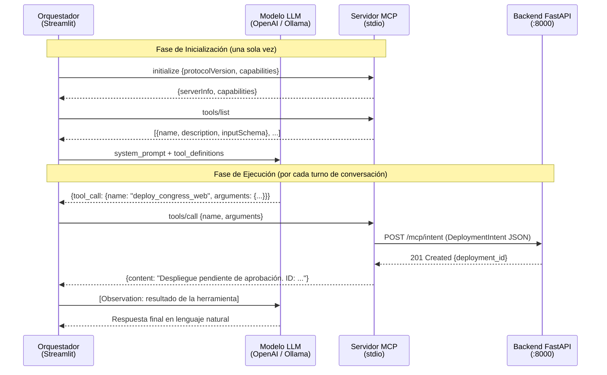
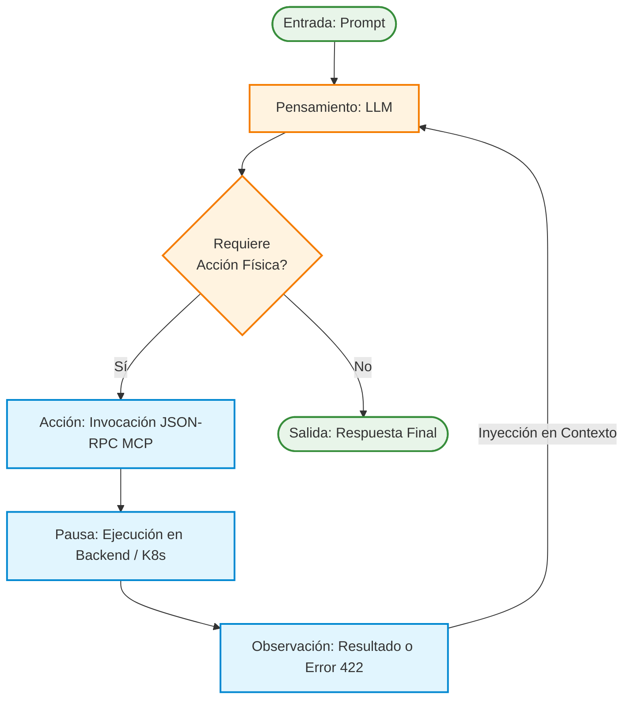

# Capítulo 6. Desarrollo del Agente Cognitivo y MCP

Sobre los cimientos deterministas del Capítulo 5, este capítulo detalla la implementación del núcleo heurístico del *Agentic Deployer*: el motor cognitivo que transforma el lenguaje natural en operaciones de infraestructura mediante la integración del estándar *Model Context Protocol* (MCP), el diseño abstracto del cliente de inferencia y el bucle de razonamiento *ReAct*.

> **Nota sobre terminología:** A lo largo de este capítulo se emplea el acrónimo **LLM** (*Large Language Model*, Modelo de Lenguaje Grande), que designa a la familia de redes neuronales de gran escala entrenadas sobre corpus masivos de texto. No debe confundirse con otras denominaciones coloquiales; el término preciso en la literatura es *Large Language Model*.

## 6.1. Implementación del Servidor *Model Context Protocol* (MCP)

En las arquitecturas iniciales de Inteligencia Artificial aplicada, la capacidad de un Modelo de Lenguaje para invocar código externo se lograba mediante integraciones fuertemente acopladas (*Vendor Lock-in*). Históricamente, el orquestador debía codificar a mano la firma de las herramientas (como diccionarios JSON rígidos) y empaquetarlas bajo especificaciones privativas (como la especificación *Function Calling* nativa de la API de OpenAI). Esta práctica vulneraba el Principio de Abierto/Cerrado (letra 'O' de S.O.L.I.D.), obligando a reescribir masivamente la base de código si la universidad decidía migrar hacia un proveedor de IA alternativo, como Anthropic o un clúster de Llama-3 local.

Para superar este antipatrón arquitectónico, el sistema desarrollado adopta como estándar troncal el **Model Context Protocol (MCP)** [13], un protocolo abierto diseñado para estandarizar la forma en que los modelos fundacionales interactúan con fuentes de datos y herramientas de ejecución. El MCP actúa como una capa de abstracción universal (un *middleware* cognitivo), desacoplando por completo el catálogo de herramientas de las peculiaridades de la API del LLM subyacente.

### 6.1.1. Introspección Dinámica de Funciones (Generación de JSON Schemas)

El mayor desafío en la ingeniería de Agentes Autónomos reside en la sincronización del contrato de la herramienta. Si un ingeniero de sistemas modifica el código de la función de despliegue para exigir un nuevo parámetro (por ejemplo, `memoria_ram`), el esquema JSON que se envía al LLM debe actualizarse simultáneamente; de lo contrario, la inferencia fallará, produciendo una desincronización de estado (*Schema Drift*).

Para mitigar este riesgo, el Servidor MCP implementado en el *Agentic Deployer* (ubicado en el Contenedor B de la arquitectura C4) hace uso intensivo de técnicas de **Introspección Estática y Dinámica de Tipos**. En lugar de requerir que el desarrollador defina los JSON Schemas manualmente, el SDK de MCP (utilizando el módulo nativo `inspect` de Python) lee las anotaciones de tipo y parámetros de las funciones en tiempo de ejecución.

El proceso algorítmico, detallado a continuación en pseudocódigo formal, ilustra cómo el sistema transforma una función Python pura en una representación semántica universal (*Tool Definition*) inteligible para cualquier LLM:

```text
01 ENTRADA:
02  funcion_objetivo -> Referencia en memoria a un método (ej. desplegar_app)
03 
04 SALIDA:
05  json_schema -> Estructura estándar JSON-RPC de Tool Calling
06 
07 INICIO
08   Variable esquema = NUEVO Diccionario JSON
09   esquema["name"] = funcion_objetivo.obtenerNombre()
10   esquema["description"] = funcion_objetivo.obtenerDocstring()
11   
12   // Inspección del AST (Abstract Syntax Tree)
13   Variable parametros = funcion_objetivo.obtenerFirmaLexica()
14   esquema["parameters"] = NUEVO Objeto Tipo(Objeto)
15   
16   PARA CADA (parametro, anotacion_de_tipo) EN parametros HACER
17     Variable tipo_json = "string" // Por defecto
18     
19     // Mapeo Inyectivo de Tipos (Python -> JSON Schema)
20     SI anotacion_de_tipo ES Entero ENTONCES
21       tipo_json = "integer"
22     SINO SI anotacion_de_tipo ES Booleano ENTONCES
23       tipo_json = "boolean"
24     FIN SI
25     
26     esquema["parameters"]["properties"][parametro] = NUEVO Diccionario(
27       "type" -> tipo_json,
28       "description" -> extraerDescripcion(parametro)
29     )
30     
31     SI parametro ES obligatorio ENTONCES
32       AÑADIR parametro A esquema["parameters"]["required"]
33     FIN SI
34   FIN PARA
35   
36   RETORNAR esquema
37 FIN
```
<p align="center"><i><b>Algoritmo 2:</b> Introspección Dinámica de Contratos de Herramientas.</i></p>

La adopción de este algoritmo garantiza que la base de código posea una **Única Fuente de Verdad (*Single Source of Truth*)**. El desarrollador simplemente anota sus funciones de infraestructura con *Type Hints* (ej. `puerto: int`) y *Docstrings*. El servidor MCP, al inicializarse, inspecciona el código, extrae las anotaciones, genera el esquema JSON dinámico y lo inyecta en el orquestador. Esta aproximación reduce el riesgo de inconsistencias entre la firma de las funciones y sus esquemas asociados.

### 6.1.2. Aislamiento de Red mediante Transporte *stdio*

El estándar MCP ofrece múltiples vectores para la transmisión del protocolo JSON-RPC, siendo los más destacados *Server-Sent Events* (SSE) sobre protocolo HTTP y flujos de Entrada/Salida Estándar (*stdio*).

En un diseño de microservicios tradicional, la comunicación entre el Agente Frontend (Contenedor A) y el Servidor de Herramientas (Contenedor B) recaería intuitivamente sobre una API REST clásica. Sin embargo, en el contexto de inferencias estocásticas concurrentes, donde un bucle ReAct puede invocar decenas de herramientas por segundo para sondear el estado del sistema, la sobrecarga (*overhead*) asociada al protocolo TCP/IP (encapsulamiento de cabeceras HTTP, latencia de red de *loopback* y serialización) resulta prohibitiva.

Por esta razón, la arquitectura del *Agentic Deployer* impone una decisión de diseño restrictiva: **El canal de comunicación para el Tool Calling se restringe exclusivamente al transporte local vía `stdio`** (Standard Input / Standard Output).

Esta decisión acarrea tres beneficios arquitectónicos fundamentales para el TFM:

1. **Latencia Sub-milisegundo (Inter-Process Communication):** Al emplear `stdio`, el Agente y el Servidor MCP se comunican directamente a través de tuberías del kernel de Linux (*Pipes IPC*), evitando por completo la pila de red (OSI Layer 4-7). La invocación de una herramienta pasa de tardar ~20ms (HTTP local) a menos de ~1ms, lo cual es crítico para no interrumpir el flujo cognitivo del LLM.
2. **Superficie de Ataque Cero (Zero-Trust Network):** A diferencia de un puerto HTTP (que puede ser escaneado mediante herramientas como Nmap, o falsificado mediante *Server-Side Request Forgery*), un proceso comunicado por `stdio` no expone ningún puerto de red al sistema operativo. Es topológicamente inviable que un atacante externo invoque herramientas de infraestructura si no posee acceso al árbol de procesos padre del agente.
3. **Simplicidad de Despliegue (Sidecar Pattern):** Al no requerir balanceadores de carga internos ni certificados TLS para la comunicación interna entre servicios, el Servidor MCP se ejecuta junto al orquestador en un patrón de contenedor acoplado (*Sidecar*), simplificando la disponibilidad de las herramientas.

La combinación entre la introspección dinámica de tipos y la comunicación local por tuberías (`stdio`) proporciona un catálogo de herramientas seguro, interoperable y de baja latencia.

El siguiente diagrama ilustra el ciclo de vida completo de un mensaje MCP, desde el momento en que el Agente decide invocar una herramienta hasta que recibe el resultado:


<p align="center"><i><b>Figura 14:</b> Ciclo de vida completo de un mensaje MCP. El protocolo JSON-RPC define tres fases: inicialización (handshake y descubrimiento de herramientas), ejecución (invocación y respuesta) y observación (retroalimentación al LLM).</i></p>

#### 6.1.2.1. Desglose del Flujo de Mensajería JSON-RPC

La interacción modelada en la Figura 14 se estructura en dos fases operativas diferenciadas:

1. **Fase de Inicialización y Negociación de Capacidades (única por sesión):**
   - El `AgentOrchestrator` remite un mensaje `initialize` al servidor MCP mediante JSON-RPC, declarando la versión del protocolo y sus capacidades soportadas.
   - El servidor MCP responde con sus metadatos y confirma la compatibilidad de la conexión.
   - A continuación, el orquestador solicita el catálogo de operaciones disponibles mediante `tools/list`. El servidor devuelve una lista estructurada con los nombres de las funciones, descripciones textuales y esquemas JSON estrictos de los parámetros esperados (`inputSchema`).
   - El orquestador inyecta estas definiciones estructuradas junto al *System Prompt* en la ventana de contexto del modelo LLM (Ollama o Cloud).

2. **Fase de Ejecución y Observación (iterativa por turno de diálogo):**
   - Cuando el modelo deduce la necesidad de invocar una acción de infraestructura, emite un objeto `tool_call` estructurado (por ejemplo, `deploy_congress_web` con sus argumentos correspondientes).
   - El orquestador intercepta dicha intención y despacha un mensaje `tools/call` al servidor MCP a través de los canales estándar `stdio`.
   - El servidor MCP transforma los argumentos recibidos en una llamada HTTP REST tipada (`POST /mcp/intent`) hacia el backend FastAPI en el puerto `:8000`.
   - Tras superar la validación determinista del dominio, el backend registra la solicitud en estado `PENDING_APPROVAL` y responde con un código `HTTP 201 Created` y el identificador unívoco asignado (`deployment_id`).
   - El servidor MCP encapsula esta respuesta en un objeto de observación y la retorna al orquestador, el cual la reinyecta en el contexto del LLM para que este elabore la respuesta final explicativa en lenguaje natural orientada al usuario.

> **Nota de implementación (distinción entre modos de transporte MCP):** Conviene enfatizar la distinción operativa entre los dos modos de transporte soportados por la arquitectura del servidor MCP:
> 1. **Modo Integrado *In-Memory* (utilizado en el MVP con Streamlit):** Las definiciones de herramientas y sus despachadores se importan directamente en el mismo espacio de memoria del intérprete Python (`TOOL_REGISTRY`, `TOOL_DEFINITIONS`). La ejecución de la herramienta es una llamada nativa a función Python en memoria (`in-process`), lo que elimina por completo cualquier serialización JSON-RPC o *pipe* IPC, reduciendo el retardo a una escala de microsegundos. Este enfoque se adoptó para simplificar la orquestación del MVP y evitar la gestión de subprocesos concurrentes en el contenedor de Streamlit.
> 2. **Modo Externo Canónico vía `stdio`:** Cuando el agente y el servidor MCP se ejecutan como procesos separados del sistema operativo (por ejemplo, al conectar el servidor con clientes de escritorio como Claude Desktop o scripts externos), la comunicación discurre a través de los canales estándar de entrada y salida (`stdin`/`stdout`) empleando tramas JSON-RPC estructuradas. En este modo externo, el coste de serialización y lectura por *pipes* del kernel se sitúa típicamente en latencias sub-milisegundo (<1 ms), lo que preserva una velocidad órdenes de magnitud superior a la de transportes de red (HTTP/SSE) y dota al sistema de un aislamiento riguroso de memoria entre procesos.
>
> Ambas modalidades son funcionalmente equivalentes e intercambiables gracias al desacoplamiento del `AgentOrchestrator`, que consume el contrato de herramientas con total independencia del mecanismo de transporte subyacente.

## 6.2. Diseño de la Abstracción Multiproveedor y Soberanía del Dato

La vertiginosa evolución de la Inteligencia Artificial Generativa ha consolidado un mercado oligopólico liderado por grandes corporaciones tecnológicas proveedoras de inferencia en la nube (*AI-as-a-Service*). En el desarrollo de sistemas de software empresarial, acoplar el código fuente (el *Core Business*) a los kits de desarrollo de software (SDK) específicos de OpenAI, Anthropic o Google supone un riesgo inasumible de obsolescencia tecnológica y pérdida de poder de negociación.

Para garantizar la viabilidad a largo plazo del *Agentic Deployer*, el diseño del orquestador cognitivo abraza el principio de agnósticismo absoluto frente al proveedor algorítmico. Esta sección desgrana la fundamentación técnica que permite al sistema conmutar dinámicamente entre motores de inferencia dispares sin requerir recompilación, así como la implicación de este diseño en las políticas de confidencialidad de la información.

### 6.2.1. El Contrato Abstracto (Patrones *Adapter* y *Factory*)

El aislamiento del proveedor se consigue orquestando una arquitectura basada en la conjunción de dos patrones de diseño clásicos de la banda de los cuatro (GoF) [30]: el patrón **Adapter** y el patrón **Factory Method**.

En la capa de aplicación, el `AgentOrchestrator` jamás invoca directamente a ninguna librería de IA. Su comunicación se dirige exclusivamente hacia una Interfaz de Clase Base Abstracta (ABC en Python) denominada `LLMClient`. Esta interfaz establece el contrato formal de inferencia:

```text
CONTRATO ABSTRACTO: Interfaz Cliente LLM (LLMClient)

ESTADO INTERNO:
 - historial_conversacion -> Lista estructurada de mensajes (Rol, Contenido)
 - sistema_base -> Prompt base del sistema (directrices operativas y reglas del Agente)

MÉTODO chat(messages, tools):
  ENTRADA: messages -> historial; tools -> JSON Schemas del servidor MCP
  SALIDA_ESPERADA:
   - Objeto tipo AgentResponse (texto plano)
   - Objeto tipo ToolCall (id, nombre_función, argumentos_json)
```

El sistema implementa tres adaptadores principales que satisfacen este contrato:

**`OpenAILLMClient`** — Formatea el historial bajo la especificación REST de OpenAI (`messages`, `tools`, `tool_choice`), negocia el *handshake* TLS hacia la API en la nube (o endpoints compatibles) y deserializa la respuesta JSON.

**`OllamaLLMClient`** — Implementado de forma nativa sobre el cliente oficial de Ollama con soporte de transporte HTTP asíncrono [31] (`ollama.Client`), conectándose a la instancia local (`http://localhost:11434`). Garantiza que **ni un solo token de inferencia abandona la red privada institucional**:

```text
PSEUDOCÓDIGO: Implementación del Cliente Local Ollama

CLASE OllamaLLMClient IMPLEMENTA LLMClient:
  ATRIBUTOS:
    modelo: Cadena (ej. "qwen2.5-coder:7b")
    servidor_host: Cadena (ej. "http://localhost:11434")
    cliente_ollama: ClienteSDK(host=servidor_host)

  MÉTODO chat(mensajes, herramientas):
    Variable parametros = NUEVO Diccionario(
      "model" -> modelo,
      "messages" -> mensajes
    )
    SI herramientas EXISTE ENTONCES
      parametros["tools"] = herramientas
    FIN SI

    // Inferencia local síncrona mediante el SDK de Ollama
    Variable respuesta = cliente_ollama.chat(parametros)
    Variable mensaje = respuesta.message

    SI mensaje.tool_calls EXISTE ENTONCES
      Variable llamadas_herramienta = ListaVacia()
      PARA CADA llamada EN mensaje.tool_calls HACER
        llamadas_herramienta.Agregar(
          NUEVO ToolCall(llamada.function.name, llamada.function.arguments)
        )
      FIN PARA
      RETORNAR NUEVO AgentResponse(content=mensaje.content, tool_calls=llamadas_herramienta)
    FIN SI

    RETORNAR NUEVO AgentResponse(content=mensaje.content)
FIN CLASE
```

**`FakeLLMClient`** — Implementación determinista basada en reglas y expresiones regulares utilizada para pruebas unitarias, benchmarks sin consumo de GPU y demostraciones portables.

La instanciación en memoria recae sobre un patrón **Factory**. Durante la fase de inicialización (*bootstrapping*) del contenedor web, el sistema lee la variable de entorno `LLM_PROVIDER`. La clase Factory evalúa esta variable e inyecta la implementación correcta en el Orquestador mediante *Dependency Injection*:

```text
PSEUDOCÓDIGO: Inyección de Dependencias del Motor Cognitivo (Factory)

ENTRADA: proveedor -> Cadena desde variable de entorno (LLM_PROVIDER)
SALIDA: motor_llm -> Instancia de motor cognitivo (compatible con LLMClient)

INICIO
  SI proveedor ES "ollama" ENTONCES
    RETORNAR NUEVO OllamaLLMClient(modelo="qwen2.5-coder:7b")
  SINO SI proveedor ES "openai" ENTONCES
    RETORNAR NUEVO OpenAILLMClient(modelo="gpt-4o-mini")
  SINO
    RETORNAR NUEVO SICFakeLLMClient() // Entorno de pruebas determinista
  FIN SI
FIN
```

Esta Inyección de Dependencias permite **permutar el motor cognitivo con un simple reinicio del proceso y cambio de variable de entorno**, sin modificar una sola línea de la lógica de negocio ni del servidor MCP.


### 6.2.2. Justificación de la Elección del Modelo Local (Qwen 2.5 Coder)

El ecosistema *open-source* actual ofrece múltiples modelos de lenguaje capaces de ejecutarse en hardware local con recursos restringidos (ej. 6 GB VRAM). Para este entorno de pruebas, se optó finalmente por desplegar la variante especializada **Qwen 2.5 Coder (7B)** de Alibaba Cloud, descartando a sus homólogos generalistas como Llama 3.2, Mistral, o el propio Qwen 2.5 base.

Esta elección responde a la necesidad de garantizar una alta eficacia en la invocación de herramientas (*Tool Calling*). La variante Coder incorpora un ajuste fino (*fine-tuning*) exhaustivo sobre corpus de código fuente, lo que le confiere una robustez superior en la generación y manipulación de estructuras JSON complejas frente a modelos puramente conversacionales. Durante la experimentación, mientras que modelos generalistas como *Llama 3.2* o *Mistral* generaron con frecuencia JSON inválido o ignoraron el esquema de herramientas al procesar entradas ruidosas, **Qwen 2.5 Coder (7B)** demostró ser la única solución local de su categoría capaz de superar íntegramente la batería de Pruebas Metamórficas, exhibiendo la mayor estabilidad estructural frente a la entropía lingüística y posibilitando la correcta orquestación del bucle ReAct (véase el análisis empírico en el Capítulo 9).

### 6.2.3. Soberanía del Dato en Entornos Institucionales

La abstracción multiproveedor, más allá de ser una práctica higiénica de Ingeniería del Software, responde a un requerimiento de ciberseguridad crítico en el contexto de las administraciones públicas y el sector académico: la **Soberanía del Dato** y el cumplimiento normativo (RGPD/GDPR).

El *Agentic Deployer* maneja, por su propia naturaleza operativa, información extremadamente sensible. Durante la negociación lingüística (fase heurística del bucle de ReAct), un investigador distraído podría deslizar inadvertidamente tokens de acceso a bases de datos, contraseñas de red corporativas (secretos) o direcciones IP reservadas que revelan la topología interna del Servicio de Informática. Enviar estas trazas en texto plano hacia servidores ubicados fuera de las fronteras europeas (como es el caso de los clústeres por defecto de algunas empresas americanas) constituye una vulneración de las políticas de retención de datos.

El diseño agnóstico permite adaptar la configuración según el nivel de sensibilidad de los datos manejados:
- **Datos no sensibles:** Para entornos de investigación pública (despliegue de servidores web estáticos o *sandboxes* de prueba), el sistema puede apuntar mediante el *Factory* a la API de OpenAI, aprovechando la baja latencia de la nube.
- **Datos confidenciales (entorno aislado):** Cuando la provisión involucra servicios con datos sensibles (como bases de datos sanitarias o expedientes de alumnado), el equipo de Operaciones reconfigura la variable de entorno `LLM_PROVIDER` para inyectar el adaptador de Ollama [26].

  Bajo esta configuración, la inferencia se ejecuta en servidores con aceleración GPU (Nvidia/AMD) alojados en el propio Centro de Procesamiento de Datos (CPD) institucional, de modo que ningún dato abandona la intranet universitaria.

Esta capacidad de conmutar entre inferencia en la nube e inferencia local, implementada mediante el patrón *Adapter* y la inyección de dependencias, permite al prototipo adaptarse a distintos requisitos de privacidad y auditoría sin modificar la lógica de negocio.

## 6.3. Bucle Cognitivo y Resiliencia Estocástica (Patrón ReAct)

La mera exposición de un catálogo de herramientas a un Modelo de Lenguaje no garantiza la ejecución autónoma de una tarea compleja. Cuando a un modelo de lenguaje se le instruye para que actúe en un entorno dinámico (como un clúster de Kubernetes, cuyo estado puede mutar durante la propia inferencia), los enfoques directos de Petición-Respuesta (*Zero-Shot Prompting*) resultan insuficientes. Si el modelo asume un contexto inicial falso o comete un error sintáctico en su primer intento, carece de mecanismos intrínsecos para rectificar, desembocando en estados de fallo no recuperables.

Para superar estas limitaciones, el orquestador implementa el patrón **ReAct (Reasoning and Acting)** [9], que articula la descomposición del razonamiento discursivo con la invocación secuencial de herramientas.

### 6.3.1. Arquitectura del Bucle Acotado de Razonamiento y Acción

El patrón ReAct modifica la estructura de la interacción. En lugar de procesar la petición del usuario y devolver una única respuesta estática, el agente ejecuta una máquina de estados iterativa con un **bucle acotado** (`MIENTRAS turno_actual < MAX_TURNOS`). Esta cota máxima de turnos cognitivos evita bucles indefinidos ante respuestas inesperadas del modelo. Cada iteración de este bucle transita secuencialmente por cuatro etapas:

1. **Pensamiento (*Thought*):** El modelo deduce lógicamente el siguiente paso basándose en el historial. Esta externalización del monólogo interno (derivada de las técnicas *Chain-of-Thought*) reduce sustancialmente la tasa de alucinaciones.
2. **Acción (*Action*):** El modelo invoca una función específica del catálogo MCP, inyectándole los argumentos sintácticos deducidos (ej. `deploy_intent(name="api", port=80)`).
3. **Pausa (*Yield*):** El orquestador pausa la inferencia algorítmica, toma el control del hilo de ejecución, cruza la barrera de red hacia el servidor backend, ejecuta la acción física y espera el resultado.
4. **Observación (*Observation*):** El sistema inyecta el resultado físico (ya sea un éxito o una excepción de error del sistema operativo) de vuelta en la ventana de contexto del LLM.

El modelo reevalúa el estado global tras la observación y decide si necesita ejecutar una nueva acción o si la tarea ha concluido. Cuando dictamina que el objetivo se ha cumplido, transiciona a la fase final (*Final Answer*), devolviendo el control al usuario humano.

Como se ilustra en la **Figura 15**, este proceso rompe con el paradigma de petición-respuesta estático, instaurando un flujo de retroalimentación dinámica.

<div style="max-width: 10cm; margin: 0 auto;">



</div>
<p align="center"><i><b>Figura 15:</b> Diagrama de flujo del bucle cognitivo ReAct (Reasoning and Acting).</i></p>

Para ilustrar el funcionamiento de este motor de orquestación, se formaliza a continuación su arquitectura mediante pseudocódigo:

```text
01 ENTRADA: 
02  peticion_usuario -> Cadena de texto natural
03  contexto_historico -> Memoria de la sesión actual
04 
05 SALIDA: 
06  respuesta_final -> Cadena de texto natural o Markdown
07 
08 INICIO
09   AÑADIR peticion_usuario A contexto_historico
10   Variable turno_actual = 0
11   Variable MAX_TURNOS = 5 // Prevención de bucles infinitos (Infinite Loop)
12 
13   MIENTRAS turno_actual < MAX_TURNOS HACER
14     // 1. Inferencia del LLM (Thought + Action)
15     Variable respuesta_llm = InvocacionRed(contexto_historico, herramientas_mcp)
16     
17     SI respuesta_llm ES texto_plano ENTONCES
18       // El Agente decide que ha terminado y se dirige al humano
19       RETORNAR respuesta_llm
20     FIN SI
21 
22     SI respuesta_llm ES invocacion_herramienta ENTONCES
23       Variable nombre_funcion = respuesta_llm.obtenerNombre()
24       Variable argumentos = respuesta_llm.obtenerArgumentos()
25       Variable resultado_accion
26       
27       INTENTAR
28         // 2 y 3. Ejecución y Pausa
29         resultado_accion = EjecutarProcesoLocal(nombre_funcion, argumentos)
30       CAPTURAR ExcepcionHttp COMO error
31         // Serialización del error para su interpretación por el LLM
32         resultado_accion = error.obtenerMensajeHumano() 
33       FIN INTENTAR
34 
35       // 4. Observación
36       AÑADIR "Herramienta retornó: " + resultado_accion A contexto_historico
37     FIN SI
38     
39     turno_actual = turno_actual + 1
40   FIN MIENTRAS
41   
42   LANZAR Excepcion("Límite de razonamiento excedido. El Agente está atascado.")
43 FIN
```
<p align="center"><i><b>Algoritmo 3:</b> Bucle de Orquestación Cognitiva (ReAct Loop).</i></p>

La inclusión explícita de la constante `MAX_TURNOS` es un mecanismo de salvaguarda (*Fail-Safe*) crítico en sistemas autónomos, garantizando que un LLM confundido no agote las cuotas de facturación de la API externa (consumo masivo de tokens) iterando indefinidamente sobre un fallo irresoluble.

### 6.3.2. *Feedback Loop* de Seguridad y Autocorrección

La principal ventaja operativa del bucle ReAct reside en la rama `CAPTURAR ExcepcionHttp` (línea 25 del Algoritmo 3). En la topología descrita en el Capítulo 5, el núcleo Hexagonal (Backend) protege la infraestructura emitiendo respuestas de error deterministas (ej. un código HTTP `422 Unprocessable Entity`) cuando el agente intenta vulnerar políticas (como abrir el puerto 22).

En sistemas convencionales, esta excepción HTTP provocaría la terminación abrupta de la sesión, obligando al usuario a reiniciar el flujo. Sin embargo, el *Agentic Deployer* instaura un mecanismo de resiliencia cognitiva denominado **Feedback Loop**. 

Cuando el Servidor MCP intercepta el error `422`, no detiene el orquestador. Por el contrario, inyecta la traza de la excepción directamente como una **Observación** en el contexto de trabajo del LLM.
Este flujo produce un comportamiento autorregulado:
1. El Agente lee que su *Action* previa fue rechazada por vulneración de la política de puertos.
2. Su capa de inferencia razona (*Thought*) que el puerto 22 está restringido por la normativa institucional.
3. De forma autónoma, el Agente no propaga la excepción como un fallo irresoluble al usuario; en su lugar, ejecuta una nueva *Action* recalculando un puerto lícito (ej. el puerto 8000), o bien genera una *Final Answer* notificando con precisión técnica al usuario sobre el rechazo y solicitando instrucciones alternativas.

Este ciclo de retroalimentación aporta resiliencia frente a errores sintácticos o de validación de parámetros, trasladando la necesidad de corrección hacia el propio modelo de lenguaje antes de requerir intervención directa del usuario. De este modo, la arquitectura hexagonal actúa como marco determinista de validación, mientras que el bucle ReAct permite al agente ajustar los parámetros hasta satisfacer las restricciones del *Golden Path* correspondiente.
