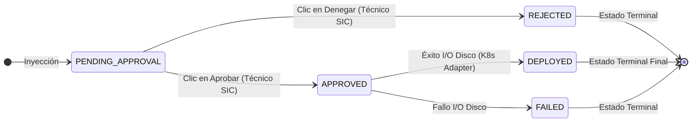
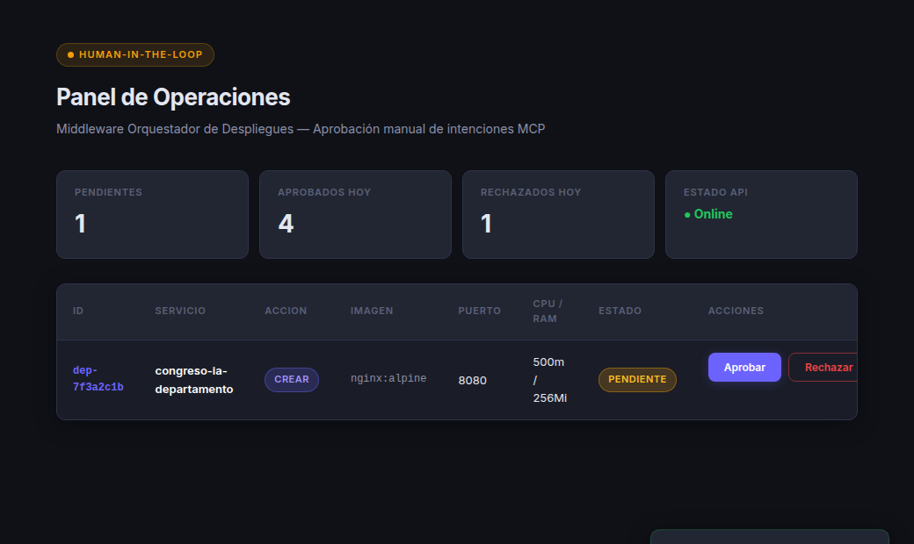
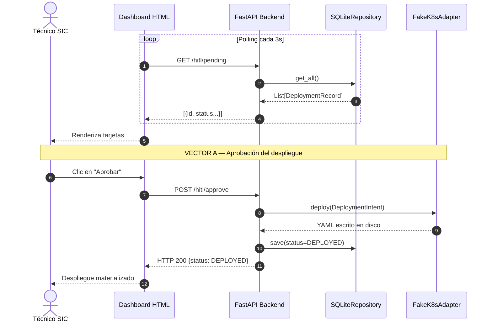
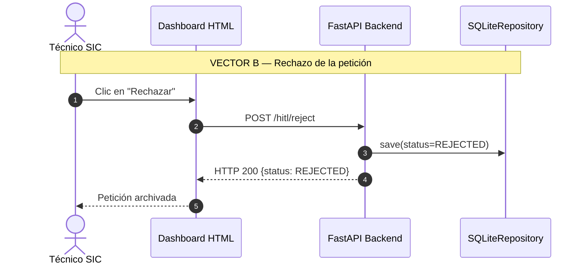
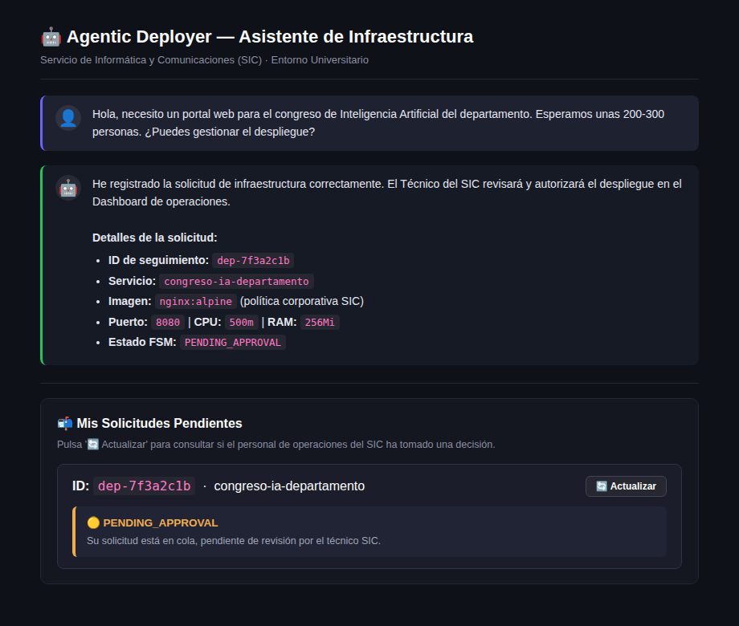

# Capítulo 7. Implementación del Patrón HITL y Gestión de Estados Finita (FSM)

El diseño del agente cognitivo abordado en los capítulos anteriores dota al sistema de una gran capacidad de extracción semántica y de razonamiento sobre herramientas. Sin embargo, la delegación completa de las decisiones de despliegue a un modelo probabilístico en infraestructuras críticas no es un hito de ingeniería deseable, sino un vector de vulnerabilidad. La orquestación de clústeres de contenedores en entornos productivos exige un grado de gobierno, responsabilidad legal y conocimiento del contexto operativo que escapa a las capacidades de un Modelo de Lenguaje.

Este capítulo detalla la solución arquitectónica implementada para gobernar a la Inteligencia Artificial: el patrón *Human-In-The-Loop* (HITL). Se fundamentará teóricamente la necesidad de interponer una fase de autorización humana y se explicará, a nivel de diseño de software, cómo esta separación de responsabilidades se garantiza tecnológicamente mediante una Máquina de Estados Finita (FSM) inmutable y un *Dashboard* asíncrono para el equipo de operaciones.

## 7.1. Fundamentación del Patrón *Human-In-The-Loop* (HITL)

En el ámbito de la automatización de TI, la taxonomía de la autonomía se divide comúnmente en cinco niveles (inspirados libremente en los niveles de conducción autónoma de la SAE). El Nivel 0 corresponde a la ejecución manual de *scripts* Bash, mientras que el Nivel 5 (Autonomía Completa) implica un sistema de Inteligencia Artificial que monitoriza, toma decisiones y ejecuta mutaciones de red en la infraestructura productiva sin ningún tipo de supervisión humana.

La tendencia del mercado tecnológico presiona hacia la consecución del Nivel 5. Sin embargo, este Trabajo de Fin de Máster defiende la tesis de que, en la gestión del *Platform Engineering* corporativo, el enfoque adecuado no es la autonomía desatendida, sino una automatización de Nivel 4 supervisada mediante el patrón **Human-In-The-Loop (HITL)**.

### 7.1.1. Los Riesgos de la Autonomía Total (Nivel 5)

Otorgar credenciales de escritura directas (ej. un token con permisos de *ClusterAdmin* en Kubernetes) a un sistema basado en redes neuronales probabilísticas introduce riesgos operativos que ninguna prueba unitaria puede mitigar. Los factores de riesgo sistémico más severos son:

1. **La Alucinación Topológica:** Los LLM, por su diseño de predicción probabilística de tokens, carecen de verificación fáctica intrínseca sobre el estado del clúster. Si el orquestador genera una alucinación y determina erróneamente que la resolución de una incidencia de red requiere eliminar y recrear un `Deployment` crítico en producción, un nivel de autonomía no supervisado ejecutaría la acción sin validación previa.
2. **Elasticidad Financiera Descontrolada:** En infraestructuras desplegadas en nubes públicas (AWS, Google Cloud, Azure), los recursos computacionales se facturan bajo esquemas de pago por consumo. Un agente operando sin supervisión que entre en un bucle anómalo de invocaciones podría auto-aprovisionar recursos de cómputo sobredimensionados, incurriendo en un sobrecoste económico significativo para el presupuesto institucional.
3. **Inadecuación de Ventanas de Mantenimiento:** Los modelos probabilísticos carecen de contexto operativo respecto a las ventanas de congelación de cambios (*change freeze*) institucionales. Un agente no supervisado podría emitir modificaciones de infraestructura durante periodos de máxima concurrencia del servicio. La supervisión por parte del equipo técnico garantiza que la ejecución efectiva se restrinja a los intervalos de mantenimiento autorizados.

### 7.1.2. Responsabilidad Legal, ITIL y la Distribución de Responsabilidades

Más allá de la viabilidad técnica, la adopción del patrón HITL es una exigencia legal y normativa. Los marcos de buenas prácticas de la industria, como **ITIL 4** (*Information Technology Infrastructure Library*) en su práctica de "Release Management" [32], así como los estándares ISO/IEC 27000 sobre ciberseguridad, exigen explícitamente el principio de trazabilidad y gobernanza de las acciones de red.

Desde una perspectiva jurídica, un modelo de lenguaje carece de responsabilidad jurídica. Si el *Agentic Deployer* instanciara una configuración errónea que expusiera públicamente datos sensibles (provocando una vulneración del RGPD), la responsabilidad recaería legalmente sobre la institución y sus operadores, con independencia de que la especificación inicial hubiese sido deducida por el modelo.

Para solventar esta carga legal, el sistema distribuye las responsabilidades entre los tres actores del sistema, donde cada uno asume el rol para el que está optimizado:

1. **El Investigador (el «qué»):** Aporta el conocimiento del dominio funcional («Necesito un WordPress para el departamento de historia con una base de datos de 10 Gigabytes»).
2. **La IA y el Servidor MCP (el «cómo»):** Aportan la traducción a la sintaxis declarativa, estructurando el lenguaje natural en entidades tipadas de la Arquitectura Hexagonal.
3. **El Técnico del SIC (el «cuándo» y el «sí»):** Aporta la validación institucional y la supervisión de los recursos («La petición es sintácticamente correcta, pero la disponibilidad de almacenamiento requiere programar el despliegue en una ventana de mantenimiento específica»).

Bajo este modelo, el modelo de lenguaje actúa como un asistente que reduce el tiempo de especificación técnica y validación de sintaxis YAML, delegando la autorización final en una confirmación visual por parte del técnico de operaciones.

## 7.2. Diseño de la Máquina de Estados Finita (FSM)

Para materializar el control del flujo operativo detallado en la sección anterior, el Backend Hexagonal no puede depender de variables booleanas simples (ej. `es_valido = True`). En entornos concurrentes donde múltiples operarios auditan la misma cola de despliegues, el estado de una petición de infraestructura debe gobernarse mediante una **Máquina de Estados Finita** (FSM, por sus siglas en inglés, *Finite-State Machine*).

Una FSM, fundamentada en la teoría de autómatas, es un modelo computacional matemático. Establece que una entidad solo puede existir en un estado mutuamente excluyente en un momento temporal *T*, y que los cambios entre estos estados (Transiciones) obedecen a un conjunto finito y predefinido de reglas direccionales.

### 7.2.1. Modelado del Grafo de Transición de Estados

En la arquitectura del *Agentic Deployer*, el ciclo de vida de una `DeploymentIntent` (la intención generada por la IA) se modela formalmente como un **grafo de transición de estados dirigido y acíclico**. El carácter "acíclico" es una condición *sine qua non* de la seguridad del sistema: por definición formal del autómata, es imposible que el estado de una petición fluya hacia atrás en el tiempo. Una vez que una orden es procesada físicamente por el clúster de Kubernetes, el registro no puede revertir a su estado de pendencia.

Los vértices de este grafo (Estados) y sus aristas dirigidas (Transiciones Autorizadas) se definen mediante **seis nodos** mutuamente excluyentes:

- **Nodo Raíz (`PENDING_APPROVAL`):** Es el punto de inyección inicial. Cuando el agente de IA formula una petición válida y el `SecurityContextValidator` (Capítulo 5) la admite en el servidor, esta ingresa obligatoriamente en este nodo de cuarentena. Ningún proceso de despliegue físico se activa desde este estado.
- **Nodo de Sumidero A (`REJECTED`):** Estado terminal e inmutable. Si el Técnico del SIC presiona el botón de denegación en el *Dashboard*, la petición transiciona aquí. Permanece en la base de datos de manera indefinida con propósitos de auditoría legal (Log de Intentos Denegados), pero es ignorada por el *garbage collector* y los adaptadores de infraestructura.
- **Nodo de Tránsito (`APPROVED`):** Estado intermedio y transitorio. Cuando el operador humano autoriza la operación, la petición ingresa a este nodo durante un breve intervalo. Actúa como el desencadenante (*Trigger*) para invocar al adaptador de infraestructura secundario (`FakeK8sAdapter` o `RealK8sAdapter`).
- **Nodo de Sumidero B (`DEPLOYED`):** Estado terminal final. Solo se alcanza si, y solo si, la intención superó el nodo `APPROVED` y la API de Kubernetes confirma que los manifiestos YAML han sido guardados sin errores de persistencia en disco.
- **Nodo de Sumidero C (`FAILED`):** Estado terminal excepcional. Alcanzado si la transición desde `APPROVED` fracasa por un error de entrada/salida en disco o una excepción de red del adaptador de infraestructura. El registro permanece en la base de datos para diagnóstico post-mortem.
- **Nodo de Sumidero D (`DELETED`):** Estado terminal de baja administrativa. Representa la eliminación lógica de un servicio previamente desplegado, invocada por la herramienta MCP `delete_university_service`. El registro no se destruye físicamente, preservando la trazabilidad de auditoría.

La transición desde el estado inicial a los estados de ejecución requiere la autorización explícita del técnico de operaciones a través del *Dashboard*. Este flujo unidireccional y acíclico se representa visualmente en la **Figura 16**.


<p align="center"><i><b>Figura 16:</b> Grafo de transición de estados que rige la Máquina de Estados Finita (FSM) del sistema.</i></p>

### 7.2.2. Prevención de Concurrencia y *Race Conditions*

La implementación de este FSM mediante Python y el *framework* asíncrono FastAPI presenta un desafío clásico de Sistemas Operativos Distribuidos: la prevención de Condiciones de Carrera (*Race Conditions*).

Considérese un escenario concurrente: una petición se encuentra en estado `PENDING_APPROVAL`. Por un problema de latencia o retransmisión en la red, el operador efectúa múltiples pulsaciones consecutivas sobre el botón de acción en su interfaz, o bien dos operarios que visualicen simultáneamente el panel interactúan sobre los botones de «Aprobar» y «Rechazar» de forma casi simultánea.

Sin una salvaguarda arquitectónica, estas peticiones paralelas generarían una condición de carrera (*race condition*) en la base de datos del servidor, provocando una inconsistencia transaccional donde el sistema intentaría desplegar y denegar el mismo registro simultáneamente, lo que comprometería la integridad del estado del clúster de Kubernetes.

Para mitigar este riesgo, la transición entre vértices del DAG se protege mediante algoritmos de comprobación de precondiciones (*Test-and-Set* lógicos) que siguen el patrón conceptual del **Optimistic Locking** (Bloqueo Optimista). Es importante matizar que esta implementación constituye un *check-then-act* lógico secuencial: el algoritmo lee el estado actual del registro y verifica que sea `PENDING_APPROVAL` antes de proceder a la mutación, sin emplear mecanismos de bloqueo real a nivel de base de datos (como un `SELECT FOR UPDATE`). En el contexto del MVP (operando sobre un único proceso Uvicorn, como se documenta en la limitación 10.2.5), este enfoque es suficientemente seguro para garantizar la integridad transaccional. En una evolución multi-proceso (Gunicorn con N workers), sería necesario escalar hacia un bloqueo pesimista real en la capa de persistencia para eliminar cualquier ventana de *race condition* residual. A continuación se expone la fundamentación algorítmica de esta defensa en el núcleo Hexagonal:

```text
01 ENTRADA:
02  id_peticion -> UUID del registro a transicionar
03  nuevo_estado -> El estado de destino (APPROVED o REJECTED) solicitado por el Humano
04 
05 SALIDA:
06  Registro_Actualizado (Si la transición es lícita)
07  LANZA HttpConflictError (409) si hay violación de estado
08 
09 INICIO
10   // 1. Adquisición y comprobación (Atomicidad)
11   Variable registro = ObtenerRegistroBaseDeDatos(id_peticion)
12   
13   SI registro ES NULO ENTONCES
14     LANZAR HttpNotFoundError(404)
15   FIN SI
16 
17   // 2. Control Invariante del DAG: Solo se muta desde PENDING_APPROVAL
18   SI registro.estado NO ES IGUAL A "PENDING_APPROVAL" ENTONCES
19     LANZAR HttpConflictError(
20       409, 
21       "Conflicto de Mutación. El registro ya había sido procesado previamente " +
22       "(Estado Actual: " + registro.estado + ")."
23     )
24   FIN SI
25   
26   // 3. Mutación del Estado mediante el Repositorio (Bloqueo Atómico)
27   registro.estado = nuevo_estado
28   registro.fecha_modificacion = ObtenerTiempoSistemaActual()
29   
30   // 4. Activación de Adaptadores Secundarios (Side-Effects)
31   SI nuevo_estado ES IGUAL A "APPROVED" ENTONCES
32     INTENTAR
33       K8sAdapter.ejecutar_despliegue(registro.intencion)
34       registro.estado = "DEPLOYED" // Segunda transición
35     CAPTURAR ExcepcionIO COMO error
36       registro.estado = "FAILED"
37     FIN INTENTAR
38   FIN SI
39   
40   RETORNAR registro
41 FIN
```
<p align="center"><i><b>Algoritmo 4:</b> Transición Inmutable de la Máquina de Estados (FSM_Transition).</i></p>

Gracias a este algoritmo determinista, si ocurre una pulsación doble, el primer *thread* (hilo de ejecución HTTP) cruzará el bloque de la Línea 18 y mutará la base de datos a `REJECTED`. El segundo *thread*, desfasado por milisegundos, evaluará la condición invariante de la Línea 18, detectará que el estado ya no es `PENDING_APPROVAL`, y abortará la transacción devolviendo inmediatamente un error `409 Conflict` a la capa frontal. 

Esta verificación asegura consistencia transaccional [33] en la gestión de estados, aislando la lógica de despliegue frente a condiciones de carrera o accesos concurrentes.

## 7.3. El Dashboard Asíncrono de Operaciones

La implementación efectiva del patrón *Human-In-The-Loop* requiere una separación de interfaces según el rol de usuario. El Investigador interactúa mediante una interfaz conversacional tolerante a la ambigüedad (Streamlit). Por el contrario, el Técnico de Operaciones (SIC) no interactúa mediante diálogo con el modelo, sino a través de un panel de control estructurado, determinista y de baja latencia.

Para satisfacer esta dicotomía, se ha diseñado un segundo portal de acceso independiente del orquestador de IA: el **Dashboard de Operaciones** (`dash.html`), concebido arquitectónicamente como una *Single-Page Application* (SPA) ligera, servida directamente por el Backend Hexagonal de FastAPI.

### 7.3.1. Estrategia de Sincronización: *Polling* Ligero vs. *WebSockets*

El reto técnico subyacente en el diseño del *Dashboard* es la sincronización del estado. Las peticiones de despliegue generadas por la IA no obedecen a un patrón predecible; ingresan en el sistema en ráfagas asíncronas, dependiendo del horario de investigación de la comunidad universitaria.

En arquitecturas web modernas fuertemente acopladas al tiempo real (como aplicaciones de *Trading* o videojuegos), el estado del servidor suele transmitirse al cliente mediante conexiones bidireccionales persistentes (Protocolo *WebSocket*, ws://). Sin embargo, mantener cientos de hilos *WebSocket* abiertos de manera perpetua entre el *Dashboard* y el clúster perfila un sobrecoste de memoria y gestión de concurrencia injustificado para un sistema de auditoría asíncrona, en el cual un retraso de 3 segundos en la visualización no reviste criticidad operacional.

Consecuentemente, el TFM implementa una estrategia de **Polling Activo Ligero**. El *Dashboard* ejecuta bucles temporizados desde el navegador del técnico utilizando llamadas `fetch` nativas de JavaScript:

1. **Interrogación Constante:** El cliente invoca el endpoint `GET /hitl/pending` a intervalos regulares (ej. cada 5.000 milisegundos).
2. **Procesamiento Eficiente y Transaccional:** El *Backend* delega la lectura de las intenciones pendientes en el repositorio local (SQLite). Mediante consultas estructuradas, este enfoque garantiza persistencia ACID y consistencia frente a reinicios inesperados, manteniendo el *overhead* al mínimo en el contexto del prototipo.
3. **Inyección Dinámica:** El cliente recibe el *payload* JSON y reconstruye dinámicamente el Document Object Model (DOM), renderizando tarjetas visuales (*Cards*) para cada petición entrante.

Esta arquitectura desacoplada (*Stateless* en la capa de transporte) favorece la resiliencia del sistema. Si el portátil del Técnico de Operaciones pierde conectividad Wi-Fi, el estado del *Backend* permanece intacto; al recuperar la conexión, el siguiente ciclo de *polling* rehidratará el *Dashboard* con las peticiones acumuladas durante la ventana de desconexión.

### 7.3.2. Ejecución Diferida y Generación de Manifiestos Declarativos

El *Dashboard* presenta al técnico los parámetros asociados a la intención de despliegue extraída por el agente: identificador único, imagen de contenedor, puerto de red y asignación de recursos de CPU y memoria.

A partir de esta información, el técnico puede ejecutar dos acciones:
- **Rechazar:** Envía una petición `POST /hitl/reject/{id}`, registrando el estado `REJECTED` en la máquina de estados (sección 6.2). La solicitud queda registrada en el repositorio para trazabilidad y auditoría, sin generar manifiestos en el sistema.
- **Aprobar:** Envía una petición `POST /hitl/approve/{id}`. Al recibir la confirmación, el backend recupera la entidad `DeploymentIntent` y la transfiere al adaptador de despliegue (`DeployPort`).

En el adaptador, los parámetros validados se interpolan sobre plantillas predefinidas (*Golden Paths*) mediante la utilidad `textwrap.dedent`, generando la especificación declarativa en formato YAML. En la implementación de prueba actual, el manifiesto resultante se escribe en disco en la ruta local configurada (`{name}.yaml`), emulando el punto de entrega que en un entorno productivo sería remitido a la API de Kubernetes o a un repositorio GitOps gestionado por herramientas como ArgoCD (véase sección 10.3.2).

En la **Figura 17** se ilustra la interfaz gráfica del Dashboard de Operaciones servida por el backend en `/frontend/index.html`. En la cabecera superior se expone la barra de métricas en tiempo real (`Pendientes: 1`, `Aprobados hoy: 4`, `Rechazados hoy: 1`) y el indicador de conexión con el backend (`● Online`). En la tabla central se muestra el registro en cuarentena correspondiente a la solicitud `dep-7f3a2c1b` generada por el agente para el servicio `congreso-ia-departamento`, con la acción tipada (`Crear`), la imagen (`nginx:alpine`), el puerto asignado (`8080`) y los límites de computación (`500m / 256Mi`). El técnico dispone de los controles visuales «Aprobar» y «Rechazar» para gobernar de forma determinista la transición atómica de la FSM.

<div align="center">
  
</div>
<p align="center"><i><b>Figura 17:</b> Captura de pantalla del Dashboard de Operaciones HITL (<code>app/frontend/index.html</code>) mostrando una petición pendiente de aprobación (<code>dep-7f3a2c1b</code>) y las métricas operativas consolidadas.</i></p>

### 7.3.3. Diagrama de Secuencia del Flujo HITL

La **Figura 18** complementa el diagrama E2E global (Figuras 11, 12 y 13, Sección 5.6) con un foco específico en la interacción entre el Técnico SIC y el Backend durante la fase de decisión. Se ilustran explícitamente los dos vectores de mutación posibles (aprobación y rechazo) y las transiciones de estado intermedias de la FSM, incluyendo la materialización del YAML por `FakeK8sAdapter` únicamente en el camino de aprobación.




<p align="center"><i><b>Figura 18:</b> Diagrama de Secuencia del flujo HITL. (Arriba) Polling asíncrono y Vector de Aprobación. (Abajo) Vector de Rechazo (estado inmutable terminal).</i></p>

#### 7.3.3.1. Análisis de los Vectores de Decisión y Ciclo de Sondeo

Como se documenta en la Figura 18, la interacción del técnico con el panel de control se articula a través de un ciclo continuo de sondeo y dos vectores mutuamente excluyentes de decisión:

1. **Ciclo de Sondeo Asíncrono (*Polling*):** El *Dashboard* web ejecuta una petición periódica en segundo plano cada 3 segundos (`GET /hitl/pending`) contra la API de FastAPI. El backend consulta el repositorio transaccional SQLite (`get_all()`), filtra las intenciones que residen en estado `PENDING_APPROVAL` y devuelve la colección JSON. La interfaz del técnico rehidrata las tarjetas visuales de inspección de forma no intrusiva y sin refresco completo de página.
2. **Vector A — Ruta de Aprobación y Materialización:** Cuando el operador valida técnica e institucionalmente los parámetros de la solicitud, acciona el control «Aprobar». El navegador remite una llamada `POST /hitl/approve` al backend. Este transiciona el registro a `APPROVED`, invoca el puerto de salida `deploy()` en el adaptador de infraestructura (`FakeK8sAdapter`), materializa el manifiesto declarativo YAML en el almacenamiento y consolida el estado final `DEPLOYED` en la base de datos, notificando el éxito a la interfaz con un código `HTTP 200`.
3. **Vector B — Ruta de Denegación y Bloqueo:** Si la solicitud presenta anomalías o no se ajusta a las políticas departamentales, el técnico acciona el control «Rechazar». El *Dashboard* emite una llamada `POST /hitl/reject`. El backend omite cualquier llamada al adaptador de infraestructura, preservando la inmutabilidad del clúster, y conmuta atómicamente el estado del registro a `REJECTED` en SQLite (`save()`). La solicitud queda archivada de forma permanente para auditoría, respondiendo al operador con la confirmación de cancelación (`HTTP 200`).

## 7.4. Canal de Retorno al Investigador: Notificación Asíncrona del Estado

Una limitación habitual del patrón HITL es la falta de visibilidad del solicitante: el técnico de operaciones conoce el estado de las peticiones a través del Dashboard (sección 6.3), pero el investigador desconoce cuándo se aprueba, rechaza o ejecuta su solicitud.

Esta sección documenta el diseño e implementación del **canal de retorno al investigador**: el mecanismo bidireccional que permite al usuario consultar el estado de sus solicitudes directamente desde la interfaz conversacional.

### 7.4.1. Diseño del Endpoint de Consulta de Estado

Se ha incorporado un nuevo endpoint `GET /hitl/status/{deployment_id}` en el `BackendAPI`, diseñado específicamente como **canal orientado al investigador** (a diferencia de `/hitl/pending`, orientado al técnico):

```text
RUTINA: Consulta de Estado de Despliegue (Endpoint REST)

ENDPOINT: GET /hitl/status/{id_despliegue}
ENTRADA: id_despliegue -> Cadena de texto (ej. "dep-1a2b3c")
SALIDA: RespuestaEstado (id, estado, mensaje_contextual)

INICIO
  Variable registro = RepositorioBD.obtener(id_despliegue)
  SI registro ES Nulo ENTONCES
    ABORTAR CON ExcepcionHttp(404, "Despliegue no encontrado")
  FIN SI

  // Mapeo semántico del estado técnico (FSM) a lenguaje natural
  Variable mensajes = NUEVO Diccionario(
    "PENDING_APPROVAL" -> "Su solicitud está en cola, pendiente de revisión por el técnico SIC.",
    "APPROVED" -> "El técnico SIC ha aprobado su solicitud. Despliegue en curso.",
    "DEPLOYED" -> "Su servicio ha sido desplegado exitosamente.",
    "REJECTED" -> "El técnico SIC ha rechazado esta solicitud.",
    "FAILED" -> "El despliegue ha encontrado un error técnico en el clúster."
  )
  
  Variable mensaje_contextual = mensajes[registro.estado_fsm]
  RETORNAR NUEVO RespuestaEstado(registro.id, registro.estado_fsm, mensaje_contextual)
FIN
```

La respuesta incluye el estado actual de la FSM junto con un **mensaje de texto contextual** adaptado a cada estado, de modo que el investigador recibe información comprensible sin necesidad de conocer la nomenclatura técnica de la máquina de estados.

### 7.4.2. Panel de Notificaciones en el Frontend (Streamlit)

La interfaz conversacional (`chat_app.py`) implementa un panel pasivo de seguimiento que se activa automáticamente cuando el agente registra una solicitud con estado `PENDING_APPROVAL`. El mecanismo opera en tres fases:

**1. Extracción automática del ID de seguimiento:**

Tras cada respuesta del agente, el frontend aplica una expresión regular sobre el texto de respuesta para detectar identificadores de deployment del patrón `dep-[a-f0-9]{7,8}`. Si se detecta uno asociado a un estado pendiente, se añade a la lista `session_state.pending_deployments`:

```text
RUTINA: Extracción de Identificadores (Frontend HITL)

ENTRADA: texto_respuesta -> Respuesta generada por el Agente Cognitivo
ESTADO: panel_pendientes -> Lista de IDs mostrados en la interfaz gráfica

INICIO
  // Buscar expresiones regulares de la forma "dep-XXXXXXX"
  Variable id_detectado = ExpresionRegular("dep-[a-f0-9]{7,8}").buscarEn(texto_respuesta)
  
  SI id_detectado EXISTE Y texto_respuesta CONTIENE "PENDING" ENTONCES
    AÑADIR id_detectado A panel_pendientes
  FIN SI
FIN
```

**2. Panel de seguimiento persistente:**

Mientras existan deployments pendientes en `session_state`, el panel " Mis Solicitudes Pendientes" se renderiza en la parte inferior del chat. Por cada solicitud, el investigador dispone de un botón **" Actualizar"** que realiza una llamada `GET /hitl/status/{id}` al backend y muestra el resultado en un badge de color semántico:

| Estado FSM | Color | Mensaje para el investigador |
|---|---|---|
| `PENDING_APPROVAL` | Amarillo | "Su solicitud está en cola, pendiente de revisión." |
| `APPROVED` | Azul | "El técnico ha aprobado. Despliegue en curso." |
| `DEPLOYED` | Verde | "Su servicio ha sido desplegado exitosamente." |
| `REJECTED` | Rojo | "Solicitud rechazada. Contacte con el SIC." |
| `FAILED` | Rojo | "Error técnico. El equipo SIC ha sido notificado." |
<p align="center"><i><b>Tabla 20:</b> Mapeo de estados FSM a indicadores visuales del panel de notificaciones del investigador.</i></p>

**3. Cierre automático del ciclo:**

Cuando el estado devuelto es terminal (`DEPLOYED`, `REJECTED` o `FAILED`), el deployment se elimina de la lista de seguimiento y el agente inyecta automáticamente un mensaje de notificación en el historial del chat, informando al investigador del resultado final sin que este tenga que preguntar activamente.

En la **Figura 19** se ilustra la experiencia de usuario del investigador en la aplicación conversacional (`chat_app.py`). Tras procesar la solicitud en lenguaje natural, el agente confirma el registro de la intención y le proporciona el identificador unívoco de seguimiento (`dep-7f3a2c1b`). Inmediatamente debajo del diálogo, el frontend activa el panel dinámico «Mis Solicitudes Pendientes», donde se expone el estado actual obtenido mediante `GET /hitl/status/{id}` con un indicador de color semántico («🟡 PENDING_APPROVAL») y un mensaje contextual en lenguaje natural que orienta al investigador sobre el proceso de revisión en curso.

<div align="center">
  
</div>
<p align="center"><i><b>Figura 19:</b> Captura de pantalla de la interfaz conversacional del investigador (Streamlit) evidenciando el panel de retorno asíncrono con el estado <code>PENDING_APPROVAL</code> y el botón de actualización manual.</i></p>

### 7.4.3. Justificación de Diseño: Polling Explícito frente a Notificaciones *Push*

La alternativa técnica más evidente sería un sistema de notificaciones *push* (correo electrónico o *webhook*). Esta aproximación fue deliberadamente descartada para el prototipo por las siguientes razones arquitectónicas:

1. **Dependencias externas no justificadas:** Un servidor SMTP o un broker de mensajería (Kafka, RabbitMQ) añadiría complejidad de infraestructura que excede el alcance del prototipo y dificulta la reproducibilidad en entornos académicos.
2. **Coherencia con el modelo de polling del Dashboard:** El técnico ya opera bajo un modelo de polling (sección 6.3.1). Mantener el mismo paradigma en el canal del investigador simplifica el modelo mental del sistema y su testing.
3. **Extensibilidad:** El endpoint `GET /hitl/status/{id}` es una interfaz pura REST que puede ser consumida por cualquier sistema externo (correo electrónico, Telegram Bot, Slack Webhook) en una evolución futura sin modificar la lógica del backend (principio de Segregación de Interfaces).

Este diseño cierra el ciclo del patrón HITL, transformándolo de un mecanismo **unidireccional** (investigador → técnico) en un canal **bidireccional** (investigador → técnico → investigador), donde ambos actores disponen de la información necesaria para realizar su rol dentro del flujo de gobierno de la infraestructura.
