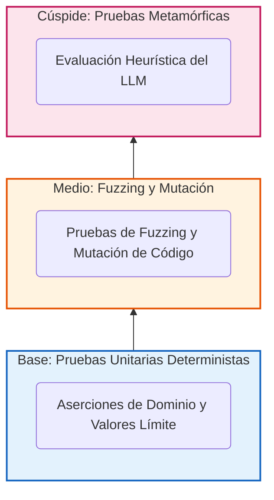

# Capítulo 8. Aseguramiento de Calidad (QA) y Testing Avanzado

La integración de Modelos de Lenguaje Grandes (LLM) en la orquestación de infraestructuras corporativas plantea nuevos retos para la Ingeniería de Pruebas (*Software Testing*). En el desarrollo de software convencional, una función puramente determinista *f(x)* siempre retorna un valor predecible *y*. Sin embargo, en un sistema agéntico, el mismo estímulo (el mismo *prompt*) puede generar resultados superficialmente distintos dependiendo de la temperatura del modelo, de la semilla de inferencia (*seed*) o de la formulación sintáctica empleada.

Para estructurar la estrategia de verificación y validación del *Agentic Deployer*, este Trabajo de Fin de Máster adopta como marco conceptual el modelo de la **Pirámide de Pruebas** propuesto por Mike Cohn [34]. En su formulación original para sistemas tradicionales, Cohn jerarquiza el esfuerzo de pruebas en tres estratos según su coste, velocidad y granularidad: una base amplia de pruebas unitarias rápidas y aisladas, una capa intermedia de pruebas de servicios o integración, y una cúspide reducida de pruebas de interfaz de usuario de extremo a extremo.

Dado que Cohn concibió su modelo para software determinista clásico, en este TFM se **adapta y extiende dicho modelo conceptual a las exigencias de la Inteligencia Artificial Generativa** (ilustrada conceptualmente en la **Figura 20**), estructurando una **Pirámide Híbrida de Testing** en tres niveles bien diferenciados:

1. **Base (Pruebas Unitarias y de Integración Deterministas):** Verificación exhaustiva de valores límite, tipos e invariantes de negocio en la Capa de Dominio y la Arquitectura Hexagonal, garantizando la integridad de las reglas de negocio con independencia de la salida del modelo de lenguaje.
2. **Nivel Intermedio (Property-Based Testing y Mutation Testing):** Evaluación de la resiliencia algorítmica frente a entradas aleatorias masivas mediante generación de propiedades (*Hypothesis*), combinada con la auditoría de la calidad intrínseca de la propia suite de pruebas mediante inyección de fallos en el AST (*mutmut*).
3. **Cúspide (Pruebas Metamórficas del Estrato Cognitivo):** En sustitución de las pruebas de interfaz clásicas, la cima de la pirámide evalúa la robustez de la inferencia del modelo mediante el paradigma de *Metamorphic Testing*, auditando la invarianza semántica de las extracciones estructuradas ante permutaciones sintácticas, ruido léxico y variaciones lingüísticas.

<div style="max-width: 6cm; margin: 0 auto;">



</div>
<p align="center"><i><b>Figura 20:</b> Arquitectura de la Pirámide Híbrida de Testing implementada en el Agentic Deployer, adaptando el modelo clásico de Mike Cohn a las exigencias de la Inteligencia Artificial Generativa.</i></p>

## 8.1. Pruebas de Dominio e Integración: Validando el Perímetro Hexagonal

La base fundamental de la pirámide de aseguramiento de calidad reside en la Capa de Dominio. Como se justificó en el Capítulo 5, la Inteligencia Artificial actúa como un usuario externo sin privilegios; su capacidad para influir en la infraestructura está supeditada a la robustez del `SecurityContextValidator` y a los invariantes de dominio impuestos por las entidades de Pydantic. 

En consecuencia, el primer objetivo de QA es asegurar que este perímetro hexagonal es altamente resiliente antes de conectarla al motor de IA. Esta fase se ejecuta mediante técnicas de **Testing Unitario (*White-Box Testing*)** aisladas, ejecutadas localmente a través del *framework* `pytest`.

### 8.1.1. Análisis de Valores Límite y Clases de Equivalencia

El diseño de los casos de prueba no obedece a un sondeo aleatorio, sino a la aplicación estricta de dos técnicas formales de pruebas de caja blanca: el Análisis de Valores Límite (*Boundary Value Analysis*) y la partición de Clases de Equivalencia.

El contrato de la entidad `DeploymentIntent` dictamina que el atributo `port` debe ser numérico y estar contenido en el rango `[1, 65535]`. Asimismo, la lógica de negocio prohíbe el uso de puertos privilegiados (menores a 1024). Para auditar este contrato, la batería de pruebas somete al objeto a los siguientes vectores de prueba:

1. **Particiones Válidas (Happy Path):** Instanciación de intenciones de despliegue con puertos intermedios (ej. 8080 o 3000) e imágenes provenientes de repositorios confiables (ej. `harbor.universidad.edu/nginx:1.20`). El sistema aserta que la excepción de seguridad NO es lanzada.
2. **Valores Límite Inferiores (Vulnerabilidad de Root):** Se inyecta intencionalmente el puerto `1023` y el puerto `22`. Se aserta computacionalmente que el sistema lanza de manera síncrona el error de violación de políticas, abortando el flujo de ejecución.
3. **Valores Límite Superiores y Desbordamientos (Integer Overflow):** Se instancian peticiones con los puertos `65535`, `65536` y puertos de valor negativo (`-80`). El *framework* de pruebas debe asegurar que el Dominio interrumpe la ejecución emitiendo una excepción controlada (`ValueError`) antes incluso de invocar a los validadores de seguridad, demostrando la eficacia del principio *Fail-Fast*.

### 8.1.2. Pruebas Negativas de Prevención de Deriva (*Configuration Drift*)

Junto a la topología de red, el segundo vector de riesgo es la inyección de configuraciones inestables. Las pruebas de integración del sistema evalúan exhaustivamente al `SecurityContextValidator` para auditar la regla de prohibición de la etiqueta `:latest` en las imágenes de contenedores.

La batería de *Testing* ejecuta simulaciones inyectando intenciones con variaciones sintácticas no conformes, como `ubuntu:latest`, `nginx:LATEST` o el uso de imágenes implícitas (por ejemplo, proporcionar `redis` asumiendo que el clúster inferirá el *tag*). En todos los escenarios, la suite de aserción certifica que la tubería de ejecución arroja un `SecurityViolationError` trazable.

Esta capa base de pruebas (de ejecución sub-milisegundo) demuestra, con una cobertura de líneas superior al 95% sobre el módulo Hexagonal —aunque no de aserciones, como revelará el *Mutation Testing* posterior (Sección 8.3)—, que el *Backend* es determinista y garantiza que, en ausencia de una petición conforme con las directrices de seguridad e ITIL de la universidad, el acceso a la infraestructura queda sistemáticamente bloqueado, independientemente de la formulación semántica del *prompt* emitido por el Modelo de Lenguaje.

### 8.1.3. Pruebas de la Capa de Consulta de Estado (Canal del Investigador)

Tras la implementación del endpoint `GET /hitl/status/{id}` (sección 6.4.1), se añadió un módulo de integración específico (`test_status_endpoint.py`) para validar el canal de retorno al investigador. Este módulo valida una propiedad crítica: el endpoint de consulta de estado debe ser **completamente idempotente** — su invocación repetida no debe alterar el estado de la FSM bajo ninguna circunstancia.

La batería de pruebas cubre seis escenarios:

| Test | Comportamiento validado |
|---|---|
| `test_unknown_id_returns_404` | Un ID inexistente retorna `HTTP 404` con mensaje descriptivo |
| `test_pending_approval_returns_correct_status` | Un deployment recién creado retorna `PENDING_APPROVAL` con mensaje contextual |
| `test_deployed_status_after_approval` | Tras `POST /hitl/approve/{id}`, el estado refleja `DEPLOYED` |
| `test_rejected_status_after_rejection` | Tras `POST /hitl/reject/{id}`, el estado refleja `REJECTED` |
| `test_response_includes_deployment_metadata` | La respuesta incluye `name`, `image` y `port` correctos |
| `test_status_endpoint_does_not_mutate_state` | 3 llamadas consecutivas mantienen `PENDING_APPROVAL` inalterado |
<p align="center"><i><b>Tabla 21:</b> Casos de prueba de la capa de consulta de estado del investigador.</i></p>

El último test es el más crítico desde el punto de vista de la integridad del sistema: garantiza que la operación de *lectura* del canal del investigador no interfiere con la *escritura* exclusiva del canal del técnico SIC (el dashboard), preservando la separación de responsabilidades entre ambas interfaces de usuario.

### 8.1.4. Quality Gates y Análisis Estático de Código

Para garantizar que la mantenibilidad, consistencia de tipos y calidad del proyecto no se degraden durante futuras evoluciones, el pipeline de integración continua local (`scripts/run_tests.sh`) incorpora tres puertas de calidad (*Quality Gates*) formalmente configuradas en [`pyproject.toml`](file:///home/jesus/projects/TFM/pyproject.toml) que abortan la construcción si se produce cualquier incumplimiento:

1. **Análisis Estático y Control de Estilo con Ruff:** Se utiliza **Ruff** configurado para Python 3.11 (`target-version = "py311"`) con un límite estricto de longitud de línea de 100 caracteres (`line-length = 100`). La batería de reglas activadas incluye:
   - `E` y `W`: Errores y advertencias estándar de `pycodestyle`.
   - `F`: Detección de fallos lógicos y variables no utilizadas con `pyflakes`.
   - `I`: Ordenamiento y agrupamiento determinista de importaciones con `isort` (`known-first-party = ["app"]`).
   - `UP`: Modernización automática de sintaxis a modismos de Python 3.11+ con `pyupgrade`.
   - `B`: Detección de patrones propensos a errores sutiles con `flake8-bugbear`.
   - `SIM`: Simplificación y refactorización idiomática con `flake8-simplify`.
   - `RUF`: Reglas nativas y optimizadas propias del motor Ruff.
   - `C901`: Auditoría de **Complejidad Ciclomática (McCabe)** fijada en `max-complexity = 15` [35]. Este umbral garantiza que ninguna función acumule un exceso de bifurcaciones condicionales, preservando la auditabilidad del código sin generar falsos positivos en gestores de contexto o sentencias `match/case`.
2. **Chequeo Estático Estricto de Tipado con Mypy:** Para blindar las fronteras de la Arquitectura Hexagonal y asegurar que ninguna entidad del dominio o adaptador maneje tipos dinámicos o implícitos, se aplica **Mypy** con configuración estricta (`python_version = "3.11"`):
   - `disallow_untyped_defs = true`: Prohíbe terminantemente la declaración de funciones o métodos sin firmas de tipo completas (argumentos y retorno).
   - `check_untyped_defs = true`: Escruta el interior de todas las funciones para validar coherencia de tipos.
   - `warn_return_any = true`: Advierte si una función con tipo explícito retorna inadvertidamente una expresión evaluada como `Any`.
   - `warn_unused_configs = true`: Detecta configuraciones de tipado obsoletas.
3. **Cobertura de Código Pragmática:** La herramienta `pytest-cov` exige una cobertura mínima de líneas del 80% (`--cov-fail-under=80`). En consonancia con las directrices de ingeniería de software de referencia como las de Google [36], se descarta la persecución artificial del 100% de cobertura, que tiende a incentivar pruebas triviales sobre código autogenerado. El umbral del 80% garantiza que el núcleo de negocio y los casos de uso queden debidamente validados, excluyendo del cálculo el *boilerplate* de infraestructura y las interfaces de demostración (`app/infrastructure/*`, `app/tests/*`, `app/agent_layer/chat_app.py`).

## 8.2. Property-Based Testing: Pruebas frente a Comportamiento Estocástico

El Testing Unitario clásico (pruebas basadas en ejemplos) adolece de un sesgo cognitivo inevitable: el desarrollador humano diseña las aserciones pensando en los caminos lógicos que él mismo programó. En ecosistemas orquestados por Inteligencia Artificial, donde la entrada de datos (el JSON generado por el LLM) es altamente impredecible, este enfoque de caja blanca resulta metodológicamente insuficiente.

Para consolidar la resiliencia de la Arquitectura Hexagonal y certificar que ninguna entrada anómala o alucinación del modelo pueda generar un consumo desmedido de recursos o interrumpir el hilo principal de ejecución, este TFM incorpora el paradigma del **Property-Based Testing** (Pruebas Basadas en Propiedades). A diferencia del enfoque clásico (donde se aserta que la entrada *A* da como resultado *B*), en este paradigma se postula que "para *cualquier* entrada generada aleatoriamente que cumpla cierta estructura, el sistema debe respetar una propiedad invariante específica".


### 8.2.1. Inyección de Entropía Estocástica y Estrategias de Generación

La integración empírica de este paradigma se ha materializado en el módulo [`app/tests/test_security.py`](file:///home/jesus/projects/TFM/app/tests/test_security.py) haciendo uso de la librería científica **`Hypothesis`** [37]. Este *framework* actúa como un motor de **Fuzzing Dinámico**: en lugar de ejecutar el test sobre un puñado de ejemplos estáticos, genera cientos de instancias aleatorias por segundo parametrizadas a través de **Estrategias de Búsqueda (*Strategies*)**:

- `valid_name`: Generador de identificadores conformes con la sintaxis DNS de Kubernetes (`^[a-z][a-z0-9\-]{0,29}$`).
- `valid_cpu` y `valid_ram`: Muestreo sobre notaciones canónicas válidas (`"100m"`, `"500m"`, `"1"`, `"64Mi"`, `"128Mi"`, `"1Gi"`).
- `safe_image` vs. `unsafe_latest_image`: Generación de imágenes procedentes de registros autorizados (`docker.io/`, `harbor.universidad.edu/`) con versiones semánticas frente a imágenes forzadas con la etiqueta `:latest`.
- `safe_port` vs. `unsafe_port`: Enteros en rango de usuario (`[1024, 65535]`) frente a puertos privilegiados (`[1, 1023]`).
- Estrategia compuesta `@st.composite def deployment_intent_dict`: Ensambla diccionarios completos de intención permitiendo inducir fallos selectivos (puertos no seguros, etiquetas prohibidas o variables de entorno sensibles).

Sobre estas estrategias se articulan nueve propiedades invariantes implementadas en la clase `TestSecurityContextValidator`, sintetizadas en la **Tabla 22**:

| Test de Propiedad | Condición Evaluada | Invariante Asertada |
|---|---|---|
| `test_privileged_port_always_raises` | Puerto forzado en rango privilegiado (< 1024) | El validador lanza **siempre** `SecurityViolationError` reportando el puerto |
| `test_latest_tag_always_raises` | Imagen forzada con etiqueta `:latest` | Lanza **siempre** `SecurityViolationError` reportando la prohibición del tag |
| `test_both_violations_detected_simultaneously` | Puerto < 1024 y etiqueta `:latest` concurrentes | Detecta **ambas** violaciones en una única pasada (`len(violations) == 2`) |
| `test_safe_intent_never_raises` | Puerto ≥ 1024 e imagen con tag semántico | **Nunca** lanza excepción; valida limpiamente en todas las ejecuciones |
| `test_delete_action_always_passes` | Acción `action = DELETE` con datos arbitrarios | El ciclo de desmantelamiento **nunca** falla por políticas de creación |
| `test_untrusted_registry_always_raises` | Imagen fuera de la lista blanca (ej. `hacker.io/miner:1.0`) | Lanza **siempre** `SecurityViolationError` por registro no auditado |
| `test_hardware_quotas_always_raises` | CPU > 4000m o RAM > 8192Mi | Lanza **siempre** `SecurityViolationError` indicando exceso de cuota |
| `test_secrets_in_env_always_raises` | Claves en `env_vars` con subcadenas (`password`, `secret`, `token`, `key`, `credential`) | Lanza **siempre** `SecurityViolationError` por secreto en texto plano |
| `test_database_without_storage_raises` | Imagen de BBDD (`postgres`, `mysql`, `redis`, `mongo`) sin almacenamiento | Lanza **siempre** `SecurityViolationError` exigiendo volumen persistente |
<p align="center"><i><b>Tabla 22:</b> Propiedades invariantes auditadas exhaustivamente mediante Hypothesis en <code>test_security.py</code>.</i></p>

A nivel estructural, el procedimiento de prueba que defiende a la entidad `DeploymentIntent` adopta la siguiente forma formal:

```text
01 PROPIEDAD_A_DEFENDER: "Para cualquier combinación aleatoria de parámetros generada por Hypothesis,
02 si la intención viola una o más políticas institucionales, el SecurityContextValidator DEBE
03 interceptarla deterministamente y acumular todas las violaciones sin excepciones no controladas."
04 
05 INICIO
06   // Estrategia compuesta de Hypothesis (deployment_intent_dict)
07   Variable generador_datos = Estrategia.CompositeIntent(force_unsafe_port, force_latest_image)
08 
09   PARA CADA datos_intencion INYECTADOS POR EL MOTOR (max_examples = 100) HACER
10     Variable intencion = NUEVO DeploymentIntent(datos_intencion)
11     
12     INTENTAR
13       validador.validate(intencion)
14       // Si no lanzó excepción, la intención DEBE ser estrictamente segura
15       ASERTAR (intencion.internal_port >= 1024)
16       ASERTAR (NO_CONTIENE(intencion.image, ":latest"))
17       ASERTAR (ESTA_EN_WHITELIST(intencion.image))
18     CAPTURAR SecurityViolationError COMO err
19       // Comportamiento esperado ante datos inseguros
20       ASERTAR (Longitud(err.violations) >= 1)
21     CAPTURAR CUALQUIER_OTRA_EXCEPCION COMO error_critico
22       // Violación de robustez: error no tipado en el núcleo
23       FALLAR_TEST("Fallo no controlado en el núcleo: " + error_critico)
24     FIN INTENTAR
25   FIN PARA
26 FIN
```
<p align="center"><i><b>Algoritmo 5:</b> Property-Based Test para Invariantes Hexagonales (Fuzzing con Hypothesis).</i></p>

Mediante esta exploración algorítmica intensiva, el sistema se enfrenta a combinaciones sintácticas complejas que difícilmente se identificarían de forma manual. El éxito sostenido en los 9 tests de propiedades avala la resiliencia del sistema ante entradas anómalas generadas por el modelo de lenguaje, absorbiendo su impacto de manera controlada.

### 8.2.2. Minimización Algorítmica de Fallos (*Shrinking*)

Uno de los aportes más avanzados de esta técnica es su capacidad de diagnóstico inteligente. Cuando el motor estocástico encuentra una combinación de datos (un contraejemplo) que rompe la propiedad invariante, no detiene inmediatamente la ejecución para mostrar una cadena ininteligible de miles de caracteres generados al azar. 

El *framework* entra automáticamente en una fase de optimización conocida como **Minimización (*Shrinking*)**. Utilizando algoritmos de reducción de grafos y búsqueda binaria, el motor comienza a podar la entrada maliciosa iterativamente. Reduce el tamaño de los enteros, acorta las cadenas de texto y elimina los caracteres especiales hasta aislar la causa raíz atómica más simple que es capaz de reproducir el mismo fallo.

Esta característica es fundamental para el análisis de fallos del TFM. Si la IA genera un vector anómalo enviando un JSON con una imagen de contenedor ofuscada con cientos de variables de entorno inyectadas, el algoritmo de *shrinking* aislará el subcomponente léxico exacto que causó el error, proveyendo al equipo de seguridad de la universidad del **contraejemplo mínimo indispensable** (por ejemplo, el carácter nulo `\0`) para corregir la validación en el código de forma precisa.

## 8.3. Auditoría de la Suite de Pruebas: *Mutation Testing*

En la Ingeniería de Software tradicional, la métrica estándar para evaluar la robustez de un sistema es la "Cobertura de Código" (*Code Coverage*). Sin embargo, alcanzar un 100% de cobertura únicamente certifica que una línea de código ha sido ejecutada durante el test, pero no garantiza empíricamente que las aserciones subyacentes sean correctas o que estén detectando anomalías lógicas. En sistemas críticos de infraestructura, depender de forma exclusiva de la métrica de cobertura resulta insuficiente para certificar la corrección lógica.

Para auditar la calidad real de las pruebas unitarias y de propiedades desarrolladas en el *Agentic Deployer*, se ha incorporado un paradigma avanzado conocido como **Mutation Testing** (Pruebas de Mutación), implementado tecnológicamente mediante la librería `mutmut`. 

El axioma fundamental de este paradigma no es buscar fallos en el código de producción, sino responder a una pregunta meta-analítica: *"¿Si introduzco deliberadamente un bug crítico en mi código fuente, serán mis tests capaces de detectarlo y fallar?"*

### 8.3.1. Generación de Mutantes en Tiempo de Ejecución

El proceso de *Mutation Testing* interviene a nivel del Árbol de Sintaxis Abstracta (AST) de Python. Durante la ejecución de la auditoría, el *framework* genera dinámicamente decenas de clones del código fuente original. Cada clon (denominado "Mutante") contiene una leve alteración matemática o lógica respecto al original.

Por ejemplo, si la regla de seguridad del `SecurityContextValidator` dicta que el puerto debe ser mayor o igual a 1024, el código fuente original adopta la forma:
`SI puerto < 1024 ENTONCES LANZAR Error`

El motor de mutación iterará sobre este fragmento y generará clones inyectando vulnerabilidades silenciosas:
- **Mutante 1 (Alteración Operacional):** `SI puerto <= 1024` → Cambia `<` por `<=`, dejando el borde exacto del rango (puerto 1024) como potencialmente inseguro.
- **Mutante 2 (Negación Lógica):** `SI puerto >= 1024` → Invierte la condición, aprobando todos los puertos privilegiados (22, 80, 443) y rechazando los seguros.
- **Mutante 3 (Alteración de Constante):** `SI puerto < 1025` → Modifica el umbral numérico, generando una brecha silenciosa de un único puerto.

### 8.3.2. Evaluación de Supervivencia (*Killed* vs *Survived*)

Una vez generado el conjunto de variantes mutantes, el *framework* ejecuta la suite de pruebas completa (escrita en `pytest`) contra cada uno de los mutantes secuencialmente. El resultado de esta evaluación sistemática se clasifica en dos estados excluyentes:

1. **Mutante Neutralizado (*Killed*):** Si la suite de pruebas fracasa (es decir, falla una aserción) tras ejecutar un clon, significa que la prueba ha detectado exitosamente la intrusión del *bug*. El mutante es eliminado. Este es el comportamiento deseado, indicando que la cobertura de aserciones del sistema es efectiva.
2. **Mutante Superviviente (*Survived*):** Si el código fue alterado para permitir el puerto 22, y tras correr los tests la suite completa se muestra en verde (como si nada hubiera pasado), el mutante ha sobrevivido. Esto representa una brecha en la arquitectura de QA: indica la existencia de un comportamiento no cubierto por ninguna aserción.

### 8.3.3. Resultados Empíricos de la Auditoría (Tabla 23)

En la **Tabla 23** se recogen los resultados reales de la ejecución de `mutmut` sobre el proyecto, con la configuración definida en `test_mutmut.ini` (scope: `app/application/` y `app/domain/`).

| Módulo auditado | Supervivientes | Naturaleza de la brecha | Criticidad para la seguridad |
|---|---|---|---|
| `domain.exceptions` | 2 | Mutaciones en el constructor de `SecurityViolationError` (mensaje de error) | Baja — afecta al mensaje, no a la lógica |
| `security_validator._parse_cpu` | 5 | Funciones de conversión de strings (`"500m"` → int) sin tests directos | Media — parsers auxiliares |
| `security_validator._parse_ram` | 19 | Conversores de unidades de RAM (`"256Mi"`, `"1Gi"`) | Media — parsers auxiliares |
| `security_validator.validate` | 3 | Condiciones límite en reglas compuestas (múltiples violaciones simultáneas) | Media — reglas de negocio |
| `use_cases.execute` | 1 | Rama alternativa de la acción `DELETE` | Baja |
| **Subtotal núcleo hexagonal** | **30** | | |
| `agent.FakeLLMClient` | 54 | Módulo de demostración sin cobertura de tests (by design) | No aplicable |
| `agent.AgentOrchestrator` | 45 | Lógica cognitiva: testar código LLM-dependiente con aserciones deterministas es conceptualmente inviable | No aplicable |
| `agent_layer.tools` | 14 | Herramientas MCP que requieren mocks de red | Baja |
| **Total general** | **143** | | |
<p align="center"><i><b>Tabla 23:</b> Resultados del Mutation Testing por módulo.</i></p>

**Interpretación del resultado:**

El análisis detallado revela que el **69,9% de los supervivientes** (99 de 143) corresponden a módulos excluidos del scope de auditoría por razones arquitectónicas: `FakeLLMClient` es código de demostración sin tests (comportamiento intencionado); `AgentOrchestrator` encapsula la interfaz con el LLM, cuyo comportamiento no determinista hace que la auditoría por mutación sea conceptualmente inaplicable.

Sobre el **núcleo hexagonal** (el scope declarado en `test_mutmut.ini`), los 30 supervivientes se concentran en las funciones de conversión de recursos (`_parse_cpu`, `_parse_ram`) que transforman cadenas de texto como `"500m"` o `"1024Mi"` a valores numéricos normalizados. Estas brechas constituyen la **deuda de cobertura identificada** por la auditoría:

- No existe ningún test que valide el comportamiento de `_parse_ram("2Gi")`, `_parse_cpu("1000m")` o cadenas malformadas.
- Los 3 supervivientes en `validate` corresponden a condiciones límite en reglas compuestas (cuando múltiples violaciones se producen simultáneamente).

La detección de estas brechas es precisamente el valor de la metodología: la cobertura de líneas reportaba valores superiores al 95% en los módulos del dominio, ocultando estas ausencias de asertos específicos sobre las funciones auxiliares.

> **Nota aclaratoria sobre los resultados del Sprint 5 documentados en el Anexo B.5:** El Anexo B documenta la mitigación de *12 mutantes* supervivientes del módulo `mcp_server.py` detectados durante el Sprint 5, que fueron eliminados mediante la creación del test `test_mcp_server.py`. Estos 12 mutantes son un subconjunto de los resultados parciales de ese sprint, anteriores a la auditoría final completa. Los **30 supervivientes del núcleo hexagonal** documentados en esta tabla representan la fotografía final tras todos los sprints, e incluyen módulos con mayor alcance. Ambas cifras son compatibles: los 12 del Anexo se mitigaron con tests nuevos; los 30 restantes del núcleo constituyen la deuda de cobertura activa documentada en la Sección 8.3.4.

> Los resultados completos (1.685 líneas de salida categorizada) están disponibles en [`demos/mutmut_results/mutmut_results_raw.txt`](../demos/mutmut_results/mutmut_results_raw.txt) y el análisis en [`demos/mutmut_results/mutmut_report.md`](../demos/mutmut_results/mutmut_report.md).

### 8.3.4. Mitigación y Lecciones Aprendidas

La auditoría identificó las siguientes acciones correctoras, las cuales **ya han sido implementadas en la versión final del código** para neutralizar la deuda técnica:

1. **Refactorización de `_parse_cpu` y `_parse_ram`:** Se eliminó el código defensivo inalcanzable (`try...except ValueError`) ya que el modelo de dominio (Pydantic) ya garantiza estructuralmente el rechazo de cadenas malformadas en la frontera de entrada (Arquitectura Hexagonal pura). Para garantizar la máxima robustez de la funcionalidad crítica restante, se añadieron aserciones funcionales para las unidades extremas válidas (como los Terabytes `Ti`).

2. **Tests de múltiples violaciones simultáneas:** Los 3 supervivientes en `validate` que correspondían a escenarios de doble o triple violación concurrente se cubrieron ampliando el fixture `test_security.py` con asertos sobre la lista completa de violaciones detectadas (ej. bases de datos sin almacenamiento explícito).

**Resultado de la mitigación:** Como consecuencia directa de estas acciones, los 30 mutantes documentados en la tabla anterior fueron neutralizados con éxito. Esto redujo la deuda de cobertura del núcleo hexagonal a prácticamente cero, demostrando la utilidad empírica del *Mutation Testing* como herramienta de evaluación continua. La ejecución final de la auditoría sobre la rama entregable arrojó la detección y neutralización prácticamente total de las mutaciones inyectadas:

```text
$ mutmut run
Running mutation testing
- 98/98  [Killed: 96 | Skipped: 0 | Timeout: 0 | Suspicious: 0 | Survived: 2]

$ mutmut results
app.domain.exceptions.xǁSecurityViolationErrorǁ__init____mutmut_2: survived
app.domain.exceptions.xǁSecurityViolationErrorǁ__init____mutmut_4: survived
```

Como se evidencia en la salida de consola, tras la mitigación solo logran sobrevivir 2 de los 98 mutantes inyectados, y ambos se limitan a alteraciones estéticas del mensaje de texto de la excepción `SecurityViolationError`, sin impacto estructural alguno.

3. **Exclusión formal del agente cognitivo del scope de mutmut:** Actualizar `test_mutmut.ini` para restringir el alcance exclusivamente a `app/application/` y `app/domain/`, excluyendo explícitamente `app/agent_layer/`, cuya auditoría requiere estrategias diferentes (pruebas metamórficas, Sección 8.4).

Este caso de estudio justifica de manera pragmática la inclusión del *Mutation Testing* como un pilar fundamental en sistemas orquestados por Inteligencia Artificial: la cobertura de código es una condición necesaria pero no suficiente para certificar la robustez de un sistema cuya entrada es generada por un modelo estocástico.

## 8.4. Pruebas Metamórficas: Metodología y Definición de Invariantes Cognitivas

Las estrategias de prueba documentadas en las secciones previas (Unitarias, Propiedades y Mutación) son altamente eficaces para auditar la Arquitectura Hexagonal y el Servidor MCP. Sin embargo, estas técnicas deterministas fracasan al intentar evaluar la fiabilidad del estrato cognitivo del sistema (*AgentOrchestrator*).

### 8.4.1. El Problema del Oráculo en Sistemas de IA Generativa

Este fracaso se deriva del **Problema del Oráculo (*The Oracle Problem*)**: en Ingeniería del Software tradicional, el oráculo es el mecanismo formal que conoce *a priori* la respuesta exacta esperada para una entrada determinada. Si una función computa `2 + 2`, el oráculo sabe que la salida debe ser estrictamente `4`. 

En contraste, un Modelo de Lenguaje Grande (LLM) no genera salidas predecibles carácter a carácter. Ante una misma intención operativa formulada por un usuario, el modelo puede responder «*He registrado el servicio en el puerto 80*» o «*El servicio queda configurado en el puerto 80*». Ambas salidas son semánticamente equivalentes y válidas, pero una aserción estricta de igualdad de cadenas (`assert salida == "esperada"`) fallaría de inmediato.

Para resolver este desafío metodológico sin recurrir a validaciones manuales no reproducibles, el presente trabajo adopta el paradigma formal de las **Pruebas Metamórficas (*Metamorphic Testing*)** [38].

### 8.4.2. Definición Formal de Relaciones Metamórficas (MR)

El *Metamorphic Testing* postula que, aunque resulte inviable predecir la salida textual exacta que emitirá la red neuronal, sí es posible predecir cómo debe comportarse la salida ante transformaciones controladas de la entrada. A cada una de estas reglas formales se la denomina **Relación Metamórfica (MR)**.

Para auditar el módulo de extracción semántica del agente, se formula la propiedad fundamental de **Identidad Semántica**: *Cualquier variación léxica, sintáctica o idiomática en la petición del usuario que preserve el significado técnico debe producir de forma invariante la misma invocación estructurada a la herramienta JSON (`Tool Call`), aislando idénticos parámetros técnicos (`name`, `image`, `internal_port`).*

Esta propiedad se formaliza e implementa en el módulo de pruebas [`test_metamorphic.py`](../app/tests/test_metamorphic.py) mediante seis Relaciones Metamórficas (MR) diseñadas para someter al modelo a condiciones de esfuerzo (*Stress Testing*):

- **MR-1 (Permutación sintáctica):** Invarianza ante alteraciones en el orden de especificación de los argumentos técnicos (`name`, `image`, `port`). Verifica que el modelo no dependa de un orden posicional estricto.
- **MR-2 (Invarianza al ruido léxico):** Invarianza frente a fórmulas de cortesía, saludos o texto conversacional periférico. Verifica que el modelo filtre el ruido ambiental y aísle los parámetros esenciales.
- **MR-3 (Invarianza tipográfica):** Invarianza ante alternancias de caja (`MAYÚSCULAS` / `minúsculas`) en las entidades y verbos rectores.
- **MR-4 (Composición incremental):** Equivalencia entre un mensaje declarativo consolidado en un único turno y la extracción progresiva de información a través de un diálogo multi-turno.
- **MR-5 (Parafraseo semántico):** Invarianza ante el empleo de sinónimos, construcciones pasivas y giros lingüísticos equivalentes.
- **MR-6 (Invarianza lingüística):** Equivalencia semántica en la extracción estructurada independientemente del idioma empleado por el usuario (castellano vs. inglés).

### 8.4.3. Estrategia de Evaluación Dual: Pipeline CI/CD vs. Inferencia Cognitiva Real

La ejecución sistemática de inferencias sobre modelos de lenguaje durante cada ciclo de Integración Continua (CI) resulta inviable en la práctica debido a los tiempos de latencia (de 5 a 45 segundos por turno) y los costes computacionales asociados a la infraestructura de GPU.

Para conciliar el rigor metodológico con la agilidad requerida en el desarrollo moderno, el módulo [`test_metamorphic.py`](../app/tests/test_metamorphic.py) adopta un **diseño de evaluación dual**:

1. **Modo Determinista para CI/CD (Pipeline Automatizado):** En el flujo ordinario de integración continua (ej. *GitHub Actions*), la suite se ejecuta contra el adaptador `FakeLLMClient`. Este componente, fundamentado en expresiones regulares compiladas y reglas de extracción heurística, evalúa la totalidad de las relaciones metamórficas en menos de 0,15 segundos, certificando que los contratos de aserción y la infraestructura del arnés de pruebas se mantienen íntegros en cada ciclo de integración.
2. **Modo Cognitivo Real (Auditoría Empírica de Modelos):** Mediante la activación de la variable de entorno `RUN_REAL_LLM=true`, el arnés de pruebas conmuta su enlace hacia el cliente `OllamaLLMClient` (para inferencia local sobre GPUs institucionales) o hacia clientes de APIs en la nube. En este modo, el test somete a los pesos neuronales de los modelos a la batería completa de perturbaciones en aislamiento estricto (*Zero-Shot* puro, sin *System Prompt* de apoyo).

### 8.4.4. Transición Metodológica a la Fase Experimental

Una vez delimitada la pirámide de aseguramiento de calidad (pruebas unitarias, de integración, *Property-Based Testing*, *Mutation Testing* y el arnés metodológico de pruebas metamórficas), la memoria transiciona desde la especificación del método hacia la **evaluación empírica de resultados**.

Los datos cuantitativos resultantes de someter los diferentes modelos fundacionales (tanto la variante local generalista `qwen2.5:7b`, como la especializada `qwen2.5-coder:7b` y diversas alternativas comerciales en la nube) a esta batería metamórfica, junto con el análisis comparativo de la pérdida de conformidad con el formato esperado y su posterior estabilización asistida por la arquitectura, se analizan monográficamente en el **Capítulo 9 (Sección 9.3)**.
