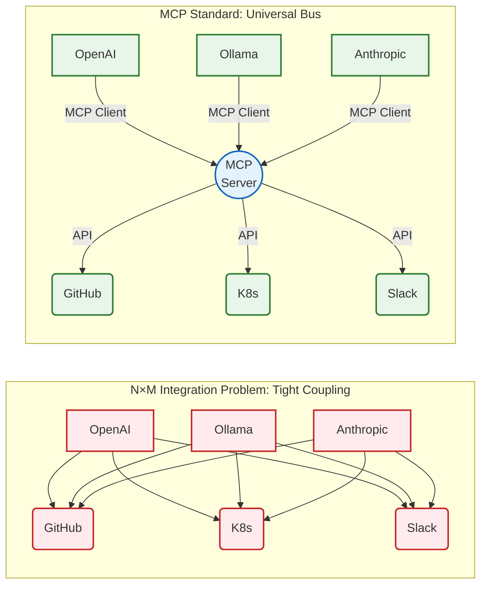

# Chapter 2. State of the Art

This chapter establishes the theoretical and technological framework underpinning the architecture of *Agentic Deployer*. It provides a comprehensive review of contemporary paradigms in Artificial Intelligence, standardization protocols for foundational model communication, and modern principles of Platform Engineering.

## 2.1. Autonomous Agents Based on Large Language Models (LLMs)

For decades, Natural Language Processing (NLP) research focused on developing models capable of understanding and generating fluent human text. However, with the introduction of the Transformer architecture [15] and the subsequent maturation of Large Language Models (LLMs), empirical evidence revealed that beyond certain parameter and training corpus scale thresholds, models exhibit emergent capabilities that transcend simple probabilistic next-token prediction.

These capabilities include deductive logical reasoning, zero-shot generalization, and complex instruction-following [16]. Leveraging these capabilities has driven a paradigm shift in the field: the evolution from passive conversational chatbots to **Autonomous Agents**. An LLM-based agent is a computational system in which the language model functions not merely as an interface, but as the central reasoning engine that perceives runtime state, plans sequential steps, and executes actions upon its operating environment to modify that state.

To transcend the model's static encapsulation—typically isolated from real-time networks and bounded by training knowledge cutoffs—and attain actionable agency, the software industry has consolidated two fundamental technical advancements: the *ReAct* reasoning paradigm and *Function Calling* (or *Tool Calling*).

### 2.1.1. The ReAct (Reason + Act) Paradigm

Prior to the formalization of agentic architectures, conventional prompting paradigms required models to emit immediate final responses or reason statically through techniques such as *Chain-of-Thought* (CoT) [17]. Although CoT significantly improves deductive reasoning by prompting models to think step by step, it suffers from an intrinsic limitation: the model reasons exclusively over information contained within its initial prompt or static parameter weights, lacking the ability to query external runtime state or rectify invalid premises dynamically. In mission-critical infrastructure operations, this frequently leads to hallucination and error propagation.

To address this challenge, Yao et al. [9] introduced the **ReAct** paradigm. This conceptual framework alternates human-interpretable reasoning trace generation with explicit environment action executions. In a ReAct control loop, the agent operates through an iterative cycle governed by three primitives:

1. **Thought:** The agent evaluates the current conversational context and user request to deduce the next logical action. For instance: *"The user requested a CMS deployment. I must verify departmental quotas before allocating memory."*
2. **Action:** The agent selects an external tool from an available catalog to execute. For example: `consultar_cuotas_departamento(departamento="informatica")`.
3. **Observation:** The execution environment (the underlying application layer) invokes the tool against real infrastructure and returns the structured output (text or JSON) to the LLM. The model integrates this observation into its context window and returns to Step 1.

This iterative loop terminates when the model determines, during its *Thought* phase, that sufficient context has been assembled and all required environment mutations have completed, at which point it emits its **Final Answer**. In the context of this thesis, ReAct serves as the orchestrator's primary control mechanism: it enables the agent to interactively negotiate deployment specifications (e.g., requesting an alternative port from the user if initial validation against Kubernetes policies fails), substantially mitigating hallucination risks by anchoring reasoning in real environment observations.

### 2.1.2. Tool Calling and Function Calling

The technical mechanism enabling an LLM to execute the *Action* phase of a ReAct loop is *Function Calling* (or *Tool Calling*). Prior to its standardization, extracting structured entities from unstructured text relied on brittle Regular Expressions (RegEx) or secondary classification layers. A user might prompt: "Deploy a redis database", but enforcing strictly parseable JSON outputs (e.g., `{"action": "deploy", "service": "redis"}`) was prone to schema violations, unwanted whitespace, or invalid escape sequences.

A qualitative leap occurred when major model providers and open-source communities (e.g., via Ollama and vLLM) introduced specialized instruction fine-tuning targeted explicitly at structured data generation and schema compliance.

Under contemporary *Tool Calling*, the application injects a structured schema (typically *JSON Schema*) into the model's system prompt alongside user input, defining available functions, descriptions, and strongly typed parameter definitions (integers, booleans, enums). When the model infers that a user request necessitates external action, it suspends conversational generation and returns a structured machine-readable payload. This payload instructs the hosting runtime to execute the designated routine on the server.

This capability has transformed the role of general-purpose programming languages in AI systems. Languages such as Python or Go are no longer merely HTTP client wrappers; they serve as operational execution interfaces for agents, granting them direct access to SQL databases, messaging channels, and, in the case of *Agentic Deployer*, container orchestration APIs. The determinism achieved through modern *Tool Calling* is the critical enabler that allows engineering teams to entrust DevOps workflows to stochastic models.

## 2.2. Integration Standardization: Model Context Protocol (MCP)

Although *Tool Calling* endowed language models with execution capabilities, its initial adoption spawned a fragmented software ecosystem. Major AI providers (OpenAI, Google, Anthropic) each introduced proprietary specifications for tool registration. Concurrently, open-source orchestration frameworks (such as LangChain, LlamaIndex, and AutoGen) established incompatible abstraction layers.

This fragmentation led to classic vendor lock-in. If an infrastructure operations team developed a suite of deployment tools tailored to LangChain and OpenAI, migrating to local open-weights models (e.g., Ollama or vLLM) to comply with data privacy policies required rewriting the tool integration layer. Maintaining redundant adapters across evolving model families proved unsustainable. **Figure 1** illustrates this $N \times M$ integration bottleneck contrasted against the universal bus architecture established by standardized context protocols.

<div style="max-width: 12cm; margin: 0 auto;">



</div>
<p align="center"><i><b>Figure 1:</b> Architectural contrast between the N×M integration problem (proprietary coupling) and the Universal Bus topology proposed by the Model Context Protocol (MCP).</i></p>

As illustrated in Figure 1, the traditional topology (left) suffers from combinatorial growth: connecting $N$ cognitive models (OpenAI, Ollama, Anthropic) directly to $M$ infrastructure tools (GitHub, Kubernetes, Slack) requires implementing and maintaining $N \times M$ tightly coupled, proprietary adapters. Conversely, adopting the MCP standard (right) introduces a universal bus architecture: cognitive clients implement a single standardized interface (*MCP Client*), while infrastructure services expose capabilities through a shared server (*MCP Server*). This mediation reduces integration complexity to linear order $O(N + M)$, decoupling agent lifecycles from infrastructure tool evolutions.

### 2.2.1. Genesis and Principles of MCP

To resolve this architectural fragmentation, in late 2024 Anthropic led the release of an open-source standard: the **Model Context Protocol (MCP)** [13]. The core motivation of MCP is to strictly decouple AI consumers (agents) from data sources and local infrastructure tools, establishing a universal interaction language.

MCP draws direct architectural inspiration from Microsoft's *Language Server Protocol (LSP)*, which standardized communication between code editors (IDEs) and language compilers. Similarly, MCP establishes a standard layer connecting any generative model with enterprise computational environments, promoting a pluggable architecture built upon lightweight `JSON-RPC 2.0` messaging.

### 2.2.2. Client-Server Architecture of MCP

The protocol replaces monolithic integrations with a formal client-server architecture, establishing strict security boundaries:

- **MCP Host / Client (The Agent):** The application interacting with the user and coordinating LLM reasoning. The client remains agnostic to tool implementations; its role is to communicate with the server via standard messages, inject retrieved context into the model prompt, and dispatch tool execution requests selected by the AI. In this project, the `AgentOrchestrator` component implements the MCP client logic.
- **MCP Server (The Environment):** An independent, lightweight process hosted within the organization's trusted network zone (operated by university IT administrators). The server operates independently of LLM reasoning; its sole purpose is to encapsulate imperative business logic (e.g., generating Kubernetes YAML manifests) and expose these operations through standardized JSON schemas.

Communication between client and server occurs via standardized transports. MCP supports direct local communication via standard operating system input/output streams (**stdio**), ideal for tools co-located on the same host as the agent, as well as network transport via **Server-Sent Events (SSE)** over HTTP, essential for distributed and cloud-native deployments.

### 2.2.3. Protocol Primitives: Resources, Prompts, and Tools

The MCP specification structures model-environment interactions around three core primitives:

1. **Resources:** Read-only data sources controlled by the server. They supply contextual data to the LLM's context window without granting mutation permissions. Examples include retrieving cluster state, database schemas, or internal documentation.
2. **Prompts:** Parameterized prompt templates stored on the server to enforce organizational consistency. An administrator can define standardized prompts (e.g., "Summarize cluster node health"), which the client retrieves and renders for users.
3. **Tools:** Executable routines with side effects (environment mutations) governed by the server. Tools represent the standardized equivalent of Function Calling. Upon initialization, the server advertises its tool catalog (e.g., `deploy_python_app`) along with required argument schemas (such as project name and language runtime version).

Adopting the Model Context Protocol via its official Python SDK forms the architectural backbone of *Agentic Deployer*. This decision ensures that institutional infrastructure automations remain decoupled from rapid evolutions in AI provider SDKs. The tools exposed by the project's MCP server can be consumed interchangeably by the local agent interface (Streamlit + Ollama) and external third-party tools (such as the official MCP Inspector or commercial IDEs), ensuring long-term maintainability and robust interoperability.

Simultaneously, the industry is exploring parallel standardization initiatives such as the **Agent Protocol** championed by the AI Engineer Foundation [18], which aims to establish a uniform REST API for communicating with autonomous agents. While the Agent Protocol addresses agent-to-agent and client-to-agent interactions, MCP addresses agent-to-environment tool integration. Both frameworks highlight the maturation of standardized protocols in autonomous computing.

## 2.3. Declarative Infrastructure and Orchestration (Kubernetes and OpenShift)

Understanding automated infrastructure provisioning requires analyzing the operational model established by Kubernetes (K8s) [5] and enterprise distributions such as Red Hat OpenShift and OKD. Originally developed at Google as the internal *Borg* system and later donated to the Cloud Native Computing Foundation (CNCF), Kubernetes has become the de facto standard for container orchestration. Its widespread adoption is rooted in its declarative management paradigm. In university datacenters and enterprise environments, this model is frequently deployed on **OpenShift / OKD** clusters, which package Kubernetes core components with hardened multi-tenant security controls (*SecurityContextConstraints*) and lifecycle operators. Standardizing the IDP on universal Kubernetes primitives guarantees native compatibility across both upstream Kubernetes and downstream OpenShift platforms.

### 2.3.1. Imperative vs. Declarative Management

Traditional systems administration relied predominantly on imperative workflows. Operators managed infrastructure through explicit command sequences (e.g., shell scripts executed against remote servers). Under an imperative model, the operator defines *how* tasks must be carried out step by step: "download this image, start the container, bind port 80, verify process health". While straightforward, this approach is fundamentally fragile. If a host restarts or a process crashes, imperative scripts lack runtime context to restore normal operations without manual intervention.

In contrast, Kubernetes adopts a declarative Infrastructure as Code (IaC) model. In a declarative paradigm, engineers do not prescribe operational procedures; instead, they specify the **Desired State** of the system. Using structured YAML or JSON manifests, the operator declares: "Maintain exactly 3 replicas of the WordPress container exposed on port 8080".

### 2.3.2. Reconciliation Loops and the Control Plane

Translating desired state into actual infrastructure is the responsibility of the Kubernetes Control Plane, operating via asynchronous **Control Loops** (or Reconciliation Loops).

A Kubernetes cluster continuously monitors network topologies and active processes. Asynchronously, it compares the **Actual State** (e.g., "only 2 WordPress pods are running because a worker node crashed") against the **Desired State** stored in its distributed key-value store (`etcd`). Upon detecting a divergence (2 actual pods vs. 3 desired pods), the reconciliation loop automatically calculates necessary remediation actions (scheduling a new pod on an available healthy node) and executes them without requiring human intervention.

### 2.3.3. Syntactic Complexity and Cognitive Load

Despite the clear resilience and self-healing benefits of declarative management, authoring desired state configurations imposes significant cognitive overhead. The Kubernetes API encompasses dozens of native resource kinds (Pods, Deployments, Services, Ingresses) and supports domain extensions via Custom Resource Definitions (CRDs), each adhering to strict schema validation rules.

Deploying a production web service requires authoring and interconnecting multiple distinct primitives:
1. **Deployment:** Manages the container lifecycle, base image tags, restart policies, health probes (*liveness* and *readiness*), and hardware resource requests and limits.
2. **Service:** Abstrates ephemeral container IP addresses by establishing a stable virtual endpoint (*ClusterIP*) to load-balance traffic across pods.
3. **Ingress:** Manages external HTTP/HTTPS routing into internal Services, handling host-based routing rules and SSL/TLS termination.

The interdependencies among these manifests require exact syntactic coordination (such as matching label selectors between Deployments and Services). A minor YAML indentation error or mismatched label key causes the workload to deploy into an unreachable network silo without triggering overt API error messages.

To illustrate this complexity, Listing 1 provides the minimum compliant manifest structure required to expose a Python API in Kubernetes. Each component is independent, yet all must remain strictly aligned:

```yaml
# 1. Deployment: defines container specifications, replicas, and resource boundaries
apiVersion: apps/v1
kind: Deployment
metadata:
  name: python-api           # Unique resource identifier within the cluster
  namespace: sic-research    # Departmental namespace
spec:
  replicas: 2                # Number of concurrent active instances
  selector:
    matchLabels:
      app: python-api        # (A) Deployment matches Pods carrying this label
  template:
    metadata:
      labels:
        app: python-api      # (A) Pods inherit this label for selector matching
    spec:
      containers:
        - name: api
          image: harbor.universidad.edu/sic-research/python-api:1.2.0  # Audited enterprise image; :latest forbidden
          ports:
            - containerPort: 8080
          resources:
            requests: { cpu: "100m", memory: "128Mi" }   # Guaranteed allocation
            limits:   { cpu: "500m", memory: "512Mi" }   # Maximum ceiling (IT ResourceQuota)
---
# 2. Service: creates a stable network abstraction over ephemeral Pod IPs
apiVersion: v1
kind: Service
metadata:
  name: python-api-svc
  namespace: sic-research
spec:
  selector:
    app: python-api          # (A) EXACT match to Deployment label; any mismatch
                             # breaks routing silently without explicit error output
  ports:
    - port: 80
      targetPort: 8080       # Forwards traffic from port 80 to container port 8080
---
# 3. Ingress: exposes the Service externally with host-based HTTP routing
apiVersion: networking.k8s.io/v1
kind: Ingress
metadata:
  name: python-api-ingress
  namespace: sic-research
  annotations:
    nginx.ingress.kubernetes.io/ssl-redirect: "true"  # Enforces HTTPS
spec:
  rules:
    - host: api.investigacion.univ.es
      http:
        paths:
          - path: /
            pathType: Prefix
            backend:
              service:
                name: python-api-svc   # Reference to Service defined above
                port:
                  number: 80
```
<p align="center"><i><b>Listing 1:</b> Complete Kubernetes manifest (Deployment + Service + Ingress) for a Python API. The three resources must coordinate precisely—especially the label designated by (A)—for the application to be accessible externally.</i></p>

Analyzing this manifest demonstrates that deploying containerized workloads requires coordinating four critical architectural dimensions:

1. **Declarative Coupling via Label Selectors:** Kubernetes traffic routing operates via decoupled labels. The *Deployment* manages the lifecycle of pods labeled with `app: python-api` (annotated as `(A)`), while the *Service* uses `spec.selector` to dynamically discover matching pods and maintain its internal routing table (*Endpoints*). Any lexical or typographical mismatch causes the Kubernetes API to accept the manifest as syntactically valid; however, the *Service* resolves zero endpoints, causing a silent failure where no deployment exception is thrown yet the application remains completely unreachable.
2. **Network Topology and Transport-Layer Port Mapping:** A multi-tier port mapping hierarchy is established. The ingress controller receives external HTTP traffic on standard port `80` and routes it to the *Service* port. In turn, the *Service* translates traffic to `targetPort: 8080`, which must match the port on which the containerized API listens (`containerPort: 8080`). Restricting ports to values $\ge 1024$ complies with least-privilege principles, avoiding root user privileges inside the container's network namespace.
3. **Resource Scheduling and Governance (*Requests and Limits*):** Defining CPU and memory `requests` and `limits` is mandatory in multi-tenant clusters. Minimum guaranteed values (`requests`) inform scheduling decisions made by `kube-scheduler`, while hard ceilings (`limits`) mitigate noisy-neighbor contention and prevent runaway processes from triggering out-of-memory kernel terminations (*OOMKilled*) on adjacent workloads. These parameters must strictly adhere to the departmental `ResourceQuota` enforced in `sic-research`.
4. **Host-Based Ingress Resolution:** External exposure depends on strict naming alignment: the HTTP routing rule references `backend.service.name`, which must match the identifier of the target *Service* (`python-api-svc`). Any mismatch prevents ingress controllers from synthesizing valid forwarding rules.

This intricate dependency graph illustrates the cognitive burden that direct infrastructure management places upon non-specialized researchers and developers. Rather than requiring users to master low-level declarative syntax, *Agentic Deployer* serves as an intelligent intermediary that infers and validates these relationships from high-level natural language prompts.

For empirical comparison, **Annex A (Section A.2, Listing 2)** provides the manifest autonomously generated by *Agentic Deployer* during a live deployment test (Scenario 1). That artifact demonstrates the agent's ability to synthesize label mappings, configure liveness and readiness health probes, inject non-privileged runtime security contexts (`securityContext` with dropped capabilities), and attach HITL governance metadata.

## 2.4. Hexagonal Architecture and Security in Stochastic Systems

Integrating Large Language Models into critical infrastructure environments presents a fundamental architectural dilemma. By their statistical nature, LLMs are stochastic and non-deterministic. In contrast, enterprise IT provisioning requires absolute determinism (e.g., rejecting any deployment attempting to expose privileged ports or untrusted registries). To reconcile generative agility with strict infrastructure compliance, *Agentic Deployer* adopts the principles of **Hexagonal Architecture**.

### 2.4.1. Foundations of Ports and Adapters

Formalized by Alistair Cockburn [19] under the name *Ports and Adapters*, Hexagonal Architecture emerged to resolve the limitations of traditional layered architectures (Presentation $\rightarrow$ Business Logic $\rightarrow$ Database). In layered designs, business logic often becomes contaminated with transitive dependencies on database drivers or UI presentation frameworks.

The central goal of Hexagonal Architecture is to enable an application to be driven equally by users, external programs, automated test suites, or batch scripts, and to be developed and tested in total isolation from concrete runtime infrastructure and databases.

Represented conceptually as a hexagon, the architecture establishes a clean boundary between two zones:
- **The Core (Domain):** Encapsulates pure business rules, domain invariants, and data models. It possesses zero external dependencies; it imports no HTTP libraries, database drivers, or AI vendor SDKs.
- **The Outer Layer (Adapters):** Contains concrete technological implementations (REST APIs, database repositories, OpenAI client libraries, Kubernetes cluster adapters).

### 2.4.2. Dependency Inversion (The SOLID 'D' Principle)

Communication between the immutable Core and volatile Adapters is governed by **Ports**. A Port is an abstract interface or protocol contract.

The structural integrity of this pattern relies on the strict application of the Dependency Inversion Principle (DIP). Rather than allowing the business core to depend on a concrete Kubernetes client to execute deployments, the core defines an abstract `DeployPort` contract (e.g., `def deploy(intent: DeploymentIntent) -> str`). The outer adapter layer implements this contract. The core remains aware only of the abstract interface, never of concrete implementations.

### 2.4.3. Sandboxing the Stochastic AI Engine

Adopting Hexagonal Architecture provides the foundation for system security in this thesis. By defining domain entities (such as `DeploymentIntent`) within the pure application core using strongly typed Pydantic models, the LLM is structurally isolated from physical infrastructure adapters.

In this topology, the AI agent acts as a **Primary (Driving) Adapter**, formulating intents that invoke application use cases. Because of hexagonal boundaries, the language model has no direct visibility into or access to physical infrastructure adapters (**Secondary or Driven Adapters**), preventing prompt injection attacks or hallucinations from reaching the cluster unmediated. Every intent emitted by the AI must cross an inbound Port, where it undergoes deterministic policy inspection by the domain rule engine (`SecurityContextValidator`).

If the model proposes a configuration violating institutional security policies, the core rejects it immediately by raising a strongly typed domain exception. This exception does not degrade system availability; rather, it flows back to the driving adapter, where the orchestrator captures it and re-injects the error description into the LLM's context window as structured feedback (the ReAct feedback loop).

Thus, Hexagonal Architecture functions as a deterministic validation sandbox, harnessing generative reasoning while withholding unmediated execution privileges over production infrastructure.

## 2.5. Related Works and Differential Positioning

The convergence of conversational agents and infrastructure automation has produced several academic and commercial initiatives in recent years. This section analyzes key approaches and establishes the differential positioning of *Agentic Deployer*.

### 2.5.1. Commercial Cloud Assistants and Copilots

Major cloud hyperscalers have launched conversational assistants embedded within their platforms. Microsoft provides **GitHub Copilot for Azure** and the **Azure AI Assistant** within its management portal. Google offers **Gemini for Google Cloud**, and Amazon Web Services provides **Amazon Q Developer**.

While powerful, these commercial solutions exhibit significant structural limitations for institutional and academic environments:
- **Vendor Lock-In:** They operate exclusively within their respective proprietary clouds, preventing unified governance across hybrid or on-premise Kubernetes clusters.
- **Data Sovereignty Violations:** Operational metadata and prompts are transmitted to commercial cloud datacenters, conflicting with European and institutional data protection regulations (GDPR, ENS).
- **Unsupervised Execution Risks:** Many cloud copilots allow direct execution without a mandatory, immutable Human-in-the-Loop approval gate.
- **Unpredictable Operational Costs (OPEX):** Their commercial models rely on per-token consumption or recurring per-seat subscriptions, introducing budgetary volatility unacceptable in public sector institutions.
- **Rigid Policy Customization:** Their generation templates are generic and cannot natively enforce localized departmental quotas, naming conventions, or customized security baselines.

### 2.5.2. Research Approaches: LLMs for IaC, ChatOps, and General-Purpose Frameworks

In academic research, multiple studies have explored applying language models to infrastructure engineering:

- **Automated Infrastructure as Code (IaC) Synthesis:** Recent empirical studies investigating LLM-generated IaC security [11] evaluate models generating Terraform and Kubernetes manifests from natural language. Large-scale quantitative assessments of LLM-assisted IaC development [12] find that while models achieve high syntactic completeness, they frequently suffer from subtle networking and storage hallucinations, as well as cumulative configuration drift that necessitates strict external validation. Similarly, cluster security frameworks like *GenKubeSec* [20] demonstrate the utility of LLMs for misconfiguration detection and automated remediation; however, the authors emphasize that unmediated automated remediation without human oversight introduces prohibitive operational risks in production. These studies confirm that delegating security and semantic correctness directly to LLMs without a deterministic verification layer is insufficient: models produce syntactically valid manifests that remain semantically vulnerable (e.g., unapproved ports or unvetted container registries).
- **ChatOps Integration for DevOps Pipelines:** Leppänen et al. [21] analyze real-world conversational tool integration within CI/CD pipelines in *"The Highways and Country Roads to Continuous Deployment"*. While conversational assistants in platforms like Slack or Teams improve collaboration, existing implementations typically execute commands directly without an intermediate strongly typed domain model or a formally verified state machine.
- **Demarcation from General-Purpose Agent Frameworks:** It is essential to distinguish this work from generic agent libraries such as **LangChain** [22] or **AutoGen** [23]. These frameworks provide baseline utilities for chaining model invocations at a lower software layer. Conversely, *Agentic Deployer* is an end-to-end infrastructure platform: it avoids volatile external framework dependencies by implementing a pure Hexagonal Architecture, strict domain typing, and standardized interoperability based on the open Model Context Protocol (MCP).

### 2.5.3. Differential Positioning of Agentic Deployer

*Agentic Deployer* occupies a distinct position at the intersection of agentic automation and Platform Engineering. Unlike proprietary cloud copilots operating as black boxes or experimental systems relying on unconstrained IaC generation, the architecture presented in this thesis establishes a **formal separation between the cognitive reasoning plane (LLM) and the physical execution plane (Hexagonal Architecture)**.

Table 1 summarizes this multidimensional comparison between proprietary cloud assistants and *Agentic Deployer*:

| Dimension | Proprietary Cloud Assistants | **Agentic Deployer** |
|---|---|---|
| **Deployment Target** | Bound to vendor's proprietary cloud | Any Kubernetes cluster (on-premise, hybrid, or multi-cloud) |
| **Data Sovereignty** | Inferences and telemetry processed in cloud provider datacenters | *Zero Data Retention* (local inference via Ollama or private cloud APIs) |
| **Human Supervision (HITL)** | Optional or reactive; direct execution permitted | Mandatory and preventive; immutable FSM gate cannot be bypassed |
| **Golden Paths** | Generic templates managed by cloud provider | Organizationally audited Golden Paths and custom security policies |
| **Interoperability** | Closed proprietary APIs | Open universal standard (MCP, interoperable with any client) |
| **Operational Cost** | Variable per-token or per-user OPEX | Self-hosted infrastructure with zero marginal inference cost |
| **Auditability and Governance** | Proprietary logs subject to external retention policies | Full local ACID transactional audit trail persisted on disk |
<p align="center"><i><b>Table 1:</b> Multidimensional comparison between proprietary cloud assistants and Agentic Deployer.</i></p>

In conclusion, *Agentic Deployer* prioritizes technological sovereignty, deterministic security, and operational auditability over SaaS convenience, providing public institutions and enterprise organizations with a robust, economically sustainable foundation for integrating intelligent agents into critical infrastructure operations.
