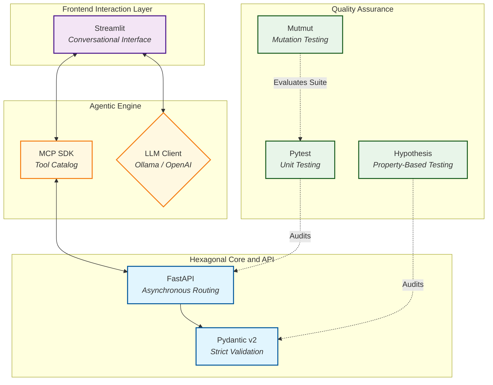

# Chapter 3. Methodology and Technology Stack

Constructing an orchestration platform that bridges classical Software Engineering practices (Hexagonal Architecture, rigorous automated testing, REST APIs) with emerging, inherently stochastic domains such as Generative Artificial Intelligence requires a structured methodological framework. This chapter describes the development methodology adopted throughout the lifecycle of *Agentic Deployer*, the scheduled development phases, and the architectural rationale behind the chosen technology stack.

## 3.1. Methodological Approach

Software engineering tailored to Artificial Intelligence differs significantly from conventional web or enterprise application development. In deterministic systems, input $A$ (e.g., clicking a button) invariably yields output $B$. In a system orchestrated by a Large Language Model (LLM), input $A$ (a natural language prompt) can yield multiple syntactically divergent yet semantically equivalent outputs. This variance necessitates establishing foundational practices that strictly decouple deterministic business constraints from stochastic reasoning.

To govern this risk, this Master's Thesis adopted an **iterative and incremental development methodology**, guided by the principles of *Domain-Driven Design* (DDD) and *Test-Driven Development* (TDD). Rather than constructing the system horizontally (designing the database schema, followed by backend endpoints, and concluding with frontend views), the methodology enforced a concentric, inside-out progression aligned with Hexagonal Architecture principles.

The central methodological rule was **core stability prior to stochastic integration**: not a single line of integration code for the OpenAI API, Ollama, or the MCP SDK was authored until the internal domain model (`DeploymentIntent`) and rule engine (`SecurityContextValidator`) demonstrated 100% deterministic reliability under extensive automated test suites. Introducing AI integrations before stabilizing validation invariants would have exposed the system to severe security vulnerabilities during early development stages.

## 3.2. Development Phases

To realize the final product, the execution schedule was structured into **five core development sprints** complemented by two transversal consolidation phases (Phases 6 and 7, detailed in Section 4.2 and Annex B). Each sprint produced a functional, test-verified software increment serving as an immutable foundation for subsequent phases.

> *Methodological Note: The following sections reference architectural design artifacts (such as `DeploymentIntent`, `SecurityContextValidator`, or `DeployPort`) that are formally detailed in **Chapter 5**. They are introduced here to establish chronological context across development sprints.*

> *Planning Note: While the initial roadmap defined a sequential sprint progression, the reality of academic research and concurrent graduate commitments necessitated flexible phase overlap. Project tracking and sprint retrospective analyses are documented in **Chapter 4** and **Annex B**.*

### 3.2.1. Sprint 1: Hexagonal Core and Domain Baseline

This phase established the project's foundation. The objective was to formally model university IT operational rules in a strictly deterministic manner, independent of AI integrations:
- **Entity Modeling:** Defined the deployment domain ontology. The `DeploymentIntent` value object was implemented with strict static typing, enforcing essential provisioning constraints (application name, base container image, network port, hardware resource quotas).
- **Validation and Use Cases:** Developed `SecurityContextValidator`, a deterministic rule engine designed to intercept invalid or malicious requests (e.g., privileged system ports $< 1024$ or unapproved container registries).
- **Contracts (Ports):** Established the abstract deployment port (`DeployPort`), defining the interface contract that downstream infrastructure adapters (Kubernetes, Docker Swarm, Nomad) must satisfy.

### 3.2.2. Sprint 2: HITL Operations Backend and FSM

Before enabling autonomous action capabilities in the AI agent, operational oversight controls were implemented:
- **REST API Layer:** Built the primary driving adapter via a FastAPI HTTP server to ingest deployment intents in a structured format.
- **Quarantine Workflow:** Implemented transitional state logic. Intents validated by the domain engine were not executed immediately; instead, they were held in a quarantined `PENDING_APPROVAL` state.
- **Operator Dashboard:** Designed and implemented an asynchronous web dashboard enabling IT administrators to inspect quarantined intents and execute final authorization decisions (`POST /hitl/approve`), closing the *Human-In-The-Loop* (HITL) architectural loop.

### 3.2.3. Sprint 3: Golden Paths and FakeK8s Adapter

The third increment introduced declarative artifact generation. While direct execution against live production clusters was scoped out of the MVP baseline, the orchestrator needed to demonstrate end-to-end synthesis of valid infrastructure configurations:
- **Emulation Adapter:** Implemented `FakeK8sAdapter`, fulfilling the `DeployPort` interface contract.
- **Declarative Materialization:** Created templated *Golden Paths*. Upon receiving an approved intent, the adapter extracts runtime variables (application name, sizing specifications) and writes complete, cross-linked Kubernetes YAML manifests (`Deployment`, `Service`, `Ingress`) to disk, verifying that the system generates production-grade manifests while eliminating manual authoring complexity.

### 3.2.4. Sprint 4: ReAct Agent and MCP SDK Integration

With a validated, deterministic infrastructure core capable of generating Kubernetes manifests, the fourth sprint integrated the cognitive reasoning layer, exposing a natural language interface to end users:
- **MCP Protocol Implementation:** Integrated the official *Model Context Protocol* SDK, refactoring IT capabilities (e.g., `deploy_python_app`) into standardized tools exposed over the `stdio` transport.
- **ReAct Engine:** Developed `AgentOrchestrator`, an iterative reasoning loop communicating with models via a provider-agnostic adapter (`LLMClient`). The engine parses model responses, executes backend MCP tools, and re-injects observations into the context window (establishing the security feedback loop).

### 3.2.5. Sprint 5: Advanced QA (Metamorphic and Property-Based Validation)

Added as an advanced software quality layer to verify system resilience against probabilistic model behavior:
- Integrated *Property-Based Testing* via Hypothesis, generating thousands of randomized deployment intents to evaluate validation boundary conditions.
- Formalized Metamorphic Testing to assess LLM semantic stability under linguistic perturbations (lexical noise, word-order transformations, prompt mutations).
- Executed *Mutation Testing* with Mutmut to audit test suite fault-detection effectiveness against logical mutant injections.

### 3.2.6. Phase 6: Post-MVP Consolidation (Hardening and HITL Lifecycle Closure)

Following MVP stabilization, several usability and architectural refinements were implemented:
- **Native Ollama Client (`OllamaLLMClient`):** Replaced the generic OpenAI SDK wrapper for local Ollama communication with direct asynchronous `httpx` calls against Ollama's native REST endpoints. This refactoring guarantees true *Zero Data Retention* without third-party cloud dependencies.
- **Bidirectional User Notification Channel:** Implemented the `GET /hitl/status/{id}` polling endpoint and corresponding Streamlit UI notification widget (`My Pending Requests`), closing the asynchronous feedback loop back to the researcher.
- **Empirical Evidence Artifacts:** Populated the `demos/` directory with complete JSON traces from live sessions and generated Kubernetes YAML manifests (Annex A).

### 3.2.7. Phase 7: Experimental Extension and Multi-Model Benchmarking

As a final research expansion (Priority P2), the prototype was extended across three technical dimensions:
- **ACID Transactional Persistence:** Migrated runtime state from in-memory structures to an on-disk **SQLite** database, providing durable transaction logging for the finite state machine.
- **MCP Tool Catalog Scaling:** Expanded the server catalog from 4 to 7 operational tools, incorporating database provisioning and workload teardown capabilities.
- **Empirical Multi-Model Evaluation:** Executed comparative benchmarks across cloud models (Gemini, Cohere, Groq) and local specialized models (Qwen Coder), consolidating feasibility and performance conclusions.

## 3.3. Technology Stack and Architectural Rationale

Technology selection in an architecture combining Artificial Intelligence with enterprise infrastructure must balance generative flexibility with deterministic reliability. The following sections outline the rationale behind the selected stack.

### 3.3.1. Core Programming Language: Python 3.12

The project is built entirely on **Python (version 3.12)**. While languages like Go dominate the cloud-native ecosystem (Kubernetes and Terraform are written in Go), Python remains the lingua franca of AI research and systems development. Python 3.12 delivers significant runtime performance optimizations and advanced static typing support (`TypeVar`, `Protocol`, generics). These capabilities are essential for establishing rigorous abstract interfaces in Hexagonal Architecture, mitigating dynamic typing risks in critical systems.

### 3.3.2. Backend and Domain Modeling

- **FastAPI:** Selected over legacy web frameworks (Django, Flask) due to its high-performance asynchronous runtime (built on ASGI and Starlette) and native OpenAPI/Swagger schema generation. For an LLM agent, interacting with an API that produces rigorous, self-describing schemas significantly improves tool comprehension.
- **Pydantic (v2):** Serves as the domain validation core [24]. Rewritten in Rust for optimal execution speed, Pydantic is utilized to enforce domain model invariants (`DeploymentIntent`). It guarantees business constraints (e.g., port boundary conditions and regex matching) prior to application logic execution.

### 3.3.3. Conversational Interface and Agent Orchestration

- **Streamlit [25]:** Developing dedicated single-page applications in React or Vue introduces substantial frontend overhead. Streamlit enables authoring reactive conversational interfaces—including chat message histories, status avatars, and HITL notification panels—entirely in Python. This streamlined visual iterations, allowing development effort to remain focused on infrastructure middleware engineering.
- **Model Context Protocol (MCP) SDK:** Rather than maintaining proprietary HTTP tool interfaces, the official Python MCP SDK was adopted. This library provides decorators (e.g., `@server.tool()`) that introspect function signatures and type annotations at runtime, transforming them into standardized JSON schemas consumable by compliant LLM clients.
- **Provider-Agnostic LLM Abstraction:** The orchestrator defines an abstract contract (`LLMClient`) supporting two concrete implementations:
  - **`OllamaLLMClient`:** A native client built using Ollama's official Python SDK [26] communicating with the local daemon on port 11434 (`POST /api/chat`). It enables self-hosted execution of models like **`qwen2.5-coder:7b`** on institutional hardware, guaranteeing strict **Data Sovereignty** (*Zero Data Retention*) with zero prompt data leaving institutional networks.
  - **`OpenAILLMClient`:** An adapter implementing the standard OpenAI interface, used as a gateway to empirically evaluate external cloud models (Google Gemini, Cohere Command-R, Mistral, Llama 3) without coupling domain logic to a single provider. Model provider selection is controlled via the `LLM_PROVIDER` environment variable.

### 3.3.4. Quality Assurance (QA) Ecosystem

Operational trust in *Agentic Deployer* is anchored in a multi-layered automated verification pipeline:
- **Pytest:** Baseline testing framework for unit and integration suites, offering robust fixture dependency injection.
- **Hypothesis:** Property-Based Testing framework that injects pseudo-randomized inputs to test boundary conditions across domain validators.
- **Mutmut:** Mutation testing tool that introduces logical mutations into source AST nodes to empirically evaluate test suite fault-detection coverage.
- **Locust and Playwright:** Utilized for non-functional verification. *Locust* executes concurrency stress tests against backend endpoints. *Playwright* orchestrates end-to-end (E2E) browser interactions to verify operator workflows in the HITL dashboard.
- **Ruff and Mypy:** Static analysis tools (*Linting* and *Type-Checking*) enforced in local verification to maintain code style consistency and enforce static type safety.

**Figure 2** summarizes the component topology of the technology stack, illustrating the clear separation between presentation, cognitive reasoning, the restrictive backend, and the quality assurance harness.

<i><b>Figure 2:</b> Component diagram of the technology stack, showing separation across the presentation layer, cognitive reasoning, restrictive backend, and continuous quality assurance tools.</i>

The component topology shown in Figure 2 establishes four decoupled tiers:

1. **Frontend Interaction Layer (`UI`):** The Streamlit conversational interface (`ST`) handles user interactions. It maintains bidirectional communication with the cognitive engine (`LLM`) for dialogue generation and with the MCP server (`MCP`) for tool discovery and execution.
2. **Agentic Engine (`Cognition`):** Encapsulates the *ReAct* loop. The LLM client (`LLM`, configurable between local Ollama and cloud APIs) resolves user intentions using tools exposed by the MCP SDK (`MCP`), which serves as a standardized bridge to backend services.
3. **Hexagonal Core and API (`Backend`):** The FastAPI server (`FA`) exposes asynchronous endpoints for intent dispatching (`/mcp/intent`) and operator review (`/hitl`). Requests are mapped to Pydantic v2 models (`PY`), deterministically enforcing domain invariants, typing rules, and security policies prior to state mutation.
4. **Continuous Quality Assurance (`QA`):** Advanced testing tools operate across critical stack components: Pytest (`PYT`) verifies FastAPI endpoints and use cases; Hypothesis (`HYP`) evaluates Pydantic validation boundaries via Property-Based Testing; and Mutmut (`MUT`) measures test suite efficacy via AST mutation analysis.
