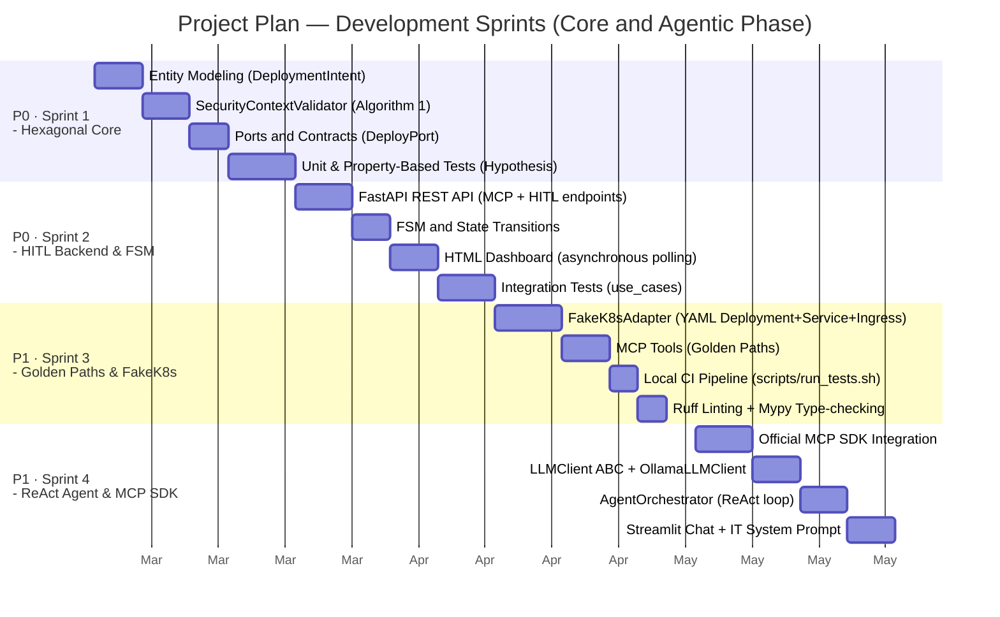
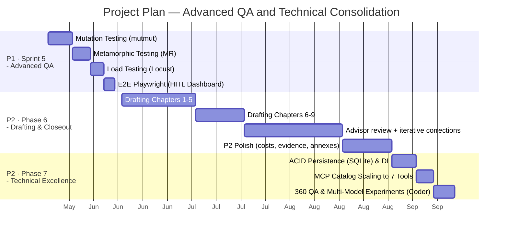

# Chapter 4. Project Management and Viability

Constructing a platform that bridges classical Software Engineering practices with emerging disciplines like Generative Artificial Intelligence requires a structured yet adaptable management framework. This chapter documents project constraints, the sprint structure, effort tracking and deviation analyses, and an economic model assessing both development expenditures and institutional adoption viability. Structuring this chapter immediately after the methodology aligns with formal software engineering principles: constraints, sprint schedules, and development budgets are established prior to detailed architectural design. Furthermore, the institutional adoption viability study and projected Return on Investment (ROI) are formulated here as an ex-ante analytical model based on operational hypotheses, whose empirical validation is evaluated in Chapter 9 (Experimental Results and Evaluation). Detailed retrospective analyses per sprint are documented in **Annex B**.

---

## 4.1. Project Plan — Context and Constraints

### 4.1.1. Structural Constraints

*Agentic Deployer* was developed in the context of an academic Master's Thesis under the following constraints:

- **Workload Dedication:** Part-time research allocation (~15–20 hours per week, maintained concurrently with external professional employment).
- **Project Team:** 1 graduate researcher + 1 academic advisor (periodic supervisory sessions, scheduled according to mutual availability).
- **Infrastructure:** Local development environment (personal workstation), incurring zero cloud hosting expenditures during development.
- **Methodology:** Iterative and incremental development centered on domain invariants (*Domain-First*).

### 4.1.2. Flexibility Principle and Adaptive Prioritization

> **Note on Planning Character:** The planning presented herein is **indicative and orientative**, rather than rigidly prescriptive. Because this thesis was conducted on a part-time basis alongside professional commitments, sprint temporal boundaries were treated as permeable: execution could be accelerated, deferred, or overlapped based on researcher availability and advisor review cadences.

This approach complies with agile management recommendations for applied R&D projects within academic frameworks (IEEE Std 12207, ISO/IEC 29110), where rigid schedules are replaced by **explicit goal prioritization**: the Minimum Viable Product (MVP) is secured first, and optional higher-complexity modules are undertaken based on remaining available time.

**Project Priority Hierarchy:**

| Priority | Module | Status |
|---|---|---|
| **P0 — Mandatory MVP** | Hexagonal core, security validator, REST API, FSM, HITL Dashboard | Completed |
| **P1 — Academic Differentiator** | MCP server (official SDK), ReAct agent, multi-provider LLM abstraction, advanced QA | Completed |
| **P2 — Engineering Excellence** | `OllamaLLMClient`, SQLite persistence, extended 7-tool catalog, empirical traces (MCP Inspector), multi-model cognitive experiments | Completed |
| **P3 — Future Work** | `RealK8sAdapter` (physical cluster integration), RBAC, cloud CI/CD, multi-cluster management | Roadmap |

<i><b>Table 2:</b> Development modules and priority hierarchy.</i>

Only modules **P0 and P1 were strictly mandatory for academic degree evaluation**. Modules P2 were addressed during the final consolidation period, elevating the technical robustness of the system. Modules P3 are documented as future research directions (Section 10.3).

### 4.1.3. Stakeholder Identification

In alignment with software engineering methodologies (ISO/IEC 29110), identifying key stakeholders bounds operational expectations, technical responsibilities, and system acceptance criteria. Five key roles participate in the project lifecycle:

- **Graduate Researcher / Lead Developer (Jesús Solís Ortega):** Responsible for end-to-end technical execution, encompassing requirements elicitation, C4 architectural modeling, hexagonal core and MCP server development, HITL interface design, automated testing pipelines, and technical thesis drafting.
- **Academic Advisor (Manuel Resinas Arias de Reyna):** Director of the Master's Thesis. Responsible for continuous methodological supervision, research guidance, conceptual design validation, and technical review gates.
- **Academic Examination Committee (EIP Evaluation Board):** Academic tribunal responsible for formal evaluation and defense grading, adhering to University of Seville assessment rubrics.
- **IT and Communications Department (SIC):** Institutional benchmark stakeholder for the primary case study. Represents corporate system operators and cluster administrators, establishing security constraints (*SecurityContext*), resource quotas, and exercising final approval authority over deployment requests.
- **University Faculty and Researchers (End Users):** Academic workloads consumers (Python APIs, CMS platforms, conference web applications) who interact with the system via natural language without requiring Kubernetes administration expertise.

### 4.1.4. Communication and Project Tracking Plan

To maintain milestone compliance within flexible timelines, a continuous tracking plan was established via **Microsoft Teams** and institutional email:

1. **Supervisory Review Sessions:** Periodic direction and milestone meetings held via Microsoft Teams videoconferencing, focusing on key deliverables: problem formalization and DSR framing (Sprint 1), MCP server architecture and LLM decoupling (Sprints 3 and 4), and QA audit strategies alongside empirical results (Sprint 5 and Phase 7).
2. **Continuous Communication Channel:** Asynchronous communication via institutional email and Microsoft Teams for progress updates, methodological inquiries, and technical blocker resolution.
3. **Iterative Document Review:** Modular document delivery through institutional channels across major thematic blocks (theoretical background, architecture and implementation, experimental evaluation, and conclusions), ensuring structured feedback prior to formal submission.

---

## 4.2. Sprint Structure and Effort Estimation

### 4.2.1. Project Scheduling Diagrams

The project roadmap was structured into **five thematic development sprints**, accompanied by a transversal documentation phase and a technical consolidation phase (illustrated in the Gantt charts of **Figure 3** and **Figure 4**), representing an initial estimated baseline of **~300 hours** ($\pm 15\%$ standard contingency buffer). Recorded actual effort at project completion was **~340 hours** (+13%); deviation analyses are detailed in §4.3.

<i><b>Figure 3:</b> Gantt chart (Part 1). Indicative schedule for Sprints 1 through 4 (core and agent).</i>

<i><b>Figure 4:</b> Gantt chart (Part 2). Indicative schedule for advanced QA and closeout/consolidation phases.</i>

#### 4.2.1.1. Timeline Analysis and Critical Path

The Gantt charts in Figures 3 and 4 illustrate project distribution over a six-month window (March to August 2026), structuring critical path execution and priority assignments:

1. **MVP Construction Horizon (Figure 3 · Sprints 1 to 4):** Spans March to May 2026. This initial phase enforces a strictly linear critical path: Sprints 1 and 2 (Priority P0) focus on the hexagonal core and deterministic backend. Completing these foundations was a mandatory prerequisite for Sprint 3 (adapters and YAML templates) and Sprint 4 (agentic orchestration and MCP), ensuring AI capabilities were built upon an already functional deterministic boundary.
2. **Verification, Documentation, and Consolidation Horizon (Figure 4 · Sprint 5, Phases 6 and 7):** Spans late May to August 2026. This block transitioned to concurrent dynamics: Sprint 5 (advanced QA) subjected the MVP to mutation and metamorphic testing before freezing the codebase. Concurrently, Phase 6 (drafting and closeout) delivered thesis chapters in modular batches alternating with advisory review cycles (§4.1.2), concluding with Phase 7 technical enhancements (SQLite ACID persistence and comparative benchmarks).

### 4.2.2. Effort Estimation per Sprint

Table 3 summarizes baseline net effort estimations, assuming part-time dedication and the incorporation of generative AI programming assistance:

| Sprint | Phase | Estimation (h) | Range ($\pm 15\%$) | Priority |
|---|---|---|---|---|
| Sprint 1 | Hexagonal Core | 50h | 43–58h | P0 |
| Sprint 2 | HITL Backend & FSM | 45h | 38–52h | P0 |
| Sprint 3 | Golden Paths & FakeK8s | 40h | 34–46h | P1 |
| Sprint 4 | ReAct Agent & MCP SDK | 55h | 47–63h | P1 |
| Sprint 5 | Advanced QA | 45h | 38–52h | P1 |
| Phase 6 | Drafting & Closeout | 55h | 47–63h | P2 |
| Phase 7 | Technical Excellence | 10h | 8–12h | P2 |
| **Total Estimated** | | **~300h** | **~255–345h** | |

<i><b>Table 3:</b> Net effort estimation per Sprint.</i>

> **Note on AI Assistant Usage:** Employing a coding assistant (Google Gemini Advanced, utilized for rapid scaffolding, boilerplate generation, logic cross-checking, and prose polishing) accelerated development phases that would have otherwise demanded substantially greater effort. This aligns directly with the core thesis premise regarding LLM utility in complex technical workflows.

---

## 4.3. Development Effort and Deviation Analysis

Compared to the initial baseline of ~300 hours, empirical project closeout recorded **~340 hours**, representing a deviation of **+13%**. This additional effort remained comfortably within the anticipated contingency boundary ($\pm 15\%$) and was deliberately invested during the consolidation phase to elevate prototype quality (implementing SQLite ACID persistence, expanding MCP tools from 4 to 7, analyzing surviving mutants, and conducting multi-model cognitive experiments).

Generative AI assistance functioned as an effective productivity multiplier, allowing a single researcher to navigate dense architectural requirements within an academic schedule.

Table 4 summarizes effort deviations across all phases:

| Phase | Estimated (h) | Actual (h) | Deviation | Primary Driver |
|---|---|---|---|---|
| Sprint 1 · Hexagonal Core | 50 | ~55 | +10% | Security validator expansion |
| Sprint 2 · HITL Backend & FSM | 45 | ~45 | 0% | Development matched baseline |
| Sprint 3 · Golden Paths & FakeK8s | 40 | ~46 | +15% | Dual MCP SDK integration requirements |
| Sprint 4 · ReAct Agent & MCP SDK | 55 | ~62 | +13% | ReAct loop tuning and native Ollama client |
| Sprint 5 · Advanced QA | 45 | ~50 | +11% | Mutation testing survivor analysis |
| Phase 6 · Drafting & Closeout | 55 | ~64 | +16% | Technical density and document length (~160 pages vs. ~100 anticipated) |
| Phase 7 · Technical Excellence | 10 | ~18 | +80% | Database persistence, full QA 360, multi-model evaluation |
| **Total** | **~300** | **~340** | **~+13%** | |

<i><b>Table 4:</b> Summary of time deviations per phase.</i>

> **Clarifying Note on Schedule Deviations:** A deviation of **+13%** against initial estimates falls well within the $\pm 15\%$ contingency threshold. This deliberate investment of ~40 additional hours occurred in Phase 7 to deliver enterprise-grade finishes. Detailed retrospective analyses per sprint, including completed milestones and lessons learned, are provided in **Annex B**.

---

## 4.4. Change Control: Traceability and Scope Evolution

In compliance with software engineering best practices and academic assessment rubrics (*Change Control* section), this section formally documents architectural adaptations made to initial project proposals.

**Initial Registered Baseline:**
* *Title:* «Design and Implementation of an Internal Developer Platform (IDP) on OpenShift Governed by AI Agents via the MCP Protocol».
* *Summary:* Development of a Platform Engineering middleware automating application lifecycle management on OpenShift/OKD environments. Built under Hexagonal Architecture to expose Infrastructure as Code capabilities (OpenTofu [10]) to AI agents governed by the Model Context Protocol (MCP), reducing developer cognitive load through standardized conversational interactions.

During development iterations (Sprints 1 to 5), ongoing research and empirical findings motivated three decisive engineering refinements:

1. **Infrastructure Target (OpenShift/OKD $\leftrightarrow$ Native Kubernetes):**
   * *Decision:* Red Hat OpenShift and OKD build upon the standard Kubernetes orchestration core. Rather than coupling middleware to proprietary OpenShift APIs (`DeploymentConfig`, `Route`), the platform standardizes artifact generation on universal declarative Kubernetes primitives (`Deployment`, `Service`, `Ingress`, `SecurityContext`).
   * *Justification:* This choice ensures native compatibility on OpenShift/OKD clusters (which execute standard manifests seamlessly) while eliminating vendor lock-in, enabling deployment across any Cloud Native distribution (K3s, EKS, GKE, or bare-metal).
2. **Provisioning Abstraction (From OpenTofu to Native Declarative Golden Paths):**
   * *Decision:* Early proposals envisioned the agent synthesizing raw OpenTofu scripts [10] (IaC in HCL syntax). Contemporary literature on LLM code generation (Siddiq & Santos [11]; Tarasova et al. [12]) demonstrated that unconstrained HCL synthesis introduces severe hallucination risks, networking misconfigurations, and state drift.
   * *Justification:* In alignment with Platform Engineering best practices (Spotify, Gartner [7, 8]), the system adopted **Golden Paths**. The AI does not author raw infrastructure; it infers high-level parameters from natural language prompts, delegating manifest instantiation to pre-validated, strongly typed templates in the hexagonal core, guaranteeing compliance.
3. **Governance Model: Integrating Human-in-the-Loop (HITL) Controls and FSM:**
   * *Decision:* Implemented an immutable Finite State Machine (FSM) and an asynchronous operations dashboard for IT personnel.
   * *Justification:* To satisfy enterprise security mandates and neutralize prompt injection vulnerabilities [27], no action proposed by the AI can mutate cluster state without prior explicit authorization from an authorized human operator.

Table 5 provides the formal traceability matrix comparing the initial proposal against the final implemented platform:

| Dimension | Initial Proposal | Final Implementation | Justification and Technical Benefit |
|---|---|---|---|
| **Core Paradigm** | Internal Developer Platform (IDP) | Internal Developer Platform (IDP) | **100% Maintained.** Self-service abstraction reducing cognitive load. |
| **Architecture** | Hexagonal Architecture (*Ports & Adapters*) | Hexagonal Architecture (*Ports & Adapters*) | **100% Maintained.** Business logic strictly isolated from external dependencies. |
| **AI Protocol** | Model Context Protocol (MCP) | Model Context Protocol (MCP) | **100% Maintained.** Official FastMCP SDK with stdio and SSE transports. |
| **Compute Target** | OpenShift / OKD | Kubernetes Core / OpenShift / OKD | Standardized on universal K8s APIs, ensuring compatibility without vendor lock-in. |
| **Provisioning** | IaC via OpenTofu [10] / Terraform | Declarative Native Golden Paths (YAML) | Eliminates HCL code hallucinations [11, 12]; enforces deterministic templates. |
| **Governance** | Unmediated Agent Execution | Human-in-the-Loop Supervision (FSM) | Enforces enterprise security against hallucinations and Prompt Injection attacks. |

<i><b>Table 5:</b> Change control and traceability matrix compared to initial proposal.</i>

---

## 4.5. Economic Development Analysis

The project was implemented using open-source tools and personal hardware, resulting in negligible direct out-of-pocket costs. However, evaluating economic viability requires calculating the **equivalent opportunity cost**: the capital expenditure required if the project were commissioned in the Spanish technology market at 2026 rates.

### 4.5.1. Human Resources Costs

| Role | Rate / Hour | Hours | Equivalent Opportunity Cost |
|---|---|---|---|
| **Graduate Researcher** (Junior Engineer — market equivalent) | 22 €/h | ~340h | ~7,480 € |
| **Academic Advisor** (Senior Lead / R&D Supervisor) | 75 €/h | ~45h *(periodic sessions + documentation review)* | ~3,375 € |
| **Human Resources Subtotal** | | **~385h** | **~10,855 €** |

<i><b>Table 6:</b> Human Resources costs (equivalent CAPEX).</i>

> **Methodological Note:** Figures represent equivalent market opportunity costs: the expenditure required if executed under professional contract. The student receives no direct remuneration; the advisor is compensated institutionally outside this calculation.

### 4.5.2. Infrastructure and Tooling Costs

| Resource | Provider | Attributable Cost | Calculation / Rationale |
|---|---|---|---|
| **Development Laptop** | Personal Hardware | **~126 €** | Laptop ~1,200 € · 4-year lifecycle · project fraction (6/48 months) $\approx$ 150 € · part-time factor ~84% $\approx$ **126 €** |
| Operating System & Utilities | Linux (Ubuntu) | 0 € | Open source |
| Python 3.12 & Ecosystem | Open source | 0 € | — |
| FastAPI, Pydantic, Hypothesis, Pytest | Open source | 0 € | — |
| Official MCP SDK (`mcp==2.2.0`) | Anthropic (MIT License) | 0 € | Open source |
| Ollama (Local LLM Server) | Open source | 0 € | Free open-weights models |
| **AI Assistant (Google Gemini Advanced)** | Google | **~120 €** | 20 €/month $\times$ 6 months. Utilized for scaffolding, boilerplate generation, and prose review |
| OpenAI API (Testing & Validation) | OpenAI | ~15 € | Development test credits |
| **Infrastructure & Tooling Subtotal** | | **~261 €** | |

<i><b>Table 7:</b> Infrastructure and Tooling Costs (Development Phase).</i>

### 4.5.3. Total Development Expenditures

| Category | Cost |
|---|---|
| Human Resources (Opportunity Cost) | ~10,855 € |
| Infrastructure & Tooling | ~261 € |
| **Total Project Development Cost** | **~11,116 €** |
| **Effective Cost per Hour** | **~28.9 €/h** |

<i><b>Table 8:</b> Subtotal and total costs of development phase.</i>

---

## 4.6. Corporate Adoption Costs and ROI Analysis

This section addresses the strategic question: **What is the capital expenditure and recurring operational cost to adopt and operate *Agentic Deployer* within a production institutional environment**, such as a university IT department or corporate infrastructure team?

> **Methodological Note on Cost Sources:** All economic values in this section reflect market benchmarks as of **2026** and were derived from the following sources:
> - **API Pricing:** Official developer pricing pages ([OpenAI API Pricing](https://openai.com/api/pricing/), [Anthropic Console Pricing](https://www.anthropic.com/pricing), [Google AI Studio](https://ai.google.dev/pricing)).
> - **Hardware (Local Ollama):** Based on official NVIDIA MSRP for the RTX 4000 series and B2B distributor averages.
> - **Cloud / VPS Infrastructure:** Public catalog pricing from IaaS providers ([AWS EC2](https://aws.amazon.com/es/ec2/pricing/), [Google Cloud Compute](https://cloud.google.com/compute/pricing), [Hetzner Cloud](https://www.hetzner.com/cloud/)).
> - **Electricity Costs:** Calculated assuming an average institutional industrial rate of ~0.15 €/kWh in Spain, referencing Eurostat and Red Eléctrica de España market reports.
> - **Salaries (Hourly Technical Cost):** Estimated between 40 €/h and 60 €/h (total employer cost), aligned with Hays Spain and Michael Page compensation surveys for *Platform Engineer* and *DevOps* roles.

### 4.6.1. Adopting Organization Profiles

| Profile | Description | Operational Complexity |
|---|---|---|
| **A — Small University / Small Enterprise** | <5,000 users, IT team of 1–3 engineers, basic local infrastructure | Low |
| **B — Mid-Sized University / Medium Enterprise** | 5,000–30,000 users, structured IT team, on-premise/hybrid K8s | Medium |
| **C — Large University / Enterprise** | >30,000 users, multi-cluster topology, dedicated platform team, strict GDPR audit | High |

<i><b>Table 9:</b> Adopting Organization Profiles (Cases A, B, and C).</i>

### 4.6.2. Implementation Costs (CAPEX — Initial Investment)

| Component | Profile A | Profile B | Profile C |
|---|---|---|---|
| **Code Customization** *(customizing `SYSTEM_PROMPT`, MCP tools, and security policies)* | 20h $\times$ 40 €/h = **800 €** | 60h $\times$ 50 €/h = **3,000 €** | 160h $\times$ 60 €/h = **9,600 €** |
| **`RealK8sAdapter` Implementation** *(cluster integration via `kubernetes-client`)* | 20h $\times$ 40 €/h = **800 €** | 40h $\times$ 50 €/h = **2,000 €** | 80h $\times$ 60 €/h = **4,800 €** |
| **Configuration & Deployment** *(CI/CD, environment variables, SSL, LDAP/SAML)* | 10h $\times$ 40 €/h = **400 €** | 30h $\times$ 50 €/h = **1,500 €** | 60h $\times$ 60 €/h = **3,600 €** |
| **Operator Training (HITL)** | 4h $\times$ 1 engineer = **160 €** | 8h $\times$ 2 engineers = **800 €** | 12h $\times$ 4 engineers = **2,880 €** |
| **Total CAPEX** | **2,160 €** | **7,300 €** | **20,880 €** |

<i><b>Table 10:</b> Implementation Costs (CAPEX - Initial Investment).</i>

### 4.6.3. Annual Operating Expenditures (OPEX)

#### Server Infrastructure

| Component | Profile A | Profile B | Profile C |
|---|---|---|---|
| Application Server (FastAPI + MCP) | VPS 4 vCPU / 8 GB $\approx$ **600 €/year** | Amortized on-prem server $\approx$ **300 €/year** | 3 cloud replicas $\approx$ **3,600 €/year** |
| Storage (Database + YAML manifests) | 50 GB SSD $\approx$ **60 €/year** | 200 GB $\approx$ **200 €/year** | 1 TB + backups $\approx$ **800 €/year** |

<i><b>Table 11:</b> Annual Infrastructure Operating Costs (OPEX).</i>

#### LLM Engine — The Critical OPEX Driver

**Option 1 — Self-Hosted Ollama (Open-Source Models, Recommended for Public Institutions)**

Local models eliminate recurring per-token fees in exchange for a one-time hardware investment. Based on empirical findings (Chapter 10), three corporate adoption tiers are established:

| Tier (Use Case) | Recommended Model | VRAM | Hardware Investment (One-off GPU) | API Cost | Privacy |
|---|---|---|---|---|---|
| **Basic** (MVP / Testing) | `qwen2.5-coder:7b` | 8 GB | ~400 € (e.g., RTX 4060) | **0 €/year** | Total (Zero Data Retention) |
| **Intermediate** (Balanced) | `qwen2.5-coder:14b` / `mistral-nemo:12b` | 16 GB | ~500 € (e.g., RTX 4060 Ti 16GB) | **0 €/year** | Total |
| **Enterprise** (Optimal Corporate) | `Qwen3-Coder-30B-A3B-Instruct` (MoE) | 24–48 GB | ~1,800 € – 5,000 € (RTX 3090/4090 or dual) | **0 €/year** | Total |

<i><b>Table 12:</b> Annual LLM Engine Operating Costs (Local vs Cloud) across adoption tiers.</i>

> **Technical Note on Scaling:** While early design assumptions posited that enterprise adoption would require 14B or 30B models to overcome reasoning limitations, empirical benchmarks with **`qwen2.5-coder:7b`** demonstrate high reliability even on basic 8 GB VRAM hardware (~400 €). Consequently, scaling to Intermediate or Enterprise tiers is primarily reserved for large institutions (Profile C) supporting high concurrency workloads.

**Option 2 — Commercial Cloud APIs**

If an organization elects cloud inference, the `OpenAILLMClient` adapter seamlessly interfaces with cloud endpoints. Table 13 models estimated annual operational expenses based on token consumption:

| Provider | Model | Input Price | Output Price | Estimated Annual Cost* |
|---|---|---|---|---|
| OpenAI | GPT-4o-mini | 0.15 \$/MTok | 0.60 \$/MTok | **~160–650 €/year** |
| OpenAI | GPT-4o | 2.50 \$/MTok | 10.00 \$/MTok | **~2,700–11,000 €/year** |
| Anthropic | Claude Haiku | 0.25 \$/MTok | 1.25 \$/MTok | **~290–1,150 €/year** |
| Google | Gemini Flash | 0.075 \$/MTok | 0.30 \$/MTok | **~80–330 €/year** |

<i><b>Table 13:</b> Estimated LLM Engine Costs (Cloud API).</i>

> *Estimated for 50–200 daily requests, assuming **~50,000 average tokens per request** (90% input context, 10% output). In ReAct loops, context accumulates cumulatively across iterations, and Kubernetes manifest dumps often exceed 3,000 tokens per tool call.

#### Consolidated Total Annual OPEX

| Component | Profile A | Profile B | Profile C |
|---|---|---|---|
| Application Server | 600 €/year | 300 €/year | 3,600 €/year |
| Storage | 60 €/year | 200 €/year | 800 €/year |
| GPU Electrical Consumption (Local)* | ~20 €/year | ~40 €/year | ~100 €/year |
| Local Ollama LLM (One-off Hardware, Year 0) | +400 € (Basic Tier) | +500 € (Intermediate Tier) | +2,000 € (Enterprise Tier) |
| Cloud LLM API (Alternative: GPT-4o)** | ~2,700 €/year | ~5,500 €/year | ~11,000 €/year |
| Maintenance & Upgrades | 10h $\times$ 40 €/h = **400 €/year** | 20h $\times$ 50 €/h = **1,000 €/year** | 40h $\times$ 60 €/h = **2,400 €/year** |
| **Total OPEX (with Ollama)** | **~1,080 €/year** | **~1,540 €/year** | **~6,900 €/year** |
| **Total OPEX (with Cloud API)** | **~3,760 €/year** | **~7,000 €/year** | **~17,800 €/year** |

<i><b>Table 14:</b> Total Annual OPEX consolidated by Adoption Profile.</i>

> *Electrical power costs are low because the GPU remains idle (15–30W) ~99% of the day, peaking only during inference execution bursts.  
> **Production cloud options require resilient models (GPT-4o class), scaling with profile volume (50, 100, and 200 daily requests respectively).

### 4.6.4. Return on Investment (ROI) Analysis

Operational value is quantified based on workload execution time reductions documented in Chapter 9 (Section 9.5, Table 35).

**Annual Operational Savings Calculation — Profile B (Mid-sized University, 500 requests/year):**

| Automated Workflow | Net Time Saved / Request | Annual Requests | Technician Rate | Annual Savings |
|---|---|---|---|---|
| Requirements Negotiation (Triage) | ~25 min (active effort) | 500 | 50 €/h | **~10,417 €** |
| Manual YAML Translation | ~15 min | 500 | 50 €/h | **~6,250 €** |
| Policy Compliance Validation | ~5 min | 500 | 50 €/h | **~2,083 €** |
| **Total Annual Operational Savings** | | | | **~18,750 €** |

<i><b>Table 15:</b> Annual operational savings calculation (Profile B scenario).</i>

> **Note on Active Effort vs. Elapsed SLA:** The ~25 minutes saved refers strictly to **technician active engineering time** (analyzing, clarifying, and re-validating specifications), not total elapsed ticket resolution duration (which spans ~24 business hours due to asynchronous email round-trips). Savings derive from subtracting interactive agent dialogue (~5 min, Table 35) from standard manual triage effort (~30 min).

**Three-Year ROI — Profile B with Self-Hosted Ollama (Basic Coder 7B Tier):**

| Concept | Year 0 | Year 1 | Year 2 | Year 3 |
|---|---|---|---|---|
| CAPEX Investment | -7,300 € | — | — | — |
| LLM Hardware (One-off GPU) | -400 € | — | — | — |
| Annual OPEX | — | -1,540 € | -1,540 € | -1,540 € |
| Operational Savings | — | +18,750 € | +18,750 € | +18,750 € |
| **Net Cash Flow** | **-7,700 €** | **+17,210 €** | **+17,210 €** | **+17,210 €** |
| **Cumulative Cash Flow** | -7,700 € | +9,510 € | +26,720 € | +43,930 € |

<i><b>Table 16:</b> 3-Year Return on Investment (ROI) (Profile B with Ollama).</i>

> **Payback Period: ~5.4 months** following initial deployment.  
> **3-Year ROI: ~475%** (calculated over Year 0 + Year 1 consolidated outlay of 9,240 €; or **~357%** over total three-year cumulative expenditure of 12,320 €).

#### ROI Sensitivity Analysis

The most sensitive variable in the ROI model is technician active effort baseline during triage. Table 17 models sensitivity variations against the 30-minute central baseline:

| Scenario | Baseline Active Time (Triage) | Time Saved / Request | Total Annual Savings | 3-Year ROI |
|---|---|---|---|---|
| **Optimistic** (Pre-optimized SLA, well-documented intake) | ~10 min | ~5 min | **~10,417 €** | **~205%** |
| **Intermediate** (Industry standard process) | ~20 min | ~15 min | **~14,583 €** | **~340%** |
| **Central** (Thesis Reference Baseline) | ~30 min | ~25 min | **~18,750 €** | **~475%** |

<i><b>Table 17:</b> Sensitivity analysis of Return on Investment (ROI) across technician baseline active time variations.</i>

Even in the most conservative scenario (a baseline process requiring only 10 minutes of active triage), the system maintains a **205% 3-year ROI** with an estimated payback period of ~10 months, demonstrating financial viability across varying organizational efficiencies.

---

## 4.7. Conclusions of the Viability Analysis

1. **Schedule flexibility is an intentional design attribute, not an oversight.** Part-time academic execution precludes rigid Gantt constraints; explicit prioritization (P0 $\rightarrow$ P3) ensured that academic core requirements were fully met before exploring optional modules.
2. **Generative AI coding assistance is a proven productivity multiplier.** Leveraging a coding agent (Google Gemini Advanced, ~120 € attributable expenditure) enabled a single engineer to implement an ambitious software architecture (Hexagonal design, official MCP SDK, multi-layer QA, ReAct engine) within ~340 total hours.
3. **Local inference is economically superior for public sector institutions.** Pairing Ollama with on-premise hardware limits OPEX to ~1,540 €/year, eliminating recurring cloud token costs and guaranteeing Zero Data Retention compliance under GDPR and ENS mandates.
4. **An ROI exceeding 470% (~355% cumulative over 3 years) validates institutional adoption.** Capital recovery is achieved in ~5.4 months for environments processing at least 500 annual provisioning requests.
5. **Hexagonal Architecture safeguards long-term technology investments.** Swapping any adapter (`FakeK8sAdapter` $\rightarrow$ `RealK8sAdapter`, Ollama $\rightarrow$ GPT-4o) requires zero modifications to business logic, minimizing technology migration costs via the Dependency Inversion Principle.
