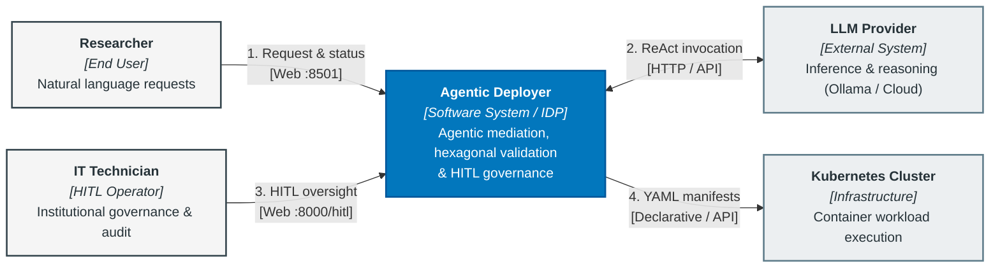
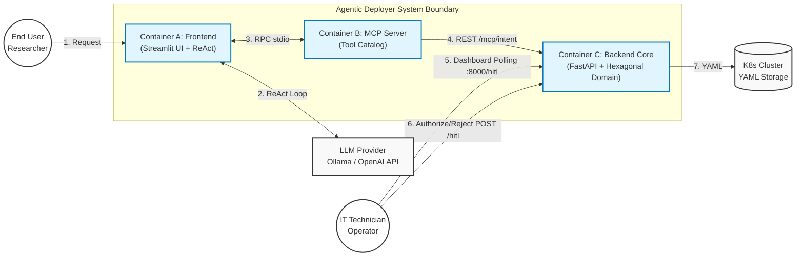
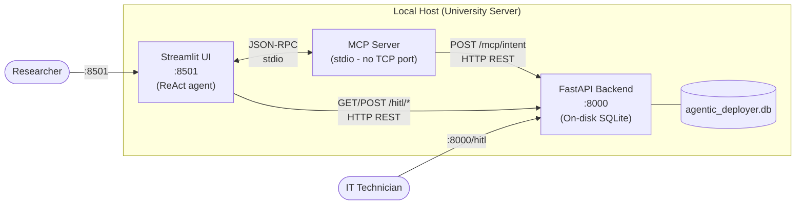
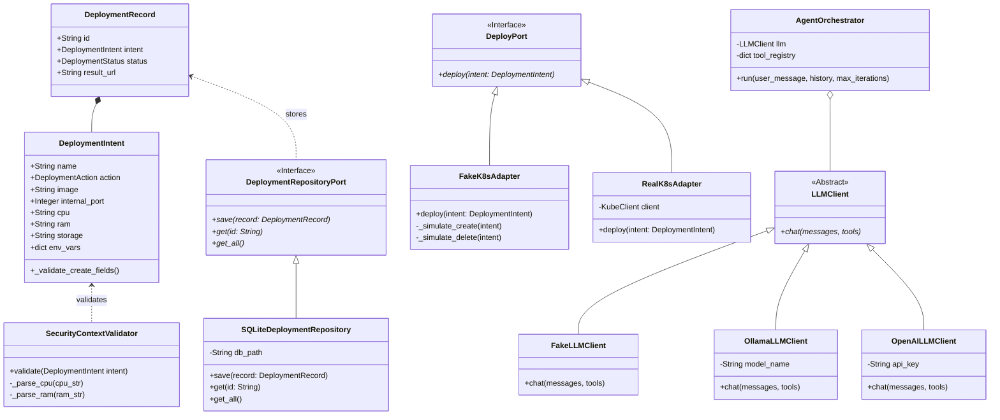
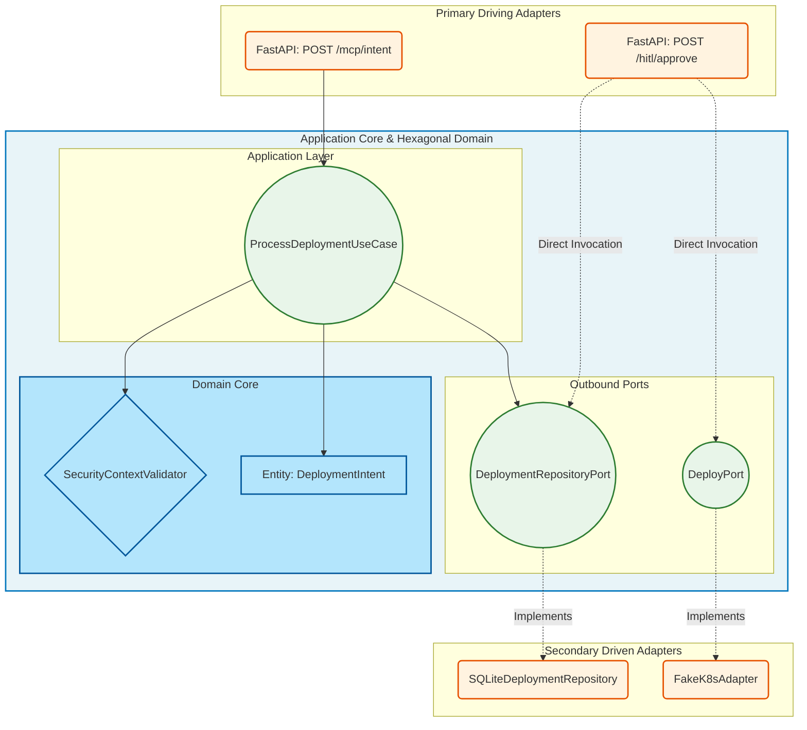
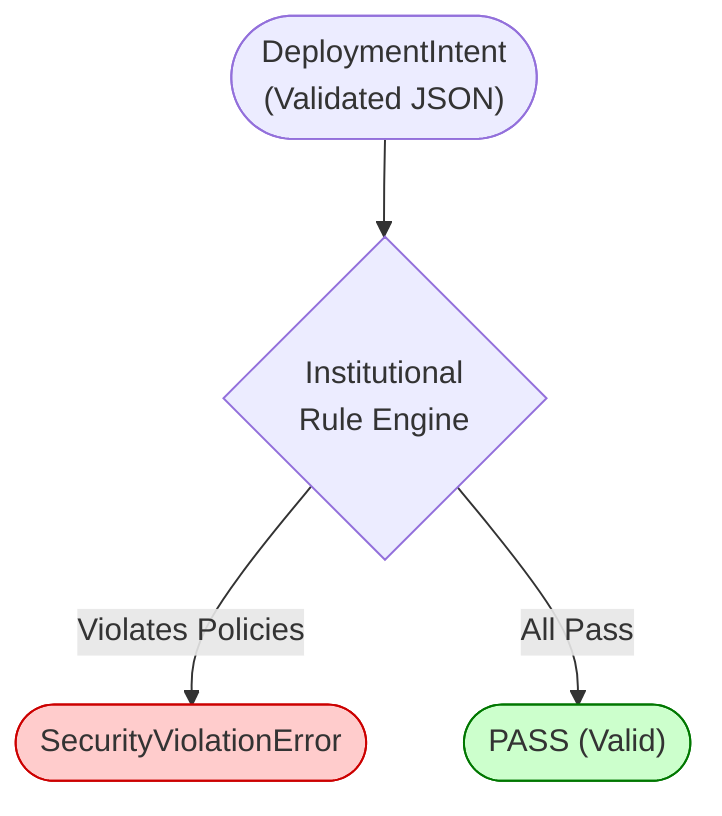
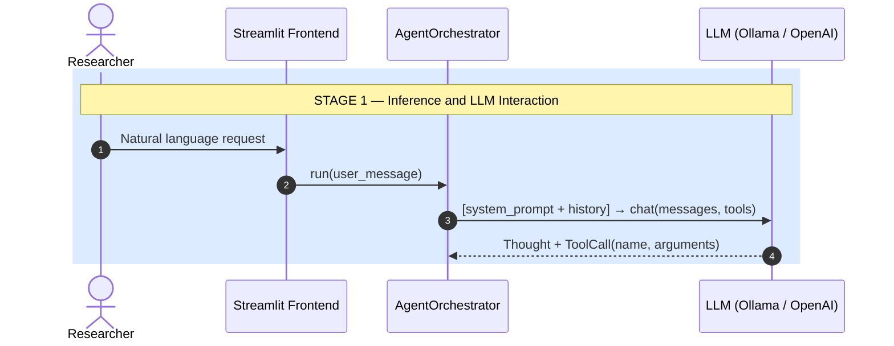
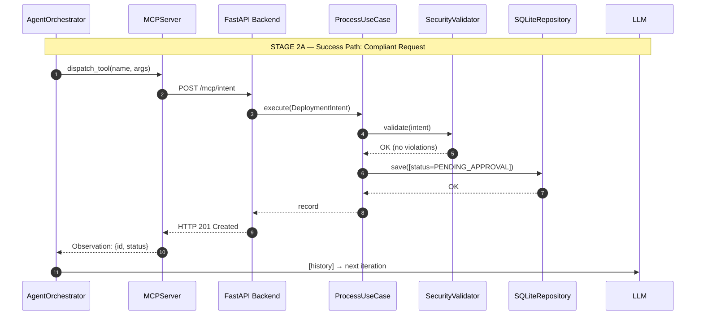
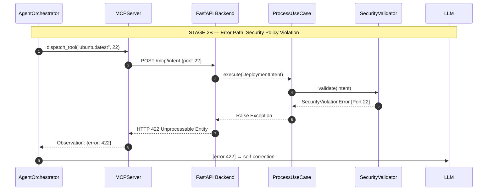
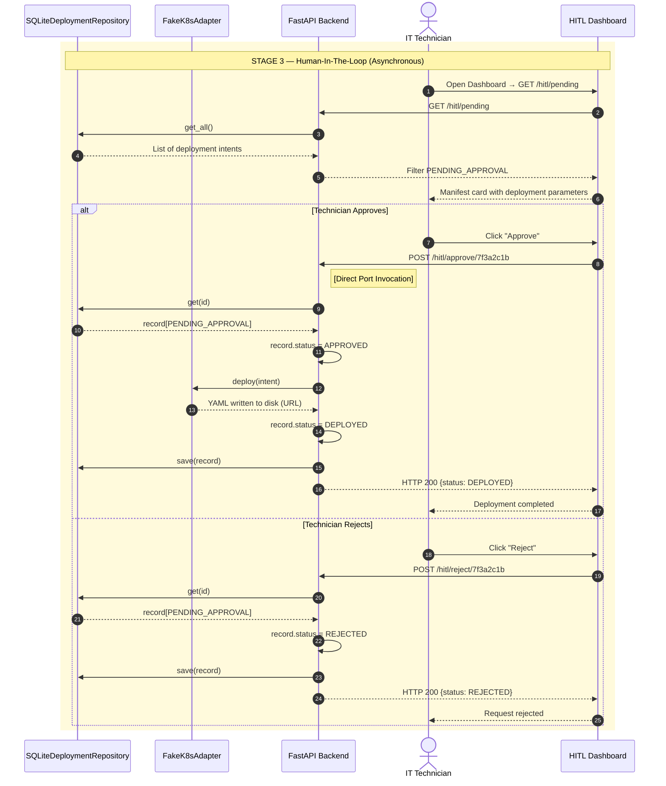

# Chapter 5. System Design and Architecture

Designing a software architecture that bridges Generative Artificial Intelligence decision-making with enterprise infrastructure operations presents a fundamental engineering challenge: reconciling the probabilistic natural language flexibility of a Large Language Model (LLM) with the deterministic guarantees and strict predictability demanded by production environments.

This chapter details the technical resolution to this dichotomy, presenting an architecture that functions as a structured, deterministic translator. The following sections outline the global solution topology using the C4 modeling framework, justifying the segregation of responsibilities across execution containers. Subsequently, the chapter analyzes the logical foundation of the application core through Hexagonal Architecture (*Ports and Adapters*), formalizes *Golden Path* provisioning contracts, and details the end-to-end operational lifecycle of a request from raw natural language input to final declarative manifest generation.

## 5.1. Requirements Analysis and Architectural Design Criteria

In conventional software engineering, architectural decisions derive directly from requirements analysis. In an agentic system where stochastic language models interface with mission-critical operational environments, this analysis must strictly delineate what Artificial Intelligence may suggest versus what deterministic software may execute.

### 5.1.1. Traceability between Requirements and Architectural Decisions

Strategic objectives formulated in Section 1.3 map to the formal specification of Functional Requirements (FR) and Non-Functional Requirements (NFR) presented in Section 1.5. **Table 18** details the direct traceability between each requirement and corresponding architectural decisions:

| Identifier | Formal Requirement | Associated Architectural Decision | Responsible Component |
|---|---|---|---|
| **FR-01** | Natural language conversational interface | Presentation layer decoupled via asynchronous web client and token streaming. | Streamlit Frontend (`app/presentation/`) |
| **FR-02** | Agentic orchestration and fault tolerance | Adoption of ReAct (*Reason + Act*) loop with observation-conditioned reflective retries. | Agent Orchestrator (`app/agent_layer/agent.py`) |
| **FR-03** | Modular infrastructure tool catalog | Open formal contract implementation based on the standardized *Model Context Protocol* (MCP). | FastMCP Server (`app/mcp_server.py`) |
| **FR-04** | Human oversight of critical operations (*HITL*) | Segregation of responsibilities via independent web dashboard and Finite State Machine (FSM) quarantine (`PENDING_APPROVAL`). | FastAPI Backend and HITL Dashboard (`app/adapters/api.py`) |
| **FR-05** | Asynchronous status notification channel | Decoupled request lifecycle query mechanism avoiding direct user-operator coupling. | SQLite Repository and periodic Streamlit polling |
| **NFR-01** | Data sovereignty and institutional privacy | Provider-agnostic engine abstraction via the *Adapter* pattern, enabling local execution with *Zero Data Retention*. | `OllamaLLMClient` adapter on local port 11434 |
| **NFR-02** | Domain isolation and independence | Hexagonal Architecture (*Ports and Adapters*), ensuring entities and invariants remain agnostic of AI, databases, and Kubernetes. | Domain and Application layers (`app/domain/`, `app/application/`) |
| **NFR-03** | Code quality and formal robustness | Multi-tiered testing strategy: static analysis (Ruff/Mypy), Property-Based Testing (Hypothesis), and Mutation Testing audit (Mutmut). | Quality assurance suite (`app/tests/`) |
| **NFR-04** | Operational resilience (*Fail-Safe*) | Strict deterministic boundary validation prior to cluster interaction; atomic state transitions. | `SecurityContextValidator` and FSM |
<p align="center"><i><b>Table 18:</b> Traceability between Formal Requirements and Architectural Decisions.</i></p>

### 5.1.2. Core Architectural Design Principles

Three core principles govern all architectural decisions detailed in this chapter:

1. **Principle of Execution Plane Segregation (Privilege Separation):** The Artificial Intelligence engine operates exclusively within the *Cognitive Suggestion Plane*. It possesses zero infrastructure credentials, network permissions to interact with Kubernetes APIs, or direct transactional capabilities. Every action generated by the agent must be validated by the *Deterministic Control Plane* (traditional software) and formally authorized by a human operator (*HITL*).
2. **Fail-Safe by Default Principle:** Upon encountering lexical ambiguity, security policy violations, or type mismatches, the system rejects operations without mutating cluster state (`HTTP 422`), returning structured observations to the agent to enable reflective self-correction.
3. **Open Interoperability and Technological Decoupling Principle:** The business core communicates externally exclusively through formal interfaces (ports). The AI communicates via the open MCP standard, the inference engine connects via interchangeable adapters, and infrastructure generation is abstracted through declarative templates (*Golden Paths*).

### 5.1.3. Comprehensive Traceability Matrix (Requirements $\leftrightarrow$ Design $\leftrightarrow$ QA Validation)

In compliance with software engineering guidelines and degree assessment rubrics, **Table 19** provides the bidirectional traceability matrix connecting formal requirements to design use cases and corresponding test suites:

| Requirement | Name and Scope | Design Use Case / Workflow | Responsible Component | Validation Module (QA) |
|---|---|---|---|---|
| **FR-01** | Natural conversational UI | UC-01: Natural language request input | Streamlit Frontend and API | `tests/test_ui.py` |
| **FR-02** | ReAct agent orchestration | UC-02: Reflective loop & self-correction after 422 | Agent Orchestrator (`app/agent_layer/agent.py`) | `app/tests/test_agent.py` |
| **FR-03** | Modular MCP catalog | UC-03: Standardized discovery and invocation | FastMCP Server (`app/mcp_server.py`) | `app/tests/test_mcp_server.py` |
| **FR-04** | Human supervision (HITL) | UC-04: Quarantine and asynchronous IT approval | FastAPI Backend & Dashboard (`app/adapters/api.py`) | `app/tests/test_use_cases.py` |
| **FR-05** | User feedback channel | UC-05: Status notification and inspection | Endpoint `/hitl/status/{id}` and SQLite | `app/tests/test_status_endpoint.py` |
| **NFR-01** | Institutional data sovereignty | Network isolation without third-party retention | `OllamaLLMClient` on local port | `app/tests/test_agent.py` |
| **NFR-02** | Domain isolation | Pure invariants without external dependencies | Hexagonal Core (`app/domain/`, `app/application/`) | `app/tests/test_use_cases.py` |
| **NFR-03** | Formal quality & robustness | Addressing oracle problem and mutant detection | Heterogeneous suite (Hypothesis, Metamorphic) | `app/tests/test_security.py`, `app/tests/test_metamorphic.py` |
| **NFR-04** | Operational resilience (Fail-Safe) | FSM immutability under invalid inputs | `SecurityContextValidator` & FSM | `app/tests/test_security.py` |
<p align="center"><i><b>Table 19:</b> Comprehensive Traceability Matrix (Requirements $\leftrightarrow$ Design $\leftrightarrow$ QA Validation).</i></p>

## 5.2. C4 Architectural Topology Modeling

Documenting modern distributed, asynchronous architectures using informal block diagrams or rigid traditional UML can introduce ambiguity. To ensure precise, hierarchical, and unambiguous architectural visualization, the **C4 Model** was adopted.

Conceived by Simon Brown [28], the C4 Model relies on hierarchical abstraction. It structures architectural views progressively from a macroscopic System Context view down to execution Containers, internal Components, and underlying Code.

In this architectural analysis of *Agentic Deployer*, focus is centered on the two most critical levels for understanding network boundaries and organizational responsibilities: Level 1 (System Context) and Level 2 (Containers).

### 5.2.1. Level 1: System Context

The System Context diagram (Level 1) establishes system boundaries, illustrating interactions between the platform, human users, and external enterprise systems.

Within the academic environment of this case study, four primary entities are modeled:

#### 5.2.1.1. Human Actors

1. **Researcher / End User (Inbound Vector):** University faculty, researchers, or administrative staff. This actor requires computing services without possessing deep systems administration expertise. They express functional goals (e.g., "I need to publish a website for the Cellular Biology conference next week") in natural language, lacking knowledge of Kubernetes YAML manifests or cluster security policies. This user possesses no direct network credentials or write permissions against university infrastructure.
2. **IT Systems Engineer / SIC (Governance Vector):** Systems engineers from the IT and Communications Department (*Servicio de Informática y Comunicaciones*). This actor possesses administrative authority to apply infrastructure mutations. In *Agentic Deployer*, their role transitions from manual provisioning to automated auditing, acting as the human supervisor in the *Human-In-The-Loop* (HITL) pattern via a dedicated operator dashboard.

#### 5.2.1.2. External Black-Box Systems

3. **LLM Provider:** Acts as the external cognitive reasoning engine. Depending on institutional data governance mandates, this node represents commercial cloud APIs (OpenAI `gpt-4o`, Anthropic `claude-3.5-sonnet`) or self-hosted open-weights models running via Ollama on local hardware (`qwen2.5:7b`). Architecturally, this provider operates as a stateless oracle: it receives context, performs probabilistic inference, and returns structured text or tool calls.
4. **Kubernetes Cluster:** The terminal destination of the operational pipeline. Represents physical or virtual cluster infrastructure running OpenShift, OKD, or Kubernetes. It hosts workloads, balances network traffic, and binds persistent volumes according to generated manifests.

*Agentic Deployer* sits at the center of these entities, acting as a trusted mediator: ensuring researchers never directly access cluster APIs, and guaranteeing language models never hold credentials to mutate corporate infrastructure unmediated.

Figure 5 summarizes the C4 Level 1 Context topology:


<p align="center"><i><b>Figure 5:</b> C4 System Context Diagram (Level 1) for Agentic Deployer.</i></p>

As illustrated in Figure 5, *Agentic Deployer* centralizes and decouples operational flows. The researcher interacts exclusively through natural language. The LLM provider supplies heuristic reasoning without network access to internal clusters. IT technicians govern operations through an independent human-in-the-loop channel. Finally, the cluster only receives declarative manifests after they pass both deterministic policy checks and explicit human authorization.

### 5.2.2. Level 2: Containers (Execution Units)

Level 2 decomposes *Agentic Deployer* into separate execution containers.

> **Note on C4 Terminology:** In C4 methodology, a "Container" represents an executable application or data store (e.g., a microservice, database, or client application). It is an architectural concept distinct from Docker OS-level virtualization containers.

Partitioning the platform into decoupled processes maximizes operational resilience [29] and enforces Separation of Concerns. If one component fails (e.g., an inference timeout), the rest of the platform continues operating to preserve data auditability.

Figure 6 illustrates the system decomposition across three execution containers (A, B, and C), mapping all seven operational interactions:


<p align="center"><i><b>Figure 6:</b> C4 Container Diagram (Level 2) for the Agentic Deployer system.</i></p>

#### 5.2.2.1. Interaction Sequence and Direct Backend Access Rationale

Figure 6 outlines the sequence of interactions (1 through 7):

1. **User Request:** The researcher submits an infrastructure requirement in natural language to Container A (Streamlit Frontend).
2. **Inference Cycle:** The orchestrator in the Frontend executes the ReAct loop, communicating bidirectionally with the LLM Provider (Ollama or Cloud API).
3. **Tool Invocation:** Upon deducing an action, the Frontend calls the tool catalog exposed by Container B (MCP Server) via JSON-RPC over `stdio`.
4. **Typed Intent Submission:** The MCP Server translates the action into an HTTP REST invocation (`POST /mcp/intent`) against Container C (FastAPI Backend).
5. **Operator Polling:** The IT technician accesses the HITL dashboard exposed by the Backend (`:8000/hitl`) to review pending requests (`PENDING_APPROVAL`).
6. **Authorization or Rejection:** Following manual review, the operator records a decision (`POST /hitl/approve/{id}` or `POST /hitl/reject/{id}`) on the Backend.
7. **Declarative Manifest Generation:** The Backend invokes the outbound infrastructure adapter (`DeployPort`) to generate the Kubernetes YAML manifest.

**Rationale for Direct Operator Access to the Backend (Interactions 5 and 6):**  
In Figure 6, the IT technician interacts directly with Container C (Backend) rather than Container A (Frontend). This design satisfies two key engineering criteria:
- **Separation of Concerns and Security:** Container A is designed solely as an end-user conversational interface handling stochastic LLM context. Corporate governance dictates that infrastructure operators should not share channels with end-user agent sessions.
- **Administrative Dashboard Isolation:** Container C natively serves the HITL Dashboard web interface at `/hitl`. This independence guarantees that even if the Streamlit UI or LLM inference hangs, operations engineers maintain uninterrupted access to system state to audit, approve, or reject deployment requests.

#### 5.2.2.2. Mapping Logical Containers to Runtime Processes

Figure 7 illustrates how logical containers map to physical processes on the hosting server:


<p align="center"><i><b>Figure 7:</b> Process deployment diagram. Components co-locate on the host; the MCP server communicates via <code>stdio</code> without binding network ports.</i></p>

Process allocation decisions include:
- **Streamlit Frontend (Port 8501):** Web process hosting the conversational UI and ReAct reasoning loop.
- **MCP Server (`stdio` Transport):** Runs as a local subprocess binding zero network ports, eliminating external attack vectors and minimizing latency via OS pipes.
- **FastAPI Backend (Port 8000):** Serves REST API endpoints for MCP tool dispatching and hosts the HITL Dashboard web UI (`/hitl`). State is persisted to a local `agentic_deployer.db` SQLite database.

#### 5.2.2.3. Functional Container Breakdown

1. **Container A — Cognitive Orchestration Frontend (Streamlit UI + ReAct):**  
   Serves as the entry point for researchers. Beyond UI rendering, it hosts the `AgentOrchestrator`, maintaining authorized network connections to external LLM providers (OpenAI or Ollama), managing conversational session histories, and governing ReAct iterations.
2. **Container B — MCP Tool Server (Python FastMCP):**  
   Acts as the university's dynamic catalog of operational capabilities, translating functions (e.g., `deploy_congress_web()`) into standardized JSON schemas for LLM tool calling. It communicates with the orchestrator over standard I/O (`stdio`), ensuring sub-millisecond JSON-RPC message exchange.
3. **Container C — Deterministic Core (FastAPI Hexagonal Backend):**  
   Built on FastAPI, this service encapsulates domain models, transactional persistence, and security validation rules. It receives typed JSON payloads from the MCP Server, deterministically evaluates corporate policies, and records compliant requests in the `PENDING_APPROVAL` state within SQLite for operator review.

### 5.2.3. Level 3: UML Class Diagram (Micro-Architecture)

Figure 8 details the unified system class diagram, formalizing relationships between domain entities, abstract interfaces, and concrete adapters:


<p align="center"><i><b>Figure 8:</b> UML Class Diagram illustrating core entities, contracts, and polymorphic dependency injection points (LLMClient, DeployPort, DeploymentRepositoryPort).</i></p>

#### 5.2.3.1. Class Structure and Design Pattern Analysis

The class diagram in Figure 8 implements five design patterns:

1. **Inference Client Abstraction (Strategy Pattern):** The abstract `LLMClient` class defines the polymorphic `chat(messages, tools)` contract. Concrete implementations `OllamaLLMClient`, `OpenAILLMClient`, and `FakeLLMClient` encapsulate specific protocol details. `AgentOrchestrator` aggregates `LLMClient`, allowing runtime engine swapping via dependency injection.
2. **Domain Entities (`DeploymentIntent` and `DeploymentRecord`):** `DeploymentIntent` serves as a strongly typed data transfer and validation object. `DeploymentRecord` establishes a composition relationship with `DeploymentIntent`, attaching persistent metadata such as a unique UUID (`id`), lifecycle status (`status: DeploymentStatus`), and artifact URL (`result_url`).
3. **Domain Validation Service (`SecurityContextValidator`):** Maintains a dependency relationship with `DeploymentIntent`. It evaluates intent attributes against institutional corporate policies, raising typed exceptions on non-compliant parameters prior to persistence.
4. **Deployment Port (`DeployPort`):** An abstract interface declaring `deploy(intent: DeploymentIntent)`. `FakeK8sAdapter` fulfills this contract by rendering YAML manifests to disk, while `RealK8sAdapter` fulfills it via live Kubernetes cluster API calls, satisfying the Open/Closed Principle.
5. **Persistence Port and Adapter (`DeploymentRepositoryPort` and `SQLiteDeploymentRepository`):** The domain interfaces with persistence via `DeploymentRepositoryPort` (`save`, `get`, `get_all`), implemented by `SQLiteDeploymentRepository`. This isolates storage operations without leaking SQL dependencies into domain entities.

## 5.3. Hexagonal Architecture Adoption (Ports and Adapters)

Designing the backend core requires a resilient architectural foundation. Granting operational autonomy to a stochastic agent requires strict deterministic boundaries. The application core implements the **Hexagonal Architecture** (*Ports and Adapters*) pattern formalized by Alistair Cockburn [19].

The pattern structures software into concentric layers with a strict inward dependency rule: external volatile technologies depend on inner immutable business logic.

### 5.3.1. Domain Layer: Entities and Invariants

At the center of the hexagon lies the Domain Layer, representing pure business logic. In *Agentic Deployer*, this layer models infrastructure deployment intents prior to declarative manifest generation.

To guarantee static type safety, the system rejects raw, untyped dictionaries emitted by language models. All external inputs are mapped to the strongly typed `DeploymentIntent` domain entity.

This entity enforces **domain invariants**:
- **Identifier:** Unique, immutable UUID string.
- **Action:** Constrained to a finite set (`CREATE`, `DELETE`).
- **Topology Attributes:** Service name, container image, compute resources (CPU/RAM).
- **Logical Invariants:** Internal network ports must reside strictly within `[1, 65535]`. Create actions strictly require an image and a valid port.

These invariants act as a first line of defense against hallucinations. If an agent emits a null or out-of-bounds port (`-80`), the domain entity rejects instantiation by raising an immediate exception, enforcing *Fail-Fast* guarantees.

#### 5.3.1.1. Illustrative `DeploymentIntent` Instance

The following code illustrates an instantiated `DeploymentIntent` generated following conversational negotiation for an academic conference portal:

```python
# Strongly typed domain entity instantiation (Pydantic / Python)
intent = DeploymentIntent(
    name="congreso-ia-2026",
    action=DeploymentAction.CREATE,
    image="docker.io/library/nginx:1.25-alpine",
    internal_port=8080,
    cpu="500m",
    ram="256Mi",
    env_vars={"APP_ENV": "production", "PORT": "8080"}
)
```

The equivalent JSON payload transmitted by the MCP Server to the Backend endpoint (`POST /mcp/intent`) reflects this structure:

```json
{
  "name": "congreso-ia-2026",
  "action": "CREATE",
  "image": "docker.io/library/nginx:1.25-alpine",
  "internal_port": 8080,
  "cpu": "500m",
  "ram": "256Mi",
  "env_vars": {
    "APP_ENV": "production",
    "PORT": "8080"
  }
}
```

The fields satisfy domain invariants: the `name` conforms to Kubernetes DNS syntax (`^[a-z0-9-]+$`), the image tag avoids mutable `:latest` references, the port (`8080`) is $\ge 1024$, and environment variables contain no plaintext credentials.

### 5.3.2. Dependency Inversion Principle (DIP)

Hexagonal design relies on the Dependency Inversion Principle (DIP). The domain core never imports external libraries or database drivers. Instead, it exposes abstract **Ports** implemented by peripheral **Adapters** (Figures 8 and 9).

Adapters are categorized into two roles:

#### 5.3.2.1. Primary (Driving) Adapters
Components that initiate execution into the core (left side of Figure 9). In this architecture, driving adapters are FastAPI REST controllers. The MCP endpoint (`/mcp/intent`) dispatches to `ProcessDeploymentUseCase`, while the dashboard approval endpoint orchestrates approval state transitions.

#### 5.3.2.2. Secondary (Driven) Adapters
Components driven by the application core to interact with external infrastructure (right side of Figure 9).

To decouple business logic from cluster platforms, the application layer declares the abstract `DeployPort`. In this prototype, `FakeK8sAdapter` fulfills this port by writing complete YAML manifests to disk. Replacing this mock with a production `RealK8sAdapter` (Section 10.3.1) requires zero changes to core domain logic.


<p align="center"><i><b>Figure 9:</b> Hexagonal Architecture topology. Control flow enters via Driving Adapters, while source code dependencies point inward toward the core (Dependency Inversion Rule).</i></p>

## 5.4. Institutional Security Policy Validation Algorithm

Delegating deployment intent authoring to an AI agent introduces a threat vector: models could generate configurations that are syntactically valid yet corporately unauthorized. Safeguarding the cluster against these requests falls to the `SecurityContextValidator` domain service.

### 5.4.1. Logical Firewall: Algorithmic Formalization

`SecurityContextValidator` operates under a Zero-Trust posture, intercepting `DeploymentIntent` objects and evaluating them against institutional security policies:

#### 5.4.1.1. System Policy Configuration Parameters (`politicas_locales`)

1. **Privileged Port Floor (`MIN_ALLOWED_PORT = 1024`):** Well-known ports (`0` to `1023`) are strictly reserved for administrative root processes.
2. **Container Registry Whitelist (`ALLOWED_REGISTRIES`):**
   - `docker.io/` (Official Docker Hub).
   - `quay.io/` (Red Hat Quay).
   - `harbor.universidad.edu/` (Internal institutional registry).
   Images outside these registries are rejected.
3. **Restricted Volatile Tags (`FORBIDDEN_IMAGE_TAGS = {"latest"}`):** Prohibits `:latest` tags to mitigate configuration drift.
4. **Departmental Hardware Limits:**
   - `MAX_CPU_MILLICORES = 4000` (4 virtual cores).
   - `MAX_RAM_MEBIBYTES = 8192` (8 GiB).
5. **Forbidden Substrings in Environment Variables (`FORBIDDEN_ENV_KEYS`):** Blocks plaintext secrets matching `"password"`, `"secret"`, `"token"`, `"key"`, `"credential"`.
6. **Mandatory Storage for Databases:** Images referencing database engines (`postgres`, `mysql`, `redis`, `mongo`) must declare explicit persistent storage.

Lifecycle exemption rule: deletion requests (`action = DELETE`) bypass creation checks, enabling resource teardown without evaluating image registries or ports.

Algorithm 1 details the validation logic:

```text
01 INPUT: 
02  intent -> DeploymentIntent object (Basic invariants satisfied)
03  local_policies -> System Configuration (Port floors, registries, quotas)
04 
05 OUTPUT: 
06  TRUE (If intent satisfies all institutional policies)
07  RAISE SecurityViolationError with list of accumulated violations
08 
09 BEGIN
10   // RULE 0: Lifecycle exemption for deletion operations
11   IF intent.action EQUALS DeploymentAction.DELETE THEN
12     RETURN TRUE
13   END IF
14 
15   Variable violations = EmptyList()
16 
17   // RULE 1: Network Topology Inspection (Principle of Least Privilege)
18   IF intent.internal_port != NULL AND intent.internal_port < 1024 THEN
19     violations.Append("Privileged port not allowed: " + intent.internal_port)
20   END IF
21 
22   // RULES 2, 3 & 4: Image and Storage Verification
23   IF intent.image != NULL THEN
24     IF ":latest" IN intent.image THEN
25       violations.Append("Use of ':latest' tag forbidden: " + intent.image)
26     END IF
27     
28     Variable valid_registry = FALSE
29     FOR EACH registry IN local_policies.ALLOWED_REGISTRIES DO
30       IF intent.image STARTS_WITH registry THEN
31         valid_registry = TRUE
32         BREAK LOOP
33       END IF
34     END FOR
35     IF valid_registry IS FALSE THEN
36       violations.Append("Untrusted registry: " + intent.image)
37     END IF
38 
39     IF ContainsDatabaseEngine(intent.image) AND intent.storage IS NULL THEN
40       violations.Append("Databases require explicit persistent storage allocation")
41     END IF
42   END IF
43 
44   // RULE 5: Hardware Quota Audit (Resource Quotas)
45   Variable cpu_m = ParseMillicores(intent.cpu)
46   IF cpu_m > 4000 THEN
47     violations.Append("CPU quota exceeded: " + intent.cpu + " > 4000m")
48   END IF
49 
50   Variable ram_mi = ParseMebibytes(intent.ram)
51   IF ram_mi > 8192 THEN
52     violations.Append("RAM quota exceeded: " + intent.ram + " > 8192Mi")
53   END IF
54 
55   // RULE 6: Heuristic Secret Detection in Environment Variables
56   FOR EACH key IN intent.env_vars DO
57     IF ContainsSubstring(key.ToLower(), ["password", "secret", "token", "key", "credential"]) THEN
58       violations.Append("Potential plaintext secret detected in variable: " + key)
59     END IF
60   END FOR
61 
62   // Halt execution if violations were accumulated
63   IF Length(violations) > 0 THEN
64     RAISE SecurityViolationError(violations)
65   END IF
66 
67   RETURN TRUE
68 END
```
<p align="center"><i><b>Algorithm 1:</b> Strict Hexagonal Domain Validation (SecurityContextValidator).</i></p>

Operating with computational complexity $O(R + K)$ (where $R$ is trusted registries count and $K$ is environment variable keys), this algorithm establishes deterministic boundaries over generative outputs.

Figure 10 summarizes the decision tree:

<div style="max-width: 6cm; margin: 0 auto;">



</div>
<p align="center"><i><b>Figure 10:</b> Simplified overview of <code>SecurityContextValidator</code>. Policy rejections raise exceptions enabling ReAct self-correction.</i></p>

### 5.4.2. Exception Management and Error Lifecycle

In standard microservice architectures, raising an unhandled `SecurityViolationError` aborts the transaction, returning an HTTP `422 Unprocessable Entity` to the user interface.

*Agentic Deployer* introduces an agent-oriented interception pattern. Rather than presenting technical stack traces to users, errors are routed back to the LLM within the conversational flow:

1. `SecurityContextValidator` raises `SecurityViolationError`.
2. FastAPI serializes the exception into an HTTP `422` response returned to the MCP Server.
3. The MCP Server transmits the error to the conversational agent. The ReAct engine records this output as an **Observation**.
4. The Observation is appended to the LLM's context window.

The model parses the structured error, updates its internal reasoning trace, and interactively requests compliant parameters from the user (e.g., asking for port 8080 instead of 22).

## 5.5. Abstraction Pattern: Golden Paths and Syntactic Expansion

The final architectural pillar addresses declarative code generation (Infrastructure as Code, IaC). A naive adoption approach would task the LLM with authoring raw YAML manifests from scratch.

However, in Site Reliability Engineering (SRE), unconstrained generation introduces severe **Configuration Drift**. The model might generate deprecated API versions (`extensions/v1beta1` instead of `apps/v1`), omit readiness probes, or misalign routing label selectors.

### 5.5.1. Theoretical Definition of Golden Paths

To mitigate this risk, the architecture implements **Golden Paths**. A Golden Path is a standardized, hardened, and pre-audited infrastructure template curated by platform operations teams.

The language model does not author raw infrastructure; its role is confined to parameter extraction. Structural topologies (the "how") are fixed within pre-audited templates, while the model supplies contextual parameters (the "what") negotiated with the user.

### 5.5.2. Templating Engine (Decoupling Topology from Variables)

Syntactic expansion occurs in the outbound infrastructure adapter (`DeployPort`). When an authorized request is approved, the adapter interpolates parameters into the pre-tested declarative matrix.

A high-level prompt ("I need a database") expands deterministically into interdependent primitives:
1. A **`Deployment`** or **`StatefulSet`** with quota limits and anti-affinity rules.
2. A **`Service`** configured as `ClusterIP` preventing accidental public exposure.
3. A **`PersistentVolumeClaim`** (PVC) sized according to inferred capacity requirements.

Every service provisioned by *Agentic Deployer* inherits identical security postures, allowing IT teams to scale provisioning safely.

> **Note on MVP Scope:** The `FakeK8sAdapter` template generates three core resources for web applications: `Deployment`, `Service`, and `Ingress`. Dedicated PVC generation for stateful databases is identified as future work (Section 10.3.1).

#### 5.5.2.1. Illustrative Golden Path Expansion Example

The following block shows the multi-document template defined in `FakeK8sAdapter` and the resulting YAML generated for the `congreso-ia-2026` portal:

```yaml
# Golden Path base template (FakeK8sAdapter in app/infrastructure/fake_k8s_adapter.py)
---
apiVersion: apps/v1
kind: Deployment
metadata:
  name: {intent.name}
  labels:
    app: {intent.name}
spec:
  replicas: 1
  selector:
    matchLabels:
      app: {intent.name}
  template:
    metadata:
      labels:
        app: {intent.name}
    spec:
      containers:
        - name: {intent.name}
          image: {intent.image}
          ports:
            - containerPort: {intent.internal_port}
          resources:
            requests:
              cpu: {intent.cpu}
              memory: {intent.ram}
---
apiVersion: v1
kind: Service
metadata:
  name: {intent.name}-svc
spec:
  selector:
    app: {intent.name}
  ports:
    - protocol: TCP
      port: 80
      targetPort: {intent.internal_port}
---
apiVersion: networking.k8s.io/v1
kind: Ingress
metadata:
  name: {intent.name}-ingress
spec:
  rules:
    - host: {intent.name}.apps.universidad.edu
      http:
        paths:
          - path: /
            pathType: Prefix
            backend:
              service:
                name: {intent.name}-svc
                port:
                  number: 80
```

Interpolating validated intent variables (`name: "congreso-ia-2026"`, `image: "docker.io/library/nginx:1.25-alpine"`, `internal_port: 8080`, `cpu: "500m"`, `ram: "256Mi"`) yields the final on-disk manifest (`outputs/congreso-ia-2026.yaml`), exposing `https://congreso-ia-2026.apps.universidad.edu`:

```yaml
# Final deterministically generated YAML manifest (outputs/congreso-ia-2026.yaml)
---
apiVersion: apps/v1
kind: Deployment
metadata:
  name: congreso-ia-2026
  labels:
    app: congreso-ia-2026
spec:
  replicas: 1
  selector:
    matchLabels:
      app: congreso-ia-2026
  template:
    metadata:
      labels:
        app: congreso-ia-2026
    spec:
      containers:
        - name: congreso-ia-2026
          image: docker.io/library/nginx:1.25-alpine
          ports:
            - containerPort: 8080
          resources:
            requests:
              cpu: 500m
              memory: 256Mi
---
apiVersion: v1
kind: Service
metadata:
  name: congreso-ia-2026-svc
spec:
  selector:
    app: congreso-ia-2026
  ports:
    - protocol: TCP
      port: 80
      targetPort: 8080
---
apiVersion: networking.k8s.io/v1
kind: Ingress
metadata:
  name: congreso-ia-2026-ingress
spec:
  rules:
    - host: congreso-ia-2026.apps.universidad.edu
      http:
        paths:
          - path: /
            pathType: Prefix
            backend:
              service:
                name: congreso-ia-2026-svc
                port:
                  number: 80
```

## 5.6. End-to-End Data Flow and Lifecycle States

Architectural components coordinate across three sequential lifecycle stages:

#### 5.6.0.1. Illustrative End-to-End Walkthrough

1. **Natural Language Input (Stage 1):** The researcher types into the Streamlit UI: *"I need to deploy the AI conference web portal with NGINX on port 8080 with 500m CPU and 256Mi RAM"*.
2. **Inference & Tool Selection:** `AgentOrchestrator` queries the model in the ReAct loop. The LLM selects `format_deployment_intent`, emitting a structured tool call.
3. **Hexagonal Validation (Stage 2):** The MCP Server issues `POST /mcp/intent`. `SecurityContextValidator` executes Algorithm 1:
   - Port 8080 $\ge 1024$ $\rightarrow$ Valid.
   - Image in whitelist without `:latest` $\rightarrow$ Valid.
   - Hardware quotas within limits $\rightarrow$ Valid.
   - Zero plaintext secrets detected $\rightarrow$ Valid.
4. **Transactional Persistence:** The Backend stores the record in SQLite with an 8-character hexadecimal identifier (e.g., `7f3a2c1b`) under `PENDING_APPROVAL`, returning HTTP `201 Created` to the agent, which notifies the user.
5. **HITL Review & Approval (Stage 3):** An IT operator opens the Dashboard (`:8000/hitl`), inspects request `7f3a2c1b`, and clicks "Approve" (`POST /hitl/approve/7f3a2c1b`).
6. **Declarative Materialization:** The backend FSM transitions to `APPROVED` and `DEPLOYED`. `FakeK8sAdapter` interpolates the Golden Path template, writes `outputs/congreso-ia-2026.yaml`, and returns the service URL.

### 5.6.1. Stage 1: Cognitive Parameter Extraction (LLM Interaction)

Figure 11 models initial conversational inference. Natural language input is processed through the ReAct loop until structured arguments (`ToolCall`) are synthesized:


<p align="center"><i><b>Figure 11:</b> E2E Sequence Diagram (Stage 1). Interaction between Researcher and LLM for structured intent extraction.</i></p>

### 5.6.2. Stage 2: Deterministic Validation and Quarantine Persistence

Figure 12 illustrates deterministic boundary validation in the backend, executing in microseconds. The diagram depicts both the nominal success path (Stage 2A) and policy violation handling (Stage 2B, returning HTTP 422 to trigger ReAct self-correction):




<p align="center"><i><b>Figure 12:</b> E2E Sequence Diagram (Stage 2). Backend deterministic validation: (Top) Compliant success path (Stage 2A); (Bottom) Security violation interception and self-correction (Stage 2B).</i></p>

### 5.6.3. Stage 3: Human Oversight and Authorization (HITL Cycle)

Figure 13 illustrates asynchronous decision-making and infrastructure materialization. Operations depend on operator review schedules in the HITL dashboard. Upon technician approval, the FSM transitions to `APPROVED` and `DEPLOYED`, instructing `DeployPort` to write YAML manifests to storage. If rejected, the transition to `REJECTED` prevents cluster execution:


<p align="center"><i><b>Figure 13:</b> E2E Sequence Diagram (Stage 3). Asynchronous IT technician oversight (HITL) and infrastructure manifest materialization.</i></p>

> *Scope Note: Figure 13 models global HITL orchestration. **Section 7.3.3** expands this flow, incorporating dashboard polling mechanics, Algorithm 4 (`FSM_Transition`), and isolated approval/rejection sequence diagrams.*

This architecture establishes strict separation of concerns: the language model serves exclusively as an **assistant for syntax interpretation and intent extraction**, while deterministic backend modules retain exclusive authority over **infrastructure state mutations**.
