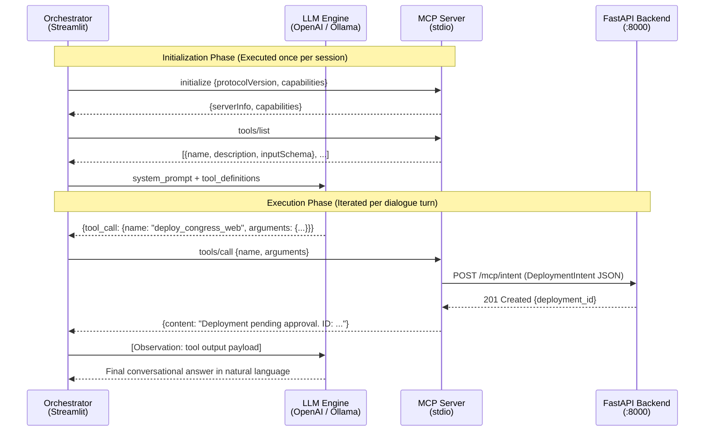
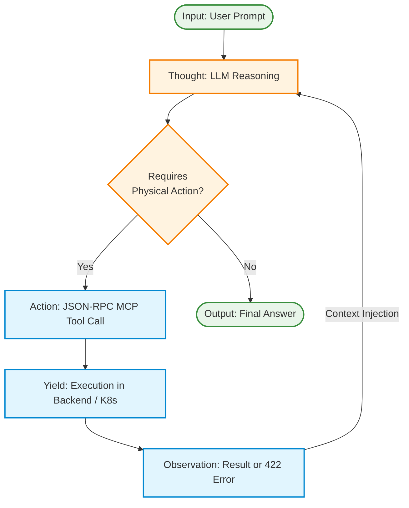

# Chapter 6. Cognitive Agent and MCP Server Development

Building upon the deterministic foundations established in Chapter 5, this chapter details the implementation of the heuristic core of *Agentic Deployer*: the cognitive engine that translates natural language into infrastructure operations by integrating the *Model Context Protocol* (MCP) open standard, a provider-agnostic inference client abstraction, and the *ReAct* reasoning loop.

> **Terminology Note:** Throughout this chapter, the acronym **LLM** (*Large Language Model*) designates deep neural networks trained on vast text corpora. It refers to foundational generative models rather than generic chatbots.

## 6.1. Model Context Protocol (MCP) Server Implementation

In early generative AI architectures, equipping a language model with code execution capabilities relied on tightly coupled, vendor-specific integrations. Orchestrators manually authored function schemas as rigid JSON structures conforming to proprietary specifications (such as OpenAI's native *Function Calling*). This practice violated the Open/Closed Principle (the 'O' in SOLID), requiring extensive code rewrites whenever an organization elected to migrate between AI providers (e.g., from OpenAI to Anthropic or self-hosted local models).

To overcome this vendor lock-in antipattern, *Agentic Deployer* adopts the **Model Context Protocol (MCP)** [13] as its core integration standard. MCP establishes an open, universal middleware layer that strictly decouples tool catalogs from model-specific API idiosyncrasies.

### 6.1.1. Dynamic Function Introspection (JSON Schema Generation)

A persistent challenge in autonomous agent engineering is tool contract synchronization. If a platform engineer modifies an infrastructure function signature to require a new parameter (e.g., `ram_quota`), the JSON Schema supplied to the LLM must be updated simultaneously; otherwise, inference fails due to schema drift.

To mitigate this risk, the MCP Server implemented in *Agentic Deployer* (Container B in the C4 model) leverages **Static and Dynamic Type Introspection**. Rather than requiring developers to craft JSON Schemas manually, the MCP SDK introspects function parameter signatures and type hints at runtime using Python's native `inspect` module.

Algorithm 2 illustrates how the system dynamically transforms a pure Python function into a universal semantic tool definition:

```text
01 INPUT:
02  target_function -> In-memory function reference (e.g., deploy_app)
03 
04 OUTPUT:
05  json_schema -> Standardized JSON-RPC Tool Calling schema
06 
07 BEGIN
08   Variable schema = NEW JSON_Dictionary
09   schema["name"] = target_function.getName()
10   schema["description"] = target_function.getDocstring()
11   
12   // Inspect Abstract Syntax Tree (AST) & Lexical Signature
13   Variable parameters = target_function.getParameterSignature()
14   schema["parameters"] = NEW Object_Type(Object)
15   
16   FOR EACH (param, type_annotation) IN parameters DO
17     Variable json_type = "string" // Default fallback
18     
19     // Injective Type Mapping (Python -> JSON Schema)
20     IF type_annotation IS Integer THEN
21       json_type = "integer"
22     ELSE IF type_annotation IS Boolean THEN
23       json_type = "boolean"
24     END IF
25     
26     schema["parameters"]["properties"][param] = NEW Dictionary(
27       "type" -> json_type,
28       "description" -> extractDocDescription(param)
29     )
30     
31     IF param IS mandatory THEN
32       APPEND param TO schema["parameters"]["required"]
33     END IF
34   END FOR
35   
36   RETURN schema
37 END
```
<p align="center"><i><b>Algorithm 2:</b> Dynamic Tool Contract Introspection.</i></p>

This approach establishes a **Single Source of Truth**. Engineers annotate infrastructure functions using standard Python Type Hints (e.g., `port: int`) and docstrings. Upon initialization, the MCP server parses annotations, synthesizes compliant JSON Schemas, and advertises them to the orchestrator, eliminating contract drift.

### 6.1.2. Network Isolation via Standard I/O (*stdio*) Transport

The MCP specification supports multiple transport bindings, notably *Server-Sent Events* (SSE) over HTTP and Standard Input/Output (*stdio*).

In conventional distributed architectures, communication between the Frontend Agent (Container A) and the Tool Server (Container B) might default to a REST API. However, in stochastic agent workflows where a ReAct loop may invoke multiple tools sequentially to query system state, TCP/IP overhead (HTTP header encapsulation, loopback socket latency, serialization) introduces unnecessary operational delays.

Consequently, *Agentic Deployer* enforces a restrictive architectural design choice: **The primary tool calling channel is bound strictly to local `stdio` (Standard Input / Standard Output) streams**.

This choice provides three distinct architectural advantages:

1. **Sub-Millisecond Inter-Process Communication (IPC):** Communicating over kernel pipes bypasses the network stack (OSI Layers 4–7). Tool dispatch latency drops from ~20 ms (local HTTP) to under ~1 ms, preserving conversational responsiveness.
2. **Zero Network Attack Surface (Zero-Trust):** Unlike network sockets (susceptible to internal port scans and Server-Side Request Forgery), a `stdio` process binds no network ports. External attackers cannot reach infrastructure tools without local OS-level process tree compromise.
3. **Operational Simplicity (Sidecar Pattern):** Eliminating internal reverse proxies, load balancers, and TLS certificates allows the tool server to deploy seamlessly alongside the orchestrator in a sidecar pattern.

Figure 14 illustrates the complete message lifecycle of an MCP interaction, from tool discovery to execution and observation:


<p align="center"><i><b>Figure 14:</b> Complete MCP message lifecycle. The JSON-RPC protocol establishes initialization (handshake and tool discovery), execution (invocation and response), and observation (LLM feedback).</i></p>

#### 6.1.2.1. JSON-RPC Messaging Breakdown

The interaction modeled in Figure 14 divides into two operational phases:

1. **Initialization and Capability Negotiation (Once per session):**
   - The `AgentOrchestrator` sends an `initialize` JSON-RPC message declaring supported protocol versions.
   - The MCP server replies with metadata confirming connection parameters.
   - The orchestrator requests available tools via `tools/list`. The server returns structured metadata including function names, descriptions, and parameter JSON Schemas (`inputSchema`).
   - The orchestrator injects these schemas into the LLM context alongside system instructions.
2. **Execution and Observation Phase (Per conversation turn):**
   - When the model determines an infrastructure action is required, it emits a structured `tool_call` object.
   - The orchestrator intercepts the call and dispatches `tools/call` over `stdio` pipes.
   - The MCP server maps arguments into a typed HTTP REST payload (`POST /mcp/intent`) dispatched to the FastAPI backend on port 8000.
   - Following deterministic policy validation, the backend records the request in `PENDING_APPROVAL`, returning an HTTP `201 Created` status with an assigned `deployment_id`.
   - The MCP server wraps this response into an observation returned to the orchestrator, which injects it into the LLM prompt for final natural language generation.

> **Implementation Note (Integrated vs. Canonical Transport):**  
> 1. **Integrated In-Memory Mode (Streamlit MVP):** Tool registries and dispatchers are loaded within the same Python process (`TOOL_REGISTRY`, `TOOL_DEFINITIONS`). Execution is an in-process Python call, eliminating IPC serialization overhead and reducing invocation latency to microseconds. This simplified thread management within Streamlit.  
> 2. **Canonical External Mode (`stdio`):** When the agent and MCP server execute as distinct operating system processes (e.g., connecting external tools like Claude Desktop or standalone CLI scripts), communication proceeds via standard input/output pipes with structured JSON-RPC frames. In this mode, serialization latency remains sub-millisecond (<1 ms), providing memory isolation between processes.  
> Both modes share identical interfaces, decoupled by `AgentOrchestrator`.

## 6.2. Multi-Provider Abstraction and Data Sovereignty

The rapid evolution of Generative Artificial Intelligence has created a concentrated market dominated by commercial AI-as-a-Service cloud providers. In enterprise software engineering, coupling core business logic to vendor-specific SDKs (OpenAI, Anthropic, Google) introduces severe risks of obsolescence and vendor lock-in.

To safeguard system longevity, *Agentic Deployer* enforces complete provider agnosticism.

### 6.2.1. The Abstract Contract (Adapter and Factory Patterns)

Provider isolation is implemented via two classic Gang of Four (GoF) design patterns [30]: the **Adapter** pattern and the **Factory Method** pattern.

The `AgentOrchestrator` never directly imports proprietary vendor SDKs. It interacts exclusively with an Abstract Base Class (ABC) named `LLMClient`:

```text
ABSTRACT CONTRACT: LLM Client Interface (LLMClient)

INTERNAL STATE:
 - conversation_history -> Structured message list (Role, Content)
 - system_prompt -> Core operational guidelines and policy rules

METHOD chat(messages, tools):
  INPUT: messages -> history; tools -> MCP server JSON Schemas
  EXPECTED OUTPUT:
   - AgentResponse object (conversational text)
   - ToolCall object (id, function_name, json_arguments)
```

The system provides three concrete adapters fulfilling this contract:

- **`OpenAILLMClient`:** Formats conversations to the OpenAI REST specification (`messages`, `tools`, `tool_choice`), manages TLS handshakes to cloud APIs, and deserializes response payloads.
- **`OllamaLLMClient`:** A native adapter built upon Ollama's official Python SDK [31] (`ollama.Client`) connecting to `http://localhost:11434`. It guarantees that **zero prompt tokens leave the institutional private network**:

```text
PSEUDOCODE: Local Ollama Client Implementation

CLASS OllamaLLMClient IMPLEMENTS LLMClient:
  ATTRIBUTES:
    model: String (e.g., "qwen2.5-coder:7b")
    host_server: String (e.g., "http://localhost:11434")
    ollama_client: ClientSDK(host=host_server)

  METHOD chat(messages, tools):
    Variable params = NEW Dictionary(
      "model" -> model,
      "messages" -> messages
    )
    IF tools EXISTS THEN
      params["tools"] = tools
    END IF

    // Synchronous local inference via Ollama SDK
    Variable response = ollama_client.chat(params)
    Variable message = response.message

    IF message.tool_calls EXISTS THEN
      Variable tool_calls = EmptyList()
      FOR EACH call IN message.tool_calls DO
        tool_calls.Append(
          NEW ToolCall(call.function.name, call.function.arguments)
        )
      END FOR
      RETURN NEW AgentResponse(content=message.content, tool_calls=tool_calls)
    END IF

    RETURN NEW AgentResponse(content=message.content)
END CLASS
```

- **`FakeLLMClient`:** A deterministic, regex-based mock adapter used for automated unit testing, CI/CD regression runs, and portable demonstrations requiring zero GPU hardware.

In-memory instantiation is governed by a **Factory**:

```text
PSEUDOCODE: Cognitive Engine Dependency Injection (Factory)

INPUT: provider -> String from environment variable (LLM_PROVIDER)
OUTPUT: llm_engine -> Concrete instance implementing LLMClient

BEGIN
  IF provider EQUALS "ollama" THEN
    RETURN NEW OllamaLLMClient(model="qwen2.5-coder:7b")
  ELSE IF provider EQUALS "openai" THEN
    RETURN NEW OpenAILLMClient(model="gpt-4o-mini")
  ELSE
    RETURN NEW SICFakeLLMClient() // Deterministic test double
  END IF
END
```

This dependency injection design allows **swapping inference engines simply by changing an environment variable and restarting the process**, without altering a single line of business logic.

### 6.2.2. Selection of the Local Model (Qwen 2.5 Coder)

Modern open-weights ecosystems offer numerous models capable of running on modest local hardware (e.g., 6–8 GB VRAM). For the local evaluation testbed, **Qwen 2.5 Coder (7B)** from Alibaba Cloud was selected over general-purpose alternatives such as Llama 3.2, Mistral, or baseline Qwen 2.5.

This decision was driven by Tool Calling reliability. The Coder variant undergoes extensive instruction fine-tuning on structured source code and schema-following corpora, conferring superior JSON generation accuracy. During empirical testing, general-purpose 7B models frequently generated malformed JSON or dropped required schema keys when processing ambiguous prompts. **Qwen 2.5 Coder (7B)** was the only local model in its weight class to successfully pass 100% of the Metamorphic Test battery, demonstrating robust resilience under linguistic variance (Chapter 9).

### 6.2.3. Data Sovereignty in Institutional Environments

Beyond clean architecture, multi-provider abstraction satisfies critical enterprise cybersecurity mandates: **Data Sovereignty** and regulatory compliance (GDPR, Spanish ENS).

*Agentic Deployer* processes sensitive operational specifications. During natural language dialogue, users might inadvertently paste database tokens, administrative credentials, or internal IP subnets. Transmitting these payloads in plaintext to foreign cloud servers violates data privacy regulations.

The architecture accommodates distinct operational risk profiles:
- **Non-Sensitive Workloads:** In public academic sandboxes, the factory can route traffic to cloud APIs (e.g., OpenAI), taking advantage of elastic cloud infrastructure.
- **Confidential / Air-Gapped Environments:** For sensitive services (patient healthcare databases, student academic registries), operations teams set `LLM_PROVIDER=ollama`. Inference executes entirely on GPU servers hosted inside the institutional datacenter, guaranteeing *Zero Data Retention*.

## 6.3. Cognitive Loop and Stochastic Resilience (ReAct Pattern)

Exposing an MCP tool catalog to a language model does not inherently guarantee autonomous task completion. When models operate in dynamic environments (such as Kubernetes clusters whose runtime state evolves during execution), static single-turn prompting (*Zero-Shot Prompting*) is insufficient. If a model generates an invalid assumption or syntax error on its first attempt, it lacks mechanisms to recover.

To address this, the orchestrator implements the **ReAct (Reasoning and Acting)** [9] pattern.

### 6.3.1. Bounded Reasoning and Action Loop

ReAct restructures the execution model. Rather than processing inputs in a single shot, the agent operates as an iterative state machine with a **bounded execution loop** (`WHILE current_turn < MAX_TURNS`). Bounding turns prevents infinite loops if the model encounters unresolvable errors.

Each iteration transitions through four stages:

1. **Thought:** The model deduces the next logical step based on conversational history. Externalizing internal reasoning reduces hallucination rates.
2. **Action:** The model invokes a specific MCP tool, supplying inferred arguments (e.g., `deploy_intent(name="api", port=80)`).
3. **Yield (Pause):** The orchestrator pauses generation, dispatches the call across the backend boundary, executes the action, and awaits the response.
4. **Observation:** The system injects the physical execution result (success or error payload) back into the LLM context window.

The model evaluates the observation and determines whether further actions are required or if task objectives have been fulfilled. Once complete, it emits its **Final Answer**, returning control to the user.

Figure 15 illustrates this feedback flow:

<div style="max-width: 10cm; margin: 0 auto;">



</div>
<p align="center"><i><b>Figure 15:</b> Flowchart of the ReAct (Reasoning and Acting) cognitive loop.</i></p>

Algorithm 3 formalizes this orchestration engine:

```text
01 INPUT: 
02  user_prompt -> Natural language text string
03  conversation_history -> Active session context memory
04 
05 OUTPUT: 
06  final_response -> Natural language or Markdown string
07 
08 BEGIN
09   APPEND user_prompt TO conversation_history
10   Variable current_turn = 0
11   Variable MAX_TURNS = 5 // Fail-safe: prevents infinite loops and token budget depletion
12 
13   WHILE current_turn < MAX_TURNS DO
14     // 1. LLM Inference (Thought + Action)
15     Variable llm_response = NetworkInference(conversation_history, mcp_tools)
16     
17     IF llm_response IS plain_text THEN
18       // Agent concluded task and addresses human user
19       RETURN llm_response
20     END IF
21 
22     IF llm_response IS tool_invocation THEN
23       Variable function_name = llm_response.getName()
24       Variable arguments = llm_response.getArguments()
25       Variable action_result
26       
27       TRY
28         // 2 & 3. Execution and Yield
29         action_result = ExecuteLocalProcess(function_name, arguments)
30       CATCH HttpException AS error
31         // Serialize error for LLM context digestion
32         action_result = error.getHumanReadableMessage()
33       END TRY
34 
35       // 4. Observation
36       APPEND "Tool returned: " + action_result TO conversation_history
37     END IF
38     
39     current_turn = current_turn + 1
40   END WHILE
41   
42   RAISE Exception("Reasoning turn limit exceeded. Agent is stalled.")
43 END
```
<p align="center"><i><b>Algorithm 3:</b> Cognitive Orchestration Loop (ReAct Loop).</i></p>

Enforcing `MAX_TURNS` represents a critical operational guardrail, preventing runaway token consumption if the model loops over unresolvable errors.

### 6.3.2. Security Feedback Loop and Autonomous Self-Correction

The central operational advantage of ReAct lies in the `CATCH HttpException` branch (line 30, Algorithm 3). The Hexagonal Backend rejects non-compliant intents with deterministic HTTP `422 Unprocessable Entity` responses when policies are violated (e.g., attempting to bind port 22).

Rather than terminating the session, the MCP Server serializes the HTTP `422` error into a structured **Observation** injected into the model's prompt.

This triggers self-correction:
1. The agent reads that its previous action was rejected due to a port policy violation.
2. The reasoning trace (*Thought*) deduces that port 22 is forbidden by institutional policy.
3. Autonomously, the agent avoids re-raising the crash; it executes a new action with a compliant port (e.g., port 8000) or prompts the user for clarification in natural language.

This feedback loop absorbs syntax and parameter errors within the agent layer before requiring manual operator intervention. The Hexagonal Architecture provides deterministic boundaries, while ReAct allows the agent to adjust inputs until they conform to Golden Path specifications.
