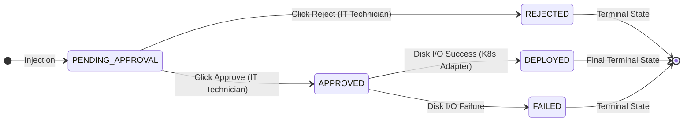
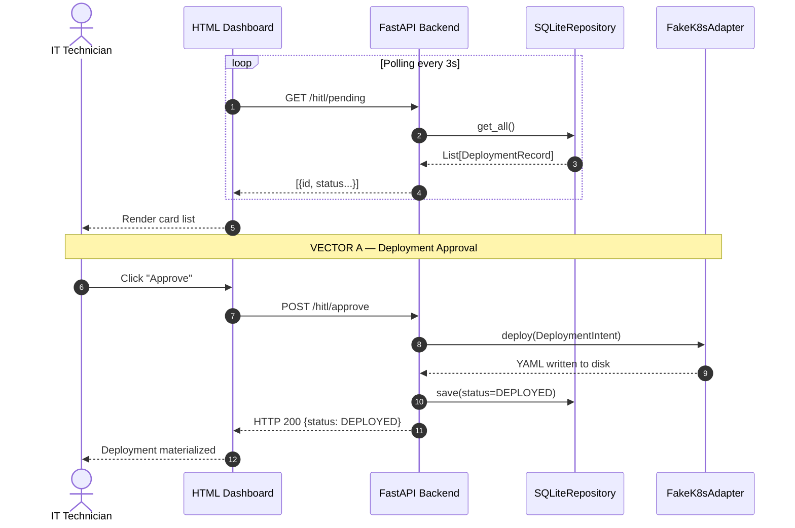
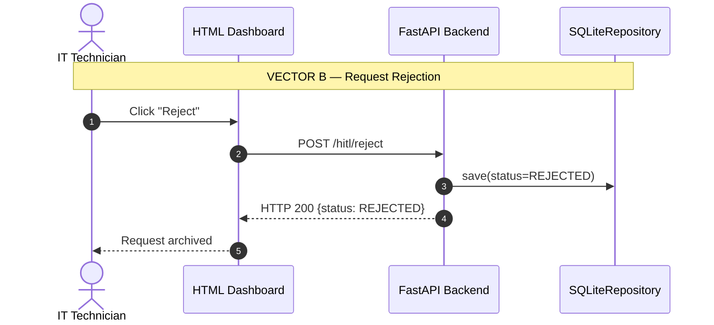

# Chapter 7. HITL Pattern Implementation and Finite State Machine (FSM) Governance

The cognitive agent design established in preceding chapters equips the system with semantic extraction and tool reasoning capabilities. However, fully delegating provisioning decisions on critical infrastructure to a probabilistic model is an operational vulnerability rather than an engineering milestone. Container orchestration in enterprise environments demands governance, legal accountability, and operational domain knowledge that exceed foundational model capabilities.

This chapter details the architectural solution implemented to govern the AI agent: the *Human-In-The-Loop* (HITL) pattern. It provides theoretical grounding for mandatory human authorization gates and explains how this separation of responsibilities is enforced through an immutable Finite State Machine (FSM) and an asynchronous operations dashboard.

## 7.1. Grounding the Human-In-The-Loop (HITL) Pattern

In IT automation, autonomy is frequently classified into five tiers (loosely adapted from SAE autonomous driving levels). Level 0 represents manual shell script execution, while Level 5 (Full Autonomy) denotes an autonomous system monitoring, deciding, and executing infrastructure mutations without human supervision.

While commercial trends push toward Level 5, this thesis argues that in enterprise Platform Engineering, the sound engineering approach is Level 4 supervised automation governed via **Human-In-The-Loop (HITL)** controls.

### 7.1.1. Risks of Unsupervised Autonomy (Level 5)

Granting unmediated write credentials (e.g., a `ClusterAdmin` service account token) to probabilistic neural networks introduces systemic operational risks that automated testing cannot eliminate:

1. **Topological Hallucination:** Relying on probabilistic token generation, LLMs lack intrinsic factual verification over physical cluster state. If an agent hallucinates that resolving a transient network issue requires deleting and recreating a critical production `Deployment`, an unsupervised system would execute the teardown immediately.
2. **Uncontrolled Financial Elasticity:** In public cloud environments (AWS, GCP, Azure), compute resources follow pay-as-you-go billing. An unsupervised agent trapped in an anomalous reasoning loop could auto-provision oversized hardware, depleting institutional operational budgets.
3. **Change Freeze Violations:** Probabilistic models lack organizational context regarding institutional change freezes. An unsupervised agent might trigger high-risk reconfigurations during peak registration or grading windows. Human operator oversight ensures deployments are restricted to authorized maintenance intervals.

### 7.1.2. Legal Liability, ITIL Compliance, and Responsibility Distribution

Beyond technical feasibility, HITL governance is a regulatory necessity. Industry best practice frameworks such as **ITIL 4** (*Information Technology Infrastructure Library*) in Release Management [32], alongside ISO/IEC 27000 cybersecurity standards, mandate strict auditability and operational change governance.

Legally, an artificial intelligence model possesses no juridical personality. If *Agentic Deployer* instantiated an erroneous manifest that exposed sensitive data publicly (violating GDPR or the Spanish LOPD), legal accountability rests with the institution and systems operators, regardless of whether the configuration was inferred by a model.

To resolve this liability, the platform establishes a three-tier separation of responsibilities:

1. **The Researcher (The "What"):** Defines functional domain needs ("I need a WordPress portal for the History Department with 10 GB persistent storage").
2. **The AI Agent & MCP Server (The "How"):** Translates intent into declarative syntax, structuring natural language into strongly typed Hexagonal Architecture entities.
3. **The IT Systems Engineer (The "When" and "If"):** Enforces institutional governance and quota validation ("The request is syntactically valid, but storage capacity constraints require scheduling provisioning during tonight's maintenance window").

The model acts as an interactive assistant reducing specification time and YAML syntax errors, delegating final execution authority to a visual verification gate by operations personnel.

## 7.2. Finite State Machine (FSM) Design

Enforcing operational flow control cannot rely on primitive boolean flags (e.g., `is_valid = True`). In concurrent environments where multiple operators inspect the deployment queue, request lifecycles must be governed by a formal **Finite State Machine** (FSM).

Rooted in automata theory, an FSM guarantees that an entity occupies exactly one mutually exclusive state at any given timestamp $T$, and that transitions obey a finite set of directional rules.

### 7.2.1. Directed Acyclic State Transition Modeling

In *Agentic Deployer*, the lifecycle of a `DeploymentIntent` is modeled as a **Directed Acyclic Graph (DAG)**. Being acyclic is essential to security: state cannot flow backward in time. Once a deployment is physically executed on the Kubernetes cluster, the record cannot revert to a pending quarantine state.

The graph vertices (States) and directed edges (Authorized Transitions) encompass **six mutually exclusive nodes**:

- **Root Node (`PENDING_APPROVAL`):** The initial entry state. When the AI agent synthesizes a valid intent and `SecurityContextValidator` (Chapter 5) accepts it, the record enters quarantine. Zero physical provisioning occurs from this state.
- **Sink Node A (`REJECTED`):** An immutable terminal state. If the IT operator rejects the request in the dashboard, the intent transitions here. It remains permanently in the database for legal auditability, ignored by downstream infrastructure adapters.
- **Transit Node (`APPROVED`):** A transient intermediate state. When authorized by an operator, the request enters this node briefly, acting as the trigger to invoke outbound adapters (`FakeK8sAdapter` or `RealK8sAdapter`).
- **Sink Node B (`DEPLOYED`):** The final successful terminal state, reached if and only if the intent traversed `APPROVED` and the adapter confirms declarative manifests were generated and persisted to storage.
- **Sink Node C (`FAILED`):** An exceptional terminal state reached if manifest generation or cluster dispatch encounters I/O exceptions or network failures. The record is retained for post-mortem analysis.
- **Sink Node D (`DELETED`):** Administrative teardown terminal state. Represents logical deletion of a previously deployed service, invoked via the `delete_university_service` MCP tool. The record is preserved for audit traceability.

Transitioning from initial quarantine to execution strictly requires explicit operator authorization. Figure 16 visualizes this unidirectional state flow:


<p align="center"><i><b>Figure 16:</b> State transition graph governing the system's Finite State Machine (FSM).</i></p>

### 7.2.2. Concurrency Control and Race Condition Mitigation

Implementing an FSM in an asynchronous web backend (FastAPI) introduces concurrency considerations.

Consider a scenario where a request sits in `PENDING_APPROVAL`. Due to network latency or double-clicking, an operator triggers multiple consecutive HTTP requests, or two concurrent technicians click "Approve" and "Reject" nearly simultaneously.

Without architectural safeguards, parallel requests could induce race conditions in the database, attempting to both provision and reject the same workload simultaneously.

To mitigate this, transitions enforce sequential pre-condition validation (*check-then-act*) reflecting **Optimistic Locking** principles. The algorithm verifies that the current database state equals `PENDING_APPROVAL` prior to mutating state. In the single-worker Uvicorn process environment of this prototype (documented in limitation 10.2.5), this sequential check ensures consistency. Scaling to multi-process deployments (Gunicorn with $N$ workers) would require database-level pessimistic locking (`SELECT FOR UPDATE`).

Algorithm 4 formalizes this state transition logic:

```text
01 INPUT:
02  request_id -> UUID of the deployment record to transition
03  target_state -> Requested destination state (APPROVED or REJECTED)
04 
05 OUTPUT:
06  Updated_Record (If transition is authorized)
07  RAISE HttpConflictError (409) on invalid state mutation attempt
08 
09 BEGIN
10   // 1. Record Retrieval and Existence Check
11   Variable record = DatabaseRepository.get(request_id)
12   
13   IF record IS NULL THEN
14     RAISE HttpNotFoundError(404)
15   END IF
16 
17   // 2. Invariant DAG Check: Mutations only permitted from PENDING_APPROVAL
18   IF record.status NOT EQUALS "PENDING_APPROVAL" THEN
19     RAISE HttpConflictError(
20       409, 
21       "State Conflict. The request has already been processed " +
22       "(Current Status: " + record.status + ")."
23     )
24   END IF
25   
26   // 3. Atomic State Mutation
27   record.status = target_state
28   record.updated_at = GetCurrentSystemTimestamp()
29   
30   // 4. Secondary Adapter Activation (Side Effects)
31   IF target_state EQUALS "APPROVED" THEN
32     TRY
33       K8sAdapter.deploy(record.intent)
34       record.status = "DEPLOYED" // Second transition
35     CATCH IOException AS error
36       record.status = "FAILED"
37     END TRY
38   END IF
39   
40   RETURN record
41 END
```
<p align="center"><i><b>Algorithm 4:</b> Immutable State Machine Transition (FSM_Transition).</i></p>

Under this algorithm, if a double-click occurs, the first HTTP thread mutates the record to `REJECTED` (or `APPROVED`). The second thread evaluates line 18, detects that the state is no longer `PENDING_APPROVAL`, aborts execution, and returns an immediate HTTP `409 Conflict` response. This prevents dual execution [33].

## 7.3. Asynchronous Operations Dashboard

Implementing HITL controls requires distinct user interfaces per role. Researchers interact through a flexible conversational UI (Streamlit), whereas operations engineers interact through a deterministic, low-latency control panel.

To serve this need, the platform provides an independent **Operations Dashboard** (`dash.html`), implemented as a lightweight Single-Page Application (SPA) served directly by FastAPI.

### 7.3.1. Synchronization Strategy: Lightweight Polling vs. WebSockets

Requests generated by the AI enter the system asynchronously. In high-frequency applications (e.g., trading platforms), state is typically synchronized via persistent bidirectional WebSockets (`ws://`). However, maintaining persistent WebSocket threads between browser dashboards and the backend introduces unnecessary memory and connection overhead for an infrastructure audit panel where 3-second display latency is operationally inconsequential.

Therefore, the platform adopts an **Active Lightweight Polling** strategy using native browser `fetch` requests:

1. **Periodic Inquiries:** The client invokes `GET /hitl/pending` at regular intervals (every 3,000 to 5,000 milliseconds).
2. **Transactional Query Execution:** The backend queries pending intents from SQLite, leveraging indexed lookups to preserve sub-millisecond execution times.
3. **Dynamic DOM Hydration:** The client processes the JSON payload, dynamically rendering card views for each quarantined request.

This decoupled, stateless design improves resilience. If an operator experiences network interruption, backend state remains intact; upon reconnection, the next polling tick immediately rehydrates the dashboard.

### 7.3.2. Deferred Execution and Declarative Manifest Synthesis

The dashboard presents extracted intent parameters to the operator: unique identifier, container image, network port, and CPU/RAM allocations.

Operators can execute two actions:
- **Reject:** Dispatches `POST /hitl/reject/{id}`, transitioning the state machine to `REJECTED` (§7.2). The record is retained for audit logging without generating cluster manifests.
- **Approve:** Dispatches `POST /hitl/approve/{id}`. Upon confirmation, the backend retrieves `DeploymentIntent` and passes it to `DeployPort`.

The adapter interpolates validated parameters into pre-tested Golden Path templates via `textwrap.dedent`, generating production-ready YAML manifests written to local storage (`{name}.yaml`). In enterprise production, this file is committed to a GitOps repository (ArgoCD) or submitted directly to the cluster API (§10.3.2).

Figure 17 displays the HITL Operations Dashboard served at `/frontend/index.html`. The top header displays real-time metrics (`Pending: 1`, `Approved today: 4`, `Rejected today: 1`) and backend connectivity status (`● Online`). The central table shows the quarantined request `dep-7f3a2c1b` for service `congreso-ia-departamento`, with typed action (`Create`), image (`nginx:alpine`), port (`8080`), and resource allocations (`500m / 256Mi`). Visual "Approve" and "Reject" controls trigger atomic FSM transitions:

<div align="center">
  
</div>
<p align="center"><i><b>Figure 17:</b> Screenshot of the HITL Operations Dashboard (<code>app/frontend/index.html</code>) displaying a request pending approval (<code>dep-7f3a2c1b</code>) alongside consolidated operational metrics.</i></p>

### 7.3.3. HITL Workflow Sequence Diagram

Figure 18 details interactions between the IT Technician and Backend during decision phases, illustrating both mutation vectors (approval and rejection):




<p align="center"><i><b>Figure 18:</b> HITL Sequence Diagram. (Top) Asynchronous polling and Approval Vector. (Bottom) Rejection Vector (immutable terminal state).</i></p>

#### 7.3.3.1. Decision Vectors and Polling Mechanics

Figure 18 illustrates two mutually exclusive decision paths:

1. **Asynchronous Polling:** The web dashboard periodically polls the backend every 3 seconds (`GET /hitl/pending`). The backend queries SQLite (`get_all()`), filters for `PENDING_APPROVAL`, and returns the active queue without requiring full page refreshes.
2. **Vector A — Approval & Materialization:** When the operator confirms specifications, they click "Approve". The browser sends `POST /hitl/approve`. The backend transitions the record to `APPROVED`, invokes `deploy()` on `FakeK8sAdapter`, writes the declarative YAML manifest, and transitions the state to `DEPLOYED`, notifying the UI with `HTTP 200`.
3. **Vector B — Rejection & Quarantine:** If specifications violate operational constraints, the operator clicks "Reject". The dashboard issues `POST /hitl/reject`. The backend skips infrastructure adapters, atomically switches the record to `REJECTED`, and archives the intent in SQLite without altering cluster state.

## 7.4. Researcher Feedback Channel: Asynchronous Status Notifications

A traditional limitation of HITL designs is lack of applicant visibility: operators track requests in dashboards, but applicants remain unaware of approvals, rejections, or provisioning delays.

This section documents the **researcher feedback channel**: a bidirectional mechanism enabling users to track deployment progress directly within the conversational chat.

### 7.4.1. Status Query Endpoint Design

A dedicated query endpoint `GET /hitl/status/{deployment_id}` was implemented in `BackendAPI`, tailored specifically for end users:

```text
ROUTINE: Deployment Status Query (REST Endpoint)

ENDPOINT: GET /hitl/status/{deployment_id}
INPUT: deployment_id -> String (e.g., "dep-1a2b3c")
OUTPUT: StatusResponse (id, status, contextual_message)

BEGIN
  Variable record = DatabaseRepository.get(deployment_id)
  IF record IS NULL THEN
    ABORT WITH HttpException(404, "Deployment not found")
  END IF

  // Semantic mapping of technical FSM states to natural language
  Variable messages = NEW Dictionary(
    "PENDING_APPROVAL" -> "Your request is queued, pending review by an IT technician.",
    "APPROVED" -> "An IT technician has approved your request. Deployment in progress.",
    "DEPLOYED" -> "Your workload has been successfully deployed.",
    "REJECTED" -> "An IT technician has rejected this request.",
    "FAILED" -> "The deployment encountered a technical error on the cluster."
  )
  
  Variable contextual_message = messages[record.fsm_status]
  RETURN NEW StatusResponse(record.id, record.fsm_status, contextual_message)
END
```

The response returns the technical FSM state paired with a contextual natural language description, translating low-level state machine codes into user-friendly explanations.

### 7.4.2. Frontend Notification Panel (Streamlit)

The chat interface (`chat_app.py`) includes a passive tracking panel that activates automatically when the agent synthesizes a `PENDING_APPROVAL` deployment:

**1. Automatic Tracking ID Extraction:**  
Following each agent turn, the frontend evaluates output text via regular expressions matching `dep-[a-f0-9]{7,8}`. When detected alongside pending status text, it appends the ID to `session_state.pending_deployments`:

```text
ROUTINE: Identifier Extraction (HITL Frontend)

INPUT: response_text -> Text generated by the Cognitive Agent
STATE: pending_panel -> ID list rendered in the UI

BEGIN
  Variable detected_id = Regex("dep-[a-f0-9]{7,8}").search(response_text)
  
  IF detected_id EXISTS AND response_text CONTAINS "PENDING" THEN
    APPEND detected_id TO pending_panel
  END IF
END
```

**2. Persistent Tracking Widget:**  
While pending deployments remain in `session_state`, a "My Pending Requests" panel renders below the chat dialogue. For each request, an interactive **"Refresh"** button invokes `GET /hitl/status/{id}` against the backend, displaying semantic badge colors:

| FSM State | Badge Color | User Notification Message |
|---|---|---|
| `PENDING_APPROVAL` | Yellow | "Your request is queued, pending review." |
| `APPROVED` | Blue | "Technician approved. Deployment in progress." |
| `DEPLOYED` | Green | "Your workload has been successfully deployed." |
| `REJECTED` | Red | "Request rejected. Please contact IT support." |
| `FAILED` | Red | "Technical failure. IT team has been notified." |
<p align="center"><i><b>Table 20:</b> Mapping of FSM states to visual indicators in the researcher's notification panel.</i></p>

**3. Automatic Lifecycle Closure:**  
When the backend returns a terminal state (`DEPLOYED`, `REJECTED`, or `FAILED`), the deployment is cleared from the pending queue, and the agent injects a completion message into chat history informing the user of the final resolution.

Figure 19 illustrates the user experience in `chat_app.py`. Following request processing, the agent confirms registration and provides the tracking ID (`dep-7f3a2c1b`). Directly below, the UI renders the dynamic panel displaying current status (`🟡 PENDING_APPROVAL`) alongside context-aware guidance:

<div align="center">
  
</div>
<p align="center"><i><b>Figure 19:</b> Screenshot of the researcher's conversational interface (Streamlit) showing the asynchronous feedback panel with <code>PENDING_APPROVAL</code> status and manual refresh control.</i></p>

### 7.4.3. Design Rationale: Explicit Polling vs. Push Webhooks

The alternative mechanism would be asynchronous push notifications (email or webhook dispatches). This was intentionally avoided for the research prototype due to:

1. **Unwarranted Infrastructure Complexity:** Configuring dedicated SMTP gateways or message brokers (RabbitMQ, Kafka) introduces deployment friction that hinders academic reproducibility.
2. **Architectural Symmetry:** The operator dashboard already relies on polling (§7.3.1). Maintaining identical paradigms in the end-user interface simplifies cognitive models and testing harnesses.
3. **Extensibility:** The `GET /hitl/status/{id}` endpoint provides a clean REST interface easily consumed by external messaging bots (Slack, Telegram, institutional email gateways) in future iterations without altering core backend logic (Interface Segregation Principle).

This architecture transforms HITL governance from a **unidirectional** pipeline (researcher $\rightarrow$ technician) into a **bidirectional** channel (researcher $\rightarrow$ technician $\rightarrow$ researcher), ensuring all stakeholders maintain visibility throughout the provisioning lifecycle.

