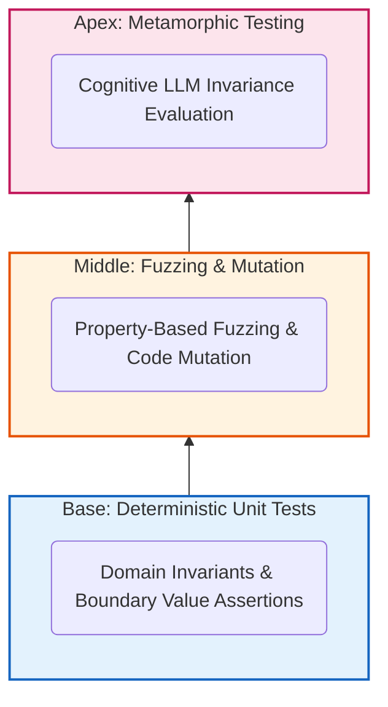

# Chapter 8. Quality Assurance (QA) and Advanced Testing

Integrating Large Language Models (LLMs) into enterprise infrastructure orchestration introduces unprecedented challenges for Software Testing. In traditional software development, a deterministic function $f(x)$ consistently yields predictable output $y$. In an agentic system, however, identical input prompts can produce syntactically divergent outputs depending on model sampling temperature, inference seed, or slight syntactic reformulations.

To structure the verification and validation strategy for *Agentic Deployer*, this Master's Thesis adapts the conceptual framework of the **Test Pyramid** introduced by Mike Cohn [34]. In its original formulation for deterministic software, Cohn arranges testing efforts across three tiers based on cost, speed, and granularity: a broad base of fast, isolated unit tests; an intermediate layer of service or integration tests; and a narrow apex of end-to-end user interface tests.

Because Cohn formulated this model for classical software, this thesis **adapts and extends the framework to address Generative Artificial Intelligence** (conceptually illustrated in **Figure 20**), establishing a **Hybrid Testing Pyramid** across three distinct levels:

1. **Base (Deterministic Unit and Integration Testing):** Exhaustive boundary value analysis, static type enforcement, and domain invariant verification within the Hexagonal Domain core, guaranteeing the integrity of business policies regardless of language model outputs.
2. **Intermediate Tier (Property-Based Testing and Mutation Testing):** Evaluating algorithmic resilience against massive randomized inputs via property generation (*Hypothesis*), combined with auditing the fault-detection quality of the test suite itself through Abstract Syntax Tree (AST) fault injection (*mutmut*).
3. **Apex (Metamorphic Testing of the Cognitive Tier):** Replacing traditional brittle UI tests, the pyramid's apex evaluates model inference robustness via *Metamorphic Testing*, assessing semantic invariance of structured tool extractions under syntactic permutations, lexical noise, and natural language variations.

<div style="max-width: 6cm; margin: 0 auto;">



</div>
<p align="center"><i><b>Figure 20:</b> Architecture of the Hybrid Testing Pyramid implemented in Agentic Deployer, adapting Mike Cohn's classic model to the requirements of Generative Artificial Intelligence.</i></p>

## 8.1. Domain and Integration Testing: Validating the Hexagonal Boundary

The foundation of the quality assurance pyramid resides within the Domain Layer. As established in Chapter 5, the AI agent operates as an unprivileged external user; its ability to impact infrastructure is bounded by the deterministic rigor of `SecurityContextValidator` and Pydantic domain invariants.

Consequently, the first QA objective is ensuring that this hexagonal perimeter remains resilient prior to connecting stochastic models. This verification is conducted via isolated **Unit Testing (*White-Box Testing*)** executed locally using `pytest`.

### 8.1.1. Boundary Value Analysis and Equivalence Partitioning

Test case design follows two formal white-box techniques: Boundary Value Analysis and Equivalence Partitioning.

The `DeploymentIntent` contract dictates that network ports must be numeric within `[1, 65535]`, while business rules prohibit privileged ports ($< 1024$). The test suite validates these contracts using three targeted input vectors:

1. **Valid Partitions (Happy Path):** Instantiating intents with unprivileged ports (e.g., 8080 or 3000) and images from trusted registries (e.g., `harbor.universidad.edu/nginx:1.20`). Tests assert that zero security exceptions are raised.
2. **Lower Boundary Values (Root Privilege Violation):** Intentionally injecting ports `1023` and `22`. The test framework asserts that the validator raises `SecurityViolationError`, aborting execution immediately.
3. **Upper Boundary Values and Overflows:** Instantiating requests with ports `65535`, `65536`, and negative values (`-80`). The domain model must reject invalid bounds immediately by raising `ValueError` prior to security validator invocation, enforcing *Fail-Fast* behavior.

### 8.1.2. Negative Testing and Configuration Drift Prevention

Alongside port checks, the test suite audits container image tags. Integration tests evaluate `SecurityContextValidator` rules prohibiting mutable `:latest` tags.

The test suite simulates requests with invalid variants, such as `ubuntu:latest`, `nginx:LATEST`, and untagged images (e.g., `redis`, where orchestrators implicitly infer `:latest`). Across all variants, tests assert that execution raises a traceable `SecurityViolationError`.

This baseline tier (executing in sub-milliseconds with $>95\%$ line coverage over the Hexagonal core) verifies that absent a fully compliant request matching institutional ITIL standards, access to infrastructure adapters remains blocked, regardless of prompt phrasing.

### 8.1.3. Testing the Status Query Layer (Researcher Feedback Channel)

Following implementation of `GET /hitl/status/{id}` (§7.4.1), a dedicated integration module (`test_status_endpoint.py`) was introduced to validate the researcher return channel. This module verifies a critical invariant: the status polling endpoint must be **strictly idempotent**—repeated invocations must never mutate FSM state.

The suite validates six distinct behaviors:

| Test Case | Validated Behavior |
|---|---|
| `test_unknown_id_returns_404` | Non-existent UUIDs return `HTTP 404` with a descriptive error payload |
| `test_pending_approval_returns_correct_status` | Newly registered deployments return `PENDING_APPROVAL` with contextual guidance |
| `test_deployed_status_after_approval` | Following `POST /hitl/approve/{id}`, status reflects `DEPLOYED` |
| `test_rejected_status_after_rejection` | Following `POST /hitl/reject/{id}`, status reflects `REJECTED` |
| `test_response_includes_deployment_metadata` | Responses contain accurate `name`, `image`, and `port` attributes |
| `test_status_endpoint_does_not_mutate_state` | Three consecutive queries maintain `PENDING_APPROVAL` without state mutation |
<p align="center"><i><b>Table 21:</b> Test cases for the researcher status query layer.</i></p>

The final idempotency test is critical: it guarantees that read operations from the researcher conversational channel never interfere with write operations from the operator dashboard.

### 8.1.4. Quality Gates and Static Code Analysis

To prevent technical debt and type safety regressions during development, the local CI pipeline (`scripts/run_tests.sh`) incorporates three formal Quality Gates configured in [`pyproject.toml`](file:///home/jesus/projects/TFM/pyproject.toml):

1. **Static Analysis and Linting with Ruff:** Enforces Python 3.11 conventions (`target-version = "py311"`) with a 100-character line length ceiling (`line-length = 100`). Active rule suites include:
   - `E` and `W`: Standard `pycodestyle` formatting rules.
   - `F`: Logical defect and unused variable detection via `pyflakes`.
   - `I`: Deterministic import sorting via `isort` (`known-first-party = ["app"]`).
   - `UP`: Syntax modernization for Python 3.11+ via `pyupgrade`.
   - `B`: Bug prevention via `flake8-bugbear`.
   - `SIM`: Code simplification via `flake8-simplify`.
   - `C901`: **McCabe Cyclomatic Complexity** auditing capped at `max-complexity = 15` [35], preventing deeply nested control flow while permitting idiomatic pattern matching.
2. **Strict Static Type Checking with Mypy:** Enforces type safety across hexagonal boundaries (`python_version = "3.11"`):
   - `disallow_untyped_defs = true`: Forbids untyped function or method signatures.
   - `check_untyped_defs = true`: Inspects internal expressions for type consistency.
   - `warn_return_any = true`: Flags explicit functions returning unvetted `Any` values.
3. **Pragmatic Code Coverage Thresholds:** Enforced via `pytest-cov` at a minimum 80% line coverage gate (`--cov-fail-under=80`). Aligned with industry engineering standards (Google [36]), artificially enforcing 100% coverage is avoided to prevent low-value boilerplate testing. Coverage focuses on application domain logic, excluding third-party UI drivers (`app/agent_layer/chat_app.py`, `app/infrastructure/*`).

## 8.2. Property-Based Testing: Evaluating Stochastic Boundaries

Traditional example-based unit testing suffers from cognitive developer bias: engineers design test assertions matching assumptions they made while coding. In systems driven by Large Language Models where inputs (agent-generated JSON payloads) exhibit high variance, example testing is insufficient.

To verify that malformed outputs or hallucinations cannot bypass security constraints, this thesis integrates **Property-Based Testing** (PBT). Rather than asserting that input $A$ produces output $B$, PBT asserts that "for *any* randomized input conforming to structural bounds, the system must satisfy a universal logical invariant".

### 8.2.1. Stochastic Entropy Injection and Generation Strategies

PBT is implemented in [`app/tests/test_security.py`](file:///home/jesus/projects/TFM/app/tests/test_security.py) using the **`Hypothesis`** scientific testing framework [37]. Hypothesis functions as an intelligent dynamic fuzzer, generating hundreds of randomized permutations per second guided by domain-specific **Strategies**:

- `valid_name`: Generates Kubernetes DNS-compliant identifiers (`^[a-z][a-z0-9\-]{0,29}$`).
- `valid_cpu` and `valid_ram`: Samples valid resource strings (`"100m"`, `"500m"`, `"1"`, `"64Mi"`, `"128Mi"`, `"1Gi"`).
- `safe_image` vs. `unsafe_latest_image`: Generates images from trusted registries (`docker.io/`, `harbor.universidad.edu/`) with semantic tags contrasted against `:latest` injections.
- `safe_port` vs. `unsafe_port`: Valid user-range integers (`[1024, 65535]`) contrasted against privileged integers (`[1, 1023]`).
- Composite strategy `@st.composite def deployment_intent_dict`: Assembles full intent dictionaries with configurable failure injection (unsafe ports, forbidden tags, plaintext secrets).

Nine invariant properties are implemented in `TestSecurityContextValidator`, summarized in **Table 22**:

| Property Test | Evaluated Condition | Asserted Invariant |
|---|---|---|
| `test_privileged_port_always_raises` | Port forced into privileged range (< 1024) | Validator **always** raises `SecurityViolationError` citing the port |
| `test_latest_tag_always_raises` | Image forced with `:latest` tag | **Always** raises `SecurityViolationError` citing tag prohibition |
| `test_both_violations_detected_simultaneously` | Port < 1024 and `:latest` tag injected concurrently | Detects **both** violations in a single pass (`len(violations) == 2`) |
| `test_safe_intent_never_raises` | Port $\ge 1024$ and semantic image tag | **Never** raises exceptions; validates cleanly across all iterations |
| `test_delete_action_always_passes` | Workload deletion (`action = DELETE`) with arbitrary data | Teardown operations **never** fail due to creation policies |
| `test_untrusted_registry_always_raises` | Image from unapproved registry (e.g., `hacker.io/miner:1.0`) | **Always** raises `SecurityViolationError` citing untrusted source |
| `test_hardware_quotas_always_raises` | CPU > 4000m or RAM > 8192Mi | **Always** raises `SecurityViolationError` indicating quota breach |
| `test_secrets_in_env_always_raises` | `env_vars` keys with substrings (`password`, `token`, `secret`, `key`) | **Always** raises `SecurityViolationError` for plaintext credentials |
| `test_database_without_storage_raises` | DB images (`postgres`, `mysql`, `redis`, `mongo`) lacking storage | **Always** raises `SecurityViolationError` requiring persistent volumes |
<p align="center"><i><b>Table 22:</b> Invariant properties exhaustively audited via Hypothesis in <code>test_security.py</code>.</i></p>

Algorithm 5 illustrates this property verification logic:

```text
01 PROPERTY_TO_DEFEND: "For any randomized parameter combination synthesized by Hypothesis,
02 if the intent violates one or more institutional policies, SecurityContextValidator MUST
03 intercept it deterministically and accumulate all violations without unhandled exceptions."
04 
05 BEGIN
06   // Composite Hypothesis Strategy (deployment_intent_dict)
07   Variable data_generator = Strategy.CompositeIntent(force_unsafe_port, force_latest_image)
08 
09   FOR EACH intent_data INJECTED BY THE ENGINE (max_examples = 100) DO
10     Variable intent = NEW DeploymentIntent(intent_data)
11     
12     TRY
13       validator.validate(intent)
14       // If no exception was raised, the intent MUST be strictly compliant
15       ASSERT (intent.internal_port >= 1024)
16       ASSERT (NOT_CONTAINS(intent.image, ":latest"))
17       ASSERT (IS_IN_WHITELIST(intent.image))
18     CATCH SecurityViolationError AS err
19       // Expected behavior upon receiving non-compliant parameters
20       ASSERT (Length(err.violations) >= 1)
21     CATCH ANY_OTHER_EXCEPTION AS critical_error
22       // Robustness violation: unhandled exception in core domain
23       FAIL_TEST("Unhandled crash in hexagonal core: " + critical_error)
24     END TRY
25   END FOR
26 END
```
<p align="center"><i><b>Algorithm 5:</b> Property-Based Test for Hexagonal Invariants (Fuzzing with Hypothesis).</i></p>

Passing all 9 property-based tests validates that the system reliably absorbs random parameter combinations generated by language models.

### 8.2.2. Algorithmic Failure Minimization (*Shrinking*)

A core strength of Hypothesis is **Shrinking**. When the fuzzer encounters a counterexample breaking an invariant, it does not output an unreadable multi-thousand-character string.

Instead, the framework initiates graph reduction and binary search routines to systematically prune failing inputs. It reduces integer values, removes extraneous characters, and eliminates array elements until isolating the **minimal failing counterexample** reproducing the fault (e.g., isolating a single null byte `\0` among hundreds of variables).

## 8.3. Test Suite Quality Audit: Mutation Testing

In software engineering, high line coverage does not guarantee that underlying test assertions are capable of detecting logical defects. In mission-critical infrastructure, relying strictly on code coverage metrics creates false confidence.

To evaluate assertion efficacy in *Agentic Deployer*, **Mutation Testing** was incorporated via `mutmut`.

The core axiom of mutation testing answers a meta-analytical question: *"If a critical bug is intentionally injected into source code, will existing test suites detect it and fail?"*

### 8.3.1. AST Mutant Generation at Runtime

Mutation testing operates directly on Python's Abstract Syntax Tree (AST), dynamically synthesizing dozens of source code clones ("Mutants"). Each mutant introduces a deliberate syntactic or logical modification:

If `SecurityContextValidator` specifies:
`IF port < 1024 THEN RAISE Error`

The engine injects mutations:
- **Mutant 1 (Operator Mutation):** `IF port <= 1024` $\rightarrow$ Mutates `<` to `<=`, leaving boundary port 1024 vulnerable.
- **Mutant 2 (Logical Inversion):** `IF port >= 1024` $\rightarrow$ Inverts conditions, approving privileged ports (22, 80) and rejecting safe ports.
- **Mutant 3 (Constant Mutation):** `IF port < 1025` $\rightarrow$ Alters threshold values, creating a single-port vulnerability window.

### 8.3.2. Evaluating Mutant Survival (*Killed* vs. *Survived*)

The framework runs the full `pytest` suite against each mutant sequentially:

1. **Mutant Neutralized (*Killed*):** If a test assertion fails, the test suite successfully detected the injected bug. The mutant is eliminated. This indicates effective assertion coverage.
2. **Mutant Surviving (*Survived*):** If code is altered (e.g., permitting port 22) and the test suite passes green, the mutant survived. This highlights an assertion coverage gap.

### 8.3.3. Empirical Mutation Audit Results

Table 23 details real `mutmut` execution results configured via `test_mutmut.ini` (Scope: `app/application/` and `app/domain/`):

| Audited Module | Surviving Mutants | Defect Nature | Security Criticality |
|---|---|---|---|
| `domain.exceptions` | 2 | Mutations in `SecurityViolationError` constructor string formatting | Low — string formatting, not logic |
| `security_validator._parse_cpu` | 5 | Unit string conversion (`"500m"` $\rightarrow$ int) lacking direct unit tests | Medium — parsing utility |
| `security_validator._parse_ram` | 19 | Memory unit string parsers (`"256Mi"`, `"1Gi"`) | Medium — parsing utility |
| `security_validator.validate` | 3 | Compound rule boundary conditions (concurrent violations) | Medium — business rules |
| `use_cases.execute` | 1 | Alternative execution branch for `DELETE` action | Low |
| **Hexagonal Core Subtotal** | **30** | | |
| `agent.FakeLLMClient` | 54 | Demonstration mock without dedicated test suite (by design) | Not applicable |
| `agent.AgentOrchestrator` | 45 | Cognitive orchestrator: testing stochastic LLM code with deterministic assertions is out of scope | Not applicable |
| `agent_layer.tools` | 14 | MCP tools requiring network mocks | Low |
| **Total Mutants** | **143** | | |
<p align="center"><i><b>Table 23:</b> Mutation Testing results categorized by module.</i></p>

**Result Interpretation:**

Analysis shows that **69.9% of survivors** (99 of 143) reside in modules excluded from formal audit scopes by architectural design: `FakeLLMClient` is un-tested demo code, while `AgentOrchestrator` manages stochastic model calls that cannot be audited with deterministic assertions.

Within the **hexagonal core**, the 30 surviving mutants concentrated in resource parsing helpers (`_parse_cpu`, `_parse_ram`) converting strings like `"500m"` or `"1024Mi"` to integers. These survivors pinpointed assertion gaps that $>95\%$ line coverage metrics had obscured.

### 8.3.4. Technical Debt Mitigation and Final Results

Identified gaps were **remediated in the final codebase**:

1. **Refactored Parsers:** Removed unreachable defensive blocks (`try...except ValueError`) since Pydantic domain models already guarantee well-formed strings at the boundary, and added parameterized assertions covering upper units (e.g., Terabytes `Ti`).
2. **Concurrent Violation Assertions:** Expanded `test_security.py` fixtures to assert exact lengths of accumulated violation lists when multiple errors occur simultaneously.

Following remediation, 96 of 98 injected mutants were successfully killed:

```text
$ mutmut run
Running mutation testing
- 98/98  [Killed: 96 | Skipped: 0 | Timeout: 0 | Suspicious: 0 | Survived: 2]

$ mutmut results
app.domain.exceptions.xǁSecurityViolationErrorǁ__init____mutmut_2: survived
app.domain.exceptions.xǁSecurityViolationErrorǁ__init____mutmut_4: survived
```

The 2 surviving mutants represent cosmetic exception string formatting, with zero impact on domain validation logic.

## 8.4. Metamorphic Testing: Methodology and Cognitive Invariants

While unit, property, and mutation testing thoroughly verify the Hexagonal Core, deterministic methods fail when assessing the cognitive tier (`AgentOrchestrator`).

### 8.4.1. The Test Oracle Problem in Generative AI

This limitation stems from the **Test Oracle Problem** [38]: in traditional engineering, an oracle knows the exact expected output for any given input ($2 + 2 = 4$).

Large Language Models, however, do not produce identical character-by-character outputs. Given an infrastructure request, a model might emit *"Registered service on port 80"* or *"Service configured on port 80"*. Both are semantically valid, yet strict string assertions (`assert output == expected`) fail.

To resolve this without resorting to manual, non-reproducible inspection, this research implements **Metamorphic Testing**.

### 8.4.2. Formal Definition of Metamorphic Relations (MR)

Metamorphic Testing posits that while predicting exact textual outputs is impossible, one can formally predict how outputs *must change* (or remain invariant) under controlled input transformations. Each formal rule is a **Metamorphic Relation (MR)**.

For semantic intent extraction, the core property is **Semantic Identity**: *Any lexical, syntactic, or linguistic variation in the user's prompt that preserves underlying technical meaning must invariantly produce an identical structured tool call (`Tool Call`), isolating matching parameters (`name`, `image`, `internal_port`).*

This property is formalized in [`app/tests/test_metamorphic.py`](file:///home/jesus/projects/TFM/app/tests/test_metamorphic.py) across six Metamorphic Relations:

- **MR-1 (Syntactic Permutation):** Invariance under argument order reordering (`name`, `image`, `port`). Verifies positional independence.
- **MR-2 (Lexical Noise Invariance):** Invariance under conversational pleasantries and greetings. Verifies parameter isolation from ambient noise.
- **MR-3 (Typographical Invariance):** Invariance under casing alterations (`UPPERCASE` / `lowercase`).
- **MR-4 (Incremental Composition):** Equivalence between a single declarative prompt and multi-turn conversational elicitation.
- **MR-5 (Semantic Paraphrasing):** Invariance under synonyms, passive voice, and equivalent phrasings.
- **MR-6 (Linguistic Invariance):** Semantic extraction equivalence across languages (Spanish vs. English).

### 8.4.3. Dual Evaluation Strategy: Automated CI/CD vs. Real Inference

Systematically executing LLM inferences during every CI commit is impractical due to execution latencies (5 to 45 seconds per turn) and GPU costs.

The test harness adopts a **dual-mode evaluation design**:

1. **Deterministic Mode (CI/CD Pipeline):** In standard CI builds, the test runs against `FakeLLMClient`. This component, built on compiled regular expressions, executes all 6 metamorphic relations in $<0.15$ seconds, verifying test harness integrity on every commit.
2. **Cognitive Audit Mode (Real Model Evaluation):** Setting `RUN_REAL_LLM=true` routes execution to `OllamaLLMClient` (local GPUs) or cloud APIs. The harness tests model neural weights under zero-shot prompt conditions without assistive system instructions.

### 8.4.4. Transition to Empirical Results

With the verification pyramid established (Unit, Integration, Property-Based, Mutation, and Metamorphic testing), the thesis transitions from methodology to **empirical experimental results**.

Quantitative benchmarks evaluating model families (baseline `qwen2.5:7b`, specialized `qwen2.5-coder:7b`, and cloud alternatives) across this metamorphic suite are detailed in **Chapter 9 (Section 9.3)**.

